# Page: DeepOps Overview

# DeepOps Overview

<details>
<summary>Relevant source files</summary>

The following files were used as context for generating this wiki page:

- [CONTRIBUTING.md](CONTRIBUTING.md)
- [README.md](README.md)
- [config.example/group_vars/all.yml](config.example/group_vars/all.yml)
- [config.example/group_vars/k8s-cluster.yml](config.example/group_vars/k8s-cluster.yml)
- [config.example/group_vars/slurm-cluster.yml](config.example/group_vars/slurm-cluster.yml)
- [playbooks/k8s-cluster.yml](playbooks/k8s-cluster.yml)
- [playbooks/slurm-cluster.yml](playbooks/slurm-cluster.yml)
- [playbooks/slurm-cluster/alertmanager.yml](playbooks/slurm-cluster/alertmanager.yml)
- [roles/pyxis/defaults/main.yml](roles/pyxis/defaults/main.yml)
- [roles/pyxis/tasks/main.yml](roles/pyxis/tasks/main.yml)
- [roles/pyxis/tasks/pyxis.yml](roles/pyxis/tasks/pyxis.yml)
- [roles/slurm/defaults/main.yml](roles/slurm/defaults/main.yml)
- [roles/slurm/tasks/compute.yml](roles/slurm/tasks/compute.yml)
- [roles/slurm/tasks/controller.yml](roles/slurm/tasks/controller.yml)
- [roles/slurm/tasks/main.yml](roles/slurm/tasks/main.yml)
- [roles/slurm/tasks/munge.yml](roles/slurm/tasks/munge.yml)
- [roles/slurm/vars/redhat.yml](roles/slurm/vars/redhat.yml)
- [roles/slurm/vars/ubuntu.yml](roles/slurm/vars/ubuntu.yml)
- [scripts/k8s/install_helm.sh](scripts/k8s/install_helm.sh)

</details>


DeepOps is a comprehensive infrastructure automation framework for deploying and managing GPU-accelerated Kubernetes and Slurm clusters. It encapsulates best practices for setting up high-performance computing environments with NVIDIA GPUs, providing a modular approach that can be used for complete end-to-end deployments or selective component integration.

For information on getting started with DeepOps, see [Getting Started](#1.1). For details on configuring DeepOps, see [Configuration System](#1.2).

## Core Concepts

DeepOps provides tooling for two distinct cluster deployment approaches:

1. **Kubernetes-based clusters**: For containerized workloads, microservices, and cloud-native applications
2. **Slurm-based clusters**: For traditional HPC (High-Performance Computing) workloads and batch scheduling

Both deployment paths include support for NVIDIA GPUs, monitoring, storage integration, and user management, tailored to their respective environments.

Sources: [README.md:22-31](), [playbooks/k8s-cluster.yml:1-3](), [playbooks/slurm-cluster.yml:1-3]()

## System Architecture

The following diagram illustrates the high-level architecture of DeepOps:

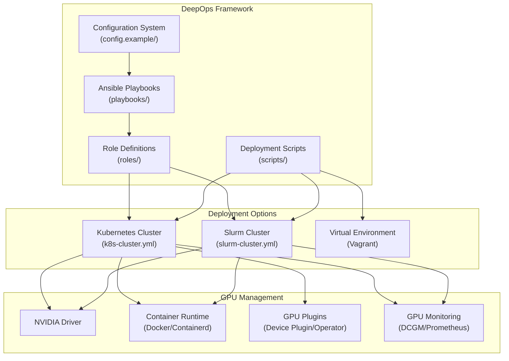

Sources: [README.md:22-30](), [playbooks/k8s-cluster.yml:1-294](), [playbooks/slurm-cluster.yml:1-163](), [config.example/group_vars/all.yml:1-308]()

## Deployment Paths

### Kubernetes Deployment

The Kubernetes deployment in DeepOps leverages Kubespray for orchestration and includes specialized components for GPU support in containerized environments.

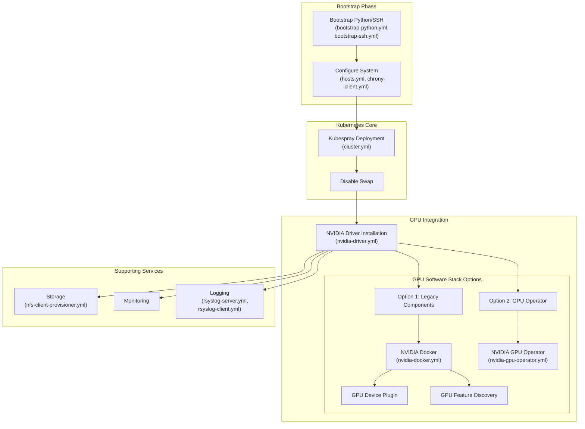

Sources: [playbooks/k8s-cluster.yml:14-309](), [config.example/group_vars/k8s-cluster.yml:1-96]()

### Slurm Deployment

The Slurm deployment provides a traditional HPC environment with job scheduling, GPU integration, and software module management.

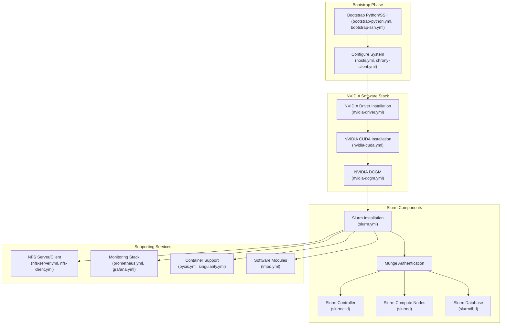

Sources: [playbooks/slurm-cluster.yml:1-163](), [config.example/group_vars/slurm-cluster.yml:1-201](), [roles/slurm/tasks/main.yml:1-49]()

## Key Components

### Configuration System

DeepOps uses a hierarchical configuration system based on Ansible's group_vars structure. This allows for customization at different levels:

| Configuration Level | Description | Location |
|---------------------|-------------|----------|
| Global | Settings applied to all nodes | `config.example/group_vars/all.yml` |
| Kubernetes | Settings specific to Kubernetes clusters | `config.example/group_vars/k8s-cluster.yml` |
| Slurm | Settings specific to Slurm clusters | `config.example/group_vars/slurm-cluster.yml` |
| Node-specific | Settings for specific node types | Inventory-specific files |

Key configuration categories include:

- Network settings
- Storage configuration
- Authentication/user management
- GPU settings
- Container runtime options
- Monitoring parameters

Sources: [config.example/group_vars/all.yml:1-308](), [config.example/group_vars/k8s-cluster.yml:1-96](), [config.example/group_vars/slurm-cluster.yml:1-201]()

### GPU Integration

DeepOps provides extensive GPU integration for both Kubernetes and Slurm deployments:

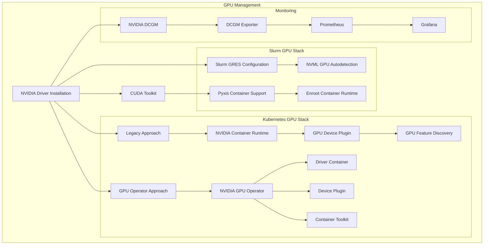

Sources: [playbooks/k8s-cluster.yml:169-293](), [playbooks/slurm-cluster.yml:43-54](), [config.example/group_vars/all.yml:124-143](), [roles/slurm/defaults/main.yml:47-50](), [roles/pyxis/tasks/main.yml:1-46]()

### Role of the Slurm Cluster

The Slurm cluster deployment provides a traditional HPC environment with:

1. **Job scheduling and resource allocation**: Managed by the Slurm controller (`slurmctld`)
2. **Compute node management**: Handled by Slurm daemon (`slurmd`) on worker nodes
3. **User and accounting database**: Provided by Slurm database daemon (`slurmdbd`)
4. **GPU integration**: Through GRES (Generic Resource) configuration
5. **Node health checking**: Optional health checks for compute nodes
6. **Software environment modules**: Via Lmod or similar tools
7. **Container support**: Through Singularity, Enroot, and Pyxis

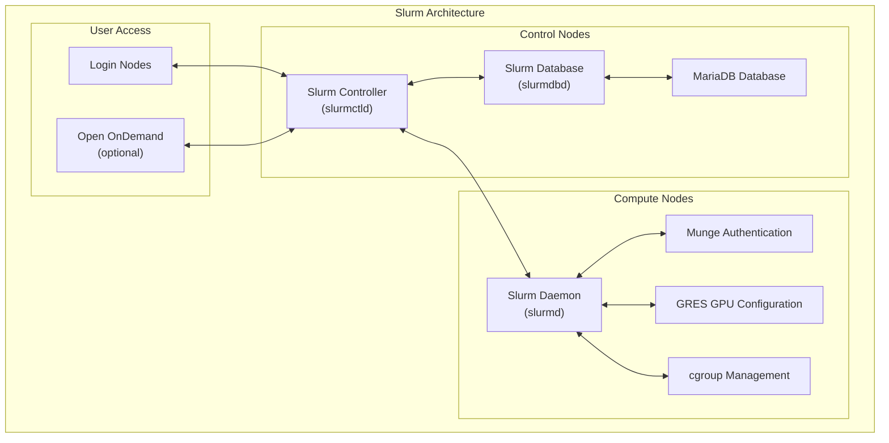

Sources: [roles/slurm/tasks/controller.yml:1-201](), [roles/slurm/tasks/compute.yml:1-211](), [config.example/group_vars/slurm-cluster.yml:1-201]()

### Role of the Kubernetes Cluster

The Kubernetes cluster deployment enables container orchestration with:

1. **Container orchestration**: Core Kubernetes components deployed via Kubespray
2. **GPU support**: Through NVIDIA GPU Operator or legacy device plugin
3. **Networking**: With options for different CNI plugins
4. **Storage**: With support for NFS and other storage options
5. **Monitoring**: Via Prometheus and Grafana
6. **Logging**: Through rsyslog or other logging solutions
7. **Cluster access**: Through kubectl and kubeconfig management

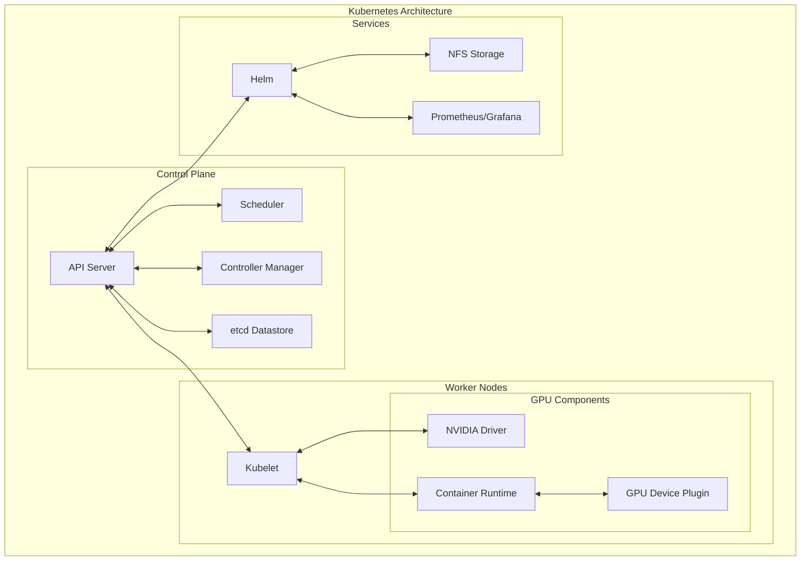

Sources: [playbooks/k8s-cluster.yml:114-116](), [playbooks/k8s-cluster.yml:169-293](), [config.example/group_vars/k8s-cluster.yml:1-96]()

## Virtual Testing Environment

DeepOps includes a virtual testing environment using Vagrant, allowing users to test deployments on a single machine before applying them to actual hardware.

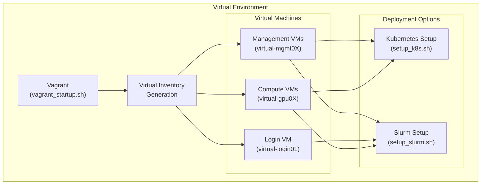

Sources: [README.md:82-86]()

## Deployable Components

DeepOps enables the deployment of various components depending on the cluster type:

| Component | Kubernetes Cluster | Slurm Cluster | Description |
|-----------|:------------------:|:-------------:|-------------|
| NVIDIA Drivers | ✓ | ✓ | GPU drivers |
| CUDA Toolkit | ✓ | ✓ | NVIDIA CUDA for GPU computing |
| Container Runtime | Docker/Containerd | Enroot/Singularity | Container execution environment |
| Monitoring | Prometheus/Grafana | Prometheus/Grafana | System and GPU monitoring |
| Storage | NFS | NFS | Shared storage |
| Logging | rsyslog | rsyslog | Log aggregation |
| GPU Management | GPU Operator/Device Plugin | GRES/NVML | GPU resource management |
| Authentication | Kubernetes RBAC | Munge | Authentication system |
| Software Management | Helm | Lmod | Software deployment/environment |

Sources: [config.example/group_vars/all.yml:124-175](), [playbooks/k8s-cluster.yml:169-309](), [playbooks/slurm-cluster.yml:43-163]()

## Workflow Integration

A key benefit of DeepOps is its integration with common AI/ML and HPC workflows:

1. **Kubernetes for AI/ML workflows**:
   - Kubeflow integration
   - RAPIDS and Dask support
   - GPU sharing and MIG capabilities
   - Helm chart deployment

2. **Slurm for HPC workflows**:
   - MPI job support
   - GPU-aware scheduling
   - Container integration via Pyxis/Enroot
   - Software modules via Lmod
   - HPC SDK integration

DeepOps provides the infrastructure foundation for these workflows, enabling researchers and data scientists to focus on their applications rather than infrastructure management.

Sources: [playbooks/slurm-cluster.yml:79-163](), [config.example/group_vars/slurm-cluster.yml:55-132]()

## Project Information

DeepOps is an open-source project maintained by NVIDIA. Contributions to the project follow a standard pull request workflow with signed commits, as detailed in the [CONTRIBUTING.md]() file.

Sources: [README.md:92-104](), [CONTRIBUTING.md:1-59]()

---

# Page: Getting Started

# Getting Started

<details>
<summary>Relevant source files</summary>

The following files were used as context for generating this wiki page:

- [.github/workflows/ansible-lint-roles.yml](.github/workflows/ansible-lint-roles.yml)
- [.gitignore](.gitignore)
- [ansible.cfg](ansible.cfg)
- [config.example/requirements.yml](config.example/requirements.yml)
- [playbooks/slurm-cluster/easybuild-modules.yml](playbooks/slurm-cluster/easybuild-modules.yml)
- [playbooks/slurm-cluster/files/cve_2021_44228.options](playbooks/slurm-cluster/files/cve_2021_44228.options)
- [playbooks/slurm-cluster/logging.yml](playbooks/slurm-cluster/logging.yml)
- [playbooks/slurm-cluster/open-ondemand.yml](playbooks/slurm-cluster/open-ondemand.yml)
- [playbooks/slurm-cluster/slurm-validation.yml](playbooks/slurm-cluster/slurm-validation.yml)
- [playbooks/slurm-cluster/spack-modules.yml](playbooks/slurm-cluster/spack-modules.yml)
- [playbooks/slurm-cluster/templates/filebeat.conf](playbooks/slurm-cluster/templates/filebeat.conf)
- [roles/netapp-trident/.ansible-lint](roles/netapp-trident/.ansible-lint)
- [roles/requirements.yml](roles/requirements.yml)
- [scripts/deepops/ansible-lint-roles.sh](scripts/deepops/ansible-lint-roles.sh)
- [scripts/setup.sh](scripts/setup.sh)
- [src/containers/pxe/docker-compose.yml](src/containers/pxe/docker-compose.yml)
- [virtual/.gitignore](virtual/.gitignore)
- [virtual/k8s_environment.sh](virtual/k8s_environment.sh)

</details>


This guide provides instructions for setting up and configuring NVIDIA DeepOps. It covers the initial repository setup, dependency installation, and configuration preparation. For deployment-specific information, see [Kubernetes Deployment](#2) or [Slurm Deployment](#3).

## Prerequisites

Before starting with DeepOps, ensure your system meets the following requirements:

| Requirement | Details |
|-------------|---------|
| Operating System | Ubuntu, CentOS, or RHEL (see supported versions below) |
| Python | Python 3 |
| Network Access | Internet connectivity for package installation |
| Permissions | Sudo access on the management node |

Supported operating systems:
- Ubuntu 18.04 LTS or newer
- CentOS/RHEL 7.x or 8.x

Sources: [scripts/setup.sh:29-36]()

## Setup Process

DeepOps uses a setup script to bootstrap the environment with required dependencies and configuration. This process prepares your system to run Ansible playbooks that will deploy either a Kubernetes or Slurm cluster.

### Initial Setup Workflow

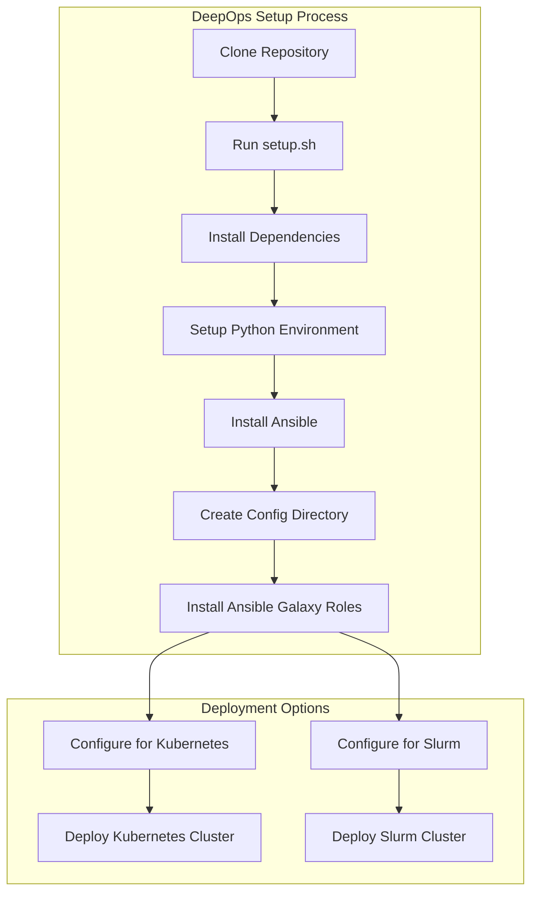

Sources: [scripts/setup.sh:67-88](), [scripts/setup.sh:90-127](), [scripts/setup.sh:142-149](), [scripts/setup.sh:152-169]()

### Clone the Repository

```bash
git clone https://github.com/NVIDIA/deepops.git
cd deepops
```

### Run the Setup Script

The `setup.sh` script installs required dependencies, creates a Python virtual environment, and prepares the repository for deployment:

```bash
./scripts/setup.sh
```

This script:
1. Installs system dependencies (git, virtualenv, sshpass, wget)
2. Creates a Python virtual environment at `/opt/deepops/env`
3. Installs Ansible and other required Python packages
4. Copies default configuration files to `config/` directory
5. Installs Ansible Galaxy roles and collections

Sources: [scripts/setup.sh:1-191]()

### Activate the Python Virtual Environment

After the setup script completes, activate the Python virtual environment:

```bash
source /opt/deepops/env/bin/activate
```

The setup script also adds this command to your `.bashrc` file, so it will be activated automatically in new shell sessions.

Sources: [scripts/setup.sh:182-185]()

## Configuration Structure

DeepOps uses a configuration directory structure to manage deployment settings. The setup script creates a copy of the example configuration that you can customize.

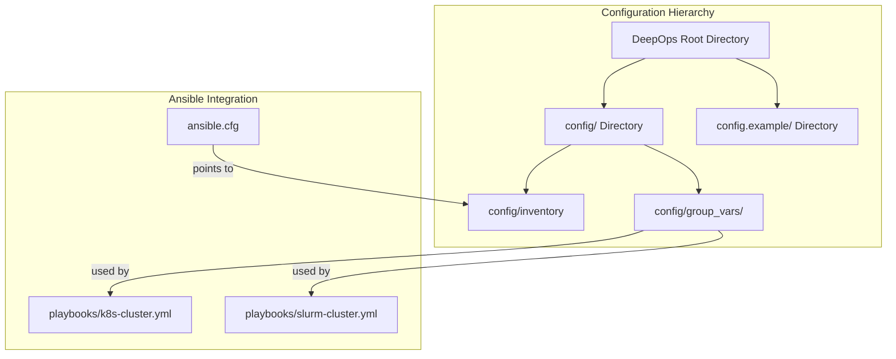

Sources: [ansible.cfg:1-26](), [scripts/setup.sh:142-149](), [.gitignore:7-10]()

### Inventory Configuration

The core of your DeepOps configuration is the inventory file at `config/inventory`. This file defines the servers in your cluster and their roles. Edit this file to include your server hostnames or IP addresses.

Example inventory structure:
```ini
[all]
mgmt01 ansible_host=10.0.0.1

[kube-master]
mgmt01

[etcd]
mgmt01

[kube-node]
mgmt01

[k8s-cluster:children]
kube-master
kube-node
```

For Slurm clusters:
```ini
[all]
login01 ansible_host=10.0.0.1
node01 ansible_host=10.0.0.2

[slurm-master]
login01

[slurm-node]
node01

[slurm-cluster:children]
slurm-master
slurm-node
```

Sources: [ansible.cfg:5]()

### Configuration Variables

DeepOps uses Ansible group variables to configure the deployment. The default variables are copied from `config.example/group_vars/` to `config/group_vars/`. You can modify these files to customize your deployment.

Key configuration files:
- `config/group_vars/all.yml` - Common variables for all hosts
- `config/group_vars/k8s-cluster.yml` - Kubernetes-specific variables
- `config/group_vars/slurm-cluster.yml` - Slurm-specific variables

Sources: [scripts/setup.sh:144-146]()

## Component Dependencies

DeepOps relies on several external Ansible roles and collections, which are installed automatically by the setup script.

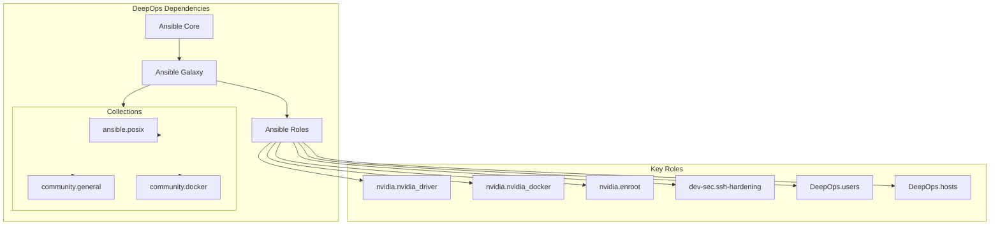

Sources: [roles/requirements.yml:1-74](), [scripts/setup.sh:152-169]()

## Virtual Testing Environment

DeepOps includes a virtual testing environment that allows you to deploy a test cluster using Vagrant. This is useful for testing your configuration before deploying to physical hardware.

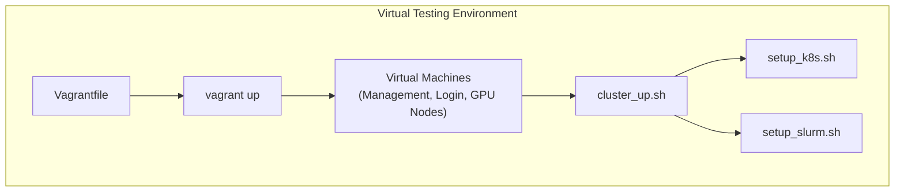

Sources: [virtual/.gitignore:1-6](), [virtual/k8s_environment.sh:1-9]()

## Next Steps

After completing the initial setup and configuration, proceed to deploy either a Kubernetes or Slurm cluster:

### For Kubernetes Deployment

Deploy a Kubernetes cluster with NVIDIA GPU support:

```bash
ansible-playbook -l k8s-cluster playbooks/k8s-cluster.yml
```

For more details about Kubernetes deployment options, see [Kubernetes Deployment](#2).

### For Slurm Deployment

Deploy a Slurm cluster for HPC workloads:

```bash
ansible-playbook -l slurm-cluster playbooks/slurm-cluster.yml
```

For more details about Slurm deployment options, see [Slurm Deployment](#3).

Sources: [playbooks/slurm-cluster/slurm-validation.yml:1-214](), [playbooks/slurm-cluster/logging.yml:1-87]()

## Troubleshooting

If you encounter issues during the setup process:

1. Ensure all prerequisites are installed
2. Check that your Python version is compatible (Python 3.6+)
3. Verify that the virtual environment is activated (`source /opt/deepops/env/bin/activate`)
4. Check for errors in the Ansible output
5. Review the inventory file to ensure all hosts are correctly configured
6. Run the Ansible playbook with the `-v` flag for verbose output

For Ansible-related issues, the repository includes a linting tool to check role quality:

```bash
./scripts/deepops/ansible-lint-roles.sh
```

Sources: [scripts/deepops/ansible-lint-roles.sh:1-48](), [.github/workflows/ansible-lint-roles.yml:1-32]()

---

# Page: Configuration System

# Configuration System

<details>
<summary>Relevant source files</summary>

The following files were used as context for generating this wiki page:

- [config.example/group_vars/all.yml](config.example/group_vars/all.yml)
- [config.example/group_vars/k8s-cluster.yml](config.example/group_vars/k8s-cluster.yml)
- [config.example/group_vars/slurm-cluster.yml](config.example/group_vars/slurm-cluster.yml)
- [playbooks/k8s-cluster.yml](playbooks/k8s-cluster.yml)
- [playbooks/slurm-cluster.yml](playbooks/slurm-cluster.yml)
- [playbooks/slurm-cluster/alertmanager.yml](playbooks/slurm-cluster/alertmanager.yml)
- [roles/facts/files/gpus.fact](roles/facts/files/gpus.fact)
- [roles/facts/tasks/main.yml](roles/facts/tasks/main.yml)
- [roles/pyxis/defaults/main.yml](roles/pyxis/defaults/main.yml)
- [roles/pyxis/tasks/main.yml](roles/pyxis/tasks/main.yml)
- [roles/pyxis/tasks/pyxis.yml](roles/pyxis/tasks/pyxis.yml)
- [roles/slurm/defaults/main.yml](roles/slurm/defaults/main.yml)
- [roles/slurm/tasks/compute.yml](roles/slurm/tasks/compute.yml)
- [roles/slurm/tasks/controller.yml](roles/slurm/tasks/controller.yml)
- [roles/slurm/tasks/main.yml](roles/slurm/tasks/main.yml)
- [roles/slurm/tasks/munge.yml](roles/slurm/tasks/munge.yml)
- [roles/slurm/vars/redhat.yml](roles/slurm/vars/redhat.yml)
- [roles/slurm/vars/ubuntu.yml](roles/slurm/vars/ubuntu.yml)
- [scripts/k8s/install_helm.sh](scripts/k8s/install_helm.sh)

</details>


The Configuration System in DeepOps provides a structured way to customize and deploy GPU-accelerated computing clusters. This page explains how configuration works in DeepOps, what can be configured, and how to modify default settings for your environment. For information about actual deployment procedures, see [Getting Started](#1.1).

## Configuration Overview

DeepOps uses Ansible as its configuration management system, with a hierarchical structure of configuration files that determine how clusters are deployed and configured. Configuration files define everything from basic networking to GPU support, container registries, and monitoring services.

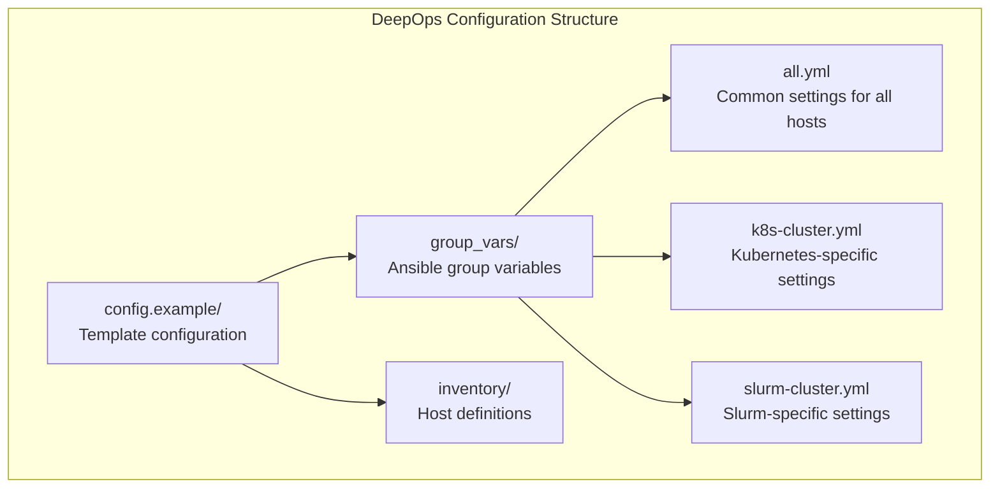

Sources: [config.example/group_vars/all.yml](), [config.example/group_vars/k8s-cluster.yml](), [config.example/group_vars/slurm-cluster.yml]()

## Configuration Workflow

When deploying a cluster, DeepOps uses your configuration files to determine which components to install and how to configure them. The workflow follows these steps:

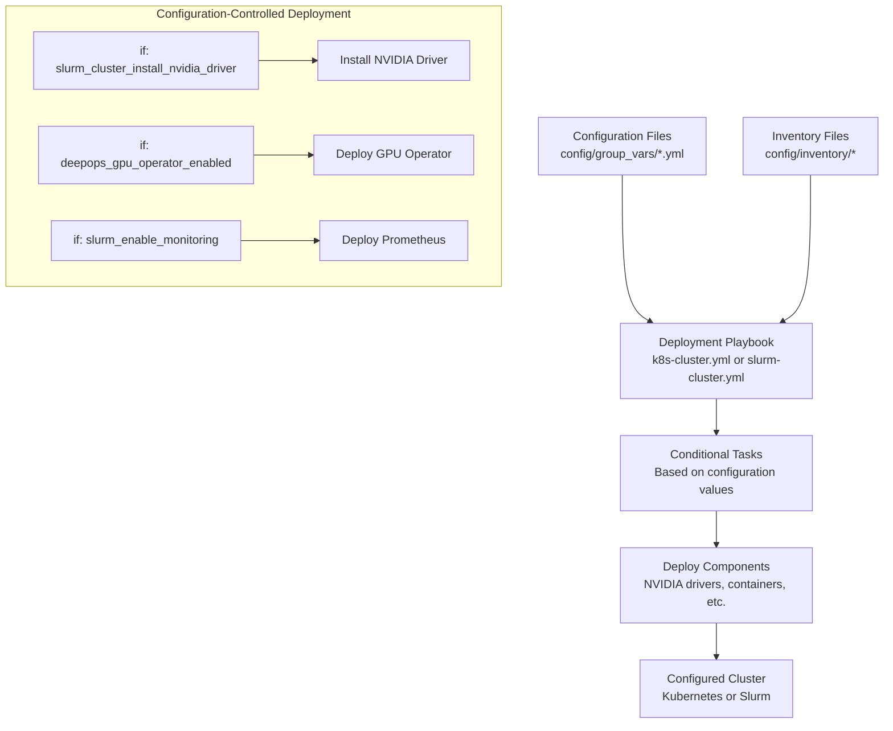

Sources: [playbooks/k8s-cluster.yml:169-177](), [playbooks/k8s-cluster.yml:289-293](), [playbooks/slurm-cluster.yml:43-46](), [playbooks/slurm-cluster.yml:96-106]()

## Configuration Files and Structure

The main configuration files are organized in the `config.example/group_vars/` directory. When setting up DeepOps, you typically copy this directory to `config/group_vars/` and modify the files as needed.

### Key Configuration Files

| File | Purpose | Affects |
|------|---------|---------|
| `all.yml` | Common configuration for all deployments | Network, users, NVIDIA software, container runtime |
| `k8s-cluster.yml` | Kubernetes-specific configuration | Container manager, GPU operator, dashboard, storage |
| `slurm-cluster.yml` | Slurm-specific configuration | Slurm settings, job scheduler, GPU management, monitoring |

### Parameter to Component Mapping

The following diagram shows how key configuration parameters directly control which components are deployed and how they are configured:

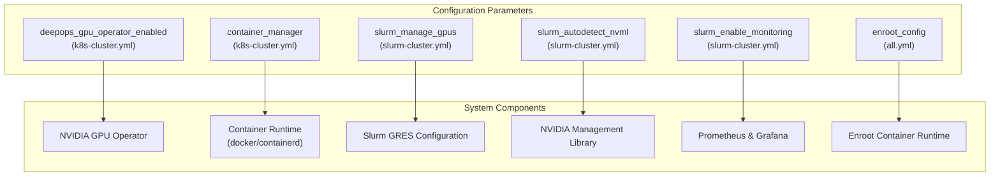

Sources: [config.example/group_vars/all.yml:151-153](), [config.example/group_vars/k8s-cluster.yml:15-16](), [config.example/group_vars/k8s-cluster.yml:25-26](), [config.example/group_vars/slurm-cluster.yml:11-12](), [config.example/group_vars/slurm-cluster.yml:22-23](), [config.example/group_vars/slurm-cluster.yml:223-229](), [config.example/group_vars/all.yml:180-188]()

## Common Configuration Options

### Network Configuration

The network configuration in `all.yml` controls settings such as DNS, NTP, and proxy. Key parameters include:

- `chrony_install`: Enable/disable NTP configuration using Chrony
- `chrony_config_server`: List of NTP servers
- `deepops_set_hostname`: Control whether hostnames are set based on inventory 

Sources: [config.example/group_vars/all.yml:26-41]()

### User Management

User configuration in `all.yml` defines which users are created during deployment:

```yaml
users:
  - username: nvidia
    name: nvidia
    password: $6$IrxI27V4ogJFfgTV$RvNskQFvXZzE9AF...
    groups: ['sudo']
    uid: 10007
    home: /home/nvidia
```

Sources: [config.example/group_vars/all.yml:98-105]()

### NVIDIA GPU Configuration

GPU-related settings in `all.yml` control how NVIDIA drivers and tools are installed:

- `nvidia_driver_force_install`: Force installation even if GPU not detected
- `gpu_clock_reset` and `gpu_clock_lock`: Control GPU clock settings
- `install_dcgm`: Enable installation of NVIDIA Datacenter GPU Manager

Sources: [config.example/group_vars/all.yml:121-142](), [config.example/group_vars/all.yml:265-266]()

### Container Runtime

Container runtime configuration across files affects which runtime is used and how it's configured:

- `docker_install`: Whether to install Docker
- `container_manager`: Container runtime for Kubernetes (docker, containerd, crio)
- `docker_insecure_registries`: List of insecure container registries
- `enroot_config`: Configuration for Enroot container runtime in Slurm

Sources: [config.example/group_vars/all.yml:152-169](), [config.example/group_vars/all.yml:180-188](), [config.example/group_vars/k8s-cluster.yml:14-15]()

## Kubernetes-Specific Configuration

The `k8s-cluster.yml` file contains Kubernetes-specific configuration options:

### GPU Support in Kubernetes

GPU support in Kubernetes can be configured in two ways:

1. Using the GPU Operator (controlled by `deepops_gpu_operator_enabled`)
2. Using individual components (GPU device plugin, GPU feature discovery)

Sources: [config.example/group_vars/k8s-cluster.yml:25-28](), [playbooks/k8s-cluster.yml:277-293]()

### Storage and Container Registry

Kubernetes storage and registry configuration includes:

- `k8s_nfs_client_provisioner`: Enable NFS client provisioner
- `k8s_deploy_nfs_server`: Deploy an NFS server for persistent storage
- `kube_enable_container_registry`: Enable local container registry

Sources: [config.example/group_vars/k8s-cluster.yml:49-62](), [config.example/group_vars/k8s-cluster.yml:67-71]()

## Slurm-Specific Configuration

The `slurm-cluster.yml` file contains configuration specific to Slurm clusters:

### Slurm Core Configuration

Core Slurm settings that control the job scheduler behavior:

- `slurm_install_prefix`: Installation directory for Slurm
- `slurm_manage_gpus`: Enable GPU management by Slurm
- `slurm_autodetect_nvml`: Auto-detect GPUs using NVIDIA Management Library
- `slurm_enable_ha`: Enable Slurm high-availability mode

You can also override Slurm configuration templates:

```yaml
# slurm_conf_template: "/path/to/slurm.conf"
# slurm_cgroup_conf_template: "/path/to/cgroup.conf"
# slurm_gres_conf_template: "/path/to/gres.conf"
# slurm_dbd_conf_template: "/path/to/slurmdbd.conf"
```

Sources: [config.example/group_vars/slurm-cluster.yml:7-19](), [config.example/group_vars/slurm-cluster.yml:31-33](), [config.example/group_vars/slurm-cluster.yml:38-41]()

### Slurm Container Support

Slurm container support configuration:

- `slurm_install_singularity`: Install Singularity container runtime
- `slurm_install_enroot`: Install Enroot container runtime
- `slurm_install_pyxis`: Install Pyxis (Slurm integration for Enroot)

Sources: [config.example/group_vars/slurm-cluster.yml:69-70](), [config.example/group_vars/slurm-cluster.yml:186-188](), [roles/pyxis/defaults/main.yml:1-4]()

### Monitoring and Logging

Slurm monitoring and logging configuration:

- `slurm_enable_monitoring`: Enable Prometheus and Grafana monitoring
- `slurm_enable_rsyslog_server`/`slurm_enable_rsyslog_client`: Enable rsyslog forwarding

Sources: [config.example/group_vars/slurm-cluster.yml:223-236]()

## Implementation Details

### Role Variables and Defaults

Many configuration options have default values defined in role default files. For example, Slurm defaults are defined in:

```yaml
# From roles/slurm/defaults/main.yml
slurm_version: "23.02.4"
slurm_cluster_name: deepops
slurm_username: slurm
slurm_password: ReplaceWithASecurePasswordInTheVault
```

Sources: [roles/slurm/defaults/main.yml:10-26](), [roles/pyxis/defaults/main.yml:1-4]()

### Platform-Specific Configuration

DeepOps handles platform differences through OS-specific variable files:

- `roles/slurm/vars/ubuntu.yml` - Ubuntu-specific variables
- `roles/slurm/vars/redhat.yml` - RHEL/CentOS-specific variables

Sources: [roles/slurm/vars/ubuntu.yml:1-25](), [roles/slurm/vars/redhat.yml:1-27]()

## Customizing Configuration

To customize DeepOps for your environment:

1. Copy the example configuration to create your working configuration:
   ```bash
   cp -r config.example config
   ```

2. Update the inventory in `config/inventory` to match your cluster hardware

3. Modify configuration files in `config/group_vars/` as needed

4. Run the appropriate deployment playbook:
   ```bash
   # For Kubernetes
   ansible-playbook -i config/inventory playbooks/k8s-cluster.yml
   
   # For Slurm
   ansible-playbook -i config/inventory playbooks/slurm-cluster.yml
   ```

The configuration values in your customized files will override the defaults and determine exactly how your cluster is deployed and configured.

## Configuration Application Flow

The following diagram shows how configuration is applied during deployment, illustrating how parameters control which components are deployed:

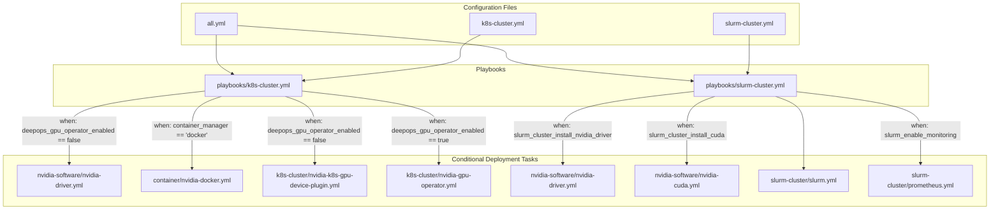

Sources: [playbooks/k8s-cluster.yml:169-177](), [playbooks/k8s-cluster.yml:178-188](), [playbooks/k8s-cluster.yml:277-287](), [playbooks/k8s-cluster.yml:289-293](), [playbooks/slurm-cluster.yml:43-46](), [playbooks/slurm-cluster.yml:50-54](), [playbooks/slurm-cluster.yml:79-80](), [playbooks/slurm-cluster.yml:96-106]()

---

# Page: Kubernetes Deployment

# Kubernetes Deployment

<details>
<summary>Relevant source files</summary>

The following files were used as context for generating this wiki page:

- [config.example/group_vars/all.yml](config.example/group_vars/all.yml)
- [config.example/group_vars/k8s-cluster.yml](config.example/group_vars/k8s-cluster.yml)
- [config.example/group_vars/slurm-cluster.yml](config.example/group_vars/slurm-cluster.yml)
- [docs/k8s-cluster/README.md](docs/k8s-cluster/README.md)
- [docs/k8s-cluster/deep-learning-examples.md](docs/k8s-cluster/deep-learning-examples.md)
- [docs/k8s-cluster/ingress.md](docs/k8s-cluster/ingress.md)
- [docs/k8s-cluster/kubeflow.md](docs/k8s-cluster/kubeflow.md)
- [docs/k8s-cluster/kubernetes-usage.md](docs/k8s-cluster/kubernetes-usage.md)
- [docs/k8s-cluster/logging.md](docs/k8s-cluster/logging.md)
- [docs/k8s-cluster/nvidia-mig.md](docs/k8s-cluster/nvidia-mig.md)
- [docs/k8s-cluster/nvidia-network-operator.md](docs/k8s-cluster/nvidia-network-operator.md)
- [docs/k8s-cluster/rapids-dask.md](docs/k8s-cluster/rapids-dask.md)
- [docs/k8s-cluster/roce-perf-k8s.md](docs/k8s-cluster/roce-perf-k8s.md)
- [docs/k8s-cluster/roce_backend.md](docs/k8s-cluster/roce_backend.md)
- [playbooks/k8s-cluster.yml](playbooks/k8s-cluster.yml)
- [playbooks/slurm-cluster.yml](playbooks/slurm-cluster.yml)
- [playbooks/slurm-cluster/alertmanager.yml](playbooks/slurm-cluster/alertmanager.yml)
- [roles/pyxis/defaults/main.yml](roles/pyxis/defaults/main.yml)
- [roles/pyxis/tasks/main.yml](roles/pyxis/tasks/main.yml)
- [roles/pyxis/tasks/pyxis.yml](roles/pyxis/tasks/pyxis.yml)
- [roles/slurm/defaults/main.yml](roles/slurm/defaults/main.yml)
- [roles/slurm/tasks/compute.yml](roles/slurm/tasks/compute.yml)
- [roles/slurm/tasks/controller.yml](roles/slurm/tasks/controller.yml)
- [roles/slurm/tasks/main.yml](roles/slurm/tasks/main.yml)
- [roles/slurm/tasks/munge.yml](roles/slurm/tasks/munge.yml)
- [roles/slurm/vars/redhat.yml](roles/slurm/vars/redhat.yml)
- [roles/slurm/vars/ubuntu.yml](roles/slurm/vars/ubuntu.yml)
- [scripts/k8s/install_helm.sh](scripts/k8s/install_helm.sh)
- [workloads/examples/k8s/deep-learning-examples/templates/statefulset.yaml](workloads/examples/k8s/deep-learning-examples/templates/statefulset.yaml)
- [workloads/examples/k8s/deep-learning-examples/values.yaml](workloads/examples/k8s/deep-learning-examples/values.yaml)

</details>


This document provides a comprehensive guide for deploying a Kubernetes cluster using DeepOps, with a specific focus on GPU-accelerated infrastructure. DeepOps provides a streamlined approach to deploying Kubernetes with NVIDIA GPU support, enabling data scientists, researchers, and infrastructure engineers to quickly set up a production-ready platform for AI/ML workloads.

## Deployment Architecture

DeepOps uses Kubespray (a collection of Ansible playbooks) under the hood, with additional customizations optimized for GPU-enabled environments. The architecture includes both core components required for basic functionality and optional components for enhanced capabilities.

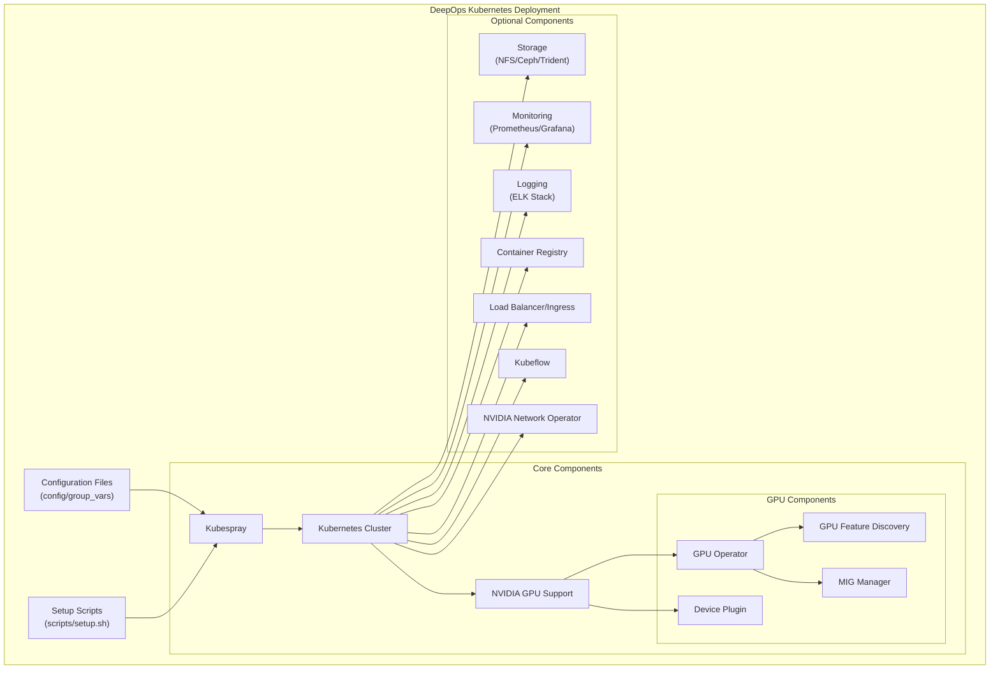

Sources: [playbooks/k8s-cluster.yml:3-294](). [docs/k8s-cluster/README.md:1-304](), [config.example/group_vars/k8s-cluster.yml:1-96]()

## Deployment Process

The deployment process follows a logical sequence from initial setup to verification and optional component installation.

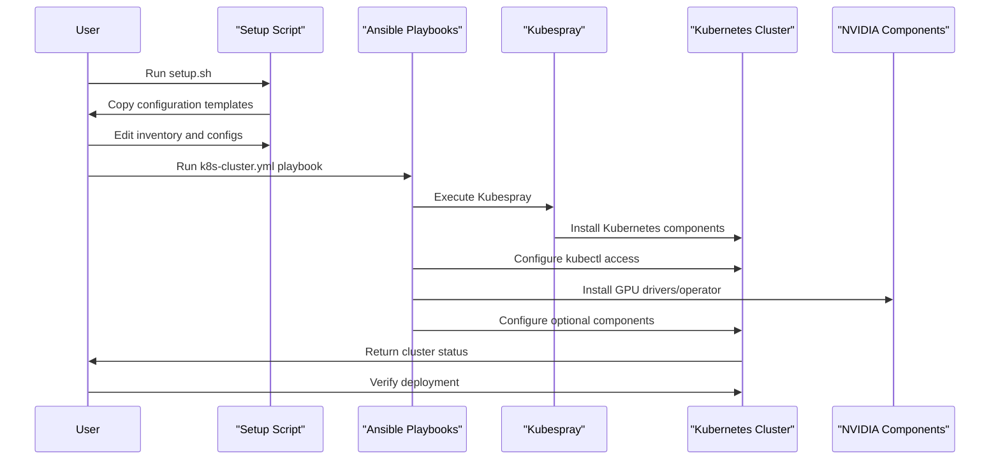

Sources: [playbooks/k8s-cluster.yml:23-309](), [docs/k8s-cluster/README.md:29-106]()

### Prerequisites

Before beginning the deployment process, ensure you have:

1. A control system to run the deployment process
2. One or more servers with compatible operating systems (Ubuntu, CentOS, or RHEL)
3. Machines with NVIDIA GPUs if you plan to use GPU capabilities
4. Network connectivity between all nodes
5. Sufficient privileges to run commands with sudo

For GPU support, ensure your systems have compatible NVIDIA GPUs with appropriate drivers or plan to deploy them via DeepOps.

Sources: [docs/k8s-cluster/README.md:29-38]()

### Configuration and Installation

1. **Install DeepOps**
   ```bash
   # Clone the repository and set up the DeepOps environment
   ./scripts/setup.sh
   ```

2. **Edit Configuration Files**
   ```bash
   # Edit inventory and add nodes to the "KUBERNETES" section
   vi config/inventory
   
   # Optionally modify configuration parameters
   vi config/group_vars/k8s-cluster.yml
   vi config/group_vars/all.yml
   ```

3. **Configure GPU Support**
   
   DeepOps offers two methods for GPU support:
   
   * Default method: NVIDIA Device Plugin (when `deepops_gpu_operator_enabled: false`)
   * Alternative method: NVIDIA GPU Operator (when `deepops_gpu_operator_enabled: true`)
   
   ```yaml
   # In config/group_vars/k8s-cluster.yml
   deepops_gpu_operator_enabled: true  # Enable GPU Operator
   
   # Enable host-level drivers (must be 'true' for clusters with pre-installed NVIDIA drivers or DGX systems)
   gpu_operator_preinstalled_nvidia_software: true
   ```

4. **Deploy Kubernetes**
   ```bash
   # Deploy Kubernetes using Ansible and Kubespray
   ansible-playbook -l k8s-cluster playbooks/k8s-cluster.yml
   ```

5. **Verify Installation**
   ```bash
   # Verify that Kubernetes is running
   kubectl get nodes
   
   # Verify GPU support (if applicable)
   kubectl get nodes -o=custom-columns=NAME:.metadata.name,GPUs:.status.allocatable.nvidia\\.com/gpu
   ```

Sources: [playbooks/k8s-cluster.yml:22-93](), [docs/k8s-cluster/README.md:42-104](), [config.example/group_vars/k8s-cluster.yml:14-37]()

## GPU Support in Kubernetes

DeepOps offers two primary methods for adding GPU support to Kubernetes:

### NVIDIA GPU Operator

The GPU Operator provides a Kubernetes native way to manage NVIDIA GPU resources, including:

- NVIDIA Driver (container or host-installed)
- NVIDIA Container Runtime
- Device Plugin
- GPU Feature Discovery
- DCGM Exporter for monitoring
- MIG Manager (for A100 GPUs)

```yaml
# In config/group_vars/k8s-cluster.yml
deepops_gpu_operator_enabled: true  # Enable GPU Operator
```

The GPU Operator is deployed as part of the main playbook execution:

```
# From playbooks/k8s-cluster.yml
- name: Install NVIDIA GPU Operator
  import_playbook: k8s-cluster/nvidia-gpu-operator.yml
  tags:
    - nvidia
  when: deepops_gpu_operator_enabled|default(true) | bool == true
```

Sources: [config.example/group_vars/k8s-cluster.yml:23-31](), [playbooks/k8s-cluster.yml:289-293](), [docs/k8s-cluster/README.md:63-73]()

### NVIDIA Device Plugin (Traditional Method)

If not using the GPU Operator, DeepOps can install the components individually:

1. NVIDIA Drivers
2. NVIDIA Docker/Container Runtime
3. NVIDIA GPU Device Plugin
4. GPU Feature Discovery

```
# From playbooks/k8s-cluster.yml
- name: Install NVIDIA driver on GPU servers
  import_playbook: nvidia-software/nvidia-driver.yml
  vars:
    hostlist: "k8s-cluster"
  tags:
    - nvidia
  when: deepops_gpu_operator_enabled|default(true) | bool == false or
        gpu_operator_preinstalled_nvidia_software|default(true)

- name: Install k8s GPU feature discovery
  import_playbook: k8s-cluster/nvidia-k8s-gpu-feature-discovery.yml
  tags:
    - nvidia
  when: deepops_gpu_operator_enabled|default(true) | bool == false

- name: Install k8s GPU device plugin
  import_playbook: k8s-cluster/nvidia-k8s-gpu-device-plugin.yml
  tags:
    - nvidia
  when: deepops_gpu_operator_enabled|default(true) | bool == false
```

Sources: [playbooks/k8s-cluster.yml:169-287](), [docs/k8s-cluster/README.md:63-73](), [config.example/group_vars/k8s-cluster.yml:23-31]()

### Multi-Instance GPU (MIG) Support

For NVIDIA A100 GPUs, MIG allows partitioning a single GPU into multiple instances. DeepOps supports MIG through the GPU Operator or standalone configuration:

```yaml
# Set the MIG labeling and use strategy to none, single, or mixed
k8s_gpu_mig_strategy: "mixed"
```

The MIG strategy determines how GPU resources are exposed to Kubernetes:
- `none`: MIG devices aren't enabled (default)
- `single`: Each GPU is configured with identical MIG geometries
- `mixed`: Different GPUs can have different MIG configurations

Sources: [config.example/group_vars/k8s-cluster.yml:31](), [docs/k8s-cluster/nvidia-mig.md:1-116]()

## Optional Components

DeepOps provides several optional components that can be deployed to enhance your Kubernetes cluster:

### Storage Options

#### NFS Client Provisioner (Default)

By default, DeepOps sets up an NFS server on the first Kubernetes master node and configures the NFS client provisioner:

```yaml
# In config/group_vars/k8s-cluster.yml
k8s_nfs_client_provisioner: true
k8s_deploy_nfs_server: true
k8s_nfs_server: '{{ groups["kube-master"][0] }}'
k8s_nfs_export_path: '/export/deepops_nfs'
```

You can configure this to use an existing NFS server by modifying these settings.

Sources: [config.example/group_vars/k8s-cluster.yml:50-62](), [docs/k8s-cluster/README.md:124-151]()

#### Other Storage Options

DeepOps also provides support for:
- Rook/Ceph cluster (deprecated)
- NetApp Astra Trident

### Monitoring

Deploy Prometheus and Grafana for monitoring your Kubernetes cluster and GPUs:

```bash
./scripts/k8s/deploy_monitoring.sh
```

This includes:
- Prometheus for metrics collection
- Grafana for visualization (accessible at http://<kube-master>:30200)
- NVIDIA DCGM for GPU metrics

Sources: [docs/k8s-cluster/README.md:189-216]()

### Logging

DeepOps supports centralized logging with ELK (Elasticsearch, Logstash, Kibana) stack:

```bash
# Follow the ELK Logging Guide
# Kibana will be available at http://<kube-master>:30700
```

Additionally, syslog forwarding can be configured:

```yaml
# In config/group_vars/k8s-cluster.yml
kube_enable_rsyslog_server: true
kube_enable_rsyslog_client: true
```

Sources: [docs/k8s-cluster/logging.md:1-92](), [config.example/group_vars/k8s-cluster.yml:88-95](), [docs/k8s-cluster/README.md:222-237]()

### Container Registry

DeepOps can deploy a local container registry:

```yaml
# In config/group_vars/k8s-cluster.yml
kube_enable_container_registry: false  # Set to true to enable
docker_insecure_registries: "{{ groups['kube-master']|map('regex_replace', '^(.*)$', '\\1:5000')|list + ['registry.local:31500']}}"
```

Deploy the registry with:
```bash
ansible-playbook --tags container-registry playbooks/k8s-cluster/container-registry.yml
```

Sources: [config.example/group_vars/k8s-cluster.yml:65-86](), [docs/k8s-cluster/README.md:239-242]()

### Load Balancer and Ingress

For exposing services externally, DeepOps provides:

1. **MetalLB Load Balancer**: Deploy with `./scripts/k8s/deploy_loadbalancer.sh`
2. **NGINX Ingress Controller**: Deploy with `./scripts/k8s/deploy_ingress.sh`

Sources: [docs/k8s-cluster/ingress.md:1-58](), [docs/k8s-cluster/README.md:247-253]()

### Kubeflow

For running machine learning workloads, DeepOps supports Kubeflow deployment:

```bash
./scripts/k8s/deploy_kubeflow.sh
```

Kubeflow will be accessible at http://<kube-master>:31380 with default credentials:
- Username: deepops@example.com
- Password: deepops

Sources: [docs/k8s-cluster/kubeflow.md:1-131](), [docs/k8s-cluster/README.md:253-256]()

### NVIDIA Network Operator

For high-performance networking in GPU clusters:

```bash
ansible-playbook playbooks/k8s-cluster/nvidia-network-operator.yaml
```

This deploys components for RDMA over Converged Ethernet (RoCE) or InfiniBand networking.

Sources: [docs/k8s-cluster/nvidia-network-operator.md:1-282](), [docs/k8s-cluster/roce-perf-k8s.md:1-410]()

## Cluster Maintenance

DeepOps leverages Kubespray for cluster maintenance operations:

### Adding Nodes

1. Add the new nodes to your `config/inventory` file
2. Run the scale-up playbook:
   ```bash
   ansible-playbook -l k8s-cluster submodules/kubespray/scale.yml
   ```

### Removing Nodes

```bash
ansible-playbook submodules/kubespray/remove-node.yml --extra-vars "node=nodename0,nodename1"
```

### Cluster Upgrade

Refer to the Kubespray upgrade documentation for detailed steps.

### Cluster Reset

To completely reset the cluster:

```bash
ansible-playbook submodules/kubespray/reset.yml
```

Sources: [docs/k8s-cluster/README.md:261-303]()

## Running Workloads

DeepOps provides examples for running various AI/ML workloads:

### Basic GPU Job

```yaml
apiVersion: batch/v1
kind: Job
metadata:
  name: gpu-job
spec:
  template:
    spec:
      containers:
      - name: gpu-container
        image: nvidia/cuda:11.0-base
        command: ["nvidia-smi"]
        resources:
          limits:
            nvidia.com/gpu: 1
      restartPolicy: Never
```

### Using NGC Container Registry

DeepOps supports the NVIDIA NGC container registry for optimized deep learning containers:

1. Generate an NGC API Key
2. Create a Kubernetes secret for the NGC registry
3. Use the secret in your deployments:
   ```yaml
   imagePullSecrets:
     - name: nvcr.dgxkey
   ```

### Deep Learning Examples

DeepOps provides helm charts for deploying various deep learning examples:

```bash
helm install <EXAMPLE_NAME> workloads/examples/k8s/deep-learning-examples --set exampleName=<EXAMPLE_NAME>
```

Sources: [docs/k8s-cluster/kubernetes-usage.md:1-116](), [docs/k8s-cluster/deep-learning-examples.md:1-282](), [workloads/examples/k8s/deep-learning-examples/values.yaml:1-28]()

## Conclusion

DeepOps provides a comprehensive solution for deploying Kubernetes with GPU support, along with a wide range of add-on components for AI/ML workloads. By following this guide, you can deploy a production-ready Kubernetes cluster optimized for GPU workloads.

For specific configurations and advanced scenarios, refer to the other pages in the DeepOps documentation.

---

# Page: GPU Support in Kubernetes

# GPU Support in Kubernetes

<details>
<summary>Relevant source files</summary>

The following files were used as context for generating this wiki page:

- [roles/alertmanager/defaults/main.yml](roles/alertmanager/defaults/main.yml)
- [roles/alertmanager/handlers/main.yml](roles/alertmanager/handlers/main.yml)
- [roles/alertmanager/tasks/main.yml](roles/alertmanager/tasks/main.yml)
- [roles/alertmanager/templates/alertmanager.yml.j2](roles/alertmanager/templates/alertmanager.yml.j2)
- [roles/alertmanager/templates/docker.alertmanager.service.j2](roles/alertmanager/templates/docker.alertmanager.service.j2)
- [roles/nvidia-gpu-operator-node-prep/files/blocklist-nouveau.conf](roles/nvidia-gpu-operator-node-prep/files/blocklist-nouveau.conf)
- [roles/nvidia-gpu-operator-node-prep/files/nvidia-driver.conf](roles/nvidia-gpu-operator-node-prep/files/nvidia-driver.conf)
- [roles/nvidia-gpu-operator-node-prep/handlers/main.yml](roles/nvidia-gpu-operator-node-prep/handlers/main.yml)
- [roles/nvidia-gpu-operator-node-prep/tasks/main.yml](roles/nvidia-gpu-operator-node-prep/tasks/main.yml)
- [roles/nvidia-gpu-operator/defaults/main.yml](roles/nvidia-gpu-operator/defaults/main.yml)
- [roles/nvidia-gpu-operator/tasks/k8s.yml](roles/nvidia-gpu-operator/tasks/k8s.yml)
- [roles/nvidia-gpu-operator/tasks/main.yml](roles/nvidia-gpu-operator/tasks/main.yml)
- [roles/nvidia-gpu-operator/tasks/nvaie.yml](roles/nvidia-gpu-operator/tasks/nvaie.yml)
- [roles/nvidia-gpu-operator/templates/client_configuration_token.tok](roles/nvidia-gpu-operator/templates/client_configuration_token.tok)
- [roles/nvidia-gpu-operator/templates/gridd.conf](roles/nvidia-gpu-operator/templates/gridd.conf)
- [roles/nvidia-k8s-gpu-device-plugin/defaults/main.yml](roles/nvidia-k8s-gpu-device-plugin/defaults/main.yml)
- [roles/nvidia-k8s-gpu-device-plugin/tasks/main.yml](roles/nvidia-k8s-gpu-device-plugin/tasks/main.yml)
- [roles/nvidia-k8s-gpu-feature-discovery/defaults/main.yml](roles/nvidia-k8s-gpu-feature-discovery/defaults/main.yml)
- [roles/nvidia-k8s-gpu-feature-discovery/meta/main.yml](roles/nvidia-k8s-gpu-feature-discovery/meta/main.yml)
- [roles/nvidia-k8s-gpu-feature-discovery/tasks/main.yml](roles/nvidia-k8s-gpu-feature-discovery/tasks/main.yml)
- [roles/nvidia-mig-manager/defaults/main.yml](roles/nvidia-mig-manager/defaults/main.yml)

</details>


This document provides details on how DeepOps enables and manages NVIDIA GPU support in Kubernetes clusters. It covers the deployment of the NVIDIA GPU Operator and related components that allow Kubernetes to recognize, schedule, and manage GPU resources efficiently.

For information about general Kubernetes deployment, see [Kubernetes Deployment](#2), and for monitoring GPU metrics in Kubernetes, see [Monitoring in Kubernetes](#2.2).

## Overview

DeepOps provides robust GPU support in Kubernetes through NVIDIA's cloud-native components. The main goal is to simplify the management of GPU resources within Kubernetes, enabling containerized applications to access and use GPUs efficiently.

The primary components are:

- **NVIDIA GPU Operator**: Automates the deployment of GPU components in Kubernetes
- **NVIDIA Device Plugin**: Exposes GPU resources to Kubernetes
- **GPU Feature Discovery**: Labels nodes with GPU capabilities for better scheduling
- **MIG Manager**: Enables Multi-Instance GPU support for resource partitioning

Sources: [roles/nvidia-gpu-operator/defaults/main.yml:1-57](), [roles/nvidia-k8s-gpu-device-plugin/defaults/main.yml:1-7](), [roles/nvidia-k8s-gpu-feature-discovery/defaults/main.yml:1-7]()

## Architecture

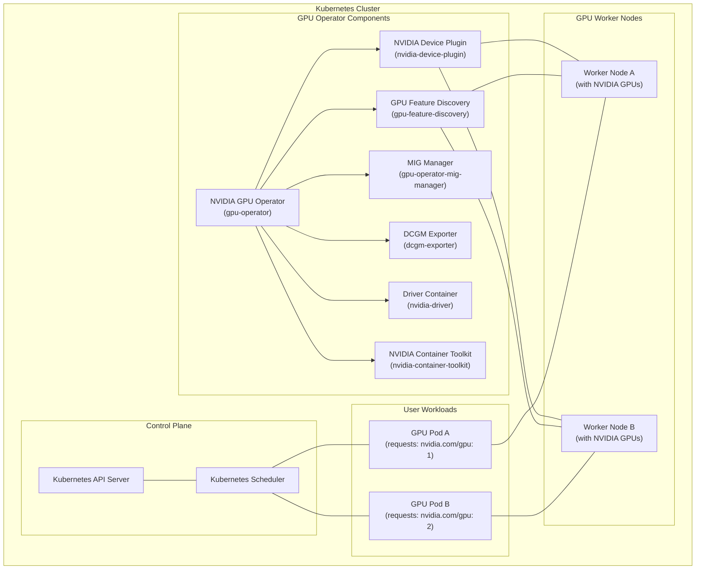

Sources: [roles/nvidia-gpu-operator/tasks/main.yml:1-16](), [roles/nvidia-gpu-operator/tasks/k8s.yml:1-17](), [roles/nvidia-k8s-gpu-device-plugin/tasks/main.yml:1-18](), [roles/nvidia-k8s-gpu-feature-discovery/tasks/main.yml:1-18]()

## NVIDIA GPU Operator

The NVIDIA GPU Operator is the central component for GPU support in Kubernetes. It automates the deployment of all necessary components to run GPU workloads, including drivers, device plugins, and monitoring tools.

### Deployment Process

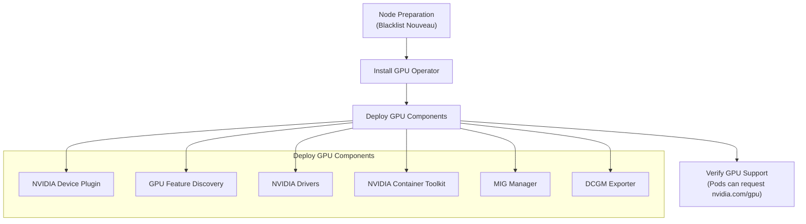

DeepOps installs the GPU Operator using Helm with a configurable set of parameters. The primary configuration happens in the [roles/nvidia-gpu-operator/defaults/main.yml:1-57]() file.

Key parameters include:
- Chart version (currently `v23.3.2`)
- MIG strategy (`mixed` by default, allowing both MIG and non-MIG modes)
- Component enablement flags for drivers, toolkit, DCGM, and MIG Manager

For systems with pre-installed NVIDIA drivers (like DGX), DeepOps configures the GPU Operator to skip driver installation:

```yaml
gpu_operator_preinstalled_nvidia_software: true
```

This setting automatically sets:
```yaml
gpu_operator_enable_driver: false
gpu_operator_enable_toolkit: true
```

Sources: [roles/nvidia-gpu-operator/tasks/main.yml:1-16](), [roles/nvidia-gpu-operator/tasks/k8s.yml:1-17](), [roles/nvidia-gpu-operator/defaults/main.yml:1-57]()

## NVIDIA Device Plugin

The NVIDIA Device Plugin is deployed as part of the GPU Operator or can be deployed separately. It's responsible for:

1. Discovering NVIDIA GPUs on Kubernetes nodes
2. Advertising them as consumable resources to the Kubernetes API server
3. Managing the allocation of GPU devices when containers request them

The device plugin enables Kubernetes pods to request GPU resources using the `nvidia.com/gpu` resource type:

```yaml
resources:
  limits:
    nvidia.com/gpu: 1
```

DeepOps configures the device plugin with the [roles/nvidia-k8s-gpu-device-plugin/defaults/main.yml:1-7]() settings, including:
- Chart version (currently `0.14.0`)
- MIG strategy (matches the GPU Operator setting)
- Initialization error handling

Sources: [roles/nvidia-k8s-gpu-device-plugin/tasks/main.yml:1-18](), [roles/nvidia-k8s-gpu-device-plugin/defaults/main.yml:1-7]()

## GPU Feature Discovery

The GPU Feature Discovery component automatically labels Kubernetes nodes with the properties of their GPUs. These labels include:

- GPU model
- GPU architecture
- CUDA version
- Driver version
- Memory
- MIG capabilities

This labeling enables workload scheduling based on GPU features through standard Kubernetes node selectors:

```yaml
nodeSelector:
  nvidia.com/gpu.product: Tesla-V100
```

DeepOps deploys this component with the settings in [roles/nvidia-k8s-gpu-feature-discovery/defaults/main.yml:1-7](), including:
- Chart version (currently `0.8.0`)
- MIG strategy configuration

Sources: [roles/nvidia-k8s-gpu-feature-discovery/tasks/main.yml:1-18](), [roles/nvidia-k8s-gpu-feature-discovery/defaults/main.yml:1-7]()

## MIG Support

DeepOps supports NVIDIA Multi-Instance GPU (MIG) technology, which enables a single GPU to be partitioned into multiple isolated GPU instances. This is particularly useful for multi-tenant environments where GPU resources need to be efficiently shared.

MIG support is configured through the `k8s_gpu_mig_strategy` parameter, which can be set to:
- `single` - All GPUs on a node operate in the same mode (all with MIG or all without)
- `mixed` - GPUs on a node can be in different modes (default in DeepOps)

The MIG Manager component, part of the GPU Operator, handles the configuration and management of MIG instances.

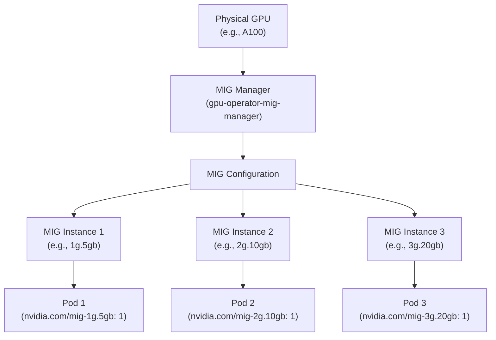

Sources: [roles/nvidia-gpu-operator/defaults/main.yml:17-27](), [roles/nvidia-mig-manager/defaults/main.yml:1-4]()

## Support for vGPU and NVIDIA AI Enterprise

DeepOps also provides support for NVIDIA vGPU and NVIDIA AI Enterprise (NVAIE) environments. This requires additional configuration for licensing and authentication.

### vGPU Licensing Configuration

For vGPU deployments, DeepOps supports both traditional license server and NLS (NVIDIA License System) approaches:

1. For traditional license server:
   - Set `vgpu_grid_license_server` to the license server IP
   - Disable NLS by setting `gpu_operator_nvaie_nls_enabled: false`

2. For NVIDIA License System (NLS):
   - Set `gpu_operator_nvaie_nls_enabled: true`
   - Configure `gpu_operator_nvaie_nls_token` with the NLS token

### NVIDIA AI Enterprise

NVAIE is enabled by setting `gpu_operator_nvaie_enable: true`, which requires additional NGC registry authentication:

```yaml
gpu_operator_registry_username: "$oauthtoken"
gpu_operator_registry_password: "<NGC API key>"
gpu_operator_registry_email: "<NGC email>"
```

When NVAIE is enabled, DeepOps uses a different Helm repository (`https://helm.ngc.nvidia.com/nvaie`) and chart (`nvaie/gpu-operator`).

Sources: [roles/nvidia-gpu-operator/defaults/main.yml:38-56](), [roles/nvidia-gpu-operator/tasks/nvaie.yml:1-60](), [roles/nvidia-gpu-operator/templates/gridd.conf:1-6]()

## Node Preparation for GPU Support

Before the GPU Operator can be deployed, DeepOps prepares nodes by:

1. Unloading and blacklisting the open-source Nouveau driver
2. Loading required kernel modules (i2c_core, ipmi_msghandler)
3. Updating the initial RAM disk (initramfs)

This preparation ensures that the NVIDIA drivers can be properly installed and function correctly.

```yaml
# Blacklisting Nouveau
blacklist nouveau
options nouveau modeset=0

# Required kernel modules
i2c_core
ipmi_msghandler
```

> **Note**: As of GPU Operator version 1.9.0, this node preparation is now handled by the GPU Operator itself and is mainly kept for backward compatibility.

Sources: [roles/nvidia-gpu-operator-node-prep/tasks/main.yml:1-38](), [roles/nvidia-gpu-operator-node-prep/files/blocklist-nouveau.conf:1-3](), [roles/nvidia-gpu-operator-node-prep/files/nvidia-driver.conf:1-3]()

## Configuration Options Reference

| Parameter | Default Value | Description |
|-----------|---------------|-------------|
| `gpu_operator_chart_version` | `v23.3.2` | Version of the GPU Operator Helm chart |
| `k8s_gpu_mig_strategy` | `mixed` | MIG strategy (single or mixed) |
| `gpu_operator_enable_driver` | `true` (false for DGX) | Enable NVIDIA driver installation |
| `gpu_operator_enable_toolkit` | `true` | Enable NVIDIA Container Toolkit |
| `gpu_operator_enable_dcgm` | `false` | Enable DCGM for monitoring |
| `gpu_operator_enable_migmanager` | `true` | Enable MIG Manager |
| `gpu_operator_namespace` | `gpu-operator` | Kubernetes namespace for GPU Operator |
| `gpu_operator_driver_version` | `525.105.17` | NVIDIA driver version |
| `k8s_gpu_plugin_chart_version` | `0.14.0` | Version of the device plugin chart |
| `k8s_gpu_feature_discovery_chart_version` | `0.8.0` | Version of the feature discovery chart |

Sources: [roles/nvidia-gpu-operator/defaults/main.yml:1-57](), [roles/nvidia-k8s-gpu-device-plugin/defaults/main.yml:1-7](), [roles/nvidia-k8s-gpu-feature-discovery/defaults/main.yml:1-7]()

## Troubleshooting

If you encounter issues with GPU support in your Kubernetes cluster, check the following:

1. Verify that GPU nodes are properly prepared:
   ```bash
   lsmod | grep -i nvidia
   ```

2. Check if the GPU Operator pods are running:
   ```bash
   kubectl get pods -n gpu-operator
   ```

3. Verify GPU resources are available:
   ```bash
   kubectl get nodes -o json | jq '.items[].status.capacity["nvidia.com/gpu"]'
   ```

4. For vGPU issues, verify the license configuration:
   ```bash
   kubectl get configmap licensing-config -n gpu-operator -o yaml
   ```

5. For MIG configuration issues, check the MIG Manager logs:
   ```bash
   kubectl logs -n gpu-operator -l app=gpu-operator-mig-manager
   ```

Sources: [roles/nvidia-gpu-operator/tasks/k8s.yml:1-17](), [roles/nvidia-gpu-operator/tasks/nvaie.yml:1-60]()

---

# Page: Monitoring in Kubernetes

# Monitoring in Kubernetes

<details>
<summary>Relevant source files</summary>

The following files were used as context for generating this wiki page:

- [config.example/env.sh](config.example/env.sh)
- [config.example/helm/dcgm-exporter.yml](config.example/helm/dcgm-exporter.yml)
- [config.example/helm/metallb-resources.yml](config.example/helm/metallb-resources.yml)
- [config.example/helm/metallb.yml](config.example/helm/metallb.yml)
- [config.example/helm/monitoring-no-persist.yml](config.example/helm/monitoring-no-persist.yml)
- [config.example/helm/monitoring.yml](config.example/helm/monitoring.yml)
- [scripts/airgap/build_offline_cache.sh](scripts/airgap/build_offline_cache.sh)
- [scripts/common.sh](scripts/common.sh)
- [scripts/generic/install_docker.sh](scripts/generic/install_docker.sh)
- [scripts/k8s/debug.sh](scripts/k8s/debug.sh)
- [scripts/k8s/deploy_ingress.sh](scripts/k8s/deploy_ingress.sh)
- [scripts/k8s/deploy_loadbalancer.sh](scripts/k8s/deploy_loadbalancer.sh)
- [scripts/k8s/deploy_monitoring.sh](scripts/k8s/deploy_monitoring.sh)
- [scripts/k8s/setup_remote_k8s.sh](scripts/k8s/setup_remote_k8s.sh)
- [scripts/k8s/verify_gpu.sh](scripts/k8s/verify_gpu.sh)
- [workloads/jenkins/scripts/get-k8s-debug.sh](workloads/jenkins/scripts/get-k8s-debug.sh)
- [workloads/jenkins/scripts/get-slurm-debug.sh](workloads/jenkins/scripts/get-slurm-debug.sh)
- [workloads/jenkins/scripts/run-gpu-job.sh](workloads/jenkins/scripts/run-gpu-job.sh)
- [workloads/jenkins/scripts/verify-ingress-config.sh](workloads/jenkins/scripts/verify-ingress-config.sh)

</details>


## Purpose and Scope

This document describes the monitoring system for Kubernetes clusters deployed with DeepOps, focusing on the components, deployment process, configuration, and GPU-specific monitoring capabilities. The monitoring stack in DeepOps includes Prometheus, Grafana, Alertmanager, and NVIDIA DCGM Exporter for comprehensive observability of cluster performance, resource utilization, and GPU metrics.

For information about GPU support in Kubernetes, see [GPU Support in Kubernetes](#2.1).

## Monitoring Architecture

The monitoring system in DeepOps leverages industry-standard tools to provide a comprehensive observability platform for Kubernetes clusters with GPU resources.

### Architecture Diagram

```mermaid
flowchart TB
    subgraph "Kubernetes Cluster"
        subgraph "Monitoring Stack"
            direction TB
            Prometheus["Prometheus"]
            Grafana["Grafana"]
            AlertManager["Alertmanager"]
            ConfigMaps["ConfigMaps<br>- dcgm-custom-metrics<br>- kube-prometheus-grafana-gpu"]
        end
        
        subgraph "GPU Nodes"
            DCGM["DCGM Exporter<br>(DaemonSet)"]
            GPUDevices["NVIDIA GPUs"]
        end
        
        subgraph "Cluster Access"
            Ingress["Ingress Controller"]
            LoadBalancer["MetalLB<br>LoadBalancer"]
        end
        
        DCGM --> Prometheus
        Prometheus --> Grafana
        Prometheus --> AlertManager
        ConfigMaps --> Grafana
        ConfigMaps --> DCGM
        GPUDevices --> DCGM
        
        Ingress --> Grafana
        Ingress --> Prometheus
        Ingress --> AlertManager
        LoadBalancer --> Ingress
    end
    
    User["User"] --> LoadBalancer
```

Sources: [scripts/k8s/deploy_monitoring.sh:101-158](), [scripts/k8s/deploy_ingress.sh:10-62](), [scripts/k8s/deploy_loadbalancer.sh:1-49]()

## Components

The monitoring stack consists of the following components:

| Component | Purpose | Configuration |
|-----------|---------|---------------|
| Prometheus | Time-series database that collects and stores metrics | [config.example/helm/monitoring.yml:5-55]() |
| Grafana | Visualization platform for metrics and dashboards | [config.example/helm/monitoring.yml:72-87]() |
| Alertmanager | Handles alerts from Prometheus | [config.example/helm/monitoring.yml:57-70]() |
| DCGM Exporter | Collects NVIDIA GPU metrics | [workloads/services/k8s/dcgm-exporter.yml]() |
| Ingress Controller | Provides external access to services | [scripts/k8s/deploy_ingress.sh]() |
| MetalLB | LoadBalancer implementation for bare metal clusters | [scripts/k8s/deploy_loadbalancer.sh]() |

Sources: [scripts/k8s/deploy_monitoring.sh:36-45]()

## Deployment Process

The monitoring stack is deployed using Helm charts and Kubernetes manifests. The deployment process is orchestrated by the `deploy_monitoring.sh` script.

### Deployment Flow

```mermaid
sequenceDiagram
    participant User
    participant Script as "deploy_monitoring.sh"
    participant Kubernetes
    participant Helm
    
    User->>Script: Execute deploy_monitoring.sh
    Script->>Script: Check dependencies
    Script->>Script: Deploy Ingress Controller
    Note right of Script: If not already deployed
    Script->>Script: Get IP information
    Script->>Helm: Deploy kube-prometheus-stack
    Note right of Helm: Includes Prometheus, Grafana, and Alertmanager
    Script->>Kubernetes: Create GPU dashboard ConfigMap
    alt No GPU Operator
        Script->>Kubernetes: Label GPU nodes
        Script->>Kubernetes: Deploy DCGM Exporter
    end
    Script->>User: Display monitoring URLs
```

Sources: [scripts/k8s/deploy_monitoring.sh:228-291]()

### Prerequisites

Before deploying the monitoring stack, ensure:

1. A working Kubernetes cluster with kubectl access
2. Helm installed (`scripts/k8s/install_helm.sh`)
3. A default StorageClass for persistent volumes (optional but recommended)
4. GPU nodes with NVIDIA drivers installed

### Deployment Steps

To deploy the monitoring stack:

```bash
./scripts/k8s/deploy_monitoring.sh
```

The script supports several options:

| Option | Description |
|--------|-------------|
| `-h` | Display help message |
| `-p` | Print monitoring URLs |
| `-d` | Delete monitoring namespace and CRDs |
| `-x` | Disable persistent data storage |
| `-w` | Wait and poll until all services are responding |

Sources: [scripts/k8s/deploy_monitoring.sh:36-83]()

## Configuration

### Default Configuration

The monitoring stack is configured using Helm values files in the `config/helm/` directory. Two main configuration files are provided:

1. `monitoring.yml` - Standard configuration with persistent storage
2. `monitoring-no-persist.yml` - Configuration without persistent storage

### Persistent Storage

By default, the monitoring stack is configured to use persistent storage for Prometheus data. This requires a default StorageClass to be configured in the Kubernetes cluster.

If no StorageClass is available, you can:
- Run with the `-x` flag to disable persistent storage
- Set up an NFS provisioner using `ansible-playbook playbooks/k8s-cluster/nfs-client-provisioner.yml`
- Deploy Rook-Ceph using `./scripts/k8s/deploy_rook.sh`

Sources: [scripts/k8s/deploy_monitoring.sh:228-254]()

## GPU Monitoring

DeepOps provides specialized monitoring for NVIDIA GPUs in the Kubernetes cluster.

### GPU Metrics Flow

```mermaid
flowchart LR
    subgraph "GPU Node"
        GPU["NVIDIA GPU"]
        Driver["NVIDIA Driver"]
        DCGM["DCGM Metrics<br>Collection"]
        DCGMExporter["DCGM Exporter<br>Container"]
    end
    
    subgraph "Kubernetes Control Plane"
        ServiceMonitor["ServiceMonitor<br>dcgm-exporter"]
        Prometheus["Prometheus"]
        ConfigMap["ConfigMap<br>dcgm-custom-metrics"]
        GrafanaDashboard["ConfigMap<br>kube-prometheus-grafana-gpu"]
        Grafana["Grafana"]
    end
    
    GPU --> Driver
    Driver --> DCGM
    DCGM --> DCGMExporter
    DCGMExporter --> ServiceMonitor
    ConfigMap --> DCGMExporter
    ServiceMonitor --> Prometheus
    Prometheus --> Grafana
    GrafanaDashboard --> Grafana
```

Sources: [scripts/k8s/deploy_monitoring.sh:161-190](), [config.example/helm/monitoring.yml:16-52]()

### GPU Monitoring Configuration

The GPU monitoring setup includes:

1. DCGM Exporter DaemonSet - Runs on all GPU nodes to collect metrics
2. Custom metrics ConfigMap - Defines which GPU metrics to collect
3. GPU Dashboard ConfigMap - Provides a pre-configured Grafana dashboard for GPU metrics
4. ServiceMonitor - Configures Prometheus to scrape metrics from the DCGM Exporter

When deploying the monitoring stack, GPU nodes are automatically labeled with `hardware-type=NVIDIAGPU`.

Sources: [scripts/k8s/deploy_monitoring.sh:169-177]()

### GPU Operator Integration

If the NVIDIA GPU Operator is deployed in the cluster, it includes its own DCGM Exporter instance. In this case, the DeepOps monitoring script will detect this and not deploy a separate DCGM Exporter.

The script checks for the presence of the NVIDIA Device Plugin in the `kube-system` or `gpu-operator` namespace to determine whether to deploy its own DCGM Exporter.

Sources: [scripts/k8s/deploy_monitoring.sh:279-286]()

## Accessing the Monitoring Stack

After deployment, the monitoring stack is accessible through the Ingress or via NodePorts.

### URLs and Credentials

The deployment script outputs the URLs for accessing each component:

```
Grafana: http://grafana-<IP>.nip.io/     admin user: admin     admin password: deepops
Prometheus: http://prometheus-<IP>.nip.io/
Alertmanager: http://alertmanager-<IP>.nip.io/
```

If using NodePort, the services are accessible at:
- Grafana: `http://<master-ip>:30200/`
- Prometheus: `http://<master-ip>:30500/`
- Alertmanager: `http://<master-ip>:30400/`

Sources: [scripts/k8s/deploy_monitoring.sh:199-225]()

### Default Credentials

The default credentials for Grafana are:
- Username: `admin`
- Password: `deepops`

Sources: [scripts/k8s/deploy_monitoring.sh:73](), [config.example/helm/monitoring.yml:73]()

## Troubleshooting

### Debug Information

To collect debug information about the monitoring stack and the Kubernetes cluster, run:

```bash
./scripts/k8s/debug.sh
```

This script collects logs, configuration, and status information about the cluster, including the monitoring components.

Sources: [scripts/k8s/debug.sh:1-79]()

### Common Issues

1. **No Persistent Storage**: If the cluster doesn't have a default StorageClass, Prometheus deployment will fail. Use the `-x` flag to deploy without persistent storage or set up a storage provider.

2. **Ingress Not Available**: If the Ingress controller deployment fails, the monitoring stack will still be accessible via NodePorts.

3. **GPU Metrics Not Appearing**: Verify that the DCGM Exporter is running on all GPU nodes and that the ServiceMonitor is correctly configured.

## Advanced Configuration

### Air-Gapped Deployments

For air-gapped environments, DeepOps provides a script to build an offline cache of all dependencies:

```bash
./scripts/airgap/build_offline_cache.sh
```

The script downloads all Helm charts, container images, and other dependencies needed for the monitoring stack.

Sources: [scripts/airgap/build_offline_cache.sh:1-106]()

### Custom Metrics

To add custom GPU metrics, modify the `dcgm-custom-metrics` ConfigMap. The default metrics are defined in the `config/files/k8s-cluster/dcgm-custom-metrics.csv` file.

Sources: [scripts/k8s/deploy_monitoring.sh:32]()

### Custom Dashboards

To add custom Grafana dashboards, create a ConfigMap in the monitoring namespace and label it with `grafana_dashboard=1`. The dashboards will be automatically imported into Grafana.

Sources: [scripts/k8s/deploy_monitoring.sh:161-166]()

---

# Page: Kubeflow Deployment

# Kubeflow Deployment

<details>
<summary>Relevant source files</summary>

The following files were used as context for generating this wiki page:

- [config.example/helm/rapids-dask.yml](config.example/helm/rapids-dask.yml)
- [docs/k8s-cluster/helm.md](docs/k8s-cluster/helm.md)
- [playbooks/k8s-cluster/container-registry.yml](playbooks/k8s-cluster/container-registry.yml)
- [roles/k8s-internal-container-registry/defaults/main.yml](roles/k8s-internal-container-registry/defaults/main.yml)
- [roles/k8s-internal-container-registry/tasks/main.yml](roles/k8s-internal-container-registry/tasks/main.yml)
- [roles/k8s-internal-container-registry/templates/values.yaml](roles/k8s-internal-container-registry/templates/values.yaml)
- [scripts/k8s/deploy_dashboard_user.sh](scripts/k8s/deploy_dashboard_user.sh)
- [scripts/k8s/deploy_kubeflow.sh](scripts/k8s/deploy_kubeflow.sh)
- [scripts/k8s/deploy_rook.sh](scripts/k8s/deploy_rook.sh)
- [workloads/examples/k8s/ingress-loadbalancer.yml](workloads/examples/k8s/ingress-loadbalancer.yml)
- [workloads/examples/k8s/ingress-nodeport.yml](workloads/examples/k8s/ingress-nodeport.yml)
- [workloads/services/k8s/dgxie/values.yaml](workloads/services/k8s/dgxie/values.yaml)

</details>


This document provides instructions for deploying Kubeflow on a Kubernetes cluster using DeepOps. Kubeflow is a machine learning toolkit for Kubernetes that makes deploying machine learning workflows on Kubernetes simple, portable, and scalable. This guide covers the prerequisites, deployment process, access methods, and management of your Kubeflow installation.

## Overview

DeepOps provides a streamlined deployment script for Kubeflow that handles the deployment of all required components, including:

- Kubeflow core components
- Istio for service mesh capabilities
- Dex for authentication
- Required storage components

```mermaid
graph TD
    subgraph "DeepOps Kubeflow Deployment"
        deployScript["deploy_kubeflow.sh"]
        kfManifests["Kubeflow Manifests Repository"]
        kustomize["Kustomize Tool"]
        
        subgraph "Infrastructure Components"
            k8s["Kubernetes Cluster"]
            storage["Storage Class<br>(Rook-Ceph/NFS)"]
            istio["Istio Service Mesh"]
        end
        
        subgraph "Kubeflow Components"
            centralDashboard["Central Dashboard"]
            notebook["Jupyter Notebook<br>Controller"]
            pipelines["ML Pipelines"]
            kfserving["KFServing/ModelServing"]
            katib["Katib<br>Hyperparameter Tuning"]
            training["Training Operators"]
        end
    end
    
    deployScript --> kfManifests
    deployScript --> kustomize
    kustomize --> k8s
    
    k8s --> istio
    k8s --> storage
    istio --> centralDashboard
    
    centralDashboard --> notebook
    centralDashboard --> pipelines
    centralDashboard --> kfserving
    centralDashboard --> katib
    centralDashboard --> training
    
    storage -.-> notebook
    storage -.-> pipelines
```

Sources: [scripts/k8s/deploy_kubeflow.sh:1-288]()

## Prerequisites

Before deploying Kubeflow, ensure your environment meets the following requirements:

### 1. Kubernetes Cluster

A functioning Kubernetes cluster deployed via DeepOps. If you haven't deployed a Kubernetes cluster yet, refer to [Kubernetes Deployment](#2).

### 2. Storage Class

Kubeflow requires a default StorageClass for persisting data. The deployment script checks for this requirement:

```bash
kubectl get storageclass 2>&1 | grep "(default)" >/dev/null 2>&1
```

If no default StorageClass is found, the script will suggest:
- Using the NFS client provisioner: `ansible-playbook playbooks/k8s-cluster/nfs-client-provisioner.yml`
- Or provisioning Ceph storage: `./scripts/k8s/deploy_rook.sh`

Sources: [scripts/k8s/deploy_kubeflow.sh:104-111](), [scripts/k8s/deploy_rook.sh:1-202]()

### 3. System Requirements

Ensure your Kubernetes nodes have sufficient resources to run Kubeflow components:
- At least 4 CPUs per node
- At least 8GB RAM per node
- Sufficient disk space for Kubeflow components and user workloads

## Deployment Process

The Kubeflow deployment in DeepOps follows this process:

```mermaid
flowchart TB
    start["Start Deployment"]
    checkDeps["Check Dependencies"]
    cloneRepo["Clone Kubeflow Manifests Repository"]
    customizeConfig["Apply DeepOps Configurations"]
    deployKustomize["Deploy with Kustomize"]
    waitDeploy["Wait for Deployment"]
    getURLs["Get Access URLs"]
    finish["Deployment Complete"]
    
    start --> checkDeps
    checkDeps --> cloneRepo
    cloneRepo --> customizeConfig
    customizeConfig --> deployKustomize
    deployKustomize --> waitDeploy
    waitDeploy --> getURLs
    getURLs --> finish
    
    subgraph "Custom Configuration"
        direction TB
        dexConfig["Configure Dex Authentication"]
        istioConfig["Configure Istio for NodePort"]
        httpConfig["Configure for HTTP Access"]
    end
    
    customizeConfig --> dexConfig
    customizeConfig --> istioConfig
    customizeConfig --> httpConfig
```

Sources: [scripts/k8s/deploy_kubeflow.sh:81-175]()

### Deployment Steps

1. **Run the deployment script**:

   ```bash
   ./scripts/k8s/deploy_kubeflow.sh
   ```

   This will:
   - Install required dependencies
   - Clone the Kubeflow manifests repository
   - Apply DeepOps-specific configurations
   - Deploy Kubeflow using Kustomize

2. **Wait for deployment to complete**:

   The script will print the Kubeflow dashboard URL once deployment is complete. Depending on your hardware, deployment may take 10-30 minutes.

3. **Verify the deployment** (optional):

   You can use the `-w` flag to wait for Kubeflow to be fully deployed and accessible:

   ```bash
   ./scripts/k8s/deploy_kubeflow.sh -w
   ```

Sources: [scripts/k8s/deploy_kubeflow.sh:280-287]()

### Customization Options

The deployment script uses several environment variables that can be set to customize the deployment:

| Variable | Description | Default |
|----------|-------------|---------|
| `KUBEFLOW_TIMEOUT` | Timeout for polling Kubeflow to start (seconds) | 600 |
| `KUBEFLOW_DEPLOY_TIMEOUT` | Timeout for the deployment process (seconds) | 1200 |
| `KUBEFLOW_MANIFESTS_VERSION` | Version of Kubeflow to deploy | v1.7.0 |
| `KUBEFLOW_MANIFESTS_URL` | URL of Kubeflow manifests repository | https://github.com/kubeflow/manifests |
| `KUBEFLOW_MANIFESTS_DEST` | Local destination for Kubeflow manifests | ${CONFIG_DIR}/kubeflow-install/manifests |

Sources: [scripts/k8s/deploy_kubeflow.sh:14-31]()

## Accessing Kubeflow

After deployment completes, the script will print connection information for the Kubeflow dashboard. You can also get this information again by running:

```bash
./scripts/k8s/deploy_kubeflow.sh -p
```

The default deployment configures Kubeflow to be accessible via:

1. **HTTP NodePort**:
   - URL: `http://<master-ip>:<nodePort>`
   - This is displayed in the terminal output after deployment

Sources: [scripts/k8s/deploy_kubeflow.sh:236-244](), [scripts/k8s/deploy_kubeflow.sh:248-259]()

### Authentication

By default, DeepOps configures Kubeflow with multi-user authentication through Dex. The default configurations are stored in:

```
${CONFIG_DIR}/files/kubeflow/dex-config-map.yaml
${CONFIG_DIR}/files/kubeflow/user-namespace-params.env
```

When accessing Kubeflow for the first time, you will need to:
1. Create a user account through the Dex authentication screen
2. Log in with your credentials
3. Create a namespace where your Kubeflow resources will reside

Sources: [scripts/k8s/deploy_kubeflow.sh:24-26]()

## Architecture Details

Kubeflow consists of several key components that work together to provide a comprehensive ML platform on Kubernetes:

```mermaid
graph TB
    subgraph "Kubeflow User Interface"
        dashboard["Central Dashboard"]
        jupyterUI["Notebooks UI"]
        pipelinesUI["Pipelines UI"]
        katibUI["Experiments UI"]
    end
    
    subgraph "Core Services"
        profiles["Profiles<br>User Namespaces"]
        notebooks["Notebook<br>Controller"]
        pipelines["ML Pipelines<br>Workflow Engine"]
        katib["Katib<br>Hyperparameter Tuning"]
        serving["KFServing<br>Model Serving"]
    end
    
    subgraph "Infrastructure"
        istio["Istio Gateway"]
        dex["Dex<br>Authentication"]
        minio["MinIO<br>Object Storage"]
        mysql["MySQL<br>Metadata Store"]
    end
    
    istio --> dashboard
    dex --> istio
    dashboard --> jupyterUI
    dashboard --> pipelinesUI
    dashboard --> katibUI
    
    jupyterUI --> notebooks
    pipelinesUI --> pipelines
    katibUI --> katib
    
    notebooks --> profiles
    pipelines --> profiles
    katib --> profiles
    serving --> profiles
    
    pipelines --> minio
    pipelines --> mysql
    katib --> mysql
```

Sources: [scripts/k8s/deploy_kubeflow.sh:12]()

### Key Components

1. **Central Dashboard**: The main interface for accessing all Kubeflow components

2. **Jupyter Notebooks**: Interactive Python notebooks for ML development
   - Notebook Controller: Manages Jupyter notebook servers
   - Jupyter Web App: Interface for creating and managing notebooks

3. **ML Pipelines**: Component for building and managing ML workflows
   - Pipeline Execution engine
   - Pipeline UI
   - MinIO for artifact storage
   - MySQL for metadata

4. **Katib**: Hyperparameter tuning and neural architecture search
   - Experiment controller
   - MySQL database for storing results

5. **Authentication and User Management**:
   - Dex: Identity service for authentication
   - Profiles: User namespace management

6. **Infrastructure Components**:
   - Istio: Service mesh providing routing and security
   - Storage: Persistent volume claims for notebooks and pipelines

## Management Operations

### Checking Deployment Status

To check if all Kubeflow components are running:

```bash
kubectl get pods -n kubeflow
```

The script polls for the following deployments to be available:
```
profiles-deployment
notebook-controller-deployment
centraldashboard
ml-pipeline
minio
mysql
jupyter-web-app-deployment
katib-mysql
```

Sources: [scripts/k8s/deploy_kubeflow.sh:12](), [scripts/k8s/deploy_kubeflow.sh:216-233]()

### Uninstalling Kubeflow

To remove Kubeflow from your cluster:

```bash
./scripts/k8s/deploy_kubeflow.sh -d
```

This removes the Kubeflow components but preserves the CRDs, istio-system namespace, and cert-manager that might be used by other applications.

Sources: [scripts/k8s/deploy_kubeflow.sh:188-211]()

### Debugging Tips

1. **Check pod status**:
   ```bash
   kubectl get pods -n kubeflow
   kubectl describe pod <pod-name> -n kubeflow
   ```

2. **View logs**:
   ```bash
   kubectl logs <pod-name> -n kubeflow
   ```

3. **Verify storage**:
   ```bash
   kubectl get pvc -n kubeflow
   ```

4. **Check Istio Gateway**:
   ```bash
   kubectl get svc -n istio-system
   ```

## Integrating with Other DeepOps Components

### Container Registry

If you're using the DeepOps internal container registry, you can use it to store custom container images for Kubeflow:

```bash
docker tag mymodel:latest registry.local:31500/mymodel:latest
docker push registry.local:31500/mymodel:latest
```

Then use the image in your Kubeflow pipelines or notebook servers.

Sources: [playbooks/k8s-cluster/container-registry.yml:1-23](), [roles/k8s-internal-container-registry/defaults/main.yml:1-22]()

### Ingress Configuration

By default, Kubeflow is deployed with Istio Ingress configured as NodePort. If you want to use an external load balancer, you can:

1. Deploy MetalLB using the DeepOps playbooks
2. Configure an Ingress resource for Kubeflow

Example configurations for Ingress are available in:
- NodePort configuration: [workloads/examples/k8s/ingress-nodeport.yml:1-24]()
- LoadBalancer configuration: [workloads/examples/k8s/ingress-loadbalancer.yml:1-24]()

## Conclusion

This document outlined the process for deploying Kubeflow on a DeepOps-managed Kubernetes cluster. Follow the deployment steps to set up a comprehensive machine learning platform that can handle the entire ML lifecycle from data preparation to model serving.

For general Kubernetes deployment information, see [Kubernetes Deployment](#2).
For GPU support in your Kubernetes cluster, which enhances ML workloads in Kubeflow, see [GPU Support in Kubernetes](#2.1).

---

# Page: Slurm Deployment

# Slurm Deployment

<details>
<summary>Relevant source files</summary>

The following files were used as context for generating this wiki page:

- [config.example/group_vars/all.yml](config.example/group_vars/all.yml)
- [config.example/group_vars/k8s-cluster.yml](config.example/group_vars/k8s-cluster.yml)
- [config.example/group_vars/slurm-cluster.yml](config.example/group_vars/slurm-cluster.yml)
- [docs/slurm-cluster/README.md](docs/slurm-cluster/README.md)
- [docs/slurm-cluster/dcgm.md](docs/slurm-cluster/dcgm.md)
- [docs/slurm-cluster/large-deployments.md](docs/slurm-cluster/large-deployments.md)
- [docs/slurm-cluster/nvml.md](docs/slurm-cluster/nvml.md)
- [docs/slurm-cluster/ood.md](docs/slurm-cluster/ood.md)
- [docs/slurm-cluster/slurm-monitor.md](docs/slurm-cluster/slurm-monitor.md)
- [docs/slurm-cluster/slurm-nfs.md](docs/slurm-cluster/slurm-nfs.md)
- [docs/slurm-cluster/slurm-perf-cluster.md](docs/slurm-cluster/slurm-perf-cluster.md)
- [docs/slurm-cluster/slurm-prolog-epilog/epilog-dcgmstats](docs/slurm-cluster/slurm-prolog-epilog/epilog-dcgmstats)
- [docs/slurm-cluster/slurm-prolog-epilog/hyperthreadingoff](docs/slurm-cluster/slurm-prolog-epilog/hyperthreadingoff)
- [docs/slurm-cluster/slurm-prolog-epilog/hyperthreadingon](docs/slurm-cluster/slurm-prolog-epilog/hyperthreadingon)
- [docs/slurm-cluster/slurm-prolog-epilog/prolog-dcgmstats](docs/slurm-cluster/slurm-prolog-epilog/prolog-dcgmstats)
- [docs/slurm-cluster/slurm-prolog-epilog/prolog-ecc](docs/slurm-cluster/slurm-prolog-epilog/prolog-ecc)
- [docs/slurm-cluster/slurm-prolog-epilog/prolog-mps](docs/slurm-cluster/slurm-prolog-epilog/prolog-mps)
- [docs/slurm-cluster/slurm-prolog-epilog/prolog-mps-per-gpu](docs/slurm-cluster/slurm-prolog-epilog/prolog-mps-per-gpu)
- [docs/slurm-cluster/slurm-usage.md](docs/slurm-cluster/slurm-usage.md)
- [docs/slurm-cluster/software-modules.md](docs/slurm-cluster/software-modules.md)
- [playbooks/k8s-cluster.yml](playbooks/k8s-cluster.yml)
- [playbooks/slurm-cluster.yml](playbooks/slurm-cluster.yml)
- [playbooks/slurm-cluster/alertmanager.yml](playbooks/slurm-cluster/alertmanager.yml)
- [roles/pyxis/defaults/main.yml](roles/pyxis/defaults/main.yml)
- [roles/pyxis/tasks/main.yml](roles/pyxis/tasks/main.yml)
- [roles/pyxis/tasks/pyxis.yml](roles/pyxis/tasks/pyxis.yml)
- [roles/slurm/defaults/main.yml](roles/slurm/defaults/main.yml)
- [roles/slurm/tasks/compute.yml](roles/slurm/tasks/compute.yml)
- [roles/slurm/tasks/controller.yml](roles/slurm/tasks/controller.yml)
- [roles/slurm/tasks/main.yml](roles/slurm/tasks/main.yml)
- [roles/slurm/tasks/munge.yml](roles/slurm/tasks/munge.yml)
- [roles/slurm/vars/redhat.yml](roles/slurm/vars/redhat.yml)
- [roles/slurm/vars/ubuntu.yml](roles/slurm/vars/ubuntu.yml)
- [scripts/k8s/install_helm.sh](scripts/k8s/install_helm.sh)

</details>


This page describes how to deploy a Slurm cluster using DeepOps. Slurm is an open-source workload manager designed for Linux clusters of all sizes. The DeepOps Slurm deployment provides a complete solution for high-performance computing (HPC) environments with NVIDIA GPUs, including job scheduling, resource management, monitoring, and container support.

For detailed information about using Slurm after deployment, see [Slurm Usage](#5) documentation.

## Architecture Overview

Below is a high-level architectural diagram of a Slurm cluster deployed with DeepOps:

```mermaid
graph TD
    subgraph "Slurm Cluster Architecture"
        subgraph "Control Plane"
            SlurmCtld["slurmctld - Controller"]
            SlurmDBD["slurmdbd - Database"]
            Munge["MUNGE Authentication"]
        end
        
        subgraph "Compute Resources"
            SlurmD1["slurmd - Compute Node 1"]
            SlurmD2["slurmd - Compute Node 2"]
            SlurmDN["slurmd - Compute Node N"]
            style SlurmDN stroke-dasharray: 5 5
        end
        
        subgraph "Shared Services"
            NFS["NFS Server"]
            Monitoring["Prometheus/Grafana"]
            Container["Container Runtime<br>(Enroot/Pyxis/Singularity)"]
        end
        
        SlurmCtld --> SlurmD1
        SlurmCtld --> SlurmD2
        SlurmCtld --> SlurmDN
        SlurmCtld --> SlurmDBD
        Munge --- SlurmCtld
        Munge --- SlurmD1
        Munge --- SlurmD2
        Munge --- SlurmDN
        NFS --- SlurmCtld
        NFS --> SlurmD1
        NFS --> SlurmD2
        NFS --> SlurmDN
        Monitoring --> SlurmCtld
        Monitoring --> SlurmD1
        Monitoring --> SlurmD2
        Monitoring --> SlurmDN
    end
```

Sources:
- [playbooks/slurm-cluster.yml:1-139]()
- [roles/slurm/tasks/main.yml:1-47]()
- [config.example/group_vars/slurm-cluster.yml:1-237]()

## Deployment Workflow

The following diagram illustrates the typical workflow for deploying a Slurm cluster with DeepOps:

```mermaid
flowchart TB
    Start["Start Deployment"] --> Bootstrap["Bootstrap Environment<br>(Python, SSH, Sudo)"]
    Bootstrap --> ConfigureHosts["Configure Hostnames<br>/etc/hosts"]
    ConfigureHosts --> SetupNFS["Set up NFS Storage<br>(Server & Client)"]
    SetupNFS --> InstallNvidia["Install NVIDIA Components<br>(Driver, CUDA, DCGM)"]
    InstallNvidia --> InstallSlurm["Install Slurm<br>(Controller, Database, Compute Nodes)"]
    InstallSlurm --> Containers["Install Container Support<br>(Enroot, Pyxis, Singularity)"]
    Containers --> Monitoring["Install Monitoring<br>(Prometheus, Grafana, Alertmanager)"]
    Monitoring --> Optional["Optional Components<br>(OpenOnDemand, Lmod, NVIDIA HPC SDK)"]
    Optional --> Complete["Deployment Complete"]
```

Sources:
- [playbooks/slurm-cluster.yml:1-139]()
- [docs/slurm-cluster/README.md:1-246]()

## Prerequisites

Before deploying a Slurm cluster, ensure you have:

1. A control system to run the install process
2. One or more servers for Slurm controllers/login nodes
3. One or more servers for Slurm compute nodes
4. All nodes must have a supported operating system installed
5. Network connectivity between all nodes

For hardware-specific requirements like DGX systems, refer to [DGX Systems](#6.1) documentation.

Sources:
- [docs/slurm-cluster/README.md:20-25]()
- [docs/slurm-cluster/slurm-perf-cluster.md:32-42]()

## Installation Process

### 1. Set up your provisioning machine

```bash
./scripts/setup.sh
```

This installs Ansible and other required software on the provisioning machine.

### 2. Create and edit the Ansible inventory

Edit the inventory file to define your cluster structure:

```bash
vi config/inventory
```

Example inventory structure:
```
[slurm-master]
login01

[slurm-node]
node01
node02
node03

[slurm-cluster:children]
slurm-master
slurm-node
```

For high-availability deployments with multiple Slurm controllers, set `slurm_enable_ha: true` in your configuration.

### 3. Install Slurm

```bash
ansible-playbook -l slurm-cluster playbooks/slurm-cluster.yml
```

This playbook performs the complete Slurm cluster deployment.

Sources:
- [docs/slurm-cluster/README.md:26-78]()
- [playbooks/slurm-cluster.yml:1-159]()

## Key Components

### 1. Slurm Controller

The Slurm controller (`slurmctld`) is the central management daemon that tracks resource status, manages the job queue, and assigns work to compute nodes.

Key configuration files:
- `/etc/slurm/slurm.conf`: Main Slurm configuration
- `/etc/slurm/slurmdbd.conf`: Slurm database configuration
- `/etc/slurm/cgroup.conf`: Control group configuration

Sources:
- [roles/slurm/tasks/controller.yml:1-200]()
- [roles/slurm/defaults/main.yml:8-20]()

### 2. Slurm Compute Nodes

Compute nodes run the `slurmd` daemon and execute jobs assigned by the controller.

Key configuration:
- GPU detection and integration
- Resource limits and cgroups
- Security and access controls via PAM

Sources:
- [roles/slurm/tasks/compute.yml:1-212]()
- [config.example/group_vars/slurm-cluster.yml:11-22]()

### 3. Shared Storage with NFS

The deployment configures shared storage for user home directories and software:

```mermaid
graph TD
    subgraph "NFS Configuration"
        NFSServer["NFS Server<br>(Default: slurm-master node)"]
        
        subgraph "Exports"
            HomeDir["/home<br>User Home Directories"]
            SWDir["/sw<br>Shared Software"]
        end
        
        subgraph "NFS Clients"
            ComputeNodes["Compute Nodes"]
            OtherClusterNodes["Other Cluster Nodes"]
        end
        
        NFSServer --> HomeDir
        NFSServer --> SWDir
        HomeDir --> ComputeNodes
        HomeDir --> OtherClusterNodes
        SWDir --> ComputeNodes
        SWDir --> OtherClusterNodes
    end
```

Sources:
- [config.example/group_vars/slurm-cluster.yml:74-101]()
- [playbooks/slurm-cluster.yml:59-69]()

### 4. Container Support

DeepOps Slurm deployment includes integration with container technologies:

1. **Enroot**: Container runtime for unprivileged containers
2. **Pyxis**: Slurm plugin for container execution
3. **Singularity** (optional): Alternative container runtime

Configuration for container registry cache is also included to optimize container pulls.

Sources:
- [config.example/group_vars/slurm-cluster.yml:173-194]()
- [roles/pyxis/tasks/main.yml:1-46]()
- [roles/pyxis/tasks/pyxis.yml:1-69]()
- [playbooks/slurm-cluster.yml:152-158]()

### 5. Monitoring Stack

The monitoring solution includes:

1. **Prometheus**: Metrics collection and storage
2. **Grafana**: Visualization dashboards
3. **Alertmanager**: Alert management
4. **Exporters**: Node exporter, DCGM exporter, Slurm exporter

```mermaid
graph TD
    subgraph "Monitoring Architecture"
        subgraph "Metric Collection"
            NodeExp["Node Exporter<br>(System Metrics)"]
            DCGMExp["DCGM Exporter<br>(GPU Metrics)"]
            SlurmExp["Slurm Exporter<br>(Job Metrics)"]
        end
        
        subgraph "Storage & Processing"
            Prometheus["Prometheus Server"]
        end
        
        subgraph "Visualization"
            Grafana["Grafana<br>(Dashboards)"]
        end
        
        subgraph "Alerts"
            AlertMgr["Alert Manager"]
        end
        
        NodeExp --> Prometheus
        DCGMExp --> Prometheus
        SlurmExp --> Prometheus
        Prometheus --> Grafana
        Prometheus --> AlertMgr
    end
```

Sources:
- [config.example/group_vars/slurm-cluster.yml:222-237]()
- [playbooks/slurm-cluster.yml:96-126]()
- [playbooks/slurm-cluster/alertmanager.yml:1-11]()

## Configuration Options

DeepOps provides extensive configuration options for Slurm deployment. The primary configuration files are:

1. `config/group_vars/all.yml`: Global settings
2. `config/group_vars/slurm-cluster.yml`: Slurm-specific settings

Key configuration parameters include:

| Configuration Parameter | Description | Default Value |
|-------------------------|-------------|---------------|
| `slurm_version` | Slurm software version | "23.02.4" |
| `slurm_install_prefix` | Installation prefix | "/usr/local" |
| `slurm_cluster_name` | Cluster name | "deepops" |
| `slurm_manage_gpus` | Enable GPU management | true |
| `slurm_autodetect_nvml` | Detect GPUs using NVML | true |
| `slurm_enable_monitoring` | Enable Prometheus/Grafana | true |
| `slurm_enable_nfs_server` | Set up NFS server | true |
| `slurm_install_lmod` | Install Lmod for software modules | true |
| `slurm_install_enroot` | Install Enroot container runtime | true |
| `slurm_install_pyxis` | Install Pyxis Slurm plugin | true |
| `slurm_install_nhc` | Install Node Health Check | yes |
| `slurm_restrict_node_access` | Restrict SSH to nodes with jobs | true |

Sources:
- [config.example/group_vars/slurm-cluster.yml:1-237]()
- [roles/slurm/defaults/main.yml:1-146]()
- [config.example/group_vars/all.yml:1-308]()

## Advanced Features

### GPU Integration

Slurm is configured to manage NVIDIA GPUs, including:

1. **Automatic GPU detection**: Using NVML for precise resource tracking
2. **GPU topology awareness**: NUMA and PCIe topology for optimized scheduling
3. **Support for Multi-Instance GPU (MIG)**: For partitioning A100 and A30 GPUs

For MIG configuration, see [docs/slurm-cluster/nvml.md]().

Sources:
- [config.example/group_vars/slurm-cluster.yml:11-22]()
- [docs/slurm-cluster/nvml.md:1-227]()

### Node Health Check

The deployment includes Node Health Check (NHC) to verify that compute nodes are functioning correctly:

- Validates that CPU, memory, and GPUs are present
- Verifies essential services are running
- Automatically drains malfunctioning nodes

Sources:
- [config.example/group_vars/slurm-cluster.yml:198-212]()
- [docs/slurm-cluster/README.md:196-204]()

### Prolog and Epilog Scripts

DeepOps includes several prolog and epilog scripts that run before and after jobs:

- MPS (Multi-Process Service) management
- DCGM statistics collection
- ECC settings
- Hyperthreading control

Sources:
- [docs/slurm-cluster/README.md:190-194]()
- [docs/slurm-cluster/slurm-prolog-epilog/prolog-mps:1-25]()
- [docs/slurm-cluster/slurm-prolog-epilog/epilog-dcgmstats:1-9]()

### Software Module Management

The deployment can optionally install software module systems:

1. **Lmod**: Environment module system
2. **Spack**: Package manager for HPC software
3. **EasyBuild**: Software build and installation framework

Sources:
- [config.example/group_vars/slurm-cluster.yml:109-132]()
- [docs/slurm-cluster/software-modules.md:1-139]()

## Scaling for Large Deployments

For larger clusters, DeepOps provides options to:

1. **Cache container pulls**: Through container registry cache
2. **Separate functions on different hardware**:
   - Separate login nodes
   - Dedicated monitoring node
   - External NFS server
3. **Manually generate static configuration files**

Sources:
- [docs/slurm-cluster/large-deployments.md:1-146]()

## Validation

DeepOps includes a validation playbook to verify your Slurm deployment:

```bash
ansible-playbook -l slurm-cluster playbooks/slurm-cluster/slurm-validation.yml
```

This playbook verifies:
- Connectivity across nodes
- Job submission functionality
- GPU accessibility from jobs
- Container runtime functionality
- Multi-node communication using NCCL tests

Sources:
- [docs/slurm-cluster/README.md:77-184]()

## Related Documentation

- For more detailed information on using Slurm after deployment, see [Slurm Usage](#5)
- For monitoring information, see [Slurm Monitoring](#5.3)
- For special hardware considerations, see [DGX Systems](#6.1)
- For air-gapped deployments, see [Air-gapped Deployments](#6.2)

---

# Page: Slurm Installation and Configuration

# Slurm Installation and Configuration

<details>
<summary>Relevant source files</summary>

The following files were used as context for generating this wiki page:

- [docs/slurm-cluster/README.md](docs/slurm-cluster/README.md)
- [docs/slurm-cluster/dcgm.md](docs/slurm-cluster/dcgm.md)
- [docs/slurm-cluster/large-deployments.md](docs/slurm-cluster/large-deployments.md)
- [docs/slurm-cluster/nvml.md](docs/slurm-cluster/nvml.md)
- [docs/slurm-cluster/ood.md](docs/slurm-cluster/ood.md)
- [docs/slurm-cluster/slurm-monitor.md](docs/slurm-cluster/slurm-monitor.md)
- [docs/slurm-cluster/slurm-nfs.md](docs/slurm-cluster/slurm-nfs.md)
- [docs/slurm-cluster/slurm-perf-cluster.md](docs/slurm-cluster/slurm-perf-cluster.md)
- [docs/slurm-cluster/slurm-prolog-epilog/epilog-dcgmstats](docs/slurm-cluster/slurm-prolog-epilog/epilog-dcgmstats)
- [docs/slurm-cluster/slurm-prolog-epilog/hyperthreadingoff](docs/slurm-cluster/slurm-prolog-epilog/hyperthreadingoff)
- [docs/slurm-cluster/slurm-prolog-epilog/hyperthreadingon](docs/slurm-cluster/slurm-prolog-epilog/hyperthreadingon)
- [docs/slurm-cluster/slurm-prolog-epilog/prolog-dcgmstats](docs/slurm-cluster/slurm-prolog-epilog/prolog-dcgmstats)
- [docs/slurm-cluster/slurm-prolog-epilog/prolog-ecc](docs/slurm-cluster/slurm-prolog-epilog/prolog-ecc)
- [docs/slurm-cluster/slurm-prolog-epilog/prolog-mps](docs/slurm-cluster/slurm-prolog-epilog/prolog-mps)
- [docs/slurm-cluster/slurm-prolog-epilog/prolog-mps-per-gpu](docs/slurm-cluster/slurm-prolog-epilog/prolog-mps-per-gpu)
- [docs/slurm-cluster/slurm-usage.md](docs/slurm-cluster/slurm-usage.md)
- [docs/slurm-cluster/software-modules.md](docs/slurm-cluster/software-modules.md)
- [roles/openmpi/molecule/default/converge.yml](roles/openmpi/molecule/default/converge.yml)
- [roles/openmpi/molecule/default/prepare.yml](roles/openmpi/molecule/default/prepare.yml)
- [roles/openmpi/molecule/default/verify.yml](roles/openmpi/molecule/default/verify.yml)
- [roles/openmpi/tasks/main.yml](roles/openmpi/tasks/main.yml)
- [roles/slurm/meta/main.yml](roles/slurm/meta/main.yml)
- [roles/slurm/tasks/build.yml](roles/slurm/tasks/build.yml)
- [roles/slurm/tasks/hwloc.yml](roles/slurm/tasks/hwloc.yml)
- [roles/slurm/tasks/pmix.yml](roles/slurm/tasks/pmix.yml)
- [roles/slurm/tasks/service-files.yml](roles/slurm/tasks/service-files.yml)

</details>


## Purpose and Scope

This document details the process of installing and configuring a Slurm cluster using NVIDIA DeepOps. It covers the steps to deploy Slurm as a workload manager for GPU-accelerated computing clusters, including installation, basic configuration options, and essential components. For related information on node health checking in Slurm clusters, see [Node Health Checking](#3.2), and for software module management in Slurm, see [Software Module Management](#3.3).

## Overview of Slurm in DeepOps

Slurm is one of the two primary deployment options in DeepOps (alongside Kubernetes) for managing GPU-enabled compute clusters. It provides job scheduling, resource allocation, and monitoring capabilities tailored specifically for high-performance computing workloads.

```mermaid
flowchart TB
    subgraph "Slurm Cluster Architecture"
        SlurmCtl["slurmctld<br>(Controller Daemon)"]
        SlurmDBD["slurmdbd<br>(Database Daemon)"]
        Munge["munge<br>(Authentication)"]
        
        subgraph "Login/Master Node"
            SlurmCtl
            SlurmDBD
            Munge
            NFS["NFS Server"]
            Monitoring["Prometheus/Grafana"]
        end
        
        subgraph "Compute Nodes"
            SlurmD["slurmd<br>(Compute Daemon)"]
            NHC["Node Health Check"]
            NVML["NVIDIA NVML"]
            GPUs["NVIDIA GPUs"]
            NFSClient["NFS Client"]
        end
        
        SlurmCtl <--> SlurmD
        SlurmCtl <--> SlurmDBD
        SlurmD <--> Munge
        SlurmD <--> NVML
        NVML <--> GPUs
        SlurmD <--> NHC
        NFS <--> NFSClient
        SlurmD --> Monitoring
    end
```

Sources: 
- [docs/slurm-cluster/README.md:1-246]()
- [docs/slurm-cluster/slurm-monitor.md:1-105]()
- [docs/slurm-cluster/nvml.md:1-227]()

## Prerequisites

Before installing Slurm with DeepOps, ensure you have:

1. **Hardware Requirements**:
   - A control system to run the installation process
   - A server to act as the Slurm controller/login node
   - One or more servers with NVIDIA GPUs to act as compute nodes

2. **Operating System Requirements**:
   - A supported Linux distribution installed on all nodes (Ubuntu or RHEL/CentOS)
   - SSH access to all nodes from the provisioning machine
   - User with sudo privileges on all nodes

Sources:
- [docs/slurm-cluster/README.md:20-25]()
- [docs/slurm-cluster/slurm-perf-cluster.md:32-42]()

## Installation Process

The installation of Slurm in DeepOps follows these major steps:

```mermaid
flowchart TD
    Start["Start Installation"] --> SetupProv["Set up Provisioning Machine"]
    SetupProv --> EditInventory["Create/Edit Ansible Inventory"]
    EditInventory --> VerifyConfig["Verify Configuration"]
    VerifyConfig --> InstallSlurm["Run Slurm Installation Playbook"]
    InstallSlurm --> ValidateSlurm["Validate Slurm Cluster"]
    
    subgraph "Slurm Installation Steps"
        InstallDeps["Install Dependencies"]
        SetupMunge["Configure Munge Authentication"]
        SetupHWLOC["Configure HWLOC (optional)"]
        SetupPMIX["Configure PMIX (optional)"]
        BuildSlurm["Build Slurm from Source"]
        InstallSlurm["Install Slurm Binaries"]
        ConfigSlurm["Configure Slurm Services"]
        StartSlurm["Start Slurm Services"]
    end
    
    InstallSlurm --> InstallDeps
    InstallDeps --> SetupMunge
    SetupMunge --> SetupHWLOC
    SetupHWLOC --> SetupPMIX
    SetupPMIX --> BuildSlurm
    BuildSlurm --> InstallSlurm
    InstallSlurm --> ConfigSlurm
    ConfigSlurm --> StartSlurm
```

Sources:
- [docs/slurm-cluster/README.md:26-76]()
- [roles/slurm/tasks/build.yml:1-252]()

### 1. Set Up Provisioning Machine

First, set up the provisioning machine with the DeepOps repository and dependencies:

```bash
# Clone the DeepOps repository
git clone https://github.com/NVIDIA/deepops.git
cd deepops

# Install software prerequisites and copy default configuration
./scripts/setup.sh
```

This will install Ansible and other required software, and copy the example configuration to the `config` directory.

Sources:
- [docs/slurm-cluster/README.md:32-39]()

### 2. Create and Edit Ansible Inventory

The Ansible inventory defines the servers in your cluster and their roles:

```bash
# Edit the inventory file
vi config/inventory
```

Example inventory structure:

```ini
[all]
login-node-01
compute-node-01
compute-node-02

[slurm-master]
login-node-01

[slurm-node]
compute-node-01
compute-node-02

[slurm-nfs]
login-node-01

[slurm-nfs-client:children]
slurm-node

[slurm-metric:children]
slurm-master

[slurm-login:children]
slurm-master

[slurm-cluster:children]
slurm-master
slurm-node
slurm-nfs
slurm-nfs-client
slurm-metric
slurm-login
```

You can also customize configuration parameters in `config/group_vars/slurm-cluster.yml`.

Sources:
- [docs/slurm-cluster/README.md:41-58]()
- [docs/slurm-cluster/large-deployments.md:67-145]()

### 3. Verify Configuration

Verify that your Ansible control node can reach all servers:

```bash
ansible all -m raw -a "hostname"
```

Sources:
- [docs/slurm-cluster/README.md:62-64]()

### 4. Install Slurm

Run the Ansible playbook to install and configure Slurm:

```bash
# NOTE: If SSH requires a password, add: `-k`
# NOTE: If sudo on remote machine requires a password, add: `-K`
# NOTE: If SSH user is different than current user, add: `-u <user>`
ansible-playbook -l slurm-cluster playbooks/slurm-cluster.yml
```

This playbook will:
1. Install and configure Slurm packages
2. Configure NFS for shared storage
3. Set up monitoring with Prometheus and Grafana
4. Configure node health checks

Sources:
- [docs/slurm-cluster/README.md:66-75]()

## Slurm Build and Configuration Process

DeepOps builds and installs Slurm from source to ensure optimal configuration for GPU clusters.

### Build Process

The Slurm build process includes:

1. Checking for existing Slurm installation and comparing versions
2. Installing build dependencies
3. Downloading Slurm source code
4. Building and installing Slurm components

```bash
# The build process is managed by Ansible with variables controlling:
slurm_version: "21.08.8"               # Slurm version to build
slurm_force_rebuild: false             # Force rebuild even if already installed
slurm_install_prefix: "/usr/local"     # Installation prefix
slurm_configure: "./configure ..."     # Configure options
```

The build process also includes building supporting libraries if enabled:
- MUNGE (authentication)
- HWLOC (Hardware Locality)
- PMIX (Process Management Interface)

Sources:
- [roles/slurm/tasks/build.yml:33-252]()
- [roles/slurm/tasks/hwloc.yml:1-114]()
- [roles/slurm/tasks/pmix.yml:1-128]()

### Configuring System Services

After building Slurm, DeepOps sets up the necessary service files for systemd:

- `slurmctld.service` - Slurm controller daemon (on master nodes)
- `slurmdbd.service` - Slurm database daemon (on master nodes)
- `slurmd.service` - Slurm compute daemon (on compute nodes)

Sources:
- [roles/slurm/tasks/service-files.yml:1-24]()

## GPU Support Configuration

### NVML Integration

DeepOps supports GPU auto-detection through NVIDIA Management Library (NVML). This integration allows Slurm to automatically discover and configure GPUs on compute nodes.

To enable NVML auto-detection, set the following variable in your DeepOps configuration:

```yaml
slurm_autodetect_nvml: true
```

If building a new cluster, follow the standard deployment steps. For an existing cluster, run:

```bash
ansible-playbook -l slurm-cluster -e '{"slurm_force_rebuild": true}' playbooks/slurm-cluster/slurm.yml
```

Sources:
- [docs/slurm-cluster/nvml.md:1-59]()

### Multi-Instance GPU (MIG) Support

For systems with NVIDIA A100 or other MIG-capable GPUs, DeepOps can configure MIG instances for more granular GPU resource allocation:

```bash
ansible-playbook -l slurm-node -e mig_manager_profile="all-1g.10gb" playbooks/nvidia-software/nvidia-mig.yml
```

For MIG configurations, you'll need to customize the `slurm.conf` to specify the number and type of MIG instances:

```
NodeName=dgx01 Gres=gpu:3g.40gb:8,gpu:2g.20gb:8,gpu:1g.10gb:16 CPUs=256 ...
```

Sources:
- [docs/slurm-cluster/nvml.md:61-226]()

## Shared Filesystem Configuration

DeepOps configures NFS for sharing data across the Slurm cluster by default.

```mermaid
flowchart TB
    subgraph "NFS Configuration"
        NFSServer["NFS Server<br>(slurm-master)"]
        
        subgraph "Exported File Systems"
            Home["/home"]
            SW["/sw"]
        end
        
        subgraph "Compute Nodes"
            Client1["Compute Node 1<br>/home → /<br>/sw → /"]
            Client2["Compute Node 2<br>/home → /<br>/sw → /"]
            Client3["Compute Node N<br>/home → /<br>/sw → /"]
        end
        
        NFSServer --> Home
        NFSServer --> SW
        Home --> Client1
        Home --> Client2
        Home --> Client3
        SW --> Client1
        SW --> Client2
        SW --> Client3
    end
```

To customize the NFS configuration, you can modify the following variables:

```yaml
# NFS exports from the server
nfs_exports:
  - path: "/home"
    options: "*(rw,sync,no_root_squash)"
  - path: "/sw"
    options: "*(rw,sync,no_root_squash)"

# NFS mounts on clients
nfs_mounts:
  - mountpoint: "/home"
    server: "login-node-01"
    path: "/home"
    options: "defaults,nofail,noatime"
  - mountpoint: "/sw"
    server: "login-node-01"
    path: "/sw"
    options: "defaults,nofail,noatime"
```

To use a separate NFS server or disable NFS:

```yaml
# For separate NFS server
slurm_enable_nfs_server: false
nfs_client_group: "slurm-cluster"

# To disable NFS completely
slurm_enable_nfs_server: false
slurm_enable_nfs_client_nodes: false
```

Sources:
- [docs/slurm-cluster/slurm-nfs.md:1-96]()

## Monitoring Configuration

DeepOps sets up monitoring for Slurm clusters using Prometheus and Grafana:

```mermaid
flowchart TB
    subgraph "Slurm Monitoring Architecture"
        Prometheus["Prometheus<br>Time-series DB"]
        Grafana["Grafana<br>Dashboard"]
        AlertManager["Alertmanager<br>Notifications"]
        
        subgraph "Exporters"
            NodeExporter["node-exporter<br>System Metrics"]
            DCGMExporter["dcgm-exporter<br>GPU Metrics"]
            SlurmExporter["slurm-exporter<br>Slurm Metrics"]
        end
        
        NodeExporter --> Prometheus
        DCGMExporter --> Prometheus
        SlurmExporter --> Prometheus
        Prometheus --> Grafana
        Prometheus --> AlertManager
    end
```

The monitoring stack includes:

- **Prometheus**: Time-series database collecting metrics
- **Grafana**: Visualization dashboard for metrics (accessible at http://\<slurm-master\>:3000)
- **DCGM Exporter**: Exports GPU metrics
- **Node Exporter**: Exports system metrics
- **Slurm Exporter**: Exports Slurm-specific metrics

Sources:
- [docs/slurm-cluster/README.md:205-213]()
- [docs/slurm-cluster/slurm-monitor.md:1-105]()
- [docs/slurm-cluster/dcgm.md:1-19]()

## Advanced Configuration Options

### Prolog and Epilog Scripts

DeepOps includes prolog and epilog scripts for Slurm that enable special configurations when jobs start and finish:

1. **MPS (Multi-Process Service)**: Enable NVIDIA MPS for better GPU sharing
2. **DCGM Stats**: Collect detailed GPU statistics during job execution
3. **ECC**: Enable/disable ECC on GPUs
4. **Hyperthreading**: Enable/disable CPU hyperthreading

These scripts are triggered by job comments. For example:
```bash
# Submit job with MPS enabled
sbatch --comment=mps myjob.sh
```

Sources:
- [docs/slurm-cluster/README.md:191-194]()
- [docs/slurm-cluster/slurm-prolog-epilog/prolog-mps:1-24]()
- [docs/slurm-cluster/slurm-prolog-epilog/prolog-mps-per-gpu:1-59]()
- [docs/slurm-cluster/slurm-prolog-epilog/prolog-dcgmstats:1-11]()
- [docs/slurm-cluster/slurm-prolog-epilog/epilog-dcgmstats:1-9]()
- [docs/slurm-cluster/slurm-prolog-epilog/prolog-ecc:1-23]()
- [docs/slurm-cluster/slurm-prolog-epilog/hyperthreadingon:1-9]()
- [docs/slurm-cluster/slurm-prolog-epilog/hyperthreadingoff:1-14]()

### Large Cluster Deployments

For larger clusters, DeepOps provides options to:

1. **Cache container pulls**: Deploy a caching proxy to reduce pulls from upstream registries
2. **Generate static configuration files**: Manually create and manage static files for cluster-wide configuration
3. **Separate specific functions**:
   - Separate login nodes
   - Separate monitoring node
   - Separate NFS server

Example configuration for separating login nodes:
```ini
# Instead of:
[slurm-login:children]
slurm-master

# Use:
[slurm-login]
login01
login02
```

Sources:
- [docs/slurm-cluster/large-deployments.md:1-146]()

### Container Support

DeepOps installs container support for Slurm by default:

- **Pyxis**: Slurm plugin for container execution
- **Enroot**: Unprivileged container runtime
- **Singularity**: Optional container platform that can be enabled with `slurm_cluster_install_singularity: yes`

This allows running containerized workloads within Slurm jobs, which is particularly useful for reproducible research and standardized environments.

Sources:
- [docs/slurm-cluster/README.md:238-240]()

## Validation and Usage

### Validating the Slurm Installation

DeepOps provides a validation playbook to verify that Slurm can run GPU jobs:

```bash
ansible-playbook -l slurm-cluster playbooks/slurm-cluster/slurm-validation.yml
```

This runs NCCL tests across all nodes to verify cluster connectivity and performance.

Sources:
- [docs/slurm-cluster/README.md:77-184]()

### Basic Slurm Usage

After installation, users can interact with the Slurm cluster using standard Slurm commands:

```bash
# Check cluster status
sinfo

# Run a job on a node
srun hostname

# Request GPUs
srun --gres=gpu:2 nvidia-smi

# Start an interactive session
srun --pty /bin/bash
```

For more information on using Slurm, refer to the Slurm usage documentation.

Sources:
- [docs/slurm-cluster/slurm-usage.md:1-142]()

## Optional Features

### Open OnDemand

Open OnDemand provides a web interface for Slurm clusters, allowing users to submit and monitor jobs through a browser. 

To install Open OnDemand, set `install_open_ondemand: yes` before running the `slurm-cluster.yml` playbook.

After installation, access Open OnDemand at http://\<slurm-master\>:9050/.

Sources:
- [docs/slurm-cluster/README.md:234-236]()
- [docs/slurm-cluster/ood.md:1-59]()

### Software Module Management

DeepOps can install and configure software module management systems:

1. **Spack**: A flexible package manager for HPC
2. **EasyBuild**: A software build and installation framework

To install Spack:
```bash
ansible-playbook -l slurm-cluster playbooks/slurm-cluster/spack-modules.yml
```

To install EasyBuild:
```bash
ansible-playbook -l slurm-cluster playbooks/slurm-cluster/easybuild-modules.yml
```

Sources:
- [docs/slurm-cluster/software-modules.md:1-139]()

## Summary

This document has covered the process of installing and configuring a Slurm cluster with NVIDIA DeepOps, including the build process, GPU integration, shared filesystem setup, monitoring configuration, and advanced options for customizing your Slurm deployment. For specific use cases or larger deployments, refer to the additional documentation on large deployments, high-performance configurations, and specialized hardware support.

---

# Page: Node Health Checking

# Node Health Checking

<details>
<summary>Relevant source files</summary>

The following files were used as context for generating this wiki page:

- [roles/nhc/defaults/main.yml](roles/nhc/defaults/main.yml)
- [roles/nhc/files/deepops.nhc](roles/nhc/files/deepops.nhc)
- [roles/nhc/tasks/main.yml](roles/nhc/tasks/main.yml)
- [roles/nhc/templates/nhc.conf.example-dgxa100](roles/nhc/templates/nhc.conf.example-dgxa100)
- [roles/nhc/templates/nhc.conf.j2](roles/nhc/templates/nhc.conf.j2)
- [roles/nhc/templates/sysconfig_nhc.j2](roles/nhc/templates/sysconfig_nhc.j2)
- [roles/nhc/vars/main.yml](roles/nhc/vars/main.yml)
- [roles/nhc/vars/ubuntu-20.04.yml](roles/nhc/vars/ubuntu-20.04.yml)
- [roles/nhc/vars/ubuntu.yml](roles/nhc/vars/ubuntu.yml)

</details>


Node Health Check (NHC) is a system for monitoring and validating the health status of compute nodes in a Slurm cluster. This document covers how to configure and use NHC in DeepOps, with a focus on GPU-specific health checks.

For general information about Slurm deployment, see [Slurm Deployment](#3).

## Overview

The Node Health Check (NHC) system provides a framework to detect and respond to various hardware, software, and configuration issues on compute nodes. When integrated with Slurm, NHC can automatically mark problematic nodes as down and prevent job scheduling on unhealthy nodes.

DeepOps extends NHC with GPU-specific health checks designed for NVIDIA GPU clusters, including checks for driver versions, PCIe link width, retired pages, and more.

```mermaid
flowchart TD
    subgraph "Slurm Cluster"
        SlurmdDaemon["slurmd daemon"]
        Slurm["Slurm Resource Manager"]
        SlurmdDaemon --> Slurm
    end
    
    subgraph "Node Health Check System"
        NHC["nhc executable\n/usr/sbin/nhc"]
        NHCConfig["Configuration\n/etc/nhc/nhc.conf"]
        NHCScripts["Health Check Scripts\n/etc/nhc/scripts/*.nhc"]
        DeepOpsNHC["DeepOps GPU Checks\n/etc/nhc/scripts/deepops.nhc"]
        SysConfig["NHC System Config\n/etc/sysconfig/nhc"]
        
        NHC --> NHCConfig
        NHC --> NHCScripts
        NHCScripts --> DeepOpsNHC
        NHC --> SysConfig
    end
    
    SlurmdDaemon -. "Executes NHC\nbefore/after jobs" .-> NHC
    NHC -. "Reports unhealthy\nnodes" .-> Slurm
```

Sources: [roles/nhc/tasks/main.yml:86-93](roles/nhc/tasks/main.yml:86-93), [roles/nhc/templates/sysconfig_nhc.j2](roles/nhc/templates/sysconfig_nhc.j2)

## Installation and Configuration

DeepOps installs NHC by building from source and configuring it to work with Slurm. The installation process is handled by Ansible during the Slurm cluster deployment.

```mermaid
flowchart LR
    subgraph "NHC Installation Process"
        CheckInstalled["Check if NHC\nis installed"] --> 
        InstallDeps["Install build\ndependencies"] -->
        Download["Download NHC\nsource"] -->
        Extract["Extract source"] -->
        Configure["Configure NHC"] -->
        Test["Run tests\n(optional)"] -->
        Make["Make and install"] -->
        AddChecks["Add DeepOps\ncustom checks"] -->
        Configure["Configure NHC\nfor Slurm"]
    end
```

Sources: [roles/nhc/tasks/main.yml:14-76](roles/nhc/tasks/main.yml:14-76), [roles/nhc/defaults/main.yml](roles/nhc/defaults/main.yml)

### Default Configuration

The default NHC configuration in DeepOps provides essential checks for:

1. CPU and memory configuration
2. Filesystem mount status and space
3. Network interfaces
4. Critical system services
5. GPU-specific checks when GPUs are present

This configuration is applied through Ansible templates, which adjust checks based on the detected hardware.

Sources: [roles/nhc/templates/nhc.conf.j2](roles/nhc/templates/nhc.conf.j2), [roles/nhc/tasks/main.yml:86-93](roles/nhc/tasks/main.yml:86-93)

### Slurm Integration

NHC is integrated with Slurm through the system configuration, which tells NHC to use Slurm as the resource manager. This integration allows Slurm to automatically execute health checks and take action based on the results.

Key configuration settings:

```
PATH=/sbin:/usr/sbin:/bin:/usr/bin:/usr/local/bin
NHC_RM=slurm
SLURM_SINFO=/usr/local/bin/sinfo
SLURM_SCONTROL=/usr/local/bin/scontrol
```

Sources: [roles/nhc/templates/sysconfig_nhc.j2](roles/nhc/templates/sysconfig_nhc.j2)

## GPU-Specific Health Checks

DeepOps extends NHC with custom checks specifically designed for GPU clusters. These checks help ensure that GPUs are functioning correctly and are properly configured.

```mermaid
flowchart TD
    subgraph "DeepOps GPU Health Checks"
        direction LR
        CheckDrv["check_nv_drv_version"]
        CheckCount["check_nv_gpu_count"]
        CheckRetired["check_nv_retired_pages"]
        CheckPCIe["check_nv_pcie_link_width"]
        CheckDCGM["check_nv_dcgmi_diag"]
        CheckXID["check_xid_errors"]
    end
    
    subgraph "Node Health Check Configuration"
        NHCConfig["nhc.conf"]
    end
    
    subgraph "Hardware and Drivers"
        GPUs["NVIDIA GPUs"]
        Driver["NVIDIA Driver"]
        DCGM["Data Center GPU Manager"]
    end
    
    NHCConfig --> CheckDrv & CheckCount & CheckRetired & CheckPCIe & CheckDCGM & CheckXID
    
    CheckDrv --> Driver
    CheckCount & CheckRetired & CheckPCIe --> GPUs
    CheckDCGM --> DCGM
    CheckXID --> Driver
```

Sources: [roles/nhc/files/deepops.nhc](roles/nhc/files/deepops.nhc), [roles/nhc/templates/nhc.conf.j2:23-46](roles/nhc/templates/nhc.conf.j2:23-46)

The table below describes the GPU-specific health checks provided by DeepOps:

| Check Function | Description | Command Used |
|----------------|-------------|-------------|
| `check_nv_drv_version` | Verifies GPU driver matches expected version | `/proc/driver/nvidia/version` |
| `check_nv_gpu_count` | Ensures expected number of GPUs are visible | `nvidia-smi -L` |
| `check_nv_retired_pages` | Checks for pending retired GPU memory pages | `nvidia-smi --query-gpu=retired_pages.pending` |
| `check_nv_pcie_link_width` | Confirms PCIe link width meets expectations | `nvidia-smi --query-gpu=pcie.link.width.current` |
| `check_nv_dcgmi_diag` | Runs DCGM diagnostic checks | `dcgmi diag -r 1` |
| `check_xid_errors` | Examines system logs for GPU XID errors | `journalctl` |

Sources: [roles/nhc/files/deepops.nhc:3-97](roles/nhc/files/deepops.nhc:3-97)

### Example GPU Checks

The default configuration enables GPU checks automatically when GPUs are detected:

```

# Check GPU count
 {{ ansible_hostname }} || check_nv_gpu_count {{ ansible_local.gpus.count }}

# Optional: run Data Center GPU Manager diagnostic as health check.
# Requires that DCGM be installed.
# {{ ansible_hostname }} || check_nv_dcgmi_diag

# Optional: check NVIDIA driver version against expected version.
# {{ ansible_hostname }} || check_nv_drv_version 450.51.06

# Optional: check for retired pages pending.
# {{ ansible_hostname }} || check_nv_retired_pages

# Optional: check PCIe width is correct for your configuration
# {{ ansible_hostname }} || check_nv_pcie_link_width 16

```

Sources: [roles/nhc/templates/nhc.conf.j2:23-46](roles/nhc/templates/nhc.conf.j2:23-46)

## Example NHC Configuration for DGX Systems

DeepOps includes an example NHC configuration specifically for NVIDIA DGX A100 systems. This configuration provides a comprehensive set of checks for high-end GPU servers, including:

1. CPU and memory validation
2. Network interface checks (Ethernet and InfiniBand)
3. PCIe link width validation
4. Storage and filesystem checks
5. Service monitoring
6. GPU health verification

This example can be used as a template for configuring NHC on similar high-performance systems.

Sources: [roles/nhc/templates/nhc.conf.example-dgxa100](roles/nhc/templates/nhc.conf.example-dgxa100)

## Customizing NHC Configuration

To customize NHC for your environment, you can modify the following:

1. **Main NHC Configuration**: Edit `/etc/nhc/nhc.conf` to adjust which checks run on which nodes
2. **System Configuration**: Configure `/etc/sysconfig/nhc` to change runtime behavior
3. **Custom Checks**: Add your own checks to `/etc/nhc/scripts/`

### NHC Configuration Syntax

The syntax of the NHC configuration file uses patterns to match hostnames followed by checks to run:

```
# Format: <hostmask> || <check> [<check> ...]
node01 || check_hw_cpuinfo 2 32 64
node[02-10] || check_hw_physmem 128GB 256GB
* || check_fs_mount_rw /
* || check_ps_service -u root sshd
```

Sources: [roles/nhc/templates/nhc.conf.j2](roles/nhc/templates/nhc.conf.j2)

## Troubleshooting NHC

If nodes are being incorrectly marked as unhealthy, you can:

1. Run NHC manually on a node with debugging output:
   ```
   /usr/sbin/nhc -d
   ```

2. Check which specific tests are failing:
   ```
   /usr/sbin/nhc -d | grep FAIL
   ```

3. Verify that the GPU-specific checks are working correctly:
   ```
   /usr/sbin/nhc -d | grep -E 'check_nv_|GPU'
   ```

## Best Practices

1. **Start Simple**: Begin with basic checks and gradually add more as you understand your environment
2. **Monitor Impact**: Some checks (like DCGM diagnostics) can be resource-intensive
3. **Regular Updates**: Update health check criteria when hardware or software configurations change
4. **Driver Version Management**: Use `check_nv_drv_version` to enforce consistent driver versions across the cluster
5. **Custom Checks**: Develop site-specific checks for your unique hardware or configuration needs

Sources: [roles/nhc/files/deepops.nhc](roles/nhc/files/deepops.nhc), [roles/nhc/templates/nhc.conf.j2](roles/nhc/templates/nhc.conf.j2), [roles/nhc/templates/nhc.conf.example-dgxa100](roles/nhc/templates/nhc.conf.example-dgxa100)

---

# Page: Software Module Management

# Software Module Management

<details>
<summary>Relevant source files</summary>

The following files were used as context for generating this wiki page:

- [roles/lmod/tasks/main.yml](roles/lmod/tasks/main.yml)
- [roles/lmod/templates/z00_lmod.csh](roles/lmod/templates/z00_lmod.csh)

</details>


This document describes how DeepOps implements software environment module management for Slurm clusters using the Lmod system. Lmod allows users and administrators to dynamically modify their environment by loading and unloading software modules, making it easy to manage multiple versions of software, dependencies, and toolchains in HPC environments.

For information about overall Slurm deployment, see [Slurm Deployment](#3). For details on Slurm installation and configuration, see [Slurm Installation and Configuration](#3.1).

## What is Lmod?

Lmod is a modern environment module system that enables users to easily switch between different versions of compilers, libraries, and applications. It is specifically designed for HPC environments and is widely used in Slurm-based clusters.

Key features of Lmod in DeepOps:

- Dynamic modification of environment variables (PATH, LD_LIBRARY_PATH, etc.)
- Support for module hierarchies
- Compatible with both bash and csh/tcsh shells
- Consistent environment management across the cluster

Sources: [roles/lmod/tasks/main.yml:1-5]()

## Lmod Architecture in DeepOps

```mermaid
graph TD
    subgraph "Lmod System in DeepOps"
        A["Installation"] --> B["Configuration"]
        B --> C["Usage"]
        
        subgraph "Installation Components"
            A1["OS-specific packages"]
            A2["Dependency management"]
        end
        
        subgraph "Configuration Components"
            B1["Module paths"]
            B2["Software paths"]
            B3["Shell initialization"]
        end
        
        subgraph "Usage Components"
            C1["Module loading/unloading"]
            C2["Module discovery"]
            C3["Environment management"]
        end
        
        A --> A1
        A --> A2
        B --> B1
        B --> B2
        B --> B3
        C --> C1
        C --> C2
        C --> C3
    end
```

Sources: [roles/lmod/tasks/main.yml:20-48]()

## Installation Process

DeepOps installs Lmod using the Ansible role system. The installation process varies depending on the operating system:

| OS Family | OS Version | Package Manager | Package Name |
|-----------|------------|-----------------|--------------|
| Debian/Ubuntu | All | apt | lmod |
| RedHat/CentOS | 7 | yum | Lmod |
| RedHat/CentOS | 8 | dnf | Lmod (from powertools repo) |

The installation also includes necessary dependencies like bash and tcsh shell support.

```mermaid
flowchart TD
    subgraph "Lmod Installation Process"
        start["Start Installation"] --> osCheck["Check OS Family"]
        
        osCheck -->|"Debian/Ubuntu"| apt["Install with apt:\n- bash\n- tcsh\n- lmod"]
        osCheck -->|"RedHat/CentOS 7"| yum["Install with yum:\n- bash\n- tcsh\n- Lmod"]
        osCheck -->|"RedHat/CentOS 8"| dnf["Install with dnf:\n- bash\n- tcsh\n- Lmod\n(powertools repo)"]
        
        apt --> createDirs["Create Directories:\n- Software Path\n- Module Path"]
        yum --> createDirs
        dnf --> createDirs
        
        createDirs --> configureShells["Configure Shell Profiles:\n- z00_lmod.sh\n- z00_lmod.csh"]
        
        configureShells --> bugfixes["Apply OS-specific bugfixes"]
        
        bugfixes --> complete["Installation Complete"]
    end
```

Sources: [roles/lmod/tasks/main.yml:20-48]()

## Directory Structure

DeepOps sets up two primary directories for Lmod:

1. **Software Path** (`sm_software_path`): Where software packages are installed
2. **Module Path** (`sm_module_path`): Where module files are stored

The Ansible role creates these directories with appropriate permissions:

```
Module Root Directory (sm_module_root)
├── Module Path (sm_module_path)
│   ├── Core modules
│   └── OS-specific modules
└── Software Path (sm_software_path)
    ├── Application 1
    │   ├── Version 1
    │   └── Version 2
    ├── Application 2
    └── ...
```

Sources: [roles/lmod/tasks/main.yml:50-62]()

## Shell Configuration

DeepOps configures both bash and csh/tcsh shells to automatically initialize Lmod when a user logs in:

1. **Bash/sh configuration**: Implemented through `/etc/profile.d/z00_lmod.sh`
2. **Csh/tcsh configuration**: Implemented through `/etc/profile.d/z00_lmod.csh`

The configuration sets important environment variables:

- `MODULEPATH_ROOT`: Base directory for module hierarchy
- `MODULEPATH`: Actual path to look for modules
- `MODULESHOME`: Location of Lmod installation

```mermaid
graph TD
    subgraph "Shell Integration"
        login["User Login"] --> profileD["Load /etc/profile.d scripts"]
        profileD --> lmodScript["Load z00_lmod.sh/csh"]
        lmodScript --> setEnv["Set Environment Variables:\n- MODULEPATH_ROOT\n- MODULEPATH\n- MODULESHOME"]
        setEnv --> initLmod["Initialize Lmod"]
        initLmod --> ready["Ready for module commands"]
    end
```

Sources: [roles/lmod/tasks/main.yml:64-84](), [roles/lmod/templates/z00_lmod.csh:1-50]()

## Ubuntu-Specific Bugfix

For Ubuntu 18.04, DeepOps implements a bugfix related to the posix_c Lua module by creating a symbolic link:

```
/usr/lib/x86_64-linux-gnu/lua/5.X/posix.so → /usr/lib/x86_64-linux-gnu/lua/5.X/posix_c.so
```

This addresses a known Debian bug (#891541) that could prevent Lmod from functioning correctly.

Sources: [roles/lmod/tasks/main.yml:86-103]()

## Basic Usage

Once installed, users can interact with Lmod using standard module commands:

| Command | Description |
|---------|-------------|
| `module avail` | Show available modules |
| `module list` | Show currently loaded modules |
| `module load <module>` | Load a module |
| `module unload <module>` | Unload a module |
| `module purge` | Unload all modules |
| `module show <module>` | Show details about a module |
| `module help <module>` | Get help for a module |

Example session:
```bash
$ module avail
$ module load gcc/9.3.0
$ module load cuda/11.0
$ module list
$ module unload cuda
$ module purge
```

## Customizing Lmod in DeepOps

To customize the Lmod installation in DeepOps, you can modify the following variables in your inventory or group variables:

| Variable | Description | Default |
|----------|-------------|---------|
| `sm_module_root` | Base directory for module hierarchy | Varies by OS |
| `sm_module_path` | Path to module files | Set in configuration |
| `sm_software_path` | Path to installed software | Set in configuration |

The default configuration ensures that modules are available across the cluster and provide a consistent environment for all users.

Sources: [roles/lmod/tasks/main.yml:50-62](), [roles/lmod/templates/z00_lmod.csh:31-34]()

## Creating Custom Modules

While DeepOps provides the Lmod infrastructure, it does not include predefined module files. Administrators should create their own module files based on installed software.

A typical module file structure might look like:

```
<sm_module_path>/
├── Core/
│   ├── compiler/
│   │   ├── gcc/7.3.0.lua
│   │   └── gcc/9.3.0.lua
│   ├── cuda/
│   │   ├── 10.2.lua
│   │   └── 11.0.lua
│   └── ...
└── <OS-specific>/
    └── ...
```

## Integration with Slurm

Lmod integrates well with Slurm by providing a consistent software environment across compute nodes. Users can specify required modules in their job scripts:

```bash
#!/bin/bash
#SBATCH --job-name=test
#SBATCH --nodes=1
#SBATCH --ntasks=1

# Load required modules
module purge
module load gcc/9.3.0
module load cuda/11.0
module load openmpi/4.0.3

# Run application
./my_application
```

This ensures that jobs run with the same software environment regardless of which compute node they land on.

---

# Page: Virtual Testing Environment

# Virtual Testing Environment

<details>
<summary>Relevant source files</summary>

The following files were used as context for generating this wiki page:

- [config.example/inventory](config.example/inventory)
- [virtual/README.md](virtual/README.md)
- [virtual/cluster_up.sh](virtual/cluster_up.sh)
- [virtual/vagrant_shutdown.sh](virtual/vagrant_shutdown.sh)
- [virtual/vagrant_startup.sh](virtual/vagrant_startup.sh)
- [virtual/virtual_inventory](virtual/virtual_inventory)
- [virtual/virtual_inventory_full](virtual/virtual_inventory_full)

</details>


## Purpose and Scope

The Virtual Testing Environment in DeepOps provides a way to deploy and test DeepOps clusters on a single machine using virtualization. This feature is particularly useful for:

1. Learning how to deploy DeepOps with limited hardware resources
2. Testing new features or configurations before implementing them in production
3. Development and troubleshooting of DeepOps components
4. Demonstrating DeepOps capabilities in a controlled environment

For information about deploying in the virtual environment specifically for Kubernetes, see [Virtual Kubernetes Setup](#4.1). For Slurm-specific virtual deployment information, see [Virtual Slurm Setup](#4.2).

Sources: [virtual/README.md:1-8]()

## System Architecture

The Virtual Testing Environment creates a set of virtual machines (VMs) using Vagrant and libvirt. These VMs form a miniature cluster that can run either Kubernetes, Slurm, or both, depending on your configuration.

### Default Virtual Cluster Architecture

```mermaid
graph TD
    subgraph "DeepOps Virtual Environment"
        vagrant["vagrant_startup.sh<br>Creates VMs"]
        cluster_up["cluster_up.sh<br>Deploys Services"]
        
        subgraph "Virtual Machines"
            mgmt["virtual-mgmt01<br>Management Node<br>10.0.0.2"]
            login["virtual-login01<br>Login Node<br>10.0.0.5"]
            gpu["virtual-gpu01<br>GPU Node<br>10.0.0.6"]
        end
        
        subgraph "Optional Deployments"
            k8s["Kubernetes<br>(Default)"]
            slurm["Slurm<br>(Optional)"]
        end
    end
    
    vagrant --> mgmt
    vagrant --> login
    vagrant --> gpu
    
    cluster_up --> k8s
    cluster_up --> slurm
    
    mgmt --> k8s
    login --> slurm
    gpu --> k8s
    gpu --> slurm
```

Sources: [virtual/README.md:31-66](), [virtual/virtual_inventory:1-67](), [virtual/cluster_up.sh:1-52]()

### VM Roles and Configuration

The default virtual environment creates three VMs with the following roles:

| VM Name | IP Address | vCPU | RAM | Storage | Primary Role |
|---------|------------|------|-----|---------|--------------|
| virtual-mgmt01 | 10.0.0.2 | 4 | 4GB | 32GB | Kubernetes master node |
| virtual-login01 | 10.0.0.5 | 2 | 2GB | 32GB | Slurm master/login node |
| virtual-gpu01 | 10.0.0.6 | 2 | 16GB | 32GB | Compute node (K8s/Slurm) |

For resource-intensive applications like Kubeflow, additional resources should be allocated to virtual-mgmt01.

Sources: [virtual/README.md:11-20](), [virtual/virtual_inventory:10-14]()

## Requirements

### Hardware Requirements

The host machine should have at least:
- 8 vCPU cores
- 22 GB RAM
- 96 GB available storage

If you plan to deploy resource-intensive applications like Kubeflow, you'll need to allocate more resources.

### Operating System Requirements

The virtual environment has been tested on:
- Ubuntu 18.04 (or greater)
- CentOS 7.6 (or greater)

### Virtualization Prerequisites

Your host machine must have virtualization enabled in the BIOS and support for KVM. The setup scripts will install the necessary packages (Vagrant, libvirt, QEMU, etc.) on the host system.

Sources: [virtual/README.md:9-29](), [virtual/vagrant_startup.sh:15-129]()

## Setup Process

The setup process consists of three main scripts that handle different aspects of the virtual environment deployment:

```mermaid
flowchart TB
    setup_sh["setup.sh<br>Installs Ansible & dependencies"]
    vagrant_startup["vagrant_startup.sh<br>Creates VMs with Vagrant"]
    cluster_up["cluster_up.sh<br>Deploys services to VMs"]
    
    subgraph "Setup Steps"
        direction TB
        step1["1. Install Dependencies"]
        step2["2. Create VM Configuration"]
        step3["3. Launch VMs"]
        step4["4. Deploy K8s/Slurm"]
        step5["5. Configure Environment"]
    end
    
    setup_sh --> step1
    step1 --> step2
    vagrant_startup --> step2
    step2 --> step3
    vagrant_startup --> step3
    step3 --> step4
    cluster_up --> step4
    step4 --> step5
```

Sources: [virtual/README.md:31-77](), [virtual/cluster_up.sh:1-52](), [virtual/vagrant_startup.sh:1-172]()

### 1. Running the Setup Script

From the main DeepOps directory:

```bash
./scripts/setup.sh
```

This installs Ansible and other dependencies needed for deployment.

### 2. Starting the Virtual Cluster

Navigate to the virtual directory and run:

```bash
cd virtual
./vagrant_startup.sh
```

This script:
1. Installs Vagrant and required dependencies if not already present
2. Creates SSH keys if needed
3. Sets up the Vagrantfile based on your OS (Ubuntu or CentOS)
4. Launches the VMs using Vagrant and libvirt

By default, this creates three VMs: virtual-mgmt01, virtual-login01, and virtual-gpu01.

### 3. Deploying Services to the Cluster

After the VMs are running, deploy the cluster services:

```bash
./cluster_up.sh
```

This script:
1. Sets up the configuration directory with the virtual inventory
2. Deploys Kubernetes by default
3. Deploys Slurm if the `DEEPOPS_ENABLE_SLURM` environment variable is set

Sources: [virtual/README.md:31-66](), [virtual/cluster_up.sh:1-52]()

## Customization Options

### Operating System Selection

By default, the VMs run Ubuntu 20.04. You can change the OS by setting environment variables:

```bash
export DEEPOPS_VAGRANT_OS=centos  # Options: ubuntu, centos
export DEEPOPS_OS_VERSION=8       # For Ubuntu: 18.04, 20.04; For CentOS: 7, 8
```

### Deploying Slurm

By default, only Kubernetes is deployed. To also deploy Slurm:

```bash
export DEEPOPS_ENABLE_SLURM=1
```

### Larger Clusters

For a larger cluster with multiple management and GPU nodes:

```bash
export DEEPOPS_FULL_INSTALL=true
```

This creates six VMs:
- virtual-mgmt01, virtual-mgmt02, virtual-mgmt03
- virtual-login01
- virtual-gpu01, virtual-gpu02

Sources: [virtual/README.md:156-207](), [virtual/vagrant_startup.sh:135-144](), [virtual/virtual_inventory_full:1-87]()

## Using GPU Passthrough

If your host has NVIDIA GPUs, you can configure the virtual environment to pass through a GPU to the virtual-gpu01 VM.

```mermaid
flowchart TB
    subgraph "GPU Passthrough Configuration"
        step1["1. Enable virtualization in BIOS"]
        step2["2. Configure VFIO kernel modules"]
        step3["3. Identify GPU PCI address"]
        step4["4. Edit Vagrantfile"]
        step5["5. Restart virtual cluster"]
    end
    
    step1 --> step2
    step2 --> step3
    step3 --> step4
    step4 --> step5
    
    subgraph "Vagrantfile Configuration"
        config["Uncomment and update:<br>v.pci :bus => '0x08', :slot => '0x00', :function => '0x0'"]
    end
    
    step4 --> config
```

### Steps to Enable GPU Passthrough

1. Ensure virtualization and IOMMU are enabled in your BIOS
2. Configure your host system to load VFIO modules
3. Find your GPU's PCI address using `lspci -nnk | grep NVIDIA`
4. Edit the Vagrantfile to uncomment the PCI passthrough configuration
5. Update the bus, slot, and function values to match your GPU
6. Restart the virtual cluster

Sources: [virtual/README.md:110-154](), [virtual/README.md:209-354]()

## Managing the Virtual Environment

### Accessing the VMs

You can SSH into any of the VMs using Vagrant:

```bash
# From the virtual directory
vagrant ssh virtual-mgmt01
vagrant ssh virtual-login01
vagrant ssh virtual-gpu01
```

### Setting Up Kubernetes Environment

After deployment, you can set up the local Kubernetes environment:

```bash
source k8s_environment.sh
```

This configures `kubectl` to connect to your virtual Kubernetes cluster.

### Destroying the Cluster

When you're done, you can destroy the virtual cluster:

```bash
./vagrant_shutdown.sh
```

This removes all VMs and associated resources.

Sources: [virtual/README.md:78-100](), [virtual/vagrant_shutdown.sh:1-36]()

## Resource Allocation Customization

For resource-intensive applications, you may need to increase the resources allocated to VMs:

### Increasing CPU and Memory

Edit the Vagrantfile to adjust resources:

1. For management node: Recommended v.memory = 16384, v.cpus = 8
2. For GPU node: Recommended v.cpus = 8

### Increasing Disk Space

Add to each VM configuration in the Vagrantfile:

```ruby
v.machine_virtual_size = 100  # 100 GB disk
```

After starting the VM, you'll need to resize the filesystem:

```bash
vagrant ssh virtual-mgmt01
sudo fdisk /dev/sda  # Follow: d, 3, n, p, 3, enter, enter, no, p, w
sudo resize2fs /dev/sda3
```

Sources: [virtual/README.md:156-198]()

## Troubleshooting

### Common Issues

1. **GPU Passthrough Problems**: Ensure IOMMU is enabled in BIOS and the correct PCI address is used
2. **Resource Constraints**: If VMs fail to start, ensure your host has sufficient resources
3. **Networking Issues**: If VMs can't communicate, check firewall settings on the host

### Verification Commands

Check the status of VMs:
```bash
virsh list --all
```

Verify libvirt network:
```bash
virsh net-list
```

Sources: [virtual/README.md:101-109]()

---

# Page: Virtual Kubernetes Setup

# Virtual Kubernetes Setup

<details>
<summary>Relevant source files</summary>

The following files were used as context for generating this wiki page:

- [config.example/inventory](config.example/inventory)
- [virtual/README.md](virtual/README.md)
- [virtual/scripts/setup_k8s.sh](virtual/scripts/setup_k8s.sh)
- [virtual/scripts/setup_slurm.sh](virtual/scripts/setup_slurm.sh)
- [virtual/vagrant_shutdown.sh](virtual/vagrant_shutdown.sh)
- [virtual/vagrant_startup.sh](virtual/vagrant_startup.sh)
- [virtual/vars_files/virt_k8s.yml](virtual/vars_files/virt_k8s.yml)
- [virtual/vars_files/virt_slurm.yml](virtual/vars_files/virt_slurm.yml)
- [virtual/virtual_inventory](virtual/virtual_inventory)
- [virtual/virtual_inventory_full](virtual/virtual_inventory_full)

</details>


## Purpose and Scope

This document details the process of setting up a Kubernetes cluster in the DeepOps virtual testing environment. The virtual setup provides a convenient way to deploy and test Kubernetes configurations using a set of virtual machines without requiring physical hardware. This is particularly useful for development, testing, and learning purposes before deploying to production environments.

For information about setting up Slurm in the virtual environment, see [Virtual Slurm Setup](#4.2).

Sources: [virtual/README.md:1-8]()

## System Overview

The virtual Kubernetes setup in DeepOps creates a configurable Kubernetes cluster running on virtual machines managed by Vagrant and libvirt. By default, it creates a 3-node setup with specific roles, though this can be expanded for larger test environments.

### Default Virtual Cluster Architecture

```mermaid
graph TD
    subgraph "Virtual Kubernetes Cluster"
        subgraph "Management Node"
            VMGMT["virtual-mgmt01"]
            KMASTER["kube-master"]
            KETCD["etcd"]
            KNODE1["kube-node"]
        end
        
        subgraph "GPU Node"
            VGPU["virtual-gpu01"]
            KNODE2["kube-node"]
        end

        subgraph "Login Node"
            VLOGIN["virtual-login01"]
        end
    end

    VMGMT --> KMASTER
    VMGMT --> KETCD
    VMGMT --> KNODE1
    VGPU --> KNODE2
```

The default setup consists of three virtual machines:
- **virtual-mgmt01**: Serves as the Kubernetes master node (control plane) and also participates as a worker node
- **virtual-gpu01**: Functions as a Kubernetes worker node, can be configured for GPU passthrough
- **virtual-login01**: Not directly part of Kubernetes, used for Slurm if that is enabled

Sources: [virtual/virtual_inventory:10-30](), [virtual/README.md:16-18]()

### Full Cluster Option

When using the expanded setup (activated by the `DEEPOPS_FULL_INSTALL` environment variable), the architecture includes more nodes:

```mermaid
graph TD
    subgraph "Virtual Kubernetes Cluster (Full)"
        subgraph "Management Nodes"
            VMGMT1["virtual-mgmt01"]
            VMGMT2["virtual-mgmt02"]
            VMGMT3["virtual-mgmt03"]
            KMASTER["kube-master<br>(control plane)"]
            KETCD["etcd<br>(distributed KV store)"]
            KNODE1["kube-node<br>(worker)"]
        end
        
        subgraph "GPU Nodes"
            VGPU1["virtual-gpu01"]
            VGPU2["virtual-gpu02"]
            KNODE2["kube-node<br>(worker)"]
        end

        subgraph "Login Node"
            VLOGIN["virtual-login01"]
        end
    end

    VMGMT1 --> KMASTER
    VMGMT2 --> KMASTER
    VMGMT3 --> KMASTER
    VMGMT1 --> KETCD
    VMGMT2 --> KETCD
    VMGMT3 --> KETCD
    VMGMT1 --> KNODE1
    VMGMT2 --> KNODE1
    VMGMT3 --> KNODE1
    VGPU1 --> KNODE2
    VGPU2 --> KNODE2
```

This expanded setup provides a more production-like environment with HA control plane (3 management nodes) and multiple worker nodes.

Sources: [virtual/virtual_inventory_full:10-42](), [virtual/README.md:49-50]()

## Hardware and Software Requirements

### Hardware Requirements

The host machine should provide sufficient resources for the virtual machines:

| VM Name | vCPU | RAM | Storage |
|---------|------|-----|---------|
| virtual-mgmt01 | 4 | 4GB | 32GB |
| virtual-login01 | 2 | 2GB | 32GB |
| virtual-gpu01 | 2 | 16GB | 32GB |
| **Total** | **8** | **22GB** | **96GB** |

For resource-intensive applications like Kubeflow, more resources should be allocated to the management node.

### Software Requirements

- Host OS: Ubuntu 18.04+ or CentOS 7.6+
- Virtualization must be enabled in BIOS
- Required software (automatically installed by the setup script):
  - Vagrant
  - libvirt and related packages
  - qemu-kvm
  - Other virtualization dependencies

Sources: [virtual/README.md:9-29](), [virtual/vagrant_startup.sh:19-129]()

## Deployment Process

### 1. Initial Setup

First, run the DeepOps setup script from the main repository directory:

```bash
./scripts/setup.sh
```

This installs Ansible and other required software on the provisioning machine.

Sources: [virtual/README.md:33-39]()

### 2. Start the Virtual Machines

Navigate to the virtual directory and run the startup script:

```bash
cd virtual
./vagrant_startup.sh
```

This script:
- Installs Vagrant and its dependencies if not already present
- Configures the appropriate Vagrantfile based on your desired OS
- Launches the virtual machines using Vagrant and libvirt

By default, Ubuntu is used as the VM operating system. You can change this by setting environment variables.

Sources: [virtual/README.md:41-54](), [virtual/vagrant_startup.sh:1-172]()

### 3. Deploy Kubernetes

Once the VMs are running, deploy Kubernetes by running:

```bash
./cluster_up.sh
```

This runs the Ansible playbooks to deploy DeepOps components, including Kubernetes, to the Vagrant VMs.

Sources: [virtual/README.md:56-66]()

### 4. Configure Kubernetes Environment

After deployment, set up your local environment to interact with the Kubernetes cluster:

```bash
source k8s_environment.sh
```

This configures `kubectl` to communicate with the virtual cluster.

Sources: [virtual/README.md:68-76]()

## Deployment Workflow

The following diagram illustrates the key components and workflow of the virtual Kubernetes setup process:

```mermaid
flowchart TD
    subgraph "Host Machine"
        SETUP["setup.sh<br>Install DeepOps dependencies"]
        VSTART["vagrant_startup.sh<br>Create virtual machines"]
        CLUSTER["cluster_up.sh<br>Deploy Kubernetes"]
        K8SENV["k8s_environment.sh<br>Configure kubectl"]
        SETUPK8S["setup_k8s.sh<br>Configure K8s components"]
    end

    subgraph "Virtual Machines"
        VMGMT["virtual-mgmt01<br>K8s master & worker"]
        VGPU["virtual-gpu01<br>K8s worker"]
        VLOGIN["virtual-login01<br>(Optional Slurm)"]
    end

    subgraph "K8s Components"
        KUBE["Kubernetes core<br>(kubespray)"]
        DASH["Dashboard"]
        LB["Load Balancer<br>(MetalLB)"]
        ING["Ingress<br>(NGINX)"]
        MON["Monitoring<br>(Prometheus/Grafana)"]
    end

    SETUP --> VSTART
    VSTART --> VMGMT
    VSTART --> VGPU
    VSTART --> VLOGIN
    CLUSTER --> SETUPK8S
    SETUPK8S --> KUBE
    KUBE --> DASH
    KUBE --> LB
    KUBE --> ING
    KUBE --> MON
    SETUPK8S --> K8SENV
```

The setup process involves several scripts that work together to create and configure the virtual environment:

1. The `setup.sh` script installs required dependencies
2. `vagrant_startup.sh` creates the virtual machines
3. `cluster_up.sh` calls Ansible playbooks including `setup_k8s.sh`
4. `setup_k8s.sh` deploys Kubernetes and additional components
5. `k8s_environment.sh` configures kubectl for cluster access

Sources: [virtual/README.md:33-76](), [virtual/scripts/setup_k8s.sh:1-57]()

## Customization Options

### Operating System Selection

By default, the virtual machines run Ubuntu 20.04. You can change this by setting environment variables before running `vagrant_startup.sh`:

```bash
export DEEPOPS_VAGRANT_OS=centos
export DEEPOPS_OS_VERSION=8
```

Supported OS options:
- Ubuntu 18.04/20.04
- CentOS 7/8

Sources: [virtual/README.md:161-167](), [virtual/vagrant_startup.sh:9-11]()

### Cluster Size

To deploy a larger cluster with more nodes:

```bash
export DEEPOPS_FULL_INSTALL=true
./vagrant_startup.sh
./cluster_up.sh
```

This will create a 6-node cluster with 3 management nodes and 2 GPU nodes, providing a high-availability configuration.

Sources: [virtual/README.md:49-50](), [virtual/vagrant_startup.sh:135-144]()

### GPU Passthrough

To enable GPU passthrough for virtual-gpu01:

1. Identify your GPU's PCI bus address using `lspci`
2. Edit the Vagrantfile to uncomment and update the PCI configuration with your GPU's bus information
3. Restart the virtual environment

```bash
./vagrant_shutdown.sh
./vagrant_startup.sh
./cluster_up.sh
```

This allows the virtual-gpu01 VM to directly access the physical GPU.

Sources: [virtual/README.md:110-154]()

### Resource Allocation

To increase resources for VMs (recommended for running resource-intensive applications):

1. Edit the Vagrantfile to increase CPU, memory, and disk space
2. For management node: recommended v.memory = 16384, v.cpus = 8
3. For GPU node: recommended v.cpus = 8
4. Resize disk partitions on each VM after increasing virtual disk size

Sources: [virtual/README.md:157-198]()

## Kubernetes Components

The setup_k8s.sh script deploys several important Kubernetes components:

```mermaid
graph TD
    subgraph "Kubernetes Deployment"
        K8S["Kubernetes Core<br>(k8s-cluster.yml)"]
        
        subgraph "Core Services"
            HELM["Helm<br>(install_helm.sh)"]
            DASH["Dashboard<br>(deploy_dashboard_user.sh)"]
            LB["Load Balancer<br>(deploy_loadbalancer.sh)"]
            ING["Ingress<br>(deploy_ingress.sh)"]
            MON["Monitoring<br>(deploy_monitoring.sh)"]
        end
        
        subgraph "GPU Support"
            NVDRIVER["NVIDIA Drivers"]
            NVDOCKER["NVIDIA Container Runtime"]
            GPUOP["GPU Operator (optional)"]
        end
    end
    
    K8S --> HELM
    K8S --> DASH
    K8S --> LB
    K8S --> ING
    K8S --> MON
    K8S --> NVDRIVER
    NVDRIVER --> NVDOCKER
    NVDOCKER --> GPUOP
```

The deployment provides:
- Core Kubernetes with kubespray
- Kubernetes Dashboard for web-based management
- MetalLB load balancer for service exposure
- NGINX Ingress for routing external traffic
- Prometheus and Grafana for monitoring
- NVIDIA drivers and container runtime for GPU support
- Optional GPU Operator for advanced GPU management

Sources: [virtual/scripts/setup_k8s.sh:29-57]()

## Using the Virtual Kubernetes Cluster

### Accessing the Cluster

After deployment, you can interact with the cluster using kubectl:

```bash
# If you've sourced the environment file
kubectl get nodes
kubectl get pods --all-namespaces
```

### Connecting to Virtual Machines

To log into any of the VMs:

```bash
# From the virtual directory
vagrant ssh virtual-mgmt01
vagrant ssh virtual-gpu01
```

Sources: [virtual/README.md:78-92]()

### Shutting Down the Cluster

To destroy the virtual cluster and shut down the VMs:

```bash
./vagrant_shutdown.sh
```

This will remove all VMs and their associated resources.

Sources: [virtual/README.md:94-108](), [virtual/vagrant_shutdown.sh:1-36]()

## Troubleshooting

### Common Issues

1. **Insufficient Resources**: If the VMs fail to start or perform poorly, ensure your host has sufficient resources
2. **Virtualization Not Enabled**: Make sure virtualization is enabled in BIOS
3. **GPU Passthrough Issues**: Check that IOMMU is properly enabled and the correct PCI bus is specified
4. **Network Connectivity**: Ensure the host machine can properly create and manage virtual networks

If the `vagrant destroy` command fails when shutting down, the `vagrant_shutdown.sh` script will attempt to manually destroy the VMs using virsh commands.

Sources: [virtual/vagrant_shutdown.sh:9-31]()

## Related Documentation

For more information on using the deployed Kubernetes cluster, refer to the [Kubernetes Usage Guide](#2).

Sources: [virtual/README.md:80-82]()

---

# Page: Virtual Slurm Setup

# Virtual Slurm Setup

<details>
<summary>Relevant source files</summary>

The following files were used as context for generating this wiki page:

- [config.example/inventory](config.example/inventory)
- [virtual/README.md](virtual/README.md)
- [virtual/cluster_up.sh](virtual/cluster_up.sh)
- [virtual/vagrant_shutdown.sh](virtual/vagrant_shutdown.sh)
- [virtual/vagrant_startup.sh](virtual/vagrant_startup.sh)
- [virtual/virtual_inventory](virtual/virtual_inventory)
- [virtual/virtual_inventory_full](virtual/virtual_inventory_full)

</details>


## Purpose and Scope

This document explains how to set up and use a Slurm cluster in the DeepOps virtual testing environment. The virtual Slurm setup allows you to deploy a functional Slurm cluster using Vagrant and libvirt, providing a way to test and develop with Slurm before deploying to a production environment. For information about setting up Kubernetes in the virtual environment, see [Virtual Kubernetes Setup](#4.1).

## Architecture

The virtual Slurm environment creates a small cluster with dedicated nodes for management and computation:

```mermaid
graph TD
    subgraph "Virtual Slurm Cluster"
        subgraph "Login Node (virtual-login01)"
            SlurmCtld["slurmctld"]
            SlurmDBD["slurmdbd"]
            NFSServer["NFS Server"]
            Prometheus["Prometheus"]
            Grafana["Grafana"]
        end
        
        subgraph "Compute Node (virtual-gpu01)"
            SlurmD["slurmd"]
            NFSClient["NFS Client"]
            GPU["GPU (optional with passthrough)"]
        end
        
        SlurmCtld --> SlurmD
        SlurmDBD --> SlurmCtld
        NFSServer --> NFSClient
        Prometheus --> SlurmCtld
        Prometheus --> SlurmD
        Grafana --> Prometheus
    end
```

Sources: [virtual/virtual_inventory:32-67](), [virtual/README.md:16-18]()

## VM Specifications

By default, the virtual environment includes the following VMs:

| VM | vCPU | RAM | Storage | Role |
|----|------|-----|---------|------|
| virtual-login01 | 2 | 2 GB | 32 GB | Slurm master/login node |
| virtual-gpu01 | 2 | 16 GB | 32 GB | Slurm compute node |
| virtual-mgmt01 | 4 | 4 GB | 32 GB | Management node (for K8s) |

The host system should have at least 8 vCPU, 22 GB RAM, and 96 GB storage to accommodate these VMs.

Sources: [virtual/README.md:11-20]()

## Setup Process

### 1. Initial Setup

From the main DeepOps directory, run the setup script to install Ansible and other dependencies:

```bash
./scripts/setup.sh
```

Sources: [virtual/README.md:35-39](), [virtual/cluster_up.sh:15-16]()

### 2. Start the Virtual Environment

Navigate to the virtual directory and run the vagrant startup script:

```bash
cd virtual
./vagrant_startup.sh
```

This script:
- Installs Vagrant and necessary plugins if not already installed
- Sets up the libvirt provider
- Creates the VMs according to the specified Vagrantfile

Sources: [virtual/README.md:41-54](), [virtual/vagrant_startup.sh:1-154]()

### 3. Deploy Slurm

By default, only Kubernetes is deployed. To enable Slurm deployment, set the `DEEPOPS_ENABLE_SLURM` environment variable before running `cluster_up.sh`:

```bash
export DEEPOPS_ENABLE_SLURM=1
./cluster_up.sh
```

The deployment process:

```mermaid
flowchart TD
    A["cluster_up.sh"] --> B["Copy example config to virtual/config"]
    B --> C["Copy virtual_inventory to config/inventory"]
    C --> D["Run Ansible playbooks"]
    D --> E["Deploy Slurm cluster components"]
    E --> F["Configure NFS for shared storage"]
    F --> G["Set up monitoring"]
```

Sources: [virtual/README.md:56-66](), [virtual/cluster_up.sh:25-51]()

## Configuration Options

The following environment variables customize the virtual Slurm setup:

| Variable | Description | Default |
|----------|-------------|---------|
| DEEPOPS_ENABLE_SLURM | Enable Slurm deployment | Not set (disabled) |
| DEEPOPS_VAGRANT_OS | VM operating system | ubuntu |
| DEEPOPS_OS_VERSION | OS version | 20.04 |
| DEEPOPS_FULL_INSTALL | Deploy a larger cluster (6 VMs) | Not set |
| DEEPOPS_LARGE_SLURM | Deploy a larger Slurm cluster | Not set |

Sources: [virtual/README.md:59-61](), [virtual/vagrant_startup.sh:8-11](), [virtual/cluster_up.sh:33-37]()

## Slurm Components and Inventory Structure

The inventory defines the virtual Slurm cluster components:

```mermaid
graph TD
    subgraph "Inventory Groups"
        SlurMaster["slurm-master\nvirtual-login01"]
        SlurNFS["slurm-nfs\nvirtual-login01"]
        SlurNode["slurm-node\nvirtual-gpu01"]
        
        SlurCache["slurm-cache"]
        SlurNFSClient["slurm-nfs-client"]
        SlurMetric["slurm-metric"]
        SlurLogin["slurm-login"]
        
        SlurCluster["slurm-cluster"]
        
        SlurMaster --> SlurCache
        SlurMaster --> SlurMetric
        SlurMaster --> SlurLogin
        SlurNode --> SlurNFSClient
        
        SlurMaster --> SlurCluster
        SlurNode --> SlurCluster
        SlurCache --> SlurCluster
        SlurNFS --> SlurCluster
        SlurMetric --> SlurCluster
        SlurLogin --> SlurCluster
        SlurNFSClient --> SlurCluster
    end
```

Sources: [virtual/virtual_inventory:35-67](), [config.example/inventory:45-78]()

## Using the Virtual Slurm Cluster

### Connecting to the VMs

To connect to any of the VM nodes:

```bash
# Must be in the deepops/virtual directory
vagrant ssh virtual-login01  # Connect to Slurm master
vagrant ssh virtual-gpu01    # Connect to Slurm compute node
```

Sources: [virtual/README.md:84-92]()

### Running Slurm Commands

Once connected to the Slurm master node (virtual-login01), you can interact with the cluster:

```bash
# Check cluster status
sinfo

# Submit a job
sbatch job_script.sh

# Check job queue
squeue

# View job accounting information
sacct
```

## Enabling GPU Passthrough

If your host has a physical GPU, you can configure GPU passthrough for the virtual-gpu01 VM:

1. Identify your GPU's PCI bus address:
   ```bash
   lspci -nnk | grep NVIDIA
   ```

2. In the Vagrantfile, find the `#BUS-GPU01` marker and uncomment/update the `v.pci` line:
   ```ruby
   v.pci :bus => '0x08', :slot => '0x00', :function => '0x0'
   ```

3. Restart the virtual environment:
   ```bash
   ./vagrant_shutdown.sh
   ./vagrant_startup.sh
   export DEEPOPS_ENABLE_SLURM=1
   ./cluster_up.sh
   ```

Sources: [virtual/README.md:110-154]()

## Larger Slurm Clusters

For testing multi-node configurations, you can deploy a larger virtual cluster:

### Full Installation (6 VMs)

```bash
export DEEPOPS_FULL_INSTALL=true
./vagrant_startup.sh
export DEEPOPS_ENABLE_SLURM=1
./cluster_up.sh
```

This deploys:
- 3 management nodes (virtual-mgmt01, virtual-mgmt02, virtual-mgmt03)
- 1 login node (virtual-login01)
- 2 GPU nodes (virtual-gpu01, virtual-gpu02)

Sources: [virtual/README.md:48-50](), [virtual/virtual_inventory_full:1-87]()

## Destroying the Virtual Cluster

To destroy the virtual Slurm cluster and clean up resources:

```bash
./vagrant_shutdown.sh
```

This destroys all VMs created by Vagrant. Verify no VMs are running with:

```bash
virsh list --all
```

Sources: [virtual/README.md:94-108](), [virtual/vagrant_shutdown.sh:1-36]()

## Troubleshooting

If you encounter issues with the virtual Slurm setup:

1. Verify the VMs are running:
   ```bash
   virsh list
   ```

2. Check Slurm service status on the master node:
   ```bash
   vagrant ssh virtual-login01
   sudo systemctl status slurmctld
   ```

3. Check Slurm service status on compute nodes:
   ```bash
   vagrant ssh virtual-gpu01
   sudo systemctl status slurmd
   ```

4. Review Slurm logs:
   ```bash
   vagrant ssh virtual-login01
   sudo cat /var/log/slurm/slurmctld.log
   ```

5. If the host doesn't have enough resources, modify the Vagrantfile to reduce VM resource allocation.

## Resource Customization

For resource-intensive workloads, you may need to increase VM resources:

1. For the login node (Slurm master), increase RAM and CPU:
   ```bash
   # Edit the Vagrantfile and modify:
   v.memory = 4096  # Increase from 2048
   v.cpus = 4       # Increase from 2
   ```

2. For GPU nodes, ensure sufficient RAM:
   ```bash
   # Edit the Vagrantfile and modify:
   v.memory = 24576  # Increase from 16384
   ```

Sources: [virtual/README.md:170-174]()

---

# Page: CI/CD and Testing

# CI/CD and Testing

<details>
<summary>Relevant source files</summary>

The following files were used as context for generating this wiki page:

- [workloads/jenkins/Jenkinsfile](workloads/jenkins/Jenkinsfile)
- [workloads/jenkins/Jenkinsfile-matrix](workloads/jenkins/Jenkinsfile-matrix)
- [workloads/jenkins/Jenkinsfile-multi-nightly](workloads/jenkins/Jenkinsfile-multi-nightly)
- [workloads/jenkins/Jenkinsfile-nightly](workloads/jenkins/Jenkinsfile-nightly)
- [workloads/jenkins/scripts/jenkins-common.sh](workloads/jenkins/scripts/jenkins-common.sh)
- [workloads/jenkins/scripts/test-dcgm-metrics.sh](workloads/jenkins/scripts/test-dcgm-metrics.sh)
- [workloads/jenkins/scripts/test-deepops-registry-mirror.sh](workloads/jenkins/scripts/test-deepops-registry-mirror.sh)
- [workloads/jenkins/scripts/test-dle-deployment.sh](workloads/jenkins/scripts/test-dle-deployment.sh)
- [workloads/jenkins/scripts/test-monitoring.sh](workloads/jenkins/scripts/test-monitoring.sh)
- [workloads/jenkins/scripts/vagrant-startup.sh](workloads/jenkins/scripts/vagrant-startup.sh)

</details>


This page documents the continuous integration, continuous deployment (CI/CD), and testing framework used in DeepOps. It explains the testing architecture, automated test suites, and how the system validates both Kubernetes and Slurm deployments across different configurations.

For hardware validation procedures, see [Burn-in Testing](#5.2).

## 1. CI/CD Architecture Overview

DeepOps employs Jenkins as its primary CI/CD platform. The system runs multiple test pipelines that validate different deployment configurations and components of the framework.

```mermaid
flowchart TD
    subgraph "CI/CD System Architecture"
        Jenkins["Jenkins Server"]
        
        subgraph "Pipeline Types"
            MainPipeline["Main Pipeline<br>(Jenkinsfile)"]
            NightlyPipeline["Nightly Pipeline<br>(Jenkinsfile-nightly)"]
            MultiNightly["Multi-Node Pipeline<br>(Jenkinsfile-multi-nightly)"]
            MatrixPipeline["Matrix Pipeline<br>(Jenkinsfile-matrix)"]
        end
        
        subgraph "Testing Environment"
            VirtualEnv["Virtual Environment<br>(Vagrant)"]
            TestScripts["Test Scripts<br>(jenkins/scripts)"]
        end
        
        subgraph "Test Categories"
            K8sTests["Kubernetes Tests"]
            SlurmTests["Slurm Tests"]
            GPUTests["GPU Validation Tests"]
            MonitoringTests["Monitoring Tests"]
            NetworkingTests["Networking Tests"]
            StorageTests["Storage Tests"]
        end
    end
    
    Jenkins --> MainPipeline
    Jenkins --> NightlyPipeline
    Jenkins --> MultiNightly
    Jenkins --> MatrixPipeline
    
    MainPipeline --> VirtualEnv
    NightlyPipeline --> VirtualEnv
    MultiNightly --> VirtualEnv
    MatrixPipeline --> VirtualEnv
    
    VirtualEnv --> TestScripts
    TestScripts --> K8sTests
    TestScripts --> SlurmTests
    TestScripts --> GPUTests
    TestScripts --> MonitoringTests
    TestScripts --> NetworkingTests
    TestScripts --> StorageTests
```

Sources: [workloads/jenkins/Jenkinsfile:1-147](), [workloads/jenkins/Jenkinsfile-nightly:1-251](), [workloads/jenkins/Jenkinsfile-multi-nightly:1-251](), [workloads/jenkins/Jenkinsfile-matrix:1-258]()

## 2. Jenkins Pipeline Structure

DeepOps utilizes several Jenkins pipeline configurations to handle different testing scenarios:

### 2.1 Main Pipeline (Jenkinsfile)

The standard pipeline performs basic validation tests on a single-GPU configuration. It tests both Kubernetes and Slurm deployments with default settings.

### 2.2 Nightly Pipeline (Jenkinsfile-nightly)

Runs an extensive test suite nightly with a single GPU:
- Kubernetes deployment with GPU Operator
- Slurm deployment
- All services and add-ons (monitoring, dashboards, etc.)

### 2.3 Multi-Node Nightly Pipeline (Jenkinsfile-multi-nightly)

Similar to the nightly pipeline but uses two GPUs to test multi-node scenarios.

### 2.4 Matrix Pipeline (Jenkinsfile-matrix)

Allows customized test configurations by specifying combinations of:
- Operating systems (Ubuntu/CentOS)
- OS versions (18.04, 20.04, 7, 8)
- Deployment platforms (Kubernetes/Slurm)
- Container managers (containerd/docker)
- Full/single-node installations
- GPU Operator configurations

```mermaid
flowchart LR
    subgraph "Pipeline Variables"
        OS["OS Type<br>centos/ubuntu"]
        OSVersion["OS Version<br>18.04/20.04/7/8"]
        DeployType["Deployment Platform<br>slurm/k8s"]
        GPUOp["GPU Operator<br>true/false"]
        ContainerMgr["Container Manager<br>containerd/docker"]
        Installation["Installation Type<br>single-node/multi-node"]
    end
    
    subgraph "Pipeline Stages"
        Setup["Setup Stage<br>Repository & Environment"]
        Deploy["Deployment Stage<br>K8s or Slurm"]
        Services["Services Stage<br>Deploy Add-ons"]
        Tests["Test Stage<br>Run Validation Tests"]
        Cleanup["Cleanup Stage<br>Tear Down Environment"]
    end
    
    OS --> Setup
    OSVersion --> Setup
    DeployType --> Deploy
    GPUOp --> Deploy
    ContainerMgr --> Deploy
    Installation --> Setup
    
    Setup --> Deploy
    Deploy --> Services
    Services --> Tests
    Tests --> Cleanup
```

Sources: [workloads/jenkins/Jenkinsfile-matrix:9-54](), [workloads/jenkins/Jenkinsfile-matrix:85-224]()

## 3. Test Script Architecture

The testing system utilizes a collection of shell scripts located in `workloads/jenkins/scripts/` that perform specific validation tasks. These scripts share common utilities and environment variables through `jenkins-common.sh`.

```mermaid
flowchart TD
    subgraph "Test Script Architecture"
        JenkinsCommon["jenkins-common.sh<br>(Common Utilities)"]
        
        subgraph "Environment Setup"
            VagrantStartup["vagrant-startup.sh<br>(Create Virtual Environment)"]
            MungeFiles["munge-files.sh<br>(Configure Test Files)"]
        end
        
        subgraph "Kubernetes Tests"
            ClusterUp["test-cluster-up.sh<br>(Deploy K8s)"]
            K8sDebug["get-k8s-debug.sh<br>(Collect K8s Status)"]
            GPUJob["run-gpu-job.sh<br>(Test GPU Workload)"]
            IngressTest["verify-ingress-config.sh"]
            LocalRegistry["test-local-registry.sh"]
            DLExample["test-dle-deployment.sh<br>(ML Workload)"]
        end
        
        subgraph "Slurm Tests"
            SlurmSetup["test-setup-slurm.sh<br>(Deploy Slurm)"]
            SlurmDebug["get-slurm-debug.sh<br>(Collect Slurm Status)"]
            SlurmJob["test-slurm-job.sh<br>(Basic Job)"]
            NFSTest["test-slurm-nfs-mount.sh<br>(Storage)"]
            MPITest["test-mpi-job.sh<br>(MPI)"]
            EnrootTest["test-slurm-enroot-job.sh<br>(Containers)"]
            SlurmGPU["test-slurm-gpu.sh<br>(GPU Access)"]
        end
        
        subgraph "Common Tests"
            Monitoring["test-monitoring.sh<br>(Prometheus/Grafana)"]
            Dashboard["test-dashboard.sh<br>(K8s Dashboard)"]
            DCGMMetrics["test-dcgm-metrics.sh<br>(GPU Metrics)"]
            RSyslogTests["test-rsyslog-k8s.sh/slurm.sh<br>(Log Forwarding)"]
        end
    end
    
    JenkinsCommon --> VagrantStartup
    JenkinsCommon --> MungeFiles
    JenkinsCommon --> ClusterUp
    JenkinsCommon --> SlurmSetup
    JenkinsCommon --> Monitoring
    
    VagrantStartup --> ClusterUp
    VagrantStartup --> SlurmSetup
    
    ClusterUp --> K8sDebug
    ClusterUp --> GPUJob
    ClusterUp --> IngressTest
    ClusterUp --> LocalRegistry
    ClusterUp --> DLExample
    ClusterUp --> Monitoring
    ClusterUp --> Dashboard
    
    SlurmSetup --> SlurmDebug
    SlurmSetup --> SlurmJob
    SlurmSetup --> NFSTest
    SlurmSetup --> MPITest
    SlurmSetup --> EnrootTest
    SlurmSetup --> SlurmGPU
    SlurmSetup --> DCGMMetrics
```

Sources: [workloads/jenkins/scripts/jenkins-common.sh:1-56](), [workloads/jenkins/scripts/vagrant-startup.sh:1-10](), [workloads/jenkins/scripts/test-monitoring.sh:1-149](), [workloads/jenkins/scripts/test-dcgm-metrics.sh:1-48](), [workloads/jenkins/scripts/test-dle-deployment.sh:1-42]()

## 4. Test Categories

The DeepOps CI/CD system validates several critical areas of functionality:

### 4.1 Kubernetes Deployment Tests

Tests that validate the deployment and functionality of Kubernetes clusters:

- Basic cluster deployment and stability
- GPU Operator functionality
- Container runtime validation (containerd/docker)
- GPU accessibility from pods
- Networking components (Ingress)
- Storage systems

### 4.2 Slurm Deployment Tests

Tests focused on validating Slurm HPC clusters:

- Basic cluster deployment and functionality
- Job submission and execution
- GPU accessibility from jobs
- MPI workloads
- Container integration (Enroot)
- NFS mounting and shared storage

### 4.3 Monitoring and Observability Tests

Tests for monitoring infrastructure:

- Prometheus and Grafana deployment
- DCGM metrics for GPU monitoring
- Alert Manager functionality
- Dashboard accessibility
- Log forwarding with rsyslog

The monitoring test suite validates both the deployment of the monitoring stack and the collection of GPU-specific metrics through DCGM.

```
# Example DCGM metrics validated in tests
DCGM_FI_DEV_GPU_TEMP
DCGM_FI_DEV_POWER_USAGE
DCGM_FI_DEV_GPU_UTIL
DCGM_FI_DEV_MEM_COPY_UTIL
DCGM_FI_DEV_MEM_CLOCK
DCGM_FI_DEV_SM_CLOCK
```

Sources: [workloads/jenkins/scripts/test-monitoring.sh:10-148](), [workloads/jenkins/scripts/test-dcgm-metrics.sh:40-48]()

### 4.4 Deep Learning Examples Tests

Tests that deploy and validate Deep Learning Examples:

- Jupyter notebook accessibility
- PyTorch model deployment
- End-to-end ML workflow validation

Sources: [workloads/jenkins/scripts/test-dle-deployment.sh:9-42]()

## 5. Virtual Testing Environment

DeepOps uses Vagrant to create virtual testing environments that simulate multi-node clusters. This provides a consistent, reproducible environment for testing deployments.

### 5.1 Vagrant Configuration

The testing environment typically consists of:

- One management node (for Kubernetes control plane or Slurm controller)
- One or more GPU nodes (with virtual or passthrough GPUs)
- In multi-node tests, additional compute nodes

```mermaid
flowchart TD
    subgraph "Virtual Testing Environment"
        Vagrant["Vagrant Controller"]
        
        subgraph "Single-Node Configuration"
            MGMT01["virtual-mgmt01<br>10.0.0.2X"]
            GPU01["virtual-gpu01<br>10.0.0.6X"]
        end
        
        subgraph "Multi-Node Configuration"
            MGMT01m["virtual-mgmt01<br>10.0.0.2X"]
            MGMT02["virtual-mgmt02<br>10.0.0.3X"]
            MGMT03["virtual-mgmt03<br>10.0.0.4X"]
            GPU01m["virtual-gpu01<br>10.0.0.6X"]
            GPU02["virtual-gpu02<br>10.0.0.7X"]
        end
    end
    
    Vagrant --> MGMT01
    Vagrant --> GPU01
    
    Vagrant --> MGMT01m
    Vagrant --> MGMT02
    Vagrant --> MGMT03
    Vagrant --> GPU01m
    Vagrant --> GPU02
```

Sources: [workloads/jenkins/scripts/vagrant-startup.sh:1-10](), [workloads/jenkins/scripts/jenkins-common.sh:17-42]()

### 5.2 GPU Resource Management

The Jenkins environment locks GPU resources using the `lock` directive to ensure tests have exclusive access to physical GPUs. The number of GPUs allocated depends on the test type:

- Standard tests use 1 GPU
- Multi-node tests use 2 GPUs

```
# Example from Jenkinsfile showing GPU resource locking
lock(resource: null, label: 'gpu', quantity: 1, variable: 'GPUDATA') {
  // Test tasks run here with exclusive GPU access
}
```

Sources: [workloads/jenkins/Jenkinsfile:18-136](), [workloads/jenkins/Jenkinsfile-multi-nightly:23-239]()

## 6. Test Execution Workflow

The typical test workflow follows this sequence:

1. **Environment Setup**
   - Reset repository to clean state
   - Configure test-specific parameters
   - Start Vagrant virtual environment

2. **Deployment**
   - Deploy Kubernetes or Slurm cluster
   - Install required components (GPU drivers, containers)
   - Verify cluster status

3. **Component Testing**
   - Test basic functionality (jobs, pods)
   - Test GPU access
   - Test additional services (NFS, MPI, etc.)

4. **Monitoring Testing**
   - Deploy monitoring stack
   - Verify metrics collection
   - Test dashboard access

5. **Cleanup**
   - Tear down environment
   - Remove test configurations

The diagram below illustrates the full test execution workflow:

```mermaid
sequenceDiagram
    participant Jenkins as "Jenkins Server"
    participant Repo as "DeepOps Repository"
    participant Vagrant as "Vagrant Environment"
    participant K8s as "Kubernetes Cluster"
    participant Slurm as "Slurm Cluster"
    participant Monitor as "Monitoring Stack"
    
    Jenkins->>Repo: Clone repository
    Jenkins->>Repo: Reset to clean state
    Jenkins->>Repo: Munge configuration files
    Jenkins->>Vagrant: Start virtual environment
    
    alt Kubernetes Deployment
        Jenkins->>K8s: Deploy K8s cluster
        Jenkins->>K8s: Install GPU Operator
        Jenkins->>K8s: Verify GPU pods
        Jenkins->>K8s: Test registry & ingress
        Jenkins->>K8s: Deploy DL examples
    else Slurm Deployment
        Jenkins->>Slurm: Deploy Slurm cluster
        Jenkins->>Slurm: Test basic jobs
        Jenkins->>Slurm: Test GPU jobs
        Jenkins->>Slurm: Test MPI & Enroot
        Jenkins->>Slurm: Test NFS mounts
    end
    
    Jenkins->>Monitor: Deploy Prometheus & Grafana
    Jenkins->>Monitor: Verify DCGM metrics
    Jenkins->>Monitor: Test dashboard access
    
    Jenkins->>Vagrant: Tear down environment
```

Sources: [workloads/jenkins/Jenkinsfile-nightly:16-239](), [workloads/jenkins/Jenkinsfile:16-136]()

## 7. Test Matrix Configuration

The matrix pipeline enables testing across multiple configurations by defining a matrix of deployment options:

| Parameter | Available Options |
|-----------|------------------|
| OS Type | ubuntu, centos |
| OS Version | 18.04, 20.04, 7, 8 |
| Deployment | k8s, slurm |
| Container Manager | containerd, docker |
| GPU Operator | true, false |
| Installation Type | single-node, multi-node |

Each combination is tested independently, providing comprehensive coverage of deployment scenarios.

Sources: [workloads/jenkins/Jenkinsfile-matrix:12-54]()

## 8. Adding New Tests

To add new tests to the CI/CD system:

1. Create a new test script in `workloads/jenkins/scripts/`
2. Source the `jenkins-common.sh` file for common utilities
3. Add the test to the appropriate Jenkins pipeline file
4. Use timeouts to prevent hanging tests
5. Include proper error handling and debugging output

Tests should be modular, focusing on validating specific functionality with clear success/failure criteria.

---

# Page: Jenkins Pipelines

# Jenkins Pipelines

<details>
<summary>Relevant source files</summary>

The following files were used as context for generating this wiki page:

- [workloads/jenkins/Jenkinsfile](workloads/jenkins/Jenkinsfile)
- [workloads/jenkins/Jenkinsfile-matrix](workloads/jenkins/Jenkinsfile-matrix)
- [workloads/jenkins/Jenkinsfile-multi-nightly](workloads/jenkins/Jenkinsfile-multi-nightly)
- [workloads/jenkins/Jenkinsfile-nightly](workloads/jenkins/Jenkinsfile-nightly)
- [workloads/jenkins/scripts/jenkins-common.sh](workloads/jenkins/scripts/jenkins-common.sh)
- [workloads/jenkins/scripts/test-dcgm-metrics.sh](workloads/jenkins/scripts/test-dcgm-metrics.sh)
- [workloads/jenkins/scripts/test-deepops-registry-mirror.sh](workloads/jenkins/scripts/test-deepops-registry-mirror.sh)
- [workloads/jenkins/scripts/test-dle-deployment.sh](workloads/jenkins/scripts/test-dle-deployment.sh)
- [workloads/jenkins/scripts/test-monitoring.sh](workloads/jenkins/scripts/test-monitoring.sh)
- [workloads/jenkins/scripts/vagrant-startup.sh](workloads/jenkins/scripts/vagrant-startup.sh)

</details>


## Purpose and Scope

This document describes the Jenkins continuous integration (CI) pipelines used for testing the DeepOps framework. The pipelines automatically validate that DeepOps deployments function correctly across different configurations, testing both Kubernetes and Slurm clusters with NVIDIA GPU support. For information about burn-in testing for hardware validation, see [Burn-in Testing](#5.2).

## Pipeline Types

DeepOps implements several Jenkins pipeline types to serve different testing needs:

| Pipeline Type | File | Purpose | GPU Resources |
|---------------|------|---------|--------------|
| Standard | Jenkinsfile | Basic deployment verification | 1 |
| Nightly | Jenkinsfile-nightly | Extended testing run on a nightly schedule | 1 |
| Multi-nightly | Jenkinsfile-multi-nightly | Extended testing with multi-node support | 2 |
| Matrix | Jenkinsfile-matrix | Customizable test matrix across various configurations | 1 or 2 |

Sources: [workloads/jenkins/Jenkinsfile:1-147](), [workloads/jenkins/Jenkinsfile-nightly:1-251](), [workloads/jenkins/Jenkinsfile-multi-nightly:1-251](), [workloads/jenkins/Jenkinsfile-matrix:1-258]()

## Pipeline Structure

### Pipeline Workflow

All DeepOps Jenkins pipelines follow a similar workflow with the following major stages:

```mermaid
flowchart TD
    subgraph "Setup Phase"
        S1["Reset Repository"] --> S2["Configure Test Environment"]
        S2 --> S3["Vagrant Startup"]
    end
    
    subgraph "Kubernetes Testing"
        K1["Deploy K8s Cluster"] --> K2["Verify K8s Status"]
        K2 --> K3["Run GPU Job"]
        K3 --> K4["Test K8s Services"]
    end
    
    subgraph "Slurm Testing"
        SL1["Deploy Slurm Cluster"] --> SL2["Verify Slurm Status"]
        SL2 --> SL3["Run Slurm Job"]
        SL3 --> SL4["Test Slurm Services"]
    end
    
    subgraph "Cleanup"
        C1["Reset Repository"] --> C2["Shutdown Virtual Environment"]
    end
    
    S3 --> K1
    K4 --> S3 --> SL1
    SL4 --> C1
```

Sources: [workloads/jenkins/Jenkinsfile:9-137](), [workloads/jenkins/Jenkinsfile-nightly:9-241]()

### Resource Allocation

The pipelines use a locking mechanism to allocate GPU resources for testing. This prevents resource contention when multiple pipelines run in parallel.

```mermaid
flowchart TD
    subgraph "Resource Management"
        RM1["Jenkins Lock Resource"]
        RM2["GPU Resource Allocation"]
        RM3["Test Execution"]
        RM4["Resource Release"]
    end
    
    RM1 --> RM2
    RM2 --> RM3
    RM3 --> RM4
```

Sources: [workloads/jenkins/Jenkinsfile:17-23](), [workloads/jenkins/Jenkinsfile-nightly:22-23](), [workloads/jenkins/Jenkinsfile-multi-nightly:22-23]()

## Test Components

### Kubernetes Tests

The Kubernetes test suite verifies the following components:

| Test Component | Description | Script |
|----------------|-------------|--------|
| Cluster Deployment | Deploy K8s cluster via Kubespray | test-cluster-up.sh |
| GPU Support | Verify GPU visibility and operation | run-gpu-job.sh |
| Ingress | Test ingress controller configuration | verify-ingress-config.sh |
| Registry | Verify local container registry | test-local-registry.sh |
| Monitoring | Test Prometheus, Grafana, and DCGM | test-monitoring.sh |
| Dashboard | Verify K8s dashboard deployment | test-dashboard.sh |
| Deep Learning Examples | Test NVIDIA DL examples deployment | test-dle-deployment.sh |

Sources: [workloads/jenkins/Jenkinsfile:41-84](), [workloads/jenkins/scripts/test-monitoring.sh:1-149]()

### Slurm Tests

The Slurm test suite verifies the following components:

| Test Component | Description | Script |
|----------------|-------------|--------|
| Cluster Deployment | Deploy Slurm cluster | test-setup-slurm.sh |
| Basic Jobs | Run basic Slurm jobs | test-slurm-job.sh |
| GPU Jobs | Verify GPU support in Slurm | test-slurm-gpu.sh |
| NFS | Test NFS mount functionality | test-slurm-nfs-mount.sh |
| MPI | Test MPI job execution | test-mpi-job.sh |
| Container Support | Verify Enroot container integration | test-slurm-enroot-job.sh |
| DCGM Metrics | Test GPU metrics collection | test-dcgm-metrics.sh |

Sources: [workloads/jenkins/Jenkinsfile:91-134](), [workloads/jenkins/scripts/test-dcgm-metrics.sh:1-48]()

## Test Environment Architecture

The Jenkins pipelines create a virtual testing environment using Vagrant to simulate a DeepOps deployment.

```mermaid
flowchart TD
    subgraph "Virtual Environment"
        V1["vagrant_startup.sh"]
        V2["Vagrantfile"]
    end
    
    subgraph "Nodes"
        N1["virtual-mgmt01"]
        N2["virtual-mgmt02"]
        N3["virtual-mgmt03"]
        N4["virtual-login01"]
        N5["virtual-gpu01"]
        N6["virtual-gpu02"]
    end
    
    subgraph "Testing"
        T1["Kubernetes Deployment"]
        T2["Slurm Deployment"]
        T3["Service Validation"]
    end
    
    V1 --> V2
    V2 --> N1
    V2 --> N2
    V2 --> N3
    V2 --> N4
    V2 --> N5
    V2 --> N6
    
    N1 --> T1
    N1 --> T2
    N5 --> T3
    N6 --> T3
```

Sources: [workloads/jenkins/scripts/vagrant-startup.sh:1-10](), [workloads/jenkins/scripts/jenkins-common.sh:1-57]()

## Matrix Pipeline Configuration

The Matrix pipeline allows testing across multiple configuration combinations. The following diagram shows the configuration options:

```mermaid
flowchart TD
    subgraph "Matrix Configuration"
        M1["DEEPOPS_VAGRANT_OS"]
        M2["DEEPOPS_OS_VERSION"]
        M3["DEEPOPS_FULL_INSTALL"]
        M4["DEEPOPS_DEPLOYMENT_PLATFORM"]
        M5["DEEPOPS_K8S_OPERATOR"]
        M6["DEEPOPS_K8S_CONTAINER_MANAGER"]
    end
    
    M1 --> V1["ubuntu"]
    M1 --> V2["centos"]
    
    M2 --> V3["18.04"]
    M2 --> V4["20.04"]
    M2 --> V5["7"]
    M2 --> V6["8"]
    
    M3 --> V7["(empty)"]
    M3 --> V8["multinode"]
    
    M4 --> V9["slurm"]
    M4 --> V10["k8s"]
    
    M5 --> V11["(empty)"]
    M5 --> V12["true"]
    
    M6 --> V13["containerd"]
    M6 --> V14["docker"]
```

Sources: [workloads/jenkins/Jenkinsfile-matrix:12-54]()

## Pipeline Execution Stages

The following diagram details the execution flow in the nightly pipelines:

```mermaid
flowchart TD
    subgraph "Pipeline Initialization"
        I1["Environment Setup"]
        I2["Stop Old Builds"]
    end
    
    subgraph "Cluster Deployment and Testing"
        C1["Reset Repository"]
        C2["Configure Files"]
        C3["Vagrant Startup"]
        C4["K8s Cluster Deployment"]
        C5["K8s Testing"]
        C6["Service Testing"]
        C7["Slurm Deployment"]
        C8["Slurm Testing"]
    end
    
    subgraph "Specific Tests"
        T1["GPU Job Verification"]
        T2["Monitoring Stack"]
        T3["Dashboard"]
        T4["Registry Mirror"]
        T5["DCGM Metrics"]
        T6["Deep Learning Examples"]
    end
    
    subgraph "Cleanup"
        CL1["Reset Repository"]
        CL2["Vagrant Shutdown"]
    end
    
    I1 --> I2 --> C1 --> C2 --> C3 --> C4
    C4 --> C5 --> T1 --> T2 --> T3 --> T4 --> T5 --> T6
    T6 --> C3 --> C7 --> C8 --> CL1 --> CL2
```

Sources: [workloads/jenkins/Jenkinsfile-nightly:9-241](), [workloads/jenkins/Jenkinsfile-multi-nightly:9-241]()

## Configuration Variables

The Jenkins pipelines use environment variables to control test behavior:

| Variable | Description | Default | Options |
|----------|-------------|---------|---------|
| DEEPOPS_NIGHTLY | Flag for nightly build testing | - | true |
| DEEPOPS_FULL_INSTALL | Enable multi-node testing | empty | multinode |
| DEEPOPS_VAGRANT_OS | Base OS for virtual machines | ubuntu | ubuntu, centos |
| DEEPOPS_OS_VERSION | OS version | 20.04 | 18.04, 20.04, 7, 8 |
| DEEPOPS_K8S_OPERATOR | Use GPU Operator for K8s | empty | true |
| DEEPOPS_K8S_OPERATOR_EXISTING_SOFTWARE | Use existing drivers with GPU Operator | empty | true |
| DEEPOPS_K8S_CONTAINER_MANAGER | Container runtime to use | containerd | containerd, docker |

Sources: [workloads/jenkins/Jenkinsfile:3-7](), [workloads/jenkins/Jenkinsfile-matrix:12-21](), [workloads/jenkins/scripts/jenkins-common.sh:20-28]()

## Test Execution Example

Below is an example of how the K8s monitoring test is executed, illustrating a typical test pattern in the DeepOps Jenkins pipelines:

1. The monitoring deployment script is sourced
2. The deployment is verified by checking endpoint responses
3. DCGM metrics are verified in Prometheus
4. The monitoring stack is deleted and verified
5. The monitoring stack is redeployed without persistence and tested again

This pattern of deploy → verify → delete → redeploy with variations is common across multiple tests.

Sources: [workloads/jenkins/scripts/test-monitoring.sh:1-149]()

## Custom Test Execution

To run only specific tests, the Matrix pipeline can be used with custom configuration options. This allows testing specific combinations of OS, deployment platform, and other variables without running the full test suite.

```mermaid
flowchart TD
    subgraph "Matrix Selection"
        MS1["Select OS"]
        MS2["Select Platform"]
        MS3["Select Configuration"]
    end
    
    subgraph "Jenkins Execution"
        JE1["Generate Test Matrix"]
        JE2["Run Selected Tests in Parallel"]
        JE3["Report Results"]
    end
    
    MS1 --> MS2 --> MS3 --> JE1 --> JE2 --> JE3
```

Sources: [workloads/jenkins/Jenkinsfile-matrix:59-258]()

---

# Page: Burn-in Testing

# Burn-in Testing

<details>
<summary>Relevant source files</summary>

The following files were used as context for generating this wiki page:

- [workloads/examples/k8s/dask-rapids/README.md](workloads/examples/k8s/dask-rapids/README.md)
- [workloads/jenkins/README.md](workloads/jenkins/README.md)

</details>


## Introduction

This document describes the burn-in testing methods and procedures for hardware validation in DeepOps deployments. Burn-in testing is a critical process for ensuring hardware reliability and stability before deploying production workloads. For continuous integration testing of DeepOps components, see [Jenkins Pipelines](#5.1).

## Overview of Burn-in Testing

Burn-in testing in DeepOps focuses on validating hardware components by subjecting them to high-stress workloads over extended periods. This process helps identify early failures (infant mortality) and ensures that systems can reliably handle demanding AI/ML and HPC workloads.

```mermaid
flowchart TD
    subgraph "Burn-in Testing Process"
        A["Initial Hardware Setup"] --> B["Deploy Testing Environment"]
        B --> C["Execute Stress Tests"]
        C --> D["Monitor Hardware Metrics"]
        D --> E["Analyze Results"]
        E --> F{Decision}
        F -->|"Pass"| G["Ready for Production"]
        F -->|"Fail"| H["Hardware Troubleshooting"]
        H --> A
    end
```

Sources: workloads/jenkins/README.md

## Burn-in Testing Components

DeepOps provides a framework for comprehensive hardware validation across different system components, with special emphasis on GPU testing.

```mermaid
flowchart TD
    subgraph "Burn-in Test Components"
        CPU["CPU Tests<br>(stress-ng, mprime)"]
        Memory["Memory Tests<br>(memtester, stressapptest)"]
        Storage["Storage Tests<br>(fio, iozone)"]
        Network["Network Tests<br>(iperf3, netperf)"]
        
        subgraph "GPU Testing Stack"
            DCGM["NVIDIA DCGM<br>Diagnostic Tools"]
            CUDA["CUDA Samples<br>bandwidth_test, etc."]
            Stress["GPU Stress Tests<br>GPU-Burn, cuda-memtest"]
            Apps["Application Benchmarks<br>RAPIDS, TensorFlow"]
        end
    end
    
    CPU --- Memory
    Memory --- Storage
    Storage --- Network
    Network --- GPU
    
    GPU --- DCGM
    GPU --- CUDA
    GPU --- Stress
    GPU --- Apps
```

Sources: workloads/examples/k8s/dask-rapids/README.md

## Setup Testing Environment

Before conducting burn-in tests, you need to set up an appropriate testing environment. DeepOps provides flexible options for testing infrastructure.

### Virtual Environment Testing

For initial validation without physical hardware:

1. Use the DeepOps virtual testing environment with Vagrant
2. Deploy a test cluster with simulated GPU resources
3. Run lightweight verification tests

### Physical Hardware Testing

For comprehensive burn-in testing:

1. Deploy a minimal DeepOps environment on target hardware
2. Configure hardware monitoring (Prometheus/Grafana)
3. Ensure proper access to GPU metrics via DCGM

## GPU Burn-in Test Workflow

The following workflow outlines the GPU-specific burn-in testing process in DeepOps environments:

```mermaid
sequenceDiagram
    participant Operator as "Test Operator"
    participant DeepOps as "DeepOps Framework"
    participant NVIDIA as "NVIDIA Components"
    participant Hardware as "Hardware Resources"
    participant Monitoring as "Monitoring Stack"
    
    Operator->>DeepOps: Initialize burn-in test
    DeepOps->>NVIDIA: Deploy NVIDIA drivers & tools
    NVIDIA->>Hardware: Activate hardware monitoring
    DeepOps->>Monitoring: Configure Prometheus/Grafana
    
    loop GPU Stress Testing
        DeepOps->>NVIDIA: Execute DCGM diagnostics
        NVIDIA->>Hardware: Run intensive GPU workload
        Hardware->>Monitoring: Report metrics (temp, power, etc.)
        Monitoring->>Operator: Display real-time status
    end
    
    Hardware->>NVIDIA: Report test completion
    NVIDIA->>DeepOps: Collect diagnostic results
    DeepOps->>Operator: Generate final validation report
```

Sources: workloads/examples/k8s/dask-rapids/README.md

## Core Testing Tools

### NVIDIA DCGM Diagnostics

NVIDIA Data Center GPU Manager (DCGM) provides robust diagnostic capabilities for GPU hardware validation:

1. Run the DCGM diagnostics tool to perform comprehensive GPU testing:
   ```bash
   dcgmi diag -r 3
   ```

2. Test levels available:
   - Level 1: Quick sanity checks
   - Level 2: Medium-duration deployment validation
   - Level 3: Extended stress tests for burn-in

### CUDA Samples Tests

CUDA samples include multiple tools useful for testing specific GPU functionality:

1. Memory bandwidth testing:
   ```bash
   bandwidth_test --memory=pinned
   ```

2. Device query for basic health check:
   ```bash
   deviceQuery
   ```

### Application-based Testing

For workload-specific validation, DeepOps includes examples of real-world applications:

1. Deploy RAPIDS and Dask for data science workload testing
2. Run performance benchmarks to validate expected performance

Table: Recommended GPU Burn-in Tests

| Test Category | Tool | Purpose | Duration |
|---------------|------|---------|----------|
| Diagnostic | DCGM Level 3 | Comprehensive hardware validation | 60+ minutes |
| Memory | cuda-memtest | VRAM error detection | 24+ hours |
| Compute | GPU-Burn | Sustained computational load | 8+ hours |
| Thermal | NVVS | Thermal & power stability | 2+ hours |
| Application | RAPIDS Benchmark | Real-world workload simulation | Varies |

Sources: workloads/examples/k8s/dask-rapids/README.md

## CPU and System Testing

While GPUs are often the focus, comprehensive burn-in should include all system components:

### CPU Stress Testing

Use industry-standard tools compatible with DeepOps:

1. stress-ng for CPU, memory, and I/O stress testing
2. Prime95/mprime for intense CPU validation

### Storage Testing

Validate storage system performance and reliability:

1. fio for flexible I/O testing
2. dd for simple throughput testing

### Network Testing

Verify network performance critical for distributed workloads:

1. iperf3 for throughput testing
2. netperf for detailed network performance metrics

## Monitoring During Burn-in

DeepOps integrates comprehensive monitoring capabilities essential for burn-in testing:

```mermaid
flowchart LR
    subgraph "Burn-in Monitoring Architecture"
        subgraph "Data Collection"
            DCGM["DCGM Exporter"]
            NE["Node Exporter"]
            CE["Custom Exporters"]
        end
        
        subgraph "Monitoring Stack"
            Prom["Prometheus"]
            Grafana["Grafana Dashboards"]
            Alert["Alertmanager"]
        end
        
        subgraph "Visualization"
            TPD["Temperature & Power Dashboard"]
            UD["Utilization Dashboard"]
            ED["Error Dashboard"]
        end
    end
    
    DCGM -->|"GPU Metrics"| Prom
    NE -->|"System Metrics"| Prom
    CE -->|"Custom Metrics"| Prom
    
    Prom --> Grafana
    Prom --> Alert
    Alert -->|"Failure Notifications"| Operator
    
    Grafana --> TPD
    Grafana --> UD
    Grafana --> ED
```

### Grafana Dashboards

Configure the following Grafana dashboards for burn-in monitoring:

1. GPU Thermal & Power Dashboard
   - Temperature trends
   - Power consumption
   - Thermal throttling events

2. GPU Utilization Dashboard
   - SM utilization
   - Memory utilization
   - PCIe bandwidth

3. Error Tracking Dashboard
   - XID errors
   - ECC errors (if supported)
   - System errors

## Automating Burn-in Testing

For large deployments, automating the burn-in process is valuable:

### Jenkins Integration

DeepOps uses Jenkins for CI/CD and can extend this for burn-in testing:

1. Create dedicated Jenkins pipelines for hardware validation
2. Integrate with resource allocation to test specific hardware

Example Jenkins pipeline configuration:
```
lock(resource: null, label: 'gpu', quantity: 2, variable: 'GPUDATA')
```

This reserves GPU resources for testing as shown in the Jenkins README.

### Automated Test Suite

Create a comprehensive test suite that includes:

1. System initialization and configuration
2. Sequential execution of test workloads
3. Results collection and analysis
4. Reporting and notification

## Analyzing Results and Acceptance Criteria

### Key Metrics to Monitor

1. **Stability Indicators**:
   - System uptime during testing
   - Process completion without errors
   - Absence of kernel or driver errors

2. **Performance Indicators**:
   - Consistent performance across test runs
   - Performance within expected ranges
   - No unexplained performance degradation

3. **Hardware Health Indicators**:
   - Temperature remains within safe ranges
   - No ECC memory errors (if supported)
   - Power draw within specifications

### Acceptance Criteria

Define clear acceptance criteria for passing burn-in:

| Component | Pass Criteria | Warning Threshold | Fail Criteria |
|-----------|---------------|-------------------|---------------|
| GPU | No errors, temp < 85°C | Temp 85-90°C | Any XID errors, temp > 90°C |
| CPU | No errors, temp < 75°C | Temp 75-80°C | Any crashes, temp > 80°C |
| Memory | No errors | Single correctable error | Multiple or uncorrectable errors |
| Storage | Expected throughput | 10% below expected | 20% below expected or any errors |
| Network | Expected bandwidth | 10% below expected | 20% below expected or packet loss |

## Recommended Burn-in Duration

The appropriate burn-in duration depends on deployment criticality:

1. **Standard Deployment**: 24-48 hours
2. **Critical Production**: 72+ hours
3. **Research/Development**: 8-24 hours

## Conclusion

Effective burn-in testing is essential for ensuring hardware reliability in DeepOps deployments. Following the procedures outlined in this document will help identify hardware issues before they impact production workloads and provide confidence in system stability for demanding AI/ML and HPC applications.

For information about continuous integration testing of DeepOps components, see [Jenkins Pipelines](#5.1).

Sources: workloads/jenkins/README.md, workloads/examples/k8s/dask-rapids/README.md

---

# Page: Advanced Topics

# Advanced Topics

<details>
<summary>Relevant source files</summary>

The following files were used as context for generating this wiki page:

- [roles/lmod/defaults/main.yml](roles/lmod/defaults/main.yml)
- [roles/nvidia-dgx/defaults/main.yml](roles/nvidia-dgx/defaults/main.yml)
- [roles/nvidia-dgx/handlers/main.yml](roles/nvidia-dgx/handlers/main.yml)
- [roles/nvidia-dgx/tasks/configure-raid.yml](roles/nvidia-dgx/tasks/configure-raid.yml)
- [roles/nvidia-dgx/tasks/main.yml](roles/nvidia-dgx/tasks/main.yml)
- [roles/nvidia-dgx/tasks/redhat.yml](roles/nvidia-dgx/tasks/redhat.yml)
- [roles/nvidia-dgx/tasks/ubuntu.yml](roles/nvidia-dgx/tasks/ubuntu.yml)
- [roles/nvidia-dgx/templates/dgx.list.j2](roles/nvidia-dgx/templates/dgx.list.j2)
- [roles/nvidia-dgx/templates/dgxos5.list.j2](roles/nvidia-dgx/templates/dgxos5.list.j2)
- [roles/nvidia-dgx/vars/dgxa100.yml](roles/nvidia-dgx/vars/dgxa100.yml)
- [roles/nvidia-dgx/vars/redhat.yml](roles/nvidia-dgx/vars/redhat.yml)
- [roles/nvidia-dgx/vars/ubuntu-18.04.yml](roles/nvidia-dgx/vars/ubuntu-18.04.yml)
- [roles/nvidia-dgx/vars/ubuntu-20.04.yml](roles/nvidia-dgx/vars/ubuntu-20.04.yml)
- [roles/nvidia_cuda/defaults/main.yml](roles/nvidia_cuda/defaults/main.yml)
- [roles/nvidia_dcgm/defaults/main.yml](roles/nvidia_dcgm/defaults/main.yml)
- [roles/openshift/defaults/main.yml](roles/openshift/defaults/main.yml)
- [roles/openshift/tasks/main.yml](roles/openshift/tasks/main.yml)
- [roles/standalone-container-registry/defaults/main.yml](roles/standalone-container-registry/defaults/main.yml)
- [roles/standalone-container-registry/tasks/main.yml](roles/standalone-container-registry/tasks/main.yml)
- [roles/standalone-container-registry/templates/config.yml](roles/standalone-container-registry/templates/config.yml)

</details>


This page covers advanced deployment scenarios and hardware-specific configurations in DeepOps. It includes specialized topics for NVIDIA DGX systems, air-gapped deployments, and OpenShift integration. These topics are intended for users with specific deployment requirements that go beyond standard Kubernetes or Slurm cluster configurations covered in the main deployment guides ([Kubernetes Deployment](#2) and [Slurm Deployment](#3)).

## DGX Systems Support

DeepOps provides specialized support for NVIDIA DGX systems, including DGX-1, DGX-2, and DGX A100. This support ensures optimal configuration of these high-performance computing systems designed specifically for AI/ML workloads.

### Supported DGX Platforms

DeepOps includes tailored configurations for different DGX hardware platforms:

| DGX Model | OS Support | GPU Configuration | Key Features |
|-----------|------------|------------------|--------------|
| DGX-1 | Ubuntu 18.04/20.04, RHEL/CentOS 7 | 8x V100 GPUs | NVIDIA CUDA, Docker integration, Mellanox networking |
| DGX-2 | Ubuntu 18.04/20.04, RHEL/CentOS 7 | 16x V100 GPUs | NVSwitch fabric, NVMe storage options |
| DGX A100 | Ubuntu 18.04/20.04, RHEL/CentOS 7 | 8x A100 GPUs | Higher memory bandwidth, Multi-Instance GPU (MIG) |

The platform detection is handled automatically in the Ansible playbooks via product name detection:

```mermaid
flowchart TD
    Start["Start DGX Configuration"] --> CheckDGX{"Check if product name\ncontains 'DGX'"}
    CheckDGX -->|No| Fail["Fail: Not a DGX system"]
    CheckDGX -->|Yes| CheckOS{"Check OS Type"}
    
    CheckOS -->|"Ubuntu"| UbuntuConfig["Configure for Ubuntu\n(ubuntu.yml)"]
    CheckOS -->|"RHEL/CentOS"| RedHatConfig["Configure for RHEL\n(redhat.yml)"]
    
    UbuntuConfig --> CheckVer{"Check Ubuntu Version"}
    CheckVer -->|"18.04"| DGX1804["Load DGX OS 4 vars"]
    CheckVer -->|"20.04"| DGX2004["Load DGX OS 5 vars"]
    
    DGX1804 --> CheckModel{"Check DGX Model"}
    DGX2004 --> CheckModel
    
    CheckModel -->|"DGX-1"| DGX1Pkgs["Install DGX-1 Packages"]
    CheckModel -->|"DGX-2"| DGX2Pkgs["Install DGX-2 Packages"]
    CheckModel -->|"DGX A100"| DGXAPkgs["Install DGX A100 Packages"]
    
    RedHatConfig --> RHCheckModel{"Check DGX Model"}
    RHCheckModel -->|"DGX-1"| RHDGX1Pkgs["Install DGX-1 Packages"]
    RHCheckModel -->|"DGX-2"| RHDGX2Pkgs["Install DGX-2 Packages"]
```

Sources: [roles/nvidia-dgx/tasks/main.yml:1-25](), [roles/nvidia-dgx/tasks/ubuntu.yml:1-67]()

### DGX OS Configuration

DeepOps configures DGX systems based on the DGX OS version, with distinct handling for:

- **DGX OS 4**: Based on Ubuntu 18.04 LTS
- **DGX OS 5**: Based on Ubuntu 20.04 LTS
- **RHEL/CentOS-based** deployments

Each OS configuration includes:

1. Repository configuration
2. Driver installation
3. NVIDIA container runtime setup
4. System management tools
5. Monitoring components

The configuration process sets up appropriate package repositories and authenticates them using GPG keys specific to each OS version:

```mermaid
flowchart LR
    subgraph "Repository Configuration"
        UbuntuRepo["Ubuntu Repository Config\nroles/nvidia-dgx/templates/dgx.list.j2\nroles/nvidia-dgx/templates/dgxos5.list.j2"]
        RHELRepo["RHEL Repository Config\nnvidia_dgx_rhel_baseurl"]
    end
    
    subgraph "Driver Management"
        CUDADrivers["CUDA Drivers\ncuda-drivers"]
        FabricManager["NVIDIA Fabric Manager\nnvidia-fabricmanager-450"]
        DCGM["DCGM\ndatacenter-gpu-manager"]
    end
    
    subgraph "Container Runtime"
        Docker["Docker CE\ndocker-ce"]
        NVDocker["NVIDIA Docker\nnvidia-docker2"]
    end
    
    subgraph "Services"
        Persistence["Persistence Mode\nnvidia-persistenced.service"]
        FabricMgr["Fabric Manager Service\nnvidia-fabricmanager.service"]
        DCGMService["DCGM Service\ndcgm.service"]
    end
    
    UbuntuRepo --> CUDADrivers
    RHELRepo --> CUDADrivers
    CUDADrivers --> FabricManager
    CUDADrivers --> DCGM
    CUDADrivers --> Docker
    Docker --> NVDocker
    CUDADrivers --> Persistence
    FabricManager --> FabricMgr
    DCGM --> DCGMService
```

Sources: [roles/nvidia-dgx/tasks/ubuntu.yml:123-146](), [roles/nvidia-dgx/tasks/redhat.yml:16-22](), [roles/nvidia-dgx/tasks/ubuntu.yml:330-341]()

### RAID Configuration for DGX Systems

DeepOps includes support for configuring RAID arrays on DGX systems. This is particularly important for optimizing storage performance for AI/ML workloads. The RAID configuration is controlled by the `dgx_configure_raid_array` variable.

When enabled, the system:

1. Creates a mount point at the path specified in `dgx_raid_mount_path` (default: `/raid`)
2. Configures a proper filesystem on the array
3. Sets up cachefilesd for improved filesystem performance

```mermaid
flowchart TD
    StartRAID["Start RAID Configuration"] --> CheckEnabled{"Check if\ndgx_configure_raid_array\nis enabled"}
    CheckEnabled -->|No| Skip["Skip RAID configuration"]
    CheckEnabled -->|Yes| CreateMount["Create mount point at\ndgx_raid_mount_path"]
    CreateMount --> StopCache["Stop cachefilesd service"]
    StopCache --> ConfigRAID["Run configure_raid_array.py"]
    ConfigRAID --> CheckSELinux{"Is SELinux\nenabled?"}
    CheckSELinux -->|Yes| RestoreSELinux["Restore SELinux context\non RAID mount"]
    CheckSELinux -->|No| SkipSELinux["Skip SELinux config"]
    RestoreSELinux --> RestartCache["Restart cachefilesd service"]
    SkipSELinux --> RestartCache
```

Sources: [roles/nvidia-dgx/tasks/configure-raid.yml:1-21](), [roles/nvidia-dgx/defaults/main.yml:12-19]()

## Air-gapped Deployments

DeepOps supports deployment in air-gapped environments where direct internet access is restricted or unavailable. This is critical for secure facilities or environments with network isolation requirements.

### Standalone Container Registry

A key component for air-gapped deployments is setting up a local container registry to host Docker images required by DeepOps components. The standalone container registry role provides this functionality.

```mermaid
flowchart TD
    subgraph "Standalone Container Registry"
        ConfigDir["Configuration Directory\ndeepops_dir/registry"]
        RegConfig["Registry Config\nconfig.yml"]
        RegContainer["Docker Container\nregistry:2.8"]
    end
    
    subgraph "Configuration Modes"
        StandaloneMode["Standalone Mode"]
        CacheMode["Pull-through Cache Mode"]
    end
    
    subgraph "Client Access"
        ClusterNodes["Cluster Nodes"]
        Docker["Docker Engine"]
    end
    
    ConfigDir --> RegConfig
    RegConfig --> RegContainer
    StandaloneMode --> RegConfig
    CacheMode --> RegConfig
    RegContainer --> Docker
    Docker --> ClusterNodes
```

Sources: [roles/standalone-container-registry/tasks/main.yml:1-59](), [roles/standalone-container-registry/defaults/main.yml:1-22]()

### Container Registry Configuration

The container registry can be deployed in two modes:

1. **Standalone Mode**: Hosts container images locally without internet access
2. **Pull-through Cache**: Acts as a caching proxy for an upstream registry (e.g., Docker Hub)

Key configuration parameters include:

| Parameter | Description | Default |
|-----------|-------------|---------|
| `standalone_container_registry_image` | Registry container image | `registry:2.8` |
| `standalone_container_registry_port` | Registry listen port | `5000` |
| `standalone_container_registry_name` | Container name | `deepops-registry` |
| `standalone_container_registry_cache_enable` | Enable pull-through cache | `false` |
| `standalone_container_registry_cache_upstream` | Upstream registry URL | `https://registry-1.docker.io` |
| `standalone_container_registry_cache_username` | Optional auth username | - |
| `standalone_container_registry_cache_password` | Optional auth password | - |

The pull-through cache is particularly useful for reducing external bandwidth usage while still allowing access to internet resources.

To configure the registry as a pull-through cache, set the following in your DeepOps configuration:

```yaml
standalone_container_registry_cache_enable: true
standalone_container_registry_cache_upstream: "https://registry-1.docker.io"
```

For private repositories or higher rate limits, you can configure authentication:

```yaml
standalone_container_registry_cache_username: "your_username"
standalone_container_registry_cache_password: "your_password"
```

Sources: [roles/standalone-container-registry/templates/config.yml:1-18](), [roles/standalone-container-registry/defaults/main.yml:5-22]()

### Air-gapped Deployment Process

The general process for an air-gapped deployment involves:

1. Setting up a standalone container registry on a node with temporary internet access
2. Populating the registry with all required container images
3. Configuring the DeepOps deployment to use the local registry
4. Proceeding with the regular deployment process using local resources

This approach requires careful planning to ensure all necessary container images and software packages are available locally before beginning the deployment.

## OpenShift Integration

DeepOps includes support for OpenShift integration, allowing you to leverage NVIDIA GPU resources in an OpenShift environment.

### OpenShift Prerequisites

The OpenShift role in DeepOps installs the necessary dependencies to integrate with OpenShift environments:

```mermaid
flowchart TD
    Start["OpenShift Integration"] --> CheckOS{"Check Operating System"}
    
    CheckOS -->|"Ubuntu"| UbuntuPrereq["Install Python Prerequisites\n- virtualenv\n- python3-setuptools"]
    CheckOS -->|"RHEL/CentOS"| RHELPrereq["Install EPEL\nand Prerequisites"]
    
    UbuntuPrereq --> CreateDir["Create DeepOps directory\n/opt/deepops"]
    RHELPrereq --> CreateDir
    
    CreateDir --> CheckRHELVer{"Check RHEL Version"}
    
    CheckRHELVer -->|"RHEL 7"| RHEL7["Install python2-openshift"]
    CheckRHELVer -->|"RHEL 8"| RHEL8["Install python3-openshift"]
    CheckRHELVer -->|"Ubuntu"| UbuntuPython["Install openshift\nusing pip in virtualenv"]
```

Sources: [roles/openshift/tasks/main.yml:1-47](), [roles/openshift/defaults/main.yml:1-5]()

### OpenShift Python Client

The core of the OpenShift integration is the installation of the OpenShift Python client, which enables Ansible to interact with OpenShift clusters using the `k8s_raw` module.

For Ubuntu systems, DeepOps creates a Python virtual environment and installs the OpenShift client within it:

```
/opt/deepops/venv/
```

For RHEL/CentOS systems, the appropriate package is installed based on the OS version:

- RHEL/CentOS 7: `python2-openshift`
- RHEL/CentOS 8: `python3-openshift`

This integration allows DeepOps to deploy and manage NVIDIA GPU resources in an OpenShift environment, including:

1. NVIDIA GPU operator deployment
2. GPU resource management
3. GPU monitoring and metrics

Sources: [roles/openshift/tasks/main.yml:18-47](), [roles/openshift/defaults/main.yml:1-5]()

## Custom CUDA Configuration for Advanced Workloads

For specialized AI/ML workloads, DeepOps provides flexibility in CUDA version configuration, especially important for DGX systems where CUDA compatibility is critical.

### DGX-specific CUDA Configuration

The CUDA configuration can be customized for specific DGX models:

```yaml
# Default CUDA version
cuda_version: cuda-toolkit

# DGX-specific versions (if needed)
cuda_dgx_1_version: "cuda-toolkit=11.7.0-1"
cuda_dgx_2_version: "cuda-toolkit=11.8.0-1"
cuda_dgx_a100_version: "cuda-toolkit=12.2.0-1"
```

This allows tailoring CUDA versions to different DGX hardware platforms based on compatibility and performance requirements.

For adding CUDA binaries to the system path, DeepOps can create a profile script:

```
/etc/profile.d/cuda-vars.sh
```

This ensures CUDA tools are available in the environment for all users.

Sources: [roles/nvidia_cuda/defaults/main.yml:1-19]()

### Hardware-specific Considerations

When deploying advanced configurations, especially with DGX systems, consider:

1. **Driver compatibility**: Ensure NVIDIA drivers match the CUDA version
2. **Fabric Manager**: For systems with NVSwitch (DGX-2, DGX A100), ensure Fabric Manager is properly configured
3. **Multi-Instance GPU (MIG)**: For A100 systems, consider MIG configuration for workload isolation
4. **InfiniBand/RDMA**: Configure high-speed networking correctly for optimal performance

The DGX role automatically handles many of these considerations, but they may need customization for specific workloads.

Sources: [roles/nvidia-dgx/vars/ubuntu-20.04.yml:135-188](), [roles/nvidia-dgx/vars/ubuntu-18.04.yml:226-248]()

---

# Page: DGX Systems

# DGX Systems

<details>
<summary>Relevant source files</summary>

The following files were used as context for generating this wiki page:

- [roles/nvidia-dgx/handlers/main.yml](roles/nvidia-dgx/handlers/main.yml)
- [roles/nvidia-dgx/tasks/configure-raid.yml](roles/nvidia-dgx/tasks/configure-raid.yml)
- [roles/nvidia-dgx/tasks/main.yml](roles/nvidia-dgx/tasks/main.yml)
- [roles/nvidia-dgx/tasks/redhat.yml](roles/nvidia-dgx/tasks/redhat.yml)
- [roles/nvidia-dgx/tasks/ubuntu.yml](roles/nvidia-dgx/tasks/ubuntu.yml)
- [roles/nvidia-dgx/templates/dgx.list.j2](roles/nvidia-dgx/templates/dgx.list.j2)
- [roles/nvidia-dgx/templates/dgxos5.list.j2](roles/nvidia-dgx/templates/dgxos5.list.j2)
- [roles/nvidia-dgx/vars/dgxa100.yml](roles/nvidia-dgx/vars/dgxa100.yml)
- [roles/nvidia-dgx/vars/redhat.yml](roles/nvidia-dgx/vars/redhat.yml)
- [roles/nvidia-dgx/vars/ubuntu-18.04.yml](roles/nvidia-dgx/vars/ubuntu-18.04.yml)
- [roles/nvidia-dgx/vars/ubuntu-20.04.yml](roles/nvidia-dgx/vars/ubuntu-20.04.yml)

</details>


This document provides technical details on deploying and managing NVIDIA DGX systems using DeepOps. It covers DGX-specific configurations, software components, and management tools that are automatically installed and configured when using DeepOps with DGX hardware.

## Supported DGX Models and Operating Systems

DeepOps includes specialized support for the following NVIDIA DGX systems:

| DGX Model | Description | Supported Operating Systems |
|-----------|-------------|----------------------------|
| DGX-1     | First-generation DGX system with 8 NVIDIA V100 GPUs | Ubuntu 18.04 (DGX OS 4), Ubuntu 20.04 (DGX OS 5), RHEL/CentOS 7 |
| DGX-2     | Second-generation DGX system with 16 NVIDIA V100 GPUs and NVSwitch | Ubuntu 18.04 (DGX OS 4), Ubuntu 20.04 (DGX OS 5), RHEL/CentOS 7 |
| DGX A100  | Latest-generation DGX system with 8 NVIDIA A100 GPUs | Ubuntu 18.04 (DGX OS 4.99), Ubuntu 20.04 (DGX OS 5), RHEL/CentOS 7 |

Sources: [roles/nvidia-dgx/tasks/main.yml:1-5](), [roles/nvidia-dgx/tasks/ubuntu.yml:1-7]()

## DGX Integration in DeepOps

The following diagram illustrates how DGX-specific configurations are integrated within the DeepOps framework:

```mermaid
graph TD
    subgraph "DeepOps Framework"
        A["Ansible Playbooks"]
        B["Configuration Files"]
        C["Deployment Scripts"]
    end
    
    subgraph "DGX Role"
        D["DGX System Detection<br>(dmidecode)"]
        E["OS-Specific Setup<br>(Ubuntu/RHEL)"]
        F["Model-Specific Configuration<br>(DGX-1/DGX-2/DGX A100)"]
        G["RAID Configuration"]
    end
    
    subgraph "DGX Software Components"
        H["NVIDIA Drivers"]
        I["CUDA"]
        J["Docker + NVIDIA Container Runtime"]
        K["DGX-specific Packages"]
        L["Fabric Manager<br>(DGX-2/DGX A100)"]
        M["Monitoring Tools<br>(DCGM/NVSM)"]
    end
    
    A --> D
    B --> E
    C --> F
    D --> E
    E --> F
    F --> G
    F --> H
    F --> I
    F --> J
    F --> K
    F --> L
    F --> M
```

Sources: [roles/nvidia-dgx/tasks/main.yml](), [roles/nvidia-dgx/tasks/ubuntu.yml](), [roles/nvidia-dgx/tasks/redhat.yml]()

## Detection and Configuration Process

DeepOps automatically detects DGX systems and applies the appropriate configurations based on the model and operating system. The process flow is shown below:

```mermaid
flowchart TD
    A["Start DGX Role"] --> B{"Is this a DGX System?<br>(dmidecode)"}
    B -- "No" --> C["Fail: Role supports DGX systems only"]
    B -- "Yes" --> D{"Operating System?"}
    
    D -- "Ubuntu" --> E["Run Ubuntu tasks"]
    D -- "RHEL/CentOS" --> F["Run RHEL tasks"]
    
    E --> G{"Ubuntu Version?"}
    G -- "18.04" --> H["Load DGX OS 4 variables"]
    G -- "20.04" --> I["Load DGX OS 5 variables"]
    
    H --> J{"DGX Model?"}
    I --> J
    F --> K{"DGX Model?"}
    
    J -- "DGX-1" --> L["Install DGX-1 packages"]
    J -- "DGX-2" --> M["Install DGX-2 packages"]
    J -- "DGX A100" --> N["Install DGX A100 packages"]
    
    K -- "DGX-1" --> O["Install RHEL DGX-1 packages"]
    K -- "DGX-2" --> P["Install RHEL DGX-2 packages"]
    
    L --> Q["Configure system services"]
    M --> Q
    N --> Q
    O --> Q
    P --> Q
    
    Q --> R{"Configure RAID?"}
    R -- "Yes" --> S["Set up RAID array"]
    R -- "No" --> T["End DGX Role"]
    S --> T
```

Sources: [roles/nvidia-dgx/tasks/main.yml](), [roles/nvidia-dgx/tasks/ubuntu.yml:9-21](), [roles/nvidia-dgx/tasks/redhat.yml:1-4]()

## Software Components

The following table shows the key software components installed for each DGX model and operating system:

| Component | DGX-1 | DGX-2 | DGX A100 | Purpose |
|-----------|-------|-------|----------|---------|
| NVIDIA Drivers | ✓ | ✓ | ✓ | GPU drivers (version varies by model) |
| CUDA | ✓ | ✓ | ✓ | CUDA toolkit for GPU computing |
| Docker + NVIDIA Container Runtime | ✓ | ✓ | ✓ | Container runtime with GPU support |
| NVIDIA Fabric Manager | | ✓ | ✓ | NVSwitch fabric management |
| DCGM | ✓ | ✓ | ✓ | Data Center GPU Manager for monitoring |
| NVSM | ✓ | ✓ | ✓ | NVIDIA System Management for hardware monitoring |
| Mellanox OFED | ✓ | ✓ | ✓ | Mellanox networking drivers and tools |

Sources: [roles/nvidia-dgx/vars/ubuntu-18.04.yml](), [roles/nvidia-dgx/vars/ubuntu-20.04.yml](), [roles/nvidia-dgx/vars/redhat.yml]()

## Package Repository Structure

DeepOps sets up the appropriate package repositories based on the DGX model and operating system:

```mermaid
graph TD
    subgraph "Repository Management"
        A["DGX Repository Setup"]
        B["GPG Key Installation"]
    end
    
    subgraph "Ubuntu 18.04 (DGX OS 4)"
        C["dgx.list<br>NVIDIA DGX Repository"]
        D["dgx-bionic-r418+cuda10.1-repo<br>CUDA 10.1 Repository"]
        E["dgx-bionic-r450+cuda11.0-repo<br>CUDA 11.0 Repository"]
        F["dgx-bionic-4.99-repo<br>DGX A100 Repository"]
    end
    
    subgraph "Ubuntu 20.04 (DGX OS 5)"
        G["dgx-repo<br>DGX OS 5 Repository"]
        H["cuda-compute-repo<br>CUDA Repository"]
    end
    
    subgraph "RHEL/CentOS"
        I["nvidia-dgx-7<br>DGX Repository"]
        J["EPEL Repository"]
    end
    
    A --> B
    B --> C
    B --> G
    B --> I
    
    C --> D
    C --> E
    C --> F
    
    G --> H
    
    I --> J
```

Sources: [roles/nvidia-dgx/tasks/ubuntu.yml:90-146](), [roles/nvidia-dgx/tasks/redhat.yml:5-22](), [roles/nvidia-dgx/templates/dgx.list.j2](), [roles/nvidia-dgx/templates/dgxos5.list.j2]()

## DGX-specific Package Installation

Different packages are installed based on the detected DGX model. The following table highlights the key model-specific packages:

| DGX-1 Packages | DGX-2 Packages | DGX A100 Packages |
|----------------|----------------|-------------------|
| dgx1-ota-update-meta | dgx2-ota-update-meta | dgx-a100-ota-update-meta |
| storcli | nvme-cli | nvme-cli |
| nvidia-conf-cachefilesd | nvidia-nvme-smartd | nvidia-nvme-smartd |
| nvidia-ipmisol | nvidia-ipmisol | nvidia-ipmisol |
| | nvidia-fabricmanager-450 | nvidia-fabricmanager-450 |
| | nvidia-acs-disable | nvidia-acs-disable |
| | msecli | msecli |

Sources: [roles/nvidia-dgx/vars/ubuntu-20.04.yml:120-188](), [roles/nvidia-dgx/tasks/ubuntu.yml:209-288]()

## RAID Configuration

DGX systems often come with multiple storage drives configured in a RAID array. DeepOps provides automation for configuring the RAID array:

```mermaid
flowchart TD
    A["Start RAID Configuration"] --> B["Create Mount Point<br>(Default: /raid)"]
    B --> C["Stop cachefilesd Service"]
    C --> D["Run configure_raid_array.py"]
    D --> E["Restore SELinux Context<br>(RHEL only)"]
    E --> F["Restart cachefilesd Service"]
```

Sources: [roles/nvidia-dgx/tasks/configure-raid.yml](), [roles/nvidia-dgx/tasks/main.yml:16-18]()

## Service Management

DeepOps ensures that critical services for DGX systems are enabled and running:

| Service | Purpose | Models |
|---------|---------|--------|
| openibd.service | Mellanox InfiniBand drivers | All |
| dcgm.service / nvidia-dcgm.service | Data Center GPU Manager | All |
| nvidia-persistenced.service | Persistent mode daemon | All |
| nvidia-fabricmanager.service | NVSwitch fabric manager | DGX-2, DGX A100 |
| cachefilesd | Cache filesystem daemon | All |
| docker | Container runtime | All |

Sources: [roles/nvidia-dgx/tasks/ubuntu.yml:329-341](), [roles/nvidia-dgx/handlers/main.yml]()

## Integration with DeepOps Clusters

DGX systems can be integrated into either Kubernetes or Slurm clusters deployed by DeepOps. The following diagram shows how DGX systems fit within the cluster architecture:

```mermaid
graph TD
    subgraph "DeepOps Cluster Deployment"
        A["Ansible Playbooks"]
        B["Inventory File<br>(includes DGX nodes)"]
    end
    
    subgraph "Pre-Deployment Steps"
        C["DGX Role<br>(nvidia-dgx)"]
        D["NVIDIA Driver Installation"]
        E["CUDA Installation (Slurm)"]
        F["NVIDIA Docker (Kubernetes)"]
    end
    
    subgraph "Cluster Deployment"
        G["Kubernetes Cluster<br>(k8s-cluster.yml)"]
        H["Slurm Cluster<br>(slurm-cluster.yml)"]
    end
    
    subgraph "Post-Deployment"
        I["GPU Operator<br>(Kubernetes)"]
        J["DCGM Exporter<br>(Monitoring)"]
        K["NVSM<br>(System Monitoring)"]
    end
    
    A --> C
    B --> C
    C --> D
    D --> E
    D --> F
    E --> H
    F --> G
    G --> I
    G --> J
    H --> J
    I --> K
    H --> K
```

Sources: [roles/nvidia-dgx/tasks/ubuntu.yml](), [roles/nvidia-dgx/tasks/redhat.yml]()

## Conclusion

The NVIDIA DGX role in DeepOps provides comprehensive automation for deploying and configuring DGX systems within the larger cluster environment. It handles all aspects of DGX-specific software installation and configuration, enabling these specialized AI systems to be easily integrated into both Kubernetes and Slurm clusters.

---

# Page: Air-gapped Deployments

# Air-gapped Deployments

<details>
<summary>Relevant source files</summary>

The following files were used as context for generating this wiki page:

- [playbooks/bootstrap/bootstrap-rook.yml](playbooks/bootstrap/bootstrap-rook.yml)

</details>


## Introduction

This document provides guidance for deploying DeepOps in air-gapped environments - computing environments that are isolated from the internet for security, compliance, or operational reasons. In such environments, standard deployment processes that rely on internet connectivity for downloading packages, container images, and other dependencies cannot be used directly.

Air-gapped deployments are common in secure facilities, regulated industries, critical infrastructure, and environments with sensitive data where network isolation is a security requirement.

## Air-gapped Deployment Challenges

Deploying DeepOps in air-gapped environments presents several challenges:

- No access to public package repositories (apt, yum)
- No access to container registries (Docker Hub, NGC)
- No access to code repositories (GitHub)
- No access to Python package repositories (PyPI)
- Limited ability to download drivers, firmware, and other binaries

## Deployment Approach

The air-gapped deployment process involves three distinct phases:

```mermaid
flowchart LR
    subgraph "Internet-Connected Environment"
        direction TB
        A1["Identify Requirements"] --> A2["Collect Artifacts"]
        A2 --> A3["Create Mirror Repositories"]
        A3 --> A4["Prepare Configuration"]
    end
    
    subgraph "Transfer"
        direction TB
        B1["Package Artifacts"] --> B2["Physical/Controlled Transfer"]
        B2 --> B3["Verify Integrity"]
    end
    
    subgraph "Air-gapped Environment"
        direction TB
        C1["Setup Local Infrastructure"] --> C2["Configure DeepOps"]
        C2 --> C3["Deploy Components"]
        C3 --> C4["Validate Deployment"]
    end
    
    Internet["Preparation Phase"] --> Transfer["Transfer Phase"]
    Transfer --> Airgapped["Deployment Phase"]
```

### Phase 1: Preparation (Internet-Connected Environment)

1. **Identify Required Components**
   - Determine which DeepOps components you need (Kubernetes or Slurm)
   - Create a comprehensive list of all required artifacts

2. **Collect Artifacts**
   - Clone the complete DeepOps repository
   - Download all required OS packages and dependencies
   - Pull all necessary container images
   - Gather Python dependencies and Ansible collections

3. **Create Mirror Repositories**
   - Set up mirrored package repositories for your OS
   - Create a container image registry mirror
   - Mirror any other required repositories

4. **Prepare Configuration Files**
   - Modify DeepOps configuration files to use local resources
   - Create offline installation scripts if needed

### Phase 2: Transfer

1. **Package Artifacts**
   - Bundle all collected components logically
   - Create checksums for verification
   - Document the contents and versions

2. **Perform Transfer**
   - Use approved transfer methods based on security requirements
   - Physical media (hard drives, optical media)
   - Approved network transfer mechanisms
   - Data diodes or other secure transfer appliances

3. **Verify Transfer**
   - Validate checksums after transfer
   - Ensure all components are intact and unmodified

### Phase 3: Deployment (Air-gapped Environment)

1. **Set Up Local Infrastructure**
   - Configure local package repositories
   - Set up private container registry
   - Establish file servers for other artifacts

2. **Configure DeepOps for Offline Use**
   - Apply modified configurations for local resources
   - Update inventory files and group variables
   - Ensure all external references point to local resources

3. **Execute Deployment**
   - Follow standard DeepOps deployment procedures with offline adjustments
   - Deploy components in the correct order
   - Validate each component as it is deployed

Sources:
- System architecture diagrams

## Key Components Requiring Air-gapped Handling

```mermaid
graph TD
    subgraph "DeepOps Air-gapped Components"
        Core["Core Infrastructure"]
        K8s["Kubernetes Stack"]
        Slurm["Slurm Stack"]
        Monitoring["Monitoring Tools"]
        
        Core --> CoreSub["Ansible\nPython\nOS Packages"]
        
        K8s --> K8sSub["Kubespray\nKubernetes Images\nNVIDIA GPU Operator\nRook-Ceph\nNetwork Components"]
        
        Slurm --> SlurmSub["Slurm Packages\nNVIDIA Drivers\nCUDA\nNFS Storage"]
        
        Monitoring --> MonSub["Prometheus\nGrafana\nDCGM Exporter\nNode Health Check"]
    end
```

### Core Infrastructure Components

1. **Ansible and Python**
   - Ansible packages and dependencies
   - Required Python modules
   - Configuration management tools

2. **Operating System Packages**
   - Base system requirements
   - Package dependencies (e.g., `xfsprogs` needed for Rook-Ceph as seen in `bootstrap-rook.yml`)

### Kubernetes Deployment Components

1. **Kubespray and Kubernetes**
   - Container images for Kubernetes control plane
   - etcd, CoreDNS, and other core services
   - Kubernetes management tools

2. **NVIDIA GPU Support**
   - GPU Operator container images
   - Device plugin
   - Driver containers
   - GPU Feature Discovery containers

3. **Supporting Services**
   - Storage solutions (Rook-Ceph)
   - Networking components (MetalLB, Ingress controllers)
   - Monitoring tools (Prometheus, Grafana, exporters)

### Slurm Deployment Components

1. **Slurm and Dependencies**
   - Slurm packages
   - Munge authentication
   - PMIx libraries

2. **NVIDIA Components**
   - GPU drivers
   - CUDA toolkit
   - Related libraries

3. **Storage and Monitoring**
   - NFS or other shared storage components
   - Monitoring tools (DCGM, Node Health Check)

Sources:
- System architecture diagrams
- [playbooks/bootstrap/bootstrap-rook.yml:1-13]()

## Configuration for Air-gapped Deployments

```mermaid
graph TD
    subgraph "Air-gapped Configuration Areas"
        cfg["DeepOps Configuration"]
        pkg["Package Management"]
        cont["Container Management"]
        ansible["Ansible Configuration"]
        deploy["Deployment-specific Settings"]
        
        cfg --> pkg
        cfg --> cont
        cfg --> ansible
        cfg --> deploy
        
        pkg --> pkgSub["Local Repository URLs\nMirror Configuration\nPriority Settings"]
        
        cont --> contSub["Private Registry Settings\nImage Pull Policies\nRegistry Authentication"]
        
        ansible --> ansSub["Local Roles Path\nLocal Collections\nVariable Overrides"]
        
        deploy --> deploySub["Kubespray Offline Settings\nSlurm Offline Settings\nStorage Configuration"]
    end
```

Several configuration areas require modification for air-gapped deployments:

### Package Management Configuration

- Configure package managers to use local repositories:
  - Update `/etc/apt/sources.list` or `/etc/yum.repos.d/` configurations
  - Ensure proper repository signing keys are available
  - Configure repository priorities if needed

### Container Management Configuration

- Set up a private container registry:
  - Configure registry authentication if required
  - Ensure proper image tagging matches expected references
  - Configure container runtimes to use the private registry

### Ansible Configuration

- Configure Ansible to use local resources:
  - Set `roles_path` to point to local roles
  - Configure collections to use local paths
  - Modify playbook variables to reference local resources

### DeepOps-specific Configuration

- For Kubernetes deployments:
  - Modify Kubespray variables for offline installation
  - Update container image references
  - Configure storage and networking for offline use

- For Slurm deployments:
  - Update package source configurations
  - Configure NVIDIA driver and CUDA installation for offline use
  - Set up storage systems for offline operation

Sources:
- System architecture diagrams

## Detailed Preparation Steps

### 1. Package Repositories

For Debian/Ubuntu systems:
1. Create a local mirror using tools like `apt-mirror` or `aptly`
2. Include repos for:
   - Base OS packages
   - NVIDIA drivers and CUDA
   - Kubernetes (if applicable)
   - Slurm (if applicable)

For RedHat/CentOS systems:
1. Create a local mirror using tools like `reposync` and `createrepo`
2. Include repos for:
   - Base OS packages
   - EPEL
   - NVIDIA drivers and CUDA
   - Kubernetes (if applicable)
   - Slurm (if applicable)

### 2. Container Images

For Kubernetes deployments, collect at minimum:
1. Kubernetes infrastructure images (from Kubespray)
2. NVIDIA GPU Operator images
3. Monitoring stack images (Prometheus, Grafana)
4. Storage solution images (Rook-Ceph)
5. Networking images (MetalLB, Ingress controllers)

### 3. Python Dependencies

Create a local PyPI mirror with all required packages:
1. Python dependencies for Ansible
2. Python dependencies for DeepOps scripts
3. Python dependencies for monitoring tools

## Best Practices

1. **Comprehensive Documentation**
   - Document all modifications made for air-gapped deployment
   - Maintain records of all locally stored artifacts and their versions
   - Create detailed procedures for future updates

2. **Version Consistency**
   - Maintain consistent versions across all components
   - Test compatibility between components before deployment
   - Create a versioning strategy for updates

3. **Testing**
   - Use the virtual environment capabilities in DeepOps to test the air-gapped configuration
   - Create a small test deployment before proceeding to production
   - Validate all functionality in the air-gapped environment

4. **Security**
   - Validate the integrity of all transferred artifacts
   - Implement proper access controls for local repositories
   - Follow security best practices even in isolated environments

Sources:
- System architecture diagrams

## Troubleshooting Air-gapped Deployments

Common issues and their solutions:

| Issue | Symptoms | Solution |
|-------|----------|----------|
| Missing packages | Installation fails with "package not found" errors | Ensure all packages and dependencies are in local repositories |
| Container image pull failures | Kubernetes pods fail to start with image pull errors | Verify images exist in local registry with correct tags |
| Repository configuration errors | Package manager cannot access repository | Check local repository configuration and indexing |
| Python dependency issues | Scripts fail with import errors | Ensure all Python packages are in local PyPI mirror |
| Certificate/SSL issues | HTTPS connection failures | Configure systems to use local CA or disable SSL verification where appropriate |

## Maintenance Considerations

Maintaining an air-gapped DeepOps deployment requires:

1. **Security Updates**
   - Establish a process for regularly collecting and applying security patches
   - Create a secure methodology for introducing updates

2. **Component Updates**
   - Plan for periodic updates of DeepOps components
   - Test updates in a staging environment before applying to production

3. **Configuration Management**
   - Version control all configuration changes
   - Document the rationale for modifications
   - Maintain backups of working configurations

4. **Update Procedures**
   - Create clear procedures for bringing updates into the air-gapped environment
   - Establish testing protocols for updates before deployment
   - Document rollback procedures in case of issues

Sources:
- System architecture diagrams

## Conclusion

Deploying DeepOps in air-gapped environments requires careful planning, preparation, and configuration. By following the three-phase approach outlined in this guide and addressing the specific needs of each component, you can successfully deploy GPU-accelerated infrastructure in environments without internet access.

For virtual environment testing of air-gapped configurations, see [Virtual Testing Environment](#4) for guidance on setting up test environments.

---

# Page: OpenShift Integration

# OpenShift Integration

<details>
<summary>Relevant source files</summary>

The following files were used as context for generating this wiki page:

- [roles/lmod/defaults/main.yml](roles/lmod/defaults/main.yml)
- [roles/nvidia-dgx/defaults/main.yml](roles/nvidia-dgx/defaults/main.yml)
- [roles/nvidia_cuda/defaults/main.yml](roles/nvidia_cuda/defaults/main.yml)
- [roles/nvidia_dcgm/defaults/main.yml](roles/nvidia_dcgm/defaults/main.yml)
- [roles/openshift/defaults/main.yml](roles/openshift/defaults/main.yml)
- [roles/openshift/tasks/main.yml](roles/openshift/tasks/main.yml)
- [roles/standalone-container-registry/defaults/main.yml](roles/standalone-container-registry/defaults/main.yml)
- [roles/standalone-container-registry/tasks/main.yml](roles/standalone-container-registry/tasks/main.yml)
- [roles/standalone-container-registry/templates/config.yml](roles/standalone-container-registry/templates/config.yml)

</details>


## Purpose and Scope

This document outlines how DeepOps integrates with Red Hat OpenShift, providing tooling and configurations to enable GPU support and container infrastructure in OpenShift environments. The integration primarily focuses on setting up the necessary components to manage GPU workloads in OpenShift clusters and supporting infrastructure like container registries. 

For information about general Kubernetes deployments that are not specific to OpenShift, see [Kubernetes Deployment](#2).

## Overview of OpenShift Integration

DeepOps provides functionality to support OpenShift environments primarily through:

1. Installation of OpenShift Python client for Kubernetes management
2. Support for standalone container registry that can work with OpenShift
3. GPU enablement in OpenShift environments

The integration focuses on ensuring GPU capabilities and proper container infrastructure, rather than deploying OpenShift itself (which is typically handled by Red Hat tools).

```mermaid
flowchart TB
    subgraph "DeepOps OpenShift Integration"
        openshift["OpenShift Python Client"]
        registry["Standalone Container Registry"]
        gpu["GPU Support Components"]
    end
    
    subgraph "OpenShift Cluster"
        master["OpenShift Master Nodes"]
        workers["OpenShift Worker Nodes"]
        apps["OpenShift Applications"]
    end
    
    openshift --> master
    registry --> master
    gpu --> workers
    workers --> apps
```

Sources: [roles/openshift/tasks/main.yml](), [roles/standalone-container-registry/tasks/main.yml]()

## OpenShift Python Client Installation

The core of the OpenShift integration is the installation of the OpenShift Python client, which enables the use of the `k8s_raw` Ansible module to interact with OpenShift/Kubernetes clusters.

### Installation Process

DeepOps installs the OpenShift Python client differently depending on the operating system:

- **Ubuntu**: Installs in a Python virtual environment
- **RHEL/CentOS 7**: Installs the `python2-openshift` package
- **RHEL/CentOS 8+**: Installs the `python3-openshift` package

```mermaid
flowchart TD
    start["Start Installation"]
    check_os{"Operating System?"}
    install_ubuntu["Install virtualenv and setuptools\nInstall openshift in venv"]
    install_epel["Add EPEL Repository"]
    check_rhel_version{"RHEL/CentOS Version?"}
    install_rhel7["Install python2-openshift"]
    install_rhel8["Install python3-openshift"]
    complete["Installation Complete"]
    
    start --> check_os
    check_os -->|"Ubuntu"| install_ubuntu
    check_os -->|"RHEL/CentOS"| install_epel
    install_epel --> check_rhel_version
    check_rhel_version -->|"7"| install_rhel7
    check_rhel_version -->|"8+"| install_rhel8
    install_ubuntu --> complete
    install_rhel7 --> complete
    install_rhel8 --> complete
```

Sources: [roles/openshift/tasks/main.yml](), [roles/openshift/defaults/main.yml]()

## Key Components for OpenShift Integration

### 1. OpenShift Python Client

The OpenShift Python client provides an interface to interact with OpenShift API. DeepOps installs this client to enable Ansible playbooks to manage OpenShift resources.

Key configurations:
- Installation location: `/opt/deepops/venv` (for Ubuntu)
- System packages for RHEL/CentOS

| Operating System | Package |
|-----------------|---------|
| Ubuntu | `openshift` (via pip in virtualenv) |
| RHEL/CentOS 7 | `python2-openshift` |
| RHEL/CentOS 8+ | `python3-openshift` |

Sources: [roles/openshift/tasks/main.yml:18-47](), [roles/openshift/defaults/main.yml]()

### 2. Standalone Container Registry

DeepOps can set up a standalone container registry that can be used with OpenShift for storing and distributing container images. This registry can also be configured as a pull-through cache to improve performance and reduce external bandwidth usage.

```mermaid
flowchart TB
    subgraph "Standalone Container Registry"
        config["Configuration File\n/opt/deepops/registry/config.yml"]
        docker["Docker Container\ndeepops-registry"]
        storage["Registry Storage\n/var/lib/registry"]
    end
    
    subgraph "Optional Components"
        cache["Pull-through Cache"]
        auth["Authentication"]
    end
    
    subgraph "OpenShift Cluster"
        pods["OpenShift Pods"]
    end
    
    config --> docker
    docker --> storage
    cache -.-> docker
    auth -.-> docker
    pods -->|"Pull Images"| docker
```

Configuration options:
- Registry port: 5000 (default)
- Registry name: deepops-registry
- Configuration directory: `/opt/deepops/registry`
- Optional pull-through cache configuration available

Sources: [roles/standalone-container-registry/tasks/main.yml](), [roles/standalone-container-registry/defaults/main.yml](), [roles/standalone-container-registry/templates/config.yml]()

### 3. GPU Support

DeepOps includes capabilities to enable GPU support in OpenShift environments by installing necessary drivers and components:

- NVIDIA drivers
- CUDA toolkit
- DCGM (Data Center GPU Manager) for monitoring

These components allow OpenShift to schedule and run GPU-accelerated workloads.

Key configuration files:
- CUDA configuration: [roles/nvidia_cuda/defaults/main.yml]()
- DCGM configuration: [roles/nvidia_dcgm/defaults/main.yml]()

Sources: [roles/nvidia_cuda/defaults/main.yml](), [roles/nvidia_dcgm/defaults/main.yml]()

## Deployment Process

The following process outlines how to deploy the OpenShift integration components:

1. **Install OpenShift Python Client**:
   ```
   ansible-playbook -l <target_hosts> playbooks/openshift.yml
   ```

2. **Deploy Standalone Container Registry** (optional):
   ```
   ansible-playbook -l <registry_host> playbooks/container-registry.yml
   ```

3. **Configure GPU Support** for OpenShift worker nodes:
   ```
   ansible-playbook -l <gpu_nodes> playbooks/nvidia-software.yml
   ```

## Configuration Examples

### Configure Pull-through Cache for Container Registry

To configure the container registry as a pull-through cache, set the following variables in your inventory:

```yaml
standalone_container_registry_cache_enable: true
standalone_container_registry_cache_upstream: "https://registry-1.docker.io"
# Optional authentication for upstream registry
standalone_container_registry_cache_username: "your_username"
standalone_container_registry_cache_password: "your_password"
```

Sources: [roles/standalone-container-registry/defaults/main.yml:14-21](), [roles/standalone-container-registry/templates/config.yml:10-17]()

### CUDA Version Configuration

To specify a particular CUDA version for your OpenShift GPU nodes:

```yaml
cuda_version: "cuda-toolkit=12.2.0-1"  # Example for specific version
```

Sources: [roles/nvidia_cuda/defaults/main.yml:2-4]()

## Common Issues and Troubleshooting

| Issue | Solution |
|-------|----------|
| OpenShift Python client installation fails | Ensure Python and pip are properly installed. For Ubuntu, verify virtualenv is accessible. For RHEL/CentOS, check EPEL repository is properly configured. |
| Container registry not accessible | Verify Docker is running, port 5000 is open in the firewall, and the container is running with `docker ps`. |
| GPU not recognized in OpenShift | Ensure NVIDIA drivers are properly installed and visible using `nvidia-smi`. Verify NVIDIA device plugin is running in the OpenShift cluster. |

## Integration Architecture

```mermaid
graph TD
    subgraph "DeepOps Components"
        openshift_client["openshift Python Client\n/opt/deepops/venv"]
        container_registry["Container Registry\nPort 5000"]
        nvidia_drivers["NVIDIA Drivers"]
        cuda["CUDA Toolkit"]
        dcgm["NVIDIA DCGM"]
    end
    
    subgraph "OpenShift Cluster"
        api["OpenShift API Server"]
        scheduler["OpenShift Scheduler"]
        worker_nodes["Worker Nodes"]
        gpu_pods["GPU Workloads"]
    end
    
    openshift_client -->|"Manages"| api
    container_registry -->|"Provides Images"| worker_nodes
    nvidia_drivers -->|"Enables"| worker_nodes
    cuda -->|"Provides"| gpu_pods
    dcgm -->|"Monitors"| worker_nodes
    scheduler -->|"Schedules"| gpu_pods
    worker_nodes -->|"Runs"| gpu_pods
```

Sources: [roles/openshift/tasks/main.yml](), [roles/standalone-container-registry/tasks/main.yml](), [roles/nvidia_cuda/defaults/main.yml](), [roles/nvidia_dcgm/defaults/main.yml]()

## Related Documentation

For more information about specific components:

- For DGX-specific configurations with OpenShift, see [DGX Systems](#6.1)
- For deployments in restricted environments, see [Air-gapped Deployments](#6.2)
- For general Kubernetes deployment information, see [Kubernetes Deployment](#2)