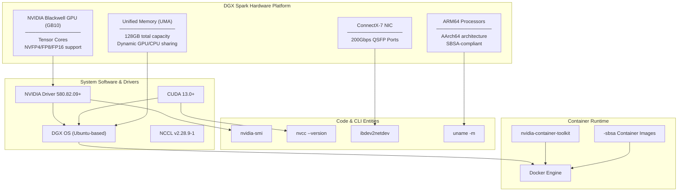
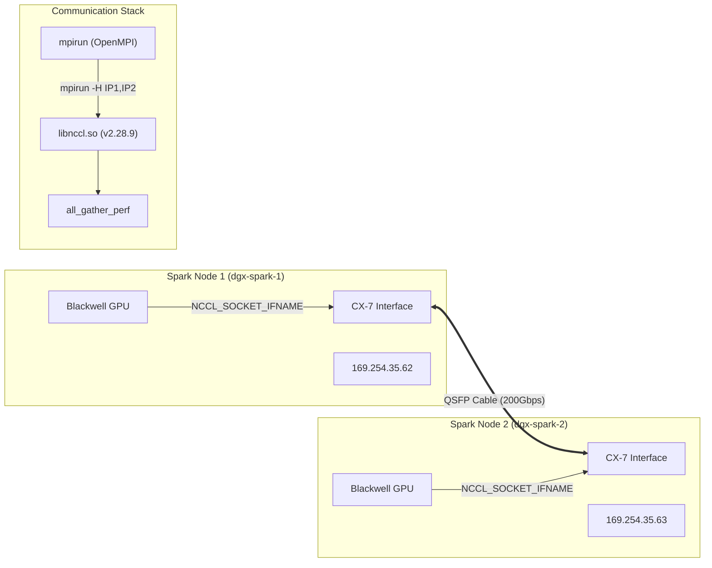

<!-- source: DeepWiki mcp.deepwiki.com · repo NVIDIA/dgx-spark-playbooks · page 1.1 Hardware Platform · fetched 2026-10-26 -->

# Hardware Platform

<details>
<summary>Relevant source files</summary>

The following files were used as context for generating this wiki page:

- [README.md](README.md)
- [nvidia/connect-two-sparks/README.md](nvidia/connect-two-sparks/README.md)
- [nvidia/cuda-x-data-science/README.md](nvidia/cuda-x-data-science/README.md)
- [nvidia/cuda-x-data-science/assets/cudf_pandas_demo.ipynb](nvidia/cuda-x-data-science/assets/cudf_pandas_demo.ipynb)
- [nvidia/cuda-x-data-science/assets/cuml_sklearn_demo.ipynb](nvidia/cuda-x-data-science/assets/cuml_sklearn_demo.ipynb)
- [nvidia/multi-modal-inference/README.md](nvidia/multi-modal-inference/README.md)
- [nvidia/nccl/README.md](nvidia/nccl/README.md)

</details>


## Purpose and Scope

This page describes the NVIDIA DGX Spark hardware specifications and architecture, including the Blackwell GPU, ARM64 processors, and Unified Memory Architecture (UMA). Understanding these hardware characteristics is essential for optimizing workloads, troubleshooting performance issues, and selecting appropriate container images.

For information about connecting to your Spark device over the network, see [Set Up Local Network Access](). For system management and monitoring, see [DGX Dashboard](). For advanced memory management techniques, see [Memory Management]().

---

## Hardware Architecture Overview

The DGX Spark is a high-performance workstation built on the NVIDIA Blackwell architecture, designed for local AI development, inference, and fine-tuning.

| Component | Specification | Code/System Entity |
| :--- | :--- | :--- |
| **GPU** | NVIDIA Blackwell (GB10) | `NVIDIA GB10` in `nvidia-smi` [nvidia/cuda-x-data-science/assets/cudf_pandas_demo.ipynb:57-57]() |
| **CPU** | ARM64 (AArch64) | `aarch64` in `uname -m` [nvidia/nccl/README.md:76-76]() |
| **Memory** | 128GB Unified Memory (UMA) | Shared pool for CPU/GPU [nvidia/multi-modal-inference/README.md:43-43]() |
| **Networking** | 200Gbps CX-7 Interconnect | `enp1s0f1np1` / `enp1s0f0np0` [nvidia/connect-two-sparks/README.md:92-97]() |

### System Architecture Diagram

Title: DGX Spark Hardware-to-Code Mapping


**Sources:** [README.md:8](), [nvidia/cuda-x-data-science/README.md:43-53](), [nvidia/nccl/README.md:17-20, 38-40, 48-48](), [nvidia/connect-two-sparks/README.md:85-97](), [nvidia/cuda-x-data-science/assets/cudf_pandas_demo.ipynb:51-60]()

---

## Blackwell GPU Architecture

The DGX Spark features the NVIDIA Blackwell GPU architecture (specifically the GB10 variant), which introduces advanced tensor acceleration and new precision formats.

### GPU Specifications and Precision

| Feature | Specification | Impact on Playbooks |
| :--- | :--- | :--- |
| **Compute Capability** | 10.x+ | Requires CUDA 13.0 [nvidia/cuda-x-data-science/README.md:51-51]() |
| **NVFP4 Support** | 4-bit Floating Point | Optimized inference [nvidia/multi-modal-inference/README.md:24-26]() |
| **FP8 Support** | 8-bit Floating Point | Standard for Blackwell inference [nvidia/multi-modal-inference/README.md:145-150]() |
| **VRAM Requirement** | ~48GB+ for large models | Critical for Flux.1 Schnell [nvidia/multi-modal-inference/README.md:163-164]() |

### GPU Verification
To verify the Blackwell GPU status and driver version:
```bash
nvidia-smi
```
Expected output identifies the device as `NVIDIA GB10` with `Driver Version: 580.82.09` and `CUDA Version: 13.0` [nvidia/cuda-x-data-science/assets/cudf_pandas_demo.ipynb:51-57]().

**Sources:** [nvidia/cuda-x-data-science/README.md:43-43](), [nvidia/multi-modal-inference/README.md:24-26, 163-164](), [nvidia/cuda-x-data-science/assets/cudf_pandas_demo.ipynb:49-70]()

---

## ARM64 Processor Architecture

DGX Spark utilizes the ARM64 (AArch64) architecture. This is a critical distinction for software compatibility, as standard x86_64 binaries and container images will not function.

### Architecture Implications for Containers
When pulling images from registries like NGC or Docker Hub, users must ensure the images are built for the ARM64 platform.

*   **SBSA Images:** Look for tags containing `-sbsa` (Server Base System Architecture) [nvidia/multi-modal-inference/README.md:45-45]().
*   **AArch64 Pathing:** System libraries are typically located in `/usr/lib/aarch64-linux-gnu/` [nvidia/nccl/README.md:76-76]().

### Verification Command
```bash
uname -m
# Output: aarch64
```

**Sources:** [nvidia/nccl/README.md:76-76](), [nvidia/multi-modal-inference/README.md:45-45]()

---

## Unified Memory Architecture (UMA)

DGX Spark implements a Unified Memory Architecture (UMA), where the CPU and GPU share a single physical pool of 128GB memory.

### Memory Characteristics
*   **Dynamic Sharing:** There is no fixed "VRAM" vs "System RAM" partition. Memory is allocated dynamically based on workload needs [nvidia/multi-modal-inference/README.md:43-43]().
*   **Buffer Management:** The Linux kernel may use free memory for buffer caches, which can occasionally conflict with large GPU allocations.
*   **Manual Cache Flushing:** To ensure maximum availability for large models, users may need to flush the system cache:
    ```bash
    sudo sh -c 'sync; echo 3 > /proc/sys/vm/drop_caches'
    ```

### Container Resource Limits
For UMA to function correctly within Docker, specific ulimits must be set to allow the container to lock and manage memory effectively:
```bash
docker run --gpus all --ipc=host --ulimit memlock=-1 --ulimit stack=67108864 ...
```
[nvidia/multi-modal-inference/README.md:98-101]()

**Sources:** [nvidia/multi-modal-inference/README.md:43-43, 98-101]()

---

## Multi-Node Connectivity

DGX Spark devices support high-speed inter-node communication via ConnectX-7 (CX-7) network interfaces and QSFP cabling.

### Physical Interconnect
Title: Multi-Spark Physical and Logical Connectivity


### Network Interface Identification
The primary high-speed interfaces are identified using the `ibdev2netdev` tool. Common interface names include:
*   `enp1s0f0np0`
*   `enp1s0f1np1` [nvidia/connect-two-sparks/README.md:92-97]()

### Collective Communication (NCCL)
For multi-node distributed training and inference, the NVIDIA Collective Communication Library (NCCL) must be built with Blackwell support (`sm_121` or `compute_121`) [nvidia/nccl/README.md:72-72]().

**Sources:** [nvidia/nccl/README.md:17-20, 70-79, 98-107, 141-150](), [nvidia/connect-two-sparks/README.md:85-97]()

---

## System Software Stack

The hardware is supported by a specialized software stack optimized for Blackwell and ARM64.

| Layer | Requirement | Verification |
| :--- | :--- | :--- |
| **Operating System** | DGX OS (Ubuntu-based) | `cat /etc/os-release` |
| **NVIDIA Driver** | 580.82.09+ | `nvidia-smi` [nvidia/cuda-x-data-science/assets/cudf_pandas_demo.ipynb:51-51]() |
| **CUDA Toolkit** | 13.0+ | `nvcc --version` [nvidia/nccl/README.md:39-39]() |
| **Container Engine** | Docker with `nvidia-container-runtime` | `docker ps` [nvidia/multi-modal-inference/README.md:82-82]() |

### Docker Configuration
To manage GPU workloads without root privileges, the user must be added to the `docker` group:
```bash
sudo usermod -aG docker $USER
newgrp docker
```
[nvidia/multi-modal-inference/README.md:88-89]()

**Sources:** [nvidia/nccl/README.md:38-40](), [nvidia/multi-modal-inference/README.md:39-41, 82-89](), [nvidia/cuda-x-data-science/assets/cudf_pandas_demo.ipynb:51-51]()

---

