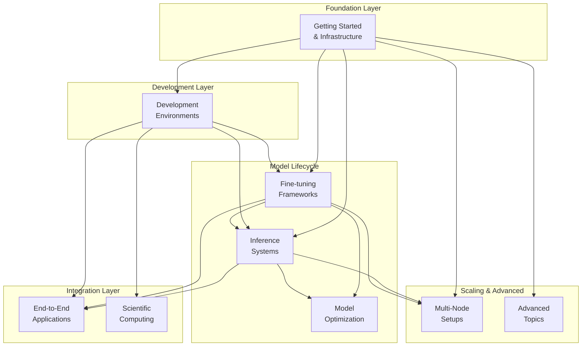
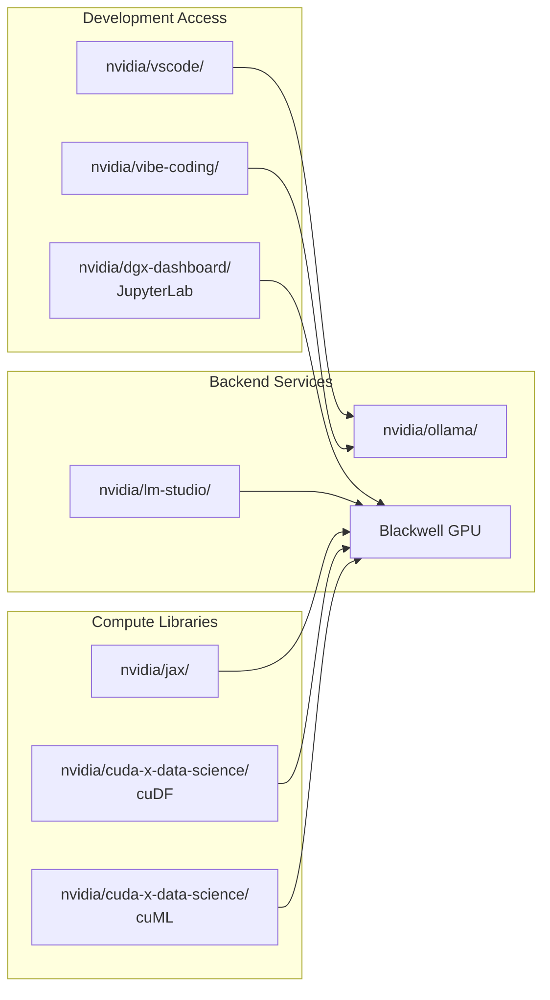
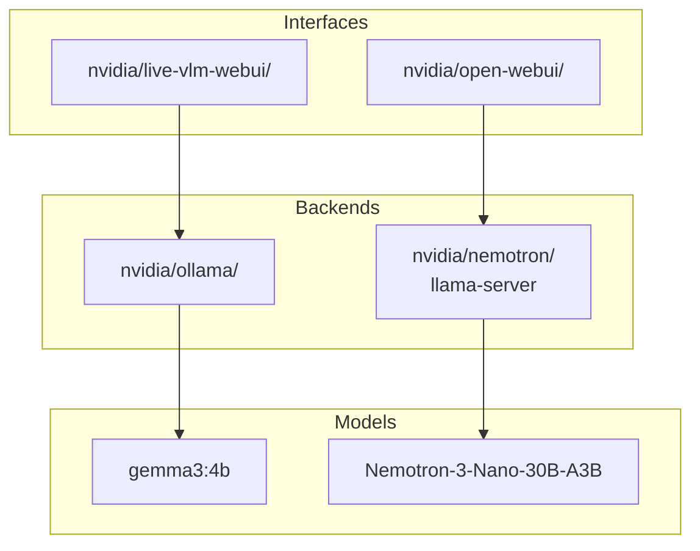
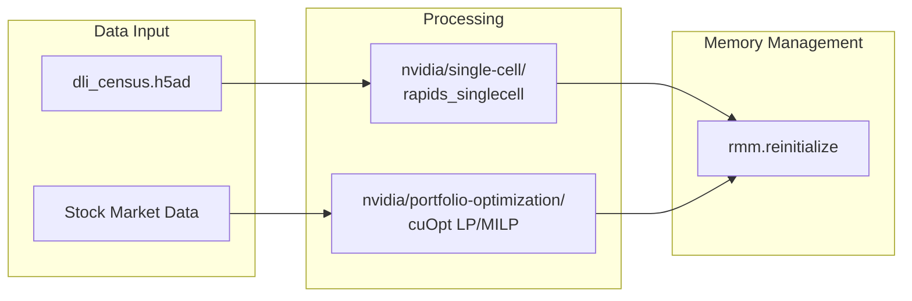

<!-- source: DeepWiki mcp.deepwiki.com · repo NVIDIA/dgx-spark-playbooks · page 1.2 Playbook Categories · fetched 2026-10-26 -->

# Playbook Categories

Relevant source files

The following files were used as context for generating this wiki page:

- [README.md](README.md)
- [nvidia/cuda-x-data-science/README.md](nvidia/cuda-x-data-science/README.md)
- [nvidia/cuda-x-data-science/assets/cudf_pandas_demo.ipynb](nvidia/cuda-x-data-science/assets/cudf_pandas_demo.ipynb)
- [nvidia/cuda-x-data-science/assets/cuml_sklearn_demo.ipynb](nvidia/cuda-x-data-science/assets/cuml_sklearn_demo.ipynb)
- [nvidia/live-vlm-webui/README.md](nvidia/live-vlm-webui/README.md)
- [nvidia/nemotron/README.md](nvidia/nemotron/README.md)
- [nvidia/portfolio-optimization/README.md](nvidia/portfolio-optimization/README.md)
- [nvidia/single-cell/README.md](nvidia/single-cell/README.md)
- [nvidia/single-cell/assets/scRNA_analysis_preprocessing.ipynb](nvidia/single-cell/assets/scRNA_analysis_preprocessing.ipynb)

## Purpose and Scope

This document provides an organized overview of the playbook categories available in the DGX Spark Playbooks repository. It helps users navigate to relevant playbooks based on their objectives—whether setting up infrastructure, developing AI applications, running inference, fine-tuning models, or deploying complete solutions.

For hardware specifications, see [Hardware Platform](#1.1). For initial setup instructions, see [Getting Started](#2).

---

## Overview of Categories

The DGX Spark Playbooks are organized into functional categories that span from initial setup through model deployment and optimization.

**Category Architecture**

The diagram above illustrates how categories build upon each other. The **Foundation Layer** (Getting Started) must be completed first. **Development Environments** provide tools for prototyping. The **Model Lifecycle** categories (Fine-tuning, Inference, Optimization) represent the core AI workflow. **Integration Layer** (Applications and Scientific Computing) combines multiple components into solutions. **Scaling & Advanced** categories address production requirements.

Sources: [README.md:1-63]()

---

## Category Details

### 1. Getting Started & Infrastructure

**Purpose**: Establish connectivity, access, and system management capabilities.

**Playbooks**:

| Playbook | Directory | Purpose |
|----------|-----------|---------|
| Set Up Local Network Access | `nvidia/connect-to-your-spark/` | SSH access, mDNS hostname resolution | [README.md:26]() |
| Set up Tailscale | `nvidia/tailscale/` | Encrypted P2P VPN for remote access | [README.md:56]() |
| DGX Dashboard | `nvidia/dgx-dashboard/` | Web-based system management (port 11000) | [README.md:29]() |

---

### 2. Development Environments

**Purpose**: Provide interactive development tools with GPU acceleration for coding and data science.

**Playbooks**:

| Playbook | Directory | Purpose |
|----------|-----------|---------|
| Vibe Coding in VS Code | `nvidia/vibe-coding/` | VS Code + Continue extension + Ollama | [README.md:60]() |
| CUDA-X Data Science | `nvidia/cuda-x-data-science/` | cuDF (pandas-like), cuML (sklearn-like) | [README.md:28]() |
| Optimized JAX | `nvidia/jax/` | XLA-optimized NumPy-like API with marimo | [README.md:32]() |
| LM Studio | `nvidia/lm-studio/` | Headless LLM serving and remote access | [README.md:35]() |

**Development Environment Architecture**:

This diagram maps directory paths to development components. The `nvidia/vscode/` and `nvidia/vibe-coding/` playbooks set up remote development, while `nvidia/jax/` and `nvidia/cuda-x-data-science/` provide GPU-accelerated libraries. `nvidia/cuda-x-data-science/` specifically leverages `cuDF` for data preparation and `cuML` for machine learning algorithms like `UMAP` and `HDBSCAN` [nvidia/cuda-x-data-science/README.md:18-19]().

Sources: [README.md:28,32,35,60,62](), [nvidia/cuda-x-data-science/README.md:18-19]()

---

### 3. Inference Systems

**Purpose**: Deploy production-ready model serving infrastructure with different optimization strategies.

**Playbooks**:

| Playbook | Directory | Purpose |
|----------|-----------|---------|
| vLLM | `nvidia/vllm/` | PagedAttention, continuous batching | [README.md:61]() |
| TensorRT-LLM | `nvidia/trt-llm/` | Kernel optimization, FP8/NVFP4 | [README.md:57]() |
| NIM on Spark | `nvidia/nim-llm/` | Containerized microservices | [README.md:43]() |
| Ollama | `nvidia/ollama/` | Simplified API, local model management | [README.md:45]() |
| SGLang | `nvidia/sglang/` | High-throughput LLM and VLM serving | [README.md:52]() |

Sources: [README.md:43,45,52,57,61]()

---

### 4. Fine-tuning Frameworks

**Purpose**: Adapt pre-trained models to specific tasks and datasets.

**Playbooks**:

| Playbook | Directory | Purpose |
|----------|-----------|---------|
| LLaMA Factory | `nvidia/llama-factory/` | Unified CLI/WebUI for SFT, LoRA, QLoRA | [README.md:34]() |
| PyTorch Fine-tune | `nvidia/pytorch-fine-tune/` | Custom scripts with PEFT library | [README.md:50]() |
| NeMo Fine-tune | `nvidia/nemo-fine-tune/` | Enterprise-scale distributed training | [README.md:40]() |
| Unsloth | `nvidia/unsloth/` | Memory-efficient fine-tuning kernels | [README.md:59]() |
| FLUX.1 Dreambooth | `nvidia/flux-finetuning/` | Custom image generation fine-tuning | [README.md:30]() |

Sources: [README.md:30,34,40,50,59]()

---

### 5. End-to-End Applications

**Purpose**: Complete examples combining inference, fine-tuning, and logic into functional solutions.

**Playbooks**:

| Playbook | Directory | Purpose |
|----------|-----------|---------|
| Open WebUI | `nvidia/open-webui/` | Chat interface with Ollama integration | [README.md:46]() |
| Video Search & Summarization | `nvidia/vss/` | DeepStream CV + VLM analysis | [README.md:63]() |
| Live VLM WebUI | `nvidia/live-vlm-webui/` | Real-time webcam streaming to VLM | [README.md:33]() |
| Nemotron with llama.cpp | `nvidia/nemotron/` | NVIDIA MoE model serving | [README.md:42]() |
| Text to Knowledge Graph | `nvidia/txt2kg/` | Convert text to structured graphs | [README.md:58]() |
| Spark & Reachy | `nvidia/spark-reachy-photo-booth/` | Robotics + AI photo booth | [README.md:54]() |

**Application Logic Flow**:

`nvidia/live-vlm-webui/` provides a WebRTC interface for real-time analysis using backends like Ollama [nvidia/live-vlm-webui/README.md:21-23](). `nvidia/nemotron/` uses `llama-server` to serve the 30B parameter MoE model [nvidia/nemotron/README.md:122-134]().

Sources: [nvidia/live-vlm-webui/README.md:21-23](), [nvidia/nemotron/README.md:122-134](), [README.md:33,42,46,54,58,63]()

---

### 6. Scientific Computing

**Purpose**: GPU-accelerated applications for domain-specific research.

**Playbooks**:

| Playbook | Directory | Purpose |
|----------|-----------|---------|
| Portfolio Optimization | `nvidia/portfolio-optimization/` | cuOpt + cuML for Mean-CVaR models | [README.md:49]() |
| Single-cell RNA Sequencing | `nvidia/single-cell/` | RAPIDS-singlecell for genomic analysis | [README.md:53]() |
| Isaac Sim/Lab | `nvidia/isaac/` | Robotics simulation and RL | [README.md:31]() |

**Scientific Data Flow**:

`nvidia/single-cell/` uses `rapids-singlecell` to process large genomic datasets, leveraging the RAPIDS Memory Manager (`rmm`) for VRAM optimization [nvidia/single-cell/assets/scRNA_analysis_preprocessing.ipynb:63,92](). `nvidia/portfolio-optimization/` uses `cuOpt` solvers for risk modeling and strategy backtesting [nvidia/portfolio-optimization/README.md:17-24]().

Sources: [nvidia/single-cell/assets/scRNA_analysis_preprocessing.ipynb:63,92](), [nvidia/portfolio-optimization/README.md:17-24](), [README.md:31,49,53]()

---

### 7. Multi-Node Setups

**Purpose**: Configure distributed workloads across multiple DGX Spark devices.

**Playbooks**:

| Playbook | Directory | Purpose |
|----------|-----------|---------|
| Connect Two Sparks | `nvidia/connect-two-sparks/` | Physical and network setup | [README.md:27]() |
| Multi-Sparks through Switch | `nvidia/multi-sparks-through-switch/` | Automated cluster configuration | [README.md:38]() |
| NCCL for Two Sparks | `nvidia/nccl/` | GPU-to-GPU communication config | [README.md:39]() |

Sources: [README.md:27,38,39]()

---

### 8. Model Optimization

**Purpose**: Reduce model memory footprint and increase inference speed.

**Playbooks**:

| Playbook | Directory | Purpose |
|----------|-----------|---------|
| NVFP4 Quantization | `nvidia/nvfp4-quantization/` | 4-bit floating point quantization | [README.md:44]() |
| Speculative Decoding | `nvidia/speculative-decoding/` | Draft model acceleration | [README.md:55]() |

Sources: [README.md:44,55]()

---

