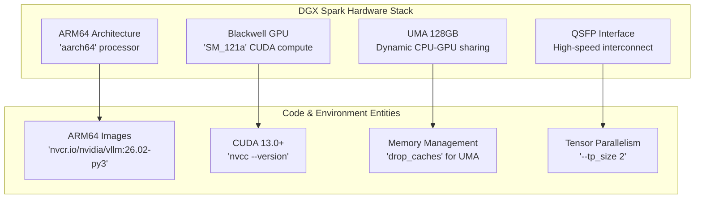
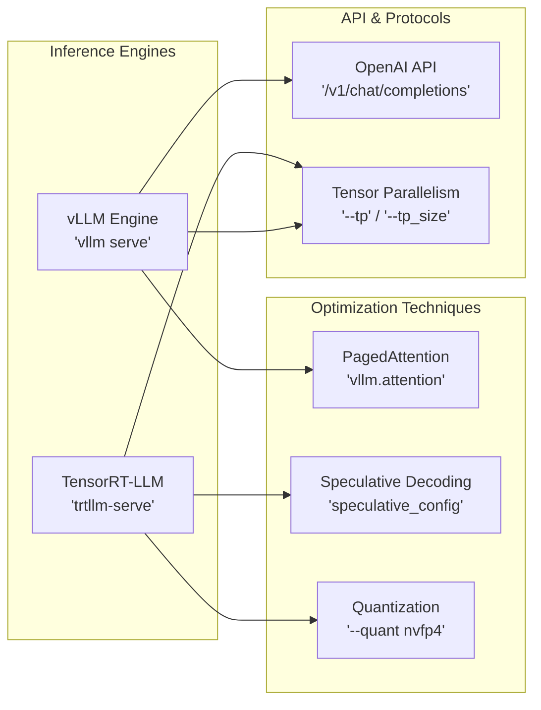

<!-- source: DeepWiki mcp.deepwiki.com · repo NVIDIA/dgx-spark-playbooks · page 10.1 Terminology Glossary · fetched 2026-10-26 -->

# Terminology Glossary

Relevant source files

The following files were used as context for generating this wiki page:

- [nvidia/llama-factory/README.md](nvidia/llama-factory/README.md)
- [nvidia/nemo-fine-tune/README.md](nvidia/nemo-fine-tune/README.md)
- [nvidia/nvfp4-quantization/README.md](nvidia/nvfp4-quantization/README.md)
- [nvidia/speculative-decoding/README.md](nvidia/speculative-decoding/README.md)
- [nvidia/trt-llm/README.md](nvidia/trt-llm/README.md)
- [nvidia/vllm/README.md](nvidia/vllm/README.md)

This glossary defines key technical terms used throughout the DGX Spark Playbooks. Terms are organized by category for easy reference. For detailed implementation guides, see the individual playbook pages referenced in each definition.

---

## Hardware & Architecture Terms

### ARM64
The 64-bit ARM processor architecture used by DGX Spark devices. Requires ARM64-compatible container images and may have package availability differences compared to x86_64 systems. Referenced in [nvidia/vllm/README.md:29-41]() and [nvidia/nemo-fine-tune/README.md:17-18]().

**Sources:** [nvidia/vllm/README.md:29-41](), [nvidia/nemo-fine-tune/README.md:17-18]()

### Blackwell GPU Architecture
NVIDIA's GPU architecture featured in DGX Spark devices, providing advanced AI acceleration capabilities. Supports native FP4/FP8 precision formats and Unified Memory Architecture.

**Sources:** [nvidia/vllm/README.md:27-41](), [nvidia/nvfp4-quantization/README.md:17-20](), [nvidia/nemo-fine-tune/README.md:17-18]()

### DGX Spark
NVIDIA's workstation-class AI development platform featuring Blackwell GPU architecture, ARM64 processors, and Unified Memory Architecture with 128GB total memory capacity.

**Sources:** [nvidia/vllm/README.md:27-41](), [nvidia/trt-llm/README.md:3-4](), [nvidia/speculative-decoding/README.md:39-41]()

### QSFP (Quad Small Form-factor Pluggable)
High-speed network interface standard used for 200GbE direct connections between DGX Spark nodes. Used to double available memory (to 256GB) and enable tensor parallelism across two devices.

**Sources:** [nvidia/speculative-decoding/README.md:41-43](), [nvidia/vllm/README.md:9-10]()

### UMA (Unified Memory Architecture)
Memory architecture that enables dynamic sharing between CPU and GPU on DGX Spark. A single Spark has 128GB of unified memory. While enabling flexible allocation, it may require manual buffer cache flushing on some systems to reclaim memory.

**Sources:** [nvidia/speculative-decoding/README.md:39-41](), [nvidia/llama-factory/README.md:210-211]()

**DGX Spark Hardware Stack to Code Entities**

**Sources:** [nvidia/vllm/README.md:27-45](), [nvidia/speculative-decoding/README.md:39-43](), [nvidia/llama-factory/README.md:210-211]()

---

## Inference Engines & Techniques

### Continuous Batching
vLLM optimization technique that allows new inference requests to be dynamically added to batches already in process, maximizing GPU utilization by avoiding idle time between batches.

**Sources:** [nvidia/vllm/README.md:22]()

### EAGLE-3
A speculative decoding method that uses a built-in drafting head to generate speculative tokens internally by fusing features from multiple layers. It provides faster generation and better accuracy than standard draft models.

**Sources:** [nvidia/speculative-decoding/README.md:104-165]()

### PagedAttention
Memory-efficient attention algorithm used by vLLM that manages KV cache in non-contiguous memory blocks (pages), enabling efficient handling of long sequences without memory fragmentation.

**Sources:** [nvidia/vllm/README.md:21]()

### Speculative Decoding
Inference acceleration technique using a small, fast model (or draft head) to predict several tokens ahead, which are then verified by the larger target model in a single forward pass.

**Sources:** [nvidia/speculative-decoding/README.md:29-31]()

### Tensor Parallelism (TP)
Technique for distributing model layers across multiple GPUs or nodes. Each node holds a portion of every layer's weight matrices. Configured via `--tp_size` (TRT-LLM) or `--tensor-parallel-size` (vLLM).

**Sources:** [nvidia/speculative-decoding/README.md:41-43](), [nvidia/vllm/README.md:139]()

### TRT-LLM (TensorRT-LLM)
NVIDIA's open-source library for optimizing LLM inference. It provides efficient kernels, memory management, and parallelism strategies (tensor, pipeline, sequence).

**Sources:** [nvidia/trt-llm/README.md:36-40]()

### vLLM
High-throughput inference engine designed to run large models efficiently using PagedAttention and continuous batching. Supports an OpenAI-compatible API.

**Sources:** [nvidia/vllm/README.md:19-23]()

**Inference Engine Components to Code Entities**

**Sources:** [nvidia/vllm/README.md:19-23](), [nvidia/trt-llm/README.md:36-40](), [nvidia/speculative-decoding/README.md:125-141](), [nvidia/nvfp4-quantization/README.md:128-129]()

---

## Fine-tuning Methods

### LoRA (Low-Rank Adaptation)
Parameter-efficient fine-tuning (PEFT) technique that trains small adapter matrices instead of full model weights. Supported by NeMo, LLaMA Factory, and Unsloth.

**Sources:** [nvidia/nemo-fine-tune/README.md:151-164](), [nvidia/llama-factory/README.md:24-25]()

### QLoRA (Quantized LoRA)
Memory-efficient fine-tuning combining 4-bit quantization of the base model with LoRA adapters. This allows fine-tuning 70B+ parameter models on single Spark devices.

**Sources:** [nvidia/nemo-fine-tune/README.md:51](), [nvidia/llama-factory/README.md:18-20]()

### SFT (Supervised Fine-Tuning)
The process of fine-tuning a pre-trained model on a labeled dataset of instruction-response pairs.

**Sources:** [nvidia/nemo-fine-tune/README.md:21](), [nvidia/llama-factory/README.md:18]()

### NeMo AutoModel
NVIDIA framework providing GPU-accelerated, end-to-end training for Hugging Face models with native PyTorch support. Supports distributed training and FP8 precision optimizations.

**Sources:** [nvidia/nemo-fine-tune/README.md:17-21]()

---

## Model Optimization & Formats

### FP4 / NVFP4
A 4-bit floating-point format introduced with NVIDIA Blackwell GPUs. It reduces memory usage by ~3.5x vs FP16 while maintaining accuracy close to FP8. Native Blackwell Tensor Cores support mixed-precision execution using FP4.

**Sources:** [nvidia/nvfp4-quantization/README.md:17-25]()

### FP8 (8-bit Floating Point)
8-bit precision format that provides a balance between memory savings (50% vs FP16) and model accuracy. Supported natively by Blackwell GPUs.

**Sources:** [nvidia/vllm/README.md:59](), [nvidia/nemo-fine-tune/README.md:21]()

### GGUF
Model format commonly used with Ollama and llama.cpp for quantized model storage and execution.

**Sources:** (Referenced in context of Unsloth export and Ollama support)

### MoE (Mixture of Experts)
A model architecture where only a subset of parameters (experts) are activated for each input token, allowing for larger total parameter counts with lower computational cost per token. Examples include Nemotron-3-Nano.

**Sources:** [nvidia/vllm/README.md:75-76]()

### Quantization
The process of reducing the numerical precision of model weights and activations (e.g., from FP16 to FP8 or FP4) to reduce memory footprint and increase throughput.

**Sources:** [nvidia/nvfp4-quantization/README.md:17-20](), [nvidia/trt-llm/README.md:46]()

---

## Communication & Networking

### NCCL (NVIDIA Collective Communications Library)
GPU-optimized communication library for multi-GPU and multi-node operations. It enables high-bandwidth communication over QSFP links for tensor parallelism.

**Sources:** [nvidia/speculative-decoding/README.md:41-43]()

### OpenMPI
An implementation of the Message Passing Interface (MPI) used by TensorRT-LLM to coordinate distributed inference processes across multiple nodes using a `hostfile`.

**Sources:** [nvidia/trt-llm/README.md:12-19](), [nvidia/speculative-decoding/README.md:16-17]()

### Unified Memory Management
On DGX Spark, the 128GB of memory is shared. Large models like GPT-OSS-120B can run on a single Spark, but models like Qwen3-235B require two Sparks (256GB) to accommodate weights, KV cache, and draft heads.

**Sources:** [nvidia/speculative-decoding/README.md:39-41]()

---

## Key Configuration Files & Tools

| Tool/File | Purpose | Source |
|-----------|---------|--------|
| `nvidia-smi` | Monitor GPU utilization and memory | [nvidia/vllm/README.md:136]() |
| `nvcc --version` | Check CUDA toolkit version | [nvidia/vllm/README.md:42]() |
| `HF_TOKEN` | Environment variable for Hugging Face authentication | [nvidia/trt-llm/README.md:147]() |
| `hostfile` | List of node IPs for OpenMPI/TRT-LLM multi-node | [nvidia/trt-llm/README.md:12-15]() |
| `finetune.py` | NeMo AutoModel entry point for fine-tuning | [nvidia/nemo-fine-tune/README.md:159]() |
| `llamafactory-cli` | Command line interface for LLaMA Factory | [nvidia/llama-factory/README.md:142]() |
| `Model-Optimizer` | Tool for NVFP4 quantization | [nvidia/nvfp4-quantization/README.md:123]() |

**Sources:** [nvidia/vllm/README.md:42-136](), [nvidia/trt-llm/README.md:12-147](), [nvidia/nemo-fine-tune/README.md:159](), [nvidia/llama-factory/README.md:142](), [nvidia/nvfp4-quantization/README.md:123]()

---

