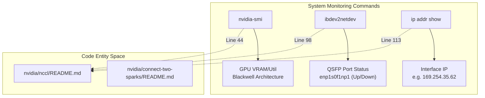
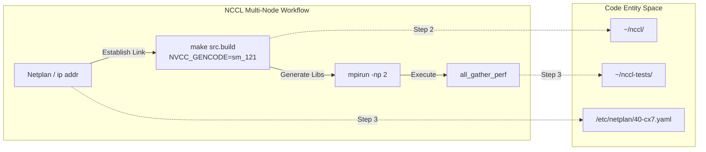

<!-- source: DeepWiki mcp.deepwiki.com · repo NVIDIA/dgx-spark-playbooks · page 10.2 Command Reference · fetched 2026-10-26 -->

# Command Reference

<details>
<summary>Relevant source files</summary>

The following files were used as context for generating this wiki page:

- [nvidia/connect-to-your-spark/README.md](nvidia/connect-to-your-spark/README.md)
- [nvidia/connect-two-sparks/README.md](nvidia/connect-two-sparks/README.md)
- [nvidia/multi-modal-inference/README.md](nvidia/multi-modal-inference/README.md)
- [nvidia/nccl/README.md](nvidia/nccl/README.md)
- [nvidia/open-webui/README.md](nvidia/open-webui/README.md)

</details>


This page provides a quick reference of commonly used commands for managing DGX Spark systems, covering Docker operations, GPU monitoring, model management, networking, and multi-node configurations. Commands are extracted from actual playbooks and organized by functional category for rapid lookup during deployment and troubleshooting.

For detailed step-by-step procedures, see the relevant playbook pages: inference systems ([4]()), fine-tuning ([5]()), and multi-node setups ([7]()). For system architecture and configuration details, see [Docker and Container Configuration](#9.2) and [Troubleshooting Guide](#9.4).

---

## Docker Container Management

### Basic Container Operations

| Operation | Command | Purpose |
|-----------|---------|---------|
| **Pull Image** | `docker pull ghcr.io/open-webui/open-webui:ollama` | Download container from registry |
| **Run Interactive** | `docker run -it --gpus all --rm <image> bash` | Start container with shell access |
| **List Running** | `docker ps` | Show active containers |
| **Add User to Group** | `sudo usermod -aG docker $USER` | Allow running docker without sudo |
| **Apply Group** | `newgrp docker` | Apply group changes to current session |
| **View Logs** | `docker logs <container>` | Display container output |

**Sources:** [nvidia/open-webui/README.md:77-78](), [nvidia/open-webui/README.md:62-64](), [nvidia/multi-modal-inference/README.md:81-83]()

### GPU-Enabled Container Patterns

```bash
# Standard GPU access with all GPUs
docker run --gpus all <image>

# Container with memory limits and stack size for Blackwell UMA
docker run --gpus all --ipc=host --ulimit memlock=-1 \
--ulimit stack=67108864 -it --rm \
-v $HOME/.cache/huggingface:/root/.cache/huggingface \
nvcr.io/nvidia/pytorch:25.11-py3
```

**Sources:** [nvidia/multi-modal-inference/README.md:98-102](), [nvidia/open-webui/README.md:132-135]()

---

## GPU and System Monitoring

### Core Monitoring Commands

| Command | Purpose | Output |
|---------|---------|--------|
| `nvidia-smi` | GPU status overview | Utilization, memory, temperature |
| `ibdev2netdev` | Check QSFP interface status | Network port availability (Up/Down) |
| `ip addr show <interface>` | View IP configuration | IP address for specific network port |
| `whoami` | Verify current user | Current logged-in username |

**Sources:** [nvidia/multi-modal-inference/README.md:44](), [nvidia/nccl/README.md:98-99](), [nvidia/connect-two-sparks/README.md:66](), [nvidia/nccl/README.md:113-115]()



**Diagram: System Monitoring Command Flow**
**Sources:** [nvidia/nccl/README.md:98-115](), [nvidia/connect-two-sparks/README.md:92-97]()

---

## Model Management

### Hugging Face Hub Operations

```bash
# Set Hugging Face token environment variable
export HF_TOKEN=<YOUR_HUGGING_FACE_TOKEN>

# Download models using Python scripts (Multi-modal example)
python3 demo_txt2img_flux.py "prompt" --hf-token=$HF_TOKEN --download-onnx-models --bf16

# Open WebUI model pull (via UI/Ollama)
# Search: gpt-oss:20b
```

**Sources:** [nvidia/multi-modal-inference/README.md:131-132](), [nvidia/multi-modal-inference/README.md:141-142](), [nvidia/open-webui/README.md:171-172]()

### Model Cache Management

| Operation | Command | Purpose |
|-----------|---------|---------|
| **Mount Cache** | `-v $HOME/.cache/huggingface:/root/.cache/huggingface` | Persistent storage for models |
| **Volume Mount** | `-v open-webui-ollama:/root/.ollama` | Docker volume for Ollama models |
| **Cleanup** | `rm -rf ~/nccl/ && rm -rf ~/nccl-tests/` | Remove build artifacts |

**Sources:** [nvidia/multi-modal-inference/README.md:100](), [nvidia/open-webui/README.md:134](), [nvidia/nccl/README.md:173-174]()

---

## Network and SSH

### SSH Configuration

```bash
# Add public key to authorized_keys (Manual)
echo "ssh-ed25519 AAA..." >> ~/.ssh/authorized_keys

# NVIDIA Sync Automatic Setup
# 1. Generates SSH key pair on laptop
# 2. Adds public key to ~/.ssh/authorized_keys
# 3. Creates local SSH alias
```

**Sources:** [nvidia/connect-to-your-spark/README.md:69](), [nvidia/connect-to-your-spark/README.md:152-155]()

### Network Interface Configuration (Multi-Node)

```bash
# Option 1: Netplan Automatic Link-Local (enp1s0f0np0, enp1s0f1np1)
sudo tee /etc/netplan/40-cx7.yaml <<EOF
network:
  version: 2
  ethernets:
    enp1s0f0np0:
      link-local: [ ipv4 ]
    enp1s0f1np1:
      link-local: [ ipv4 ]
EOF
sudo netplan apply

# Option 2: Manual IP via CLI
sudo ip addr add 192.168.100.10/24 dev enp1s0f1np1
sudo ip link set enp1s0f1np1 up
```

**Sources:** [nvidia/connect-two-sparks/README.md:119-133](), [nvidia/connect-two-sparks/README.md:228-229]()

---

## Multi-Node Operations

### NCCL Performance Testing

```bash
# Set network interface environment variables
export UCX_NET_DEVICES=enp1s0f1np1
export NCCL_SOCKET_IFNAME=enp1s0f1np1
export OMPI_MCA_btl_tcp_if_include=enp1s0f1np1

# Run all_gather test across two nodes
mpirun -np 2 -H <IP_Node1>:1,<IP_Node2>:1 \
  --mca plm_rsh_agent "ssh -o UserKnownHostsFile=/dev/null -o StrictHostKeyChecking=no" \
  -x LD_LIBRARY_PATH=$LD_LIBRARY_PATH \
  $HOME/nccl-tests/build/all_gather_perf -b 16G -e 16G -f 2
```

**Sources:** [nvidia/nccl/README.md:141-150](), [nvidia/nccl/README.md:161-164]()



**Diagram: NCCL Setup and Test Execution**
**Sources:** [nvidia/nccl/README.md:62-90](), [nvidia/connect-two-sparks/README.md:119-133]()

---

## Service Management

### NVIDIA Sync App Configuration

| Application | Port | Action |
|-------------|------|--------|
| **DGX Dashboard** | 11000 | System management & JupyterLab |
| **Open WebUI** | 12000 | Custom port mapping to container 8080 |
| **Terminal** | 22 | Automatic SSH connection |

**Sources:** [nvidia/connect-to-your-spark/README.md:122-124](), [nvidia/open-webui/README.md:97-135]()

### Docker Cleanup

```bash
# Stop and remove specific container
docker stop open-webui
docker rm open-webui

# Stop script execution (NVIDIA Sync)
# Ctrl+C in terminal stops the tunnel and container via trap
```

**Sources:** [nvidia/open-webui/README.md:108-113](), [nvidia/open-webui/README.md:188-189]()

---

## Quick Reference Tables

### Common Interface Names

| Physical Port | Logical Name 1 | Logical Name 2 | Status |
|---------------|----------------|----------------|--------|
| Port 1 | `enp1s0f0np0` | `enP2p1s0f0np0` | Management/Data |
| Port 2 | `enp1s0f1np1` | `enP2p1s0f1np1` | Management/Data |

**Sources:** [nvidia/connect-two-sparks/README.md:92-97](), [nvidia/nccl/README.md:103-106]()

### Multi-modal Precision Formats

| Format | VRAM Requirement | Script Flag |
|--------|------------------|-------------|
| BF16 | ~48GB (Flux Schnell) | `--bf16` |
| FP8 | Lower | `--fp8 --quantization-level 4` |
| FP4 | Lowest | `--fp4` |

**Sources:** [nvidia/multi-modal-inference/README.md:142-157](), [nvidia/multi-modal-inference/README.md:164-166]()

---

**Sources:**
- `nvidia/connect-to-your-spark/README.md`
- `nvidia/multi-modal-inference/README.md`
- `nvidia/nccl/README.md`
- `nvidia/open-webui/README.md`
- `nvidia/connect-two-sparks/README.md`

---

