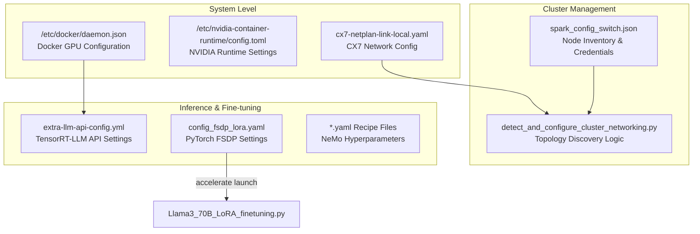

<!-- source: DeepWiki mcp.deepwiki.com · repo NVIDIA/dgx-spark-playbooks · page 10.3 Configuration Files · fetched 2026-10-26 -->

# Configuration Files

<details>
<summary>Relevant source files</summary>

The following files were used as context for generating this wiki page:

- [nvidia/multi-sparks-through-switch/assets/cx7-netplan-link-local.yaml](nvidia/multi-sparks-through-switch/assets/cx7-netplan-link-local.yaml)
- [nvidia/multi-sparks-through-switch/assets/spark_cluster_setup/config/spark_config_b2b.json](nvidia/multi-sparks-through-switch/assets/spark_cluster_setup/config/spark_config_b2b.json)
- [nvidia/multi-sparks-through-switch/assets/spark_cluster_setup/config/spark_config_ring.json](nvidia/multi-sparks-through-switch/assets/spark_cluster_setup/config/spark_config_ring.json)
- [nvidia/multi-sparks-through-switch/assets/spark_cluster_setup/config/spark_config_switch.json](nvidia/multi-sparks-through-switch/assets/spark_cluster_setup/config/spark_config_switch.json)
- [nvidia/multi-sparks-through-switch/assets/spark_cluster_setup/node_scripts/detect_and_configure_cluster_networking.py](nvidia/multi-sparks-through-switch/assets/spark_cluster_setup/node_scripts/detect_and_configure_cluster_networking.py)
- [nvidia/multi-sparks-through-switch/assets/spark_cluster_setup/requirements.txt](nvidia/multi-sparks-through-switch/assets/spark_cluster_setup/requirements.txt)
- [nvidia/pytorch-fine-tune/assets/configs/config_finetuning.yaml](nvidia/pytorch-fine-tune/assets/configs/config_finetuning.yaml)
- [nvidia/pytorch-fine-tune/assets/configs/config_fsdp_lora.yaml](nvidia/pytorch-fine-tune/assets/configs/config_fsdp_lora.yaml)
- [nvidia/pytorch-fine-tune/assets/install-requirements](nvidia/pytorch-fine-tune/assets/install-requirements)
- [nvidia/pytorch-fine-tune/assets/pytorch-ft-entrypoint.sh](nvidia/pytorch-fine-tune/assets/pytorch-ft-entrypoint.sh)
- [nvidia/pytorch-fine-tune/assets/run-multi-llama_3b](nvidia/pytorch-fine-tune/assets/run-multi-llama_3b)
- [nvidia/pytorch-fine-tune/assets/run-multi-llama_70b](nvidia/pytorch-fine-tune/assets/run-multi-llama_70b)

</details>


This page documents the configuration files used throughout the DGX Spark Playbooks. These files control container runtime behavior, inference engine parameters, fine-tuning recipes, cluster networking, and system-level GPU access. Understanding these configuration files is essential for customizing deployments and optimizing performance.

For information about command-line interfaces and shell commands, see [Command Reference](10.2). For terminology used in configuration parameters, see [Terminology Glossary](10.1).

---

## Overview of Configuration File Types

The playbooks utilize several categories of configuration files, each serving different purposes in the system architecture.



**Configuration File Hierarchy**

Sources: [nvidia/multi-sparks-through-switch/assets/spark_cluster_setup/config/spark_config_switch.json:1-28](), [nvidia/pytorch-fine-tune/assets/configs/config_fsdp_lora.yaml:1-29](), [nvidia/multi-sparks-through-switch/assets/cx7-netplan-link-local.yaml:18-24]()

---

## Cluster and Network Configuration

For multi-node setups, Spark utilizes specific JSON and YAML files to define node relationships and network interface behaviors.

### Spark Cluster Inventory
Files: `spark_config_b2b.json`, `spark_config_ring.json`, `spark_config_switch.json`

These files define the management IP addresses, SSH ports, and credentials for the nodes in a Spark cluster. They are consumed by the setup scripts to orchestrate multi-node configuration.

| File | Topology | Nodes | Reference |
|------|----------|-------|-----------|
| `spark_config_b2b.json` | Back-to-Back | 2 | [nvidia/multi-sparks-through-switch/assets/spark_cluster_setup/config/spark_config_b2b.json:1-16]() |
| `spark_config_ring.json` | Ring | 3 | [nvidia/multi-sparks-through-switch/assets/spark_cluster_setup/config/spark_config_ring.json:1-22]() |
| `spark_config_switch.json` | Switched | 4+ | [nvidia/multi-sparks-through-switch/assets/spark_cluster_setup/config/spark_config_switch.json:1-28]() |

### Netplan for ConnectX-7 (CX7)
File: `cx7-netplan-link-local.yaml`

This configuration enables IPv4 link-local addressing on the high-speed ConnectX-7 interfaces used for GPU-to-GPU communication.

```yaml
network:
  version: 2
  ethernets:
    enp1s0f1np1:
      link-local: [ ipv4 ]
    enP2p1s0f1np1:
      link-local: [ ipv4 ]
```
Sources: [nvidia/multi-sparks-through-switch/assets/cx7-netplan-link-local.yaml:18-24]()

### Topology Discovery Logic
File: `detect_and_configure_cluster_networking.py`

This script uses L2 broadcast discovery to map physical connections. It targets specific interfaces defined in `DISCOVERY_INTERFACES` [nvidia/multi-sparks-through-switch/assets/spark_cluster_setup/node_scripts/detect_and_configure_cluster_networking.py:30]() and maps them to configuration interfaces in `DISCOVERY_TO_CONFIG_IFACES` [nvidia/multi-sparks-through-switch/assets/spark_cluster_setup/node_scripts/detect_and_configure_cluster_networking.py:34-37]().

---

## PyTorch and Accelerate Configuration

Fine-tuning large models (e.g., Llama-3 70B) across multiple Spark nodes requires Fully Sharded Data Parallel (FSDP) configurations.

### FSDP LoRA Configuration
File: `config_fsdp_lora.yaml`

This file configures the `accelerate` environment for distributed LoRA fine-tuning.

| Parameter | Value | Purpose |
|-----------|-------|---------|
| `distributed_type` | `FSDP` | Enables Fully Sharded Data Parallel [nvidia/pytorch-fine-tune/assets/configs/config_fsdp_lora.yaml:3]() |
| `fsdp_sharding_strategy` | `FULL_SHARD` | Shards parameters, gradients, and optimizer states [nvidia/pytorch-fine-tune/assets/configs/config_fsdp_lora.yaml:12]() |
| `mixed_precision` | `bf16` | Uses BFloat16 for memory efficiency [nvidia/pytorch-fine-tune/assets/configs/config_fsdp_lora.yaml:20]() |
| `num_machines` | `2` | Number of Spark nodes in the cluster [nvidia/pytorch-fine-tune/assets/configs/config_fsdp_lora.yaml:21]() |

Sources: [nvidia/pytorch-fine-tune/assets/configs/config_fsdp_lora.yaml:1-29]()

---

## Container Environment and Entrypoints

### PyTorch Fine-Tuning Entrypoint
File: `pytorch-ft-entrypoint.sh`

This script handles the secure initialization of the fine-tuning container, specifically setting up SSH for inter-node communication.

**Key Actions:**
1. Configures SSH on a non-standard port (default `2233`) [nvidia/pytorch-fine-tune/assets/pytorch-ft-entrypoint.sh:21-43]().
2. Sets up root SSH keys and permissions [nvidia/pytorch-fine-tune/assets/pytorch-ft-entrypoint.sh:28-36]().
3. Disables strict host key checking for the `pyt-ft` cluster [nvidia/pytorch-fine-tune/assets/pytorch-ft-entrypoint.sh:50-51]().

### Fine-Tuning Execution Scripts
Files: `run-multi-llama_3b`, `run-multi-llama_70b`

These bash scripts execute the training inside the container using the `accelerate launch` command with the appropriate config files.

```bash
# Example for 70B model
accelerate launch --config_file=/workspace/configs/config_fsdp_lora.yaml /workspace/Llama3_70B_LoRA_finetuning.py
```
Sources: [nvidia/pytorch-fine-tune/assets/run-multi-llama_70b:18-22](), [nvidia/pytorch-fine-tune/assets/run-multi-llama_3b:18-22]()

---

## Docker Daemon and Runtime Configuration

The Docker daemon configuration enables GPU access and resource advertising.

### daemon.json
File location: `/etc/docker/daemon.json`

Configures the NVIDIA Container Runtime and advertises GPU UUIDs to Docker Swarm.

| Field | Purpose |
|-------|---------|
| `default-runtime` | Sets `nvidia` as the default for all containers. |
| `node-generic-resources` | Advertises specific GPU UUIDs for Swarm scheduling. |

### config.toml
File location: `/etc/nvidia-container-runtime/config.toml`

The critical setting is `swarm-resource`, which must be enabled to allow the NVIDIA runtime to handle Swarm-allocated GPU resources.

---

## Environment Variable Reference

### Multi-Node Network Variables
Used primarily for vLLM and distributed PyTorch communication.

| Variable | Purpose | Reference |
|----------|---------|-----------|
| `MN_IF_NAME` | Primary network interface for cluster traffic | [nvidia/multi-sparks-through-switch/assets/spark_cluster_setup/node_scripts/detect_and_configure_cluster_networking.py:30]() |
| `HF_TOKEN` | Hugging Face token for model downloads | [nvidia/pytorch-fine-tune/assets/run-multi-llama_70b:19]() |
| `SSH_PORT` | Port for inter-container SSH communication | [nvidia/pytorch-fine-tune/assets/pytorch-ft-entrypoint.sh:21]() |

### Training Requirements
File: `requirements.txt` / `install-requirements`

Defines the Python dependencies required for the environment.
- `paramiko`, `scp`, `invoke`: Used for remote node orchestration [nvidia/multi-sparks-through-switch/assets/spark_cluster_setup/requirements.txt:1-8]().
- `transformers`, `peft`, `bitsandbytes`: Used for LLM fine-tuning [nvidia/pytorch-fine-tune/assets/install-requirements:18]().

Sources: [nvidia/multi-sparks-through-switch/assets/spark_cluster_setup/requirements.txt:1-9](), [nvidia/pytorch-fine-tune/assets/install-requirements:1-19]()

---

