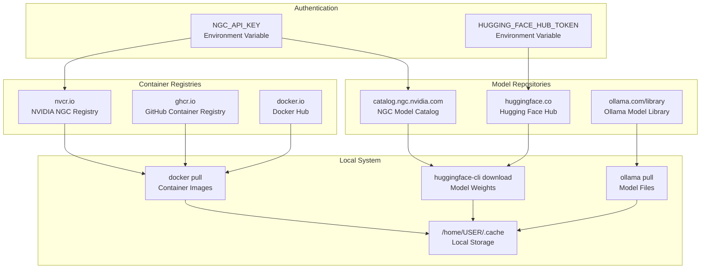
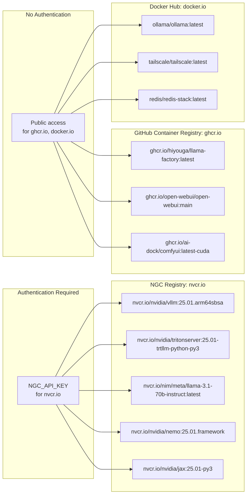

<!-- source: DeepWiki mcp.deepwiki.com · repo NVIDIA/dgx-spark-playbooks · page 10.4 External Resources · fetched 2026-10-26 -->

# External Resources

Relevant source files

The following files were used as context for generating this wiki page:

- [LICENSE](LICENSE)
- [README.md](README.md)
- [nvidia/cuda-x-data-science/README.md](nvidia/cuda-x-data-science/README.md)
- [nvidia/cuda-x-data-science/assets/cudf_pandas_demo.ipynb](nvidia/cuda-x-data-science/assets/cudf_pandas_demo.ipynb)
- [nvidia/cuda-x-data-science/assets/cuml_sklearn_demo.ipynb](nvidia/cuda-x-data-science/assets/cuml_sklearn_demo.ipynb)
- [nvidia/dgx-dashboard/assets/jupyter-cell.py](nvidia/dgx-dashboard/assets/jupyter-cell.py)

This page provides a comprehensive reference to external documentation, container registries, model repositories, and community support channels used throughout the DGX Spark playbooks. These resources are essential for obtaining container images, downloading models, accessing API credentials, and troubleshooting issues.

For information about internal configuration files and environment variables used in playbooks, see [Configuration Files](nvidia/Reference/10.3_Configuration_Files.md). For commonly used commands when interacting with these resources, see [Command Reference](nvidia/Reference/10.2_Command_Reference.md).

## Overview: External Resource Ecosystem

The DGX Spark playbooks depend on multiple external registries and services for container images, pre-trained models, and authentication. Understanding how these resources interconnect helps diagnose issues and optimize downloads.

### External Resource Flow

**Sources:** [README.md:65-70]()

## Official NVIDIA Resources

### Product Documentation

| Resource | URL | Purpose |
|----------|-----|---------|
| **DGX Spark Product Page** | https://www.nvidia.com/en-us/products/workstations/dgx-spark/ | Official product specifications, features, and purchasing information |
| **DGX Spark Downloads** | https://www.nvidia.com/en-us/data-center/dgx-spark/downloads/ | Firmware updates, driver packages, and system software |
| **DGX OS Documentation** | https://docs.nvidia.com/dgx/dgx-os-7-user-guide/ | Operating system configuration and administration guides |
| **CUDA Documentation** | https://docs.nvidia.com/cuda/ | CUDA toolkit documentation for GPU programming |

### NVIDIA NGC Platform

| Resource | URL | Purpose |
|----------|-----|---------|
| **NGC Catalog** | https://catalog.ngc.nvidia.com/ | Browse containers, models, Helm charts, and resources |
| **NGC Setup Guide** | https://docs.ngc.nvidia.com/cli/index.html | CLI installation and configuration |
| **NGC API Documentation** | https://docs.ngc.nvidia.com/ngc/api/ | REST API reference for programmatic access |
| **NGC Private Registry** | https://docs.ngc.nvidia.com/ngc/ngc-private-registry-user-guide/ | Private container registry setup |

### Support and Community

| Resource | URL | Purpose |
|----------|-----|---------|
| **DGX Spark Developer Forum** | https://forums.developer.nvidia.com/c/accelerated-computing/dgx-spark-gb10 | Community support, questions, and discussions |
| **NVIDIA Support Portal** | https://www.nvidia.com/en-us/support/ | Enterprise support ticket submission |
| **NVIDIA Developer Blog** | https://developer.nvidia.com/blog/ | Technical articles and announcements |

**Sources:** [README.md:65-70]()

## Container Registries

Container images for inference engines, fine-tuning frameworks, and applications are pulled from multiple registries. Each requires specific authentication and naming conventions.

### Registry Configuration Map

### NVIDIA NGC Registry (nvcr.io)

**Primary Container Source:** NVIDIA-optimized containers for inference, training, and data science.

| Component | Image Pattern | Documentation |
|-----------|---------------|---------------|
| **vLLM** | `nvcr.io/nvidia/vllm:YY.MM.arm64sbsa` | https://docs.nvidia.com/nim/large-language-models/latest/getting-started.html |
| **TensorRT-LLM** | `nvcr.io/nvidia/tritonserver:YY.MM-trtllm-python-py3` | https://github.com/triton-inference-server/tensorrtllm_backend |
| **NIM** | `nvcr.io/nim/<org>/<model>:<tag>` | https://docs.nvidia.com/nim/ |
| **NeMo Framework** | `nvcr.io/nvidia/nemo:YY.MM.framework` | https://docs.nvidia.com/nemo-framework/ |
| **JAX** | `nvcr.io/nvidia/jax:YY.MM-py3` | https://github.com/NVIDIA/JAX-Toolbox |
| **RAPIDS** | `nvcr.io/nvidia/rapidsai/base:YY.MM-cuda12.6-py3.12` | https://docs.rapids.ai/ |

**Authentication:** Requires `NGC_API_KEY` environment variable. Obtain from https://ngc.nvidia.com/setup/api-key

**ARM64 SBSA Note:** DGX Spark requires `-arm64sbsa` or `.arm64sbsa` tagged images. Standard `x86_64` images will not run.

### GitHub Container Registry (ghcr.io)

**Open Source Projects:** Community-maintained containers for popular AI tools.

| Project | Image | Repository |
|---------|-------|------------|
| **LLaMA Factory** | `ghcr.io/hiyouga/llama-factory:latest` | https://github.com/hiyouga/LLaMA-Factory |
| **Open WebUI** | `ghcr.io/open-webui/open-webui:main` | https://github.com/open-webui/open-webui |
| **ComfyUI** | `ghcr.io/ai-dock/comfyui:latest-cuda` | https://github.com/ai-dock/comfyui |
| **Continue.dev** | `ghcr.io/continuedev/continue:latest` | https://github.com/continuedev/continue |

**Authentication:** Public access, no credentials required.

### Docker Hub (docker.io)

**Standard Tools:** General-purpose utilities and databases.

| Tool | Image | Documentation |
|------|-------|---------------|
| **Ollama** | `ollama/ollama:latest` | https://ollama.com/download |
| **Tailscale** | `tailscale/tailscale:latest` | https://tailscale.com/kb/1282/docker |
| **Redis Stack** | `redis/redis-stack:latest` | https://redis.io/docs/latest/operate/oss_and_stack/install/install-stack/docker/ |
| **MariaDB** | `mariadb:latest` | https://hub.docker.com/_/mariadb |

**Authentication:** Public access, no credentials required.

**Sources:** [README.md:24-63]()

## Model Repositories

Pre-trained models and fine-tuned checkpoints are downloaded from multiple hubs, each with different access patterns and requirements.

### Hugging Face Hub

**Primary Model Source:** Largest repository of open-source LLMs, VLMs, and diffusion models.

| Model Family | Repository Pattern | Gated Access |
|--------------|-------------------|--------------|
| **Meta LLaMA 3/3.1** | `meta-llama/Llama-3.1-70B-Instruct` | Yes - Requires HF token |
| **Meta LLaMA 3.3** | `meta-llama/Llama-3.3-70B-Instruct` | Yes - Requires HF token |
| **Qwen 2.5/3** | `Qwen/Qwen2.5-72B-Instruct` | No |
| **FLUX.1** | `black-forest-labs/FLUX.1-dev` | Yes - Requires HF token |
| **Qwen2-VL** | `Qwen/Qwen2.5-VL-7B-Instruct` | No |
| **InternVL3** | `OpenGVLab/InternVL3-76B-InternVL3` | No |

**Access URLs:**
- Browse: https://huggingface.co/models
- Download CLI: `huggingface-cli download <model-id>`
- Python API: `from transformers import AutoModel`

**Authentication:**
- Public models: No token required
- Gated models (LLaMA, FLUX): Requires `HUGGING_FACE_HUB_TOKEN`
- Token creation: https://huggingface.co/settings/tokens

**Download Location:** `/home/$USER/.cache/huggingface/hub/`

### NGC Model Catalog

**NVIDIA-Optimized Models:** Pre-converted checkpoints for TensorRT-LLM and NIM.

| Model Type | Catalog URL | Authentication |
|------------|-------------|----------------|
| **NIM Models** | https://catalog.ngc.nvidia.com/models?filters=nimModels | NGC_API_KEY required |
| **TensorRT-LLM Engines** | https://catalog.ngc.nvidia.com/models?filters=trtllm | NGC_API_KEY required |
| **NeMo Checkpoints** | https://catalog.ngc.nvidia.com/models?filters=nemo | NGC_API_KEY required |

**Download Methods:**
- CLI: `ngc registry model download-version <org/model:version>`
- Docker: Automatic pull via NIM containers
- Python: `from nemo.collections import nlp`

### Ollama Model Library

**Simplified Local Serving:** Pre-quantized models for quick local deployment.

| Model | Pull Command | Size |
|-------|-------------|------|
| **LLaMA 3.1 8B** | `ollama pull llama3.1` | 4.7GB |
| **LLaMA 3.3 70B** | `ollama pull llama3.3` | 43GB |
| **Qwen 2.5 7B** | `ollama pull qwen2.5` | 4.7GB |
| **Qwen 2.5 Coder 32B** | `ollama pull qwen2.5-coder:32b` | 19GB |

**Access:** https://ollama.com/library

**Download Location:** `/usr/share/ollama/.ollama/models/`

**Sources:** [README.md:43-46]()

## Framework Documentation

### Inference Frameworks

| Framework | Official Documentation | GitHub Repository |
|-----------|----------------------|-------------------|
| **vLLM** | https://docs.vllm.ai/ | https://github.com/vllm-project/vllm |
| **TensorRT-LLM** | https://nvidia.github.io/TensorRT-LLM/ | https://github.com/NVIDIA/TensorRT-LLM |
| **Triton Inference Server** | https://docs.nvidia.com/deeplearning/triton-inference-server/ | https://github.com/triton-inference-server/server |
| **NVIDIA NIM** | https://docs.nvidia.com/nim/ | https://build.nvidia.com/explore/discover |
| **Ollama** | https://github.com/ollama/ollama/blob/main/README.md | https://github.com/ollama/ollama |

### Fine-tuning Frameworks

| Framework | Official Documentation | GitHub Repository |
|-----------|----------------------|-------------------|
| **LLaMA Factory** | https://llamafactory.readthedocs.io/ | https://github.com/hiyouga/LLaMA-Factory |
| **PyTorch PEFT** | https://huggingface.co/docs/peft/ | https://github.com/huggingface/peft |
| **NeMo Framework** | https://docs.nvidia.com/nemo-framework/ | https://github.com/NVIDIA/NeMo |
| **Unsloth** | https://github.com/unslothai/unsloth/blob/main/README.md | https://github.com/unslothai/unsloth |
| **Diffusers** | https://huggingface.co/docs/diffusers/ | https://github.com/huggingface/diffusers |

### Development Frameworks

| Framework | Official Documentation | GitHub Repository |
|-----------|----------------------|-------------------|
| **JAX** | https://jax.readthedocs.io/ | https://github.com/google/jax |
| **RAPIDS cuDF** | https://docs.rapids.ai/api/cudf/ | https://github.com/rapidsai/cudf |
| **RAPIDS cuML** | https://docs.rapids.ai/api/cuml/ | https://github.com/rapidsai/cuml |
| **DeepStream** | https://docs.nvidia.com/metropolis/deepstream/ | https://github.com/NVIDIA-AI-IOT/deepstream_python_apps |
| **Marimo** | https://docs.marimo.io/ | https://github.com/marimo-team/marimo |

**Sources:** [nvidia/cuda-x-data-science/README.md:13-21](), [README.md:28-32]()

## Application and UI Documentation

| Application | Official Documentation | GitHub Repository |
|------------|----------------------|-------------------|
| **Open WebUI** | https://docs.openwebui.com/ | https://github.com/open-webui/open-webui |
| **ComfyUI** | https://github.com/comfyanonymous/ComfyUI/wiki | https://github.com/comfyanonymous/ComfyUI |
| **Continue.dev** | https://docs.continue.dev/ | https://github.com/continuedev/continue |
| **AI Workbench** | https://docs.nvidia.com/ai-workbench/ | https://www.nvidia.com/en-us/deep-learning-ai/solutions/data-science/workbench/ |
| **Jupyter** | https://jupyter.org/documentation | https://github.com/jupyter |
| **Gradio** | https://www.gradio.app/docs | https://github.com/gradio-app/gradio |

**Sources:** [README.md:24-63]()

## Infrastructure and Networking

| Tool | Official Documentation | Purpose |
|------|----------------------|---------|
| **Tailscale** | https://tailscale.com/kb/ | VPN mesh network for remote access |
| **Docker** | https://docs.docker.com/ | Container runtime and orchestration |
| **Docker Compose** | https://docs.docker.com/compose/ | Multi-container application definition |
| **NCCL** | https://docs.nvidia.com/deeplearning/nccl/ | Multi-GPU communication library |
| **OpenMPI** | https://www.open-mpi.org/doc/ | MPI implementation for distributed computing |
| **Ray** | https://docs.ray.io/ | Distributed computing framework |

**Sources:** [README.md:38-39](), [README.md:56]()

## Legal and Terms of Service

| Document | URL | Purpose |
|----------|-----|---------|
| **NVIDIA API Trial Terms** | https://assets.ngc.nvidia.com/products/api-catalog/legal/NVIDIA%20API%20Trial%20Terms%20of%20Service.pdf | Legal terms for using NVIDIA APIs and services |
| **NGC Terms of Use** | https://www.nvidia.com/en-us/about-nvidia/terms-of-use/ | Terms for NGC platform access |
| **Hugging Face Terms** | https://huggingface.co/terms-of-service | Terms for Hugging Face Hub usage |

**Sources:** [README.md:69]()

## Community Support Channels

### Official NVIDIA Support

| Channel | URL | Response Time |
|---------|-----|---------------|
| **DGX Spark Forum** | https://forums.developer.nvidia.com/c/accelerated-computing/dgx-spark-gb10 | Community-driven (hours to days) |
| **Enterprise Support** | Available with purchase | 24/7 for enterprise customers |
| **Developer Zone** | https://developer.nvidia.com/ | Documentation and tutorials |

### Framework Communities

| Framework | Primary Support Channel |
|-----------|------------------------|
| **vLLM** | GitHub Issues: https://github.com/vllm-project/vllm/issues |
| **TensorRT-LLM** | GitHub Discussions: https://github.com/NVIDIA/TensorRT-LLM/discussions |
| **LLaMA Factory** | GitHub Issues: https://github.com/hiyouga/LLaMA-Factory/issues |
| **NeMo** | GitHub Issues: https://github.com/NVIDIA/NeMo/issues |
| **Ollama** | Discord: https://discord.gg/ollama |
| **Open WebUI** | Discord: https://discord.gg/5rJgQTnV4s |

### General AI/ML Communities

| Community | URL | Focus |
|-----------|-----|-------|
| **Hugging Face Forums** | https://discuss.huggingface.co/ | Model usage, fine-tuning, deployment |
| **Reddit r/LocalLLaMA** | https://reddit.com/r/LocalLLaMA | Local LLM deployment and optimization |
| **NVIDIA Developer Forums** | https://forums.developer.nvidia.com/ | GPU computing and CUDA |

**Sources:** [README.md:68]()

## Quick Reference: Common URLs by Use Case

### Setting Up Your Spark

| Task | Resource | URL |
|------|----------|-----|
| Download firmware updates | DGX Spark Downloads | https://www.nvidia.com/en-us/data-center/dgx-spark/downloads/ |
| Get NGC API key | NGC Setup | https://ngc.nvidia.com/setup/api-key |
| Get Hugging Face token | HF Settings | https://huggingface.co/settings/tokens |
| Install Tailscale | Tailscale Download | https://tailscale.com/download |

### Running Inference

| Task | Resource | URL |
|------|----------|-----|
| Browse vLLM models | NGC Catalog | https://catalog.ngc.nvidia.com/orgs/nvidia/containers/vllm |
| Browse NIM models | NIM Catalog | https://build.nvidia.com/explore/discover |
| Pull Ollama models | Ollama Library | https://ollama.com/library |
| vLLM documentation | vLLM Docs | https://docs.vllm.ai/ |

### Fine-tuning Models

| Task | Resource | URL |
|------|----------|-----|
| LLaMA Factory docs | ReadTheDocs | https://llamafactory.readthedocs.io/ |
| PEFT documentation | HF PEFT | https://huggingface.co/docs/peft/ |
| NeMo tutorials | NeMo Framework | https://docs.nvidia.com/nemo-framework/ |
| Find base models | HF Models | https://huggingface.co/models |

### Building Applications

| Task | Resource | URL |
|------|----------|-----|
| Open WebUI setup | OpenWebUI Docs | https://docs.openwebui.com/ |
| AI Workbench | NVIDIA AI Workbench | https://docs.nvidia.com/ai-workbench/ |
| DeepStream SDK | Metropolis Docs | https://docs.nvidia.com/metropolis/deepstream/ |
| Gradio documentation | Gradio Docs | https://www.gradio.app/docs |

**Sources:** [README.md:24-63]()