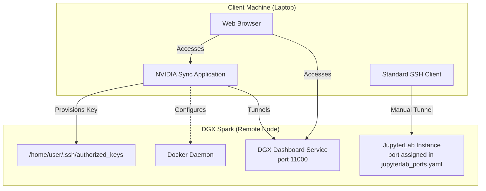
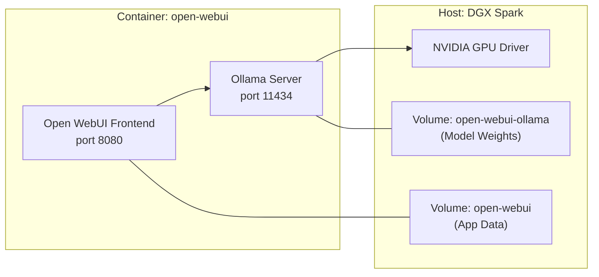

<!-- source: DeepWiki mcp.deepwiki.com · repo NVIDIA/dgx-spark-playbooks · page 2 Getting Started · fetched 2026-10-26 -->

# Getting Started

Relevant source files

The following files were used as context for generating this wiki page:

- [nvidia/connect-to-your-spark/README.md](nvidia/connect-to-your-spark/README.md)
- [nvidia/dgx-dashboard/README.md](nvidia/dgx-dashboard/README.md)
- [nvidia/jax/README.md](nvidia/jax/README.md)
- [nvidia/open-webui/README.md](nvidia/open-webui/README.md)
- [nvidia/sglang/README.md](nvidia/sglang/README.md)
- [nvidia/txt2kg/README.md](nvidia/txt2kg/README.md)
- [nvidia/unsloth/README.md](nvidia/unsloth/README.md)

This page guides you through the initial setup and configuration required to use the DGX Spark Playbooks. It covers hardware prerequisites, network access configuration, and the deployment of your first AI applications using the unique Blackwell Unified Memory Architecture (UMA).

For detailed remote access setup, see [Connecting to Your Spark](#2.2). For system monitoring and JupyterLab, see [DGX Dashboard](#2.4). To deploy your first chat interface, see [Your First Application: Open WebUI](#2.5).

## Prerequisites and System Requirements

Before beginning, ensure your environment meets the following requirements:

### Hardware Requirements
| Component | Requirement | Notes |
|:---|:---|:---|
| **DGX Spark** | Powered on | NVIDIA Grace Blackwell GB10 Superchip System [nvidia/dgx-dashboard/README.md:31]() |
| **Architecture** | ARM64 (AArch64) | Required for container compatibility [nvidia/jax/README.md:45]() |
| **Memory** | Unified Memory | Enables dynamic sharing between GPU and CPU [nvidia/txt2kg/README.md:167-168]() |
| **Network** | Local or VPN | Same network as your client laptop for mDNS/SSH [nvidia/connect-to-your-spark/README.md:61]() |

### Software Requirements
| Software | Version | Purpose |
|:---|:---|:---|
| **NVIDIA Drivers** | Latest | GPU acceleration (`nvidia-smi`) [nvidia/sglang/README.md:41]() |
| **Docker Engine** | Latest | Containerized workload execution [nvidia/sglang/README.md:40]() |
| **Container Toolkit** | Configured | GPU passthrough to Docker [nvidia/sglang/README.md:42]() |
| **CUDA Toolkit** | 13.0+ | Kernel compilation and execution [nvidia/unsloth/README.md:42]() |

Sources: [nvidia/connect-to-your-spark/README.md:58-64](), [nvidia/sglang/README.md:38-45](), [nvidia/unsloth/README.md:39-44]()

## Connection Workflow

The following diagram illustrates the relationship between your local machine, the connection tools, and the core system entities on the DGX Spark.

Sources: [nvidia/connect-to-your-spark/README.md:146-156](), [nvidia/dgx-dashboard/README.md:65-99]()

## Connecting to Your Spark

There are three primary methods to access your device. **NVIDIA Sync** is the recommended approach as it automates SSH key provisioning and manages port forwarding for you.

1.  **NVIDIA Sync (Recommended):** A desktop app for macOS, Windows, and Ubuntu that provides a "one-click" connection to your Spark. It handles the generation of SSH keys and their deployment to `~/.ssh/authorized_keys` [nvidia/connect-to-your-spark/README.md:73-156]().
2.  **Manual SSH:** For users who prefer standard terminal tools. You can connect via the mDNS hostname (e.g., `spark-abcd.local`) or direct IP [nvidia/connect-to-your-spark/README.md:216-275]().
3.  **Tailscale:** Used for secure remote access when you are not on the same local network as the Spark device.

For details, see [Connecting to Your Spark](#2.2) and [Setting Up Remote Access with Tailscale](#2.3).

## DGX Dashboard and JupyterLab

The **DGX Dashboard** is a pre-installed web application running on port `11000` [nvidia/dgx-dashboard/README.md:63](). It serves as the central hub for:
*   **System Monitoring:** Real-time GPU and CPU utilization tracking [nvidia/dgx-dashboard/README.md:187-192]().
*   **JupyterLab Management:** Launching isolated Python environments with pre-configured AI/ML libraries [nvidia/dgx-dashboard/README.md:112-125]().
*   **System Updates:** Managing firmware and OS packages.

For details, see [DGX Dashboard](#2.4).

## Running Your First Application

To validate your setup, we recommend deploying **Open WebUI with Ollama**. This application provides a ChatGPT-like interface running entirely on your local hardware.

Sources: [nvidia/open-webui/README.md:131-136](), [nvidia/txt2kg/README.md:21-25]()

The deployment involves:
1.  **Docker Configuration:** Ensuring your user is in the `docker` group to run containers without `sudo` [nvidia/open-webui/README.md:59-64]().
2.  **Container Launch:** Running the `ghcr.io/open-webui/open-webui:ollama` image with GPU access [nvidia/open-webui/README.md:106-136]().
3.  **Model Pulling:** Using the UI or CLI to download models like `gpt-oss:20b` [nvidia/open-webui/README.md:170-174]().

For details, see [Your First Application: Open WebUI](#2.5).

## Unified Memory Architecture (UMA) Note

DGX Spark features a **Unified Memory Architecture**, allowing the GPU and CPU to share a single high-bandwidth memory pool [nvidia/txt2kg/README.md:167-168](). 

> [!IMPORTANT]
> If you encounter "Out of Memory" errors despite having capacity, it may be due to the Linux buffer cache. You can manually flush this cache using:
> `sudo sh -c 'sync; echo 3 > /proc/sys/vm/drop_caches'` [nvidia/txt2kg/README.md:170-172]().

Sources: [nvidia/txt2kg/README.md:167-173](), [nvidia/unsloth/README.md:144-149]()

---

