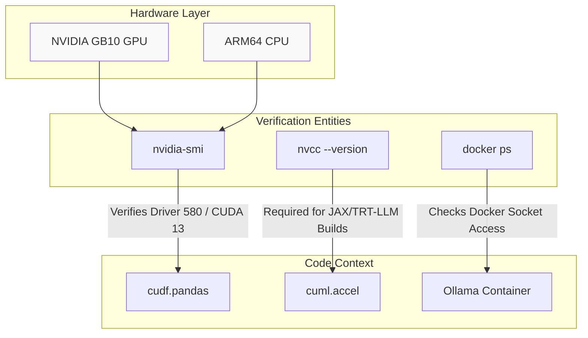
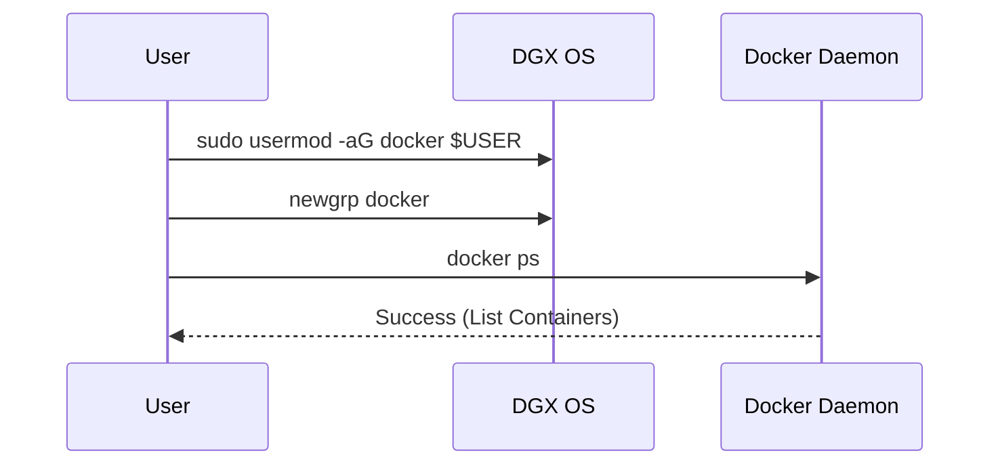

<!-- source: DeepWiki mcp.deepwiki.com · repo NVIDIA/dgx-spark-playbooks · page 2.1 Prerequisites and System Requirements · fetched 2026-10-26 -->

# Prerequisites and System Requirements

<details>
<summary>Relevant source files</summary>

The following files were used as context for generating this wiki page:

- [README.md](README.md)
- [nvidia/connect-to-your-spark/README.md](nvidia/connect-to-your-spark/README.md)
- [nvidia/cuda-x-data-science/README.md](nvidia/cuda-x-data-science/README.md)
- [nvidia/cuda-x-data-science/assets/cudf_pandas_demo.ipynb](nvidia/cuda-x-data-science/assets/cudf_pandas_demo.ipynb)
- [nvidia/cuda-x-data-science/assets/cuml_sklearn_demo.ipynb](nvidia/cuda-x-data-science/assets/cuml_sklearn_demo.ipynb)
- [nvidia/open-webui/README.md](nvidia/open-webui/README.md)

</details>


## Purpose and Scope

This page documents the hardware, software, network, and credential requirements needed before using any playbook in this repository. All playbooks assume these prerequisites are met unless explicitly stated otherwise in individual playbook documentation. These requirements ensure compatibility with the **NVIDIA Blackwell** architecture and the **ARM64** ecosystem integrated into the DGX Spark.

For instructions on connecting to your Spark device after meeting these prerequisites, see [Connecting to Your Spark](#2.2).

---

## Hardware Requirements

### NVIDIA DGX Spark Device

All playbooks in this repository target the NVIDIA DGX Spark platform with the following specifications:

| Component | Requirement | Notes |
|-----------|-------------|-------|
| GPU Architecture | NVIDIA Blackwell (GB10) | Tensor Cores + Ray Tracing capabilities [nvidia/cuda-x-data-science/assets/cudf_pandas_demo.ipynb:57]() |
| CPU Architecture | ARM64 (AArch64) | SBSA-optimized containers required [README.md:8]() |
| Unified Memory | 128GB | Shared dynamically between GPU and CPU [nvidia/vllm/README.md:191-197]() |
| Storage | Sufficient space | Required for container images and model weights [nvidia/open-webui/README.md:33]() |
| Network Interface | Ethernet or QSFP | QSFP required for multi-node/ring topologies [README.md:25-27]() |

**Sources:** [README.md:6-9](), [nvidia/cuda-x-data-science/assets/cudf_pandas_demo.ipynb:57-60]()

### Multi-Node Considerations

For playbooks involving distributed workloads (Section 7):

- **Two-Node**: Requires direct QSFP cabling [README.md:27]().
- **Three+ Nodes**: Requires a QSFP switch and `spark_cluster_setup.py` for ring topology configuration [README.md:25-38]().

---

## System Software Requirements

### Operating System and Drivers

The following software stack is required on the DGX Spark device to support the Blackwell architecture:

| Component | Minimum Version | Verification Command |
|-----------|----------------|---------------------|
| NVIDIA Drivers | 580.82+ | `nvidia-smi` [nvidia/cuda-x-data-science/assets/cudf_pandas_demo.ipynb:51]() |
| CUDA | 13.0 | `nvcc --version` [nvidia/cuda-x-data-science/README.md:43]() |
| Python | 3.12 | `python3 --version` [nvidia/cuda-x-data-science/README.md:51]() |
| Docker Engine | 20.10+ | `docker --version` [nvidia/open-webui/README.md:56]() |

### Code Entity Mapping: System Verification

The following diagram maps the physical system requirements to the commands and entities used in the playbooks to verify readiness.


**Sources:** [nvidia/cuda-x-data-science/README.md:42-45](), [nvidia/cuda-x-data-science/assets/cudf_pandas_demo.ipynb:49-60](), [nvidia/open-webui/README.md:53-57]()

---

## Network and Access Requirements

### Local Network Access

The Spark device must be reachable from your development machine (laptop/workstation).

| Access Method | Requirement | Notes |
|--------------|-------------|-------|
| **mDNS** | Avahi/Bonjour | Connect via `spark-abcd.local` [nvidia/connect-to-your-spark/README.md:38-41]() |
| **NVIDIA Sync** | Desktop App | Recommended for SSH and port tunneling [nvidia/connect-to-your-spark/README.md:23-24]() |
| **SSH** | Port 22 | Key-based auth is configured by NVIDIA Sync [nvidia/connect-to-your-spark/README.md:150-154]() |

### Port Requirements for Playbooks

Standard ports used across the playbook collection:

| Port | Service | Playbook Context |
|------|---------|------------------|
| **11000** | DGX Dashboard | System Management [nvidia/connect-to-your-spark/README.md:122]() |
| **12000** | Open WebUI | Local Chat Interface [nvidia/open-webui/README.md:97]() |
| **8888** | Jupyter Notebook | Data Science / RAPIDS [nvidia/cuda-x-data-science/README.md:68-71]() |

**Sources:** [nvidia/connect-to-your-spark/README.md:32-41](), [nvidia/open-webui/README.md:90-100]()

---

## Authentication and External Credentials

### 1. NVIDIA GPU Cloud (NGC) API Key
Required to pull optimized Blackwell containers (TensorRT-LLM, NIM, NeMo).
- **Username**: `$oauthtoken`
- **Password**: Your API Key

### 2. Kaggle API Key
Required specifically for the **CUDA-X Data Science** playbooks to download datasets (e.g., LinkedIn jobs dataset).
- **File**: `kaggle.json` must be placed in the notebook folder [nvidia/cuda-x-data-science/README.md:45]().

### 3. Hugging Face Token
Required for gated models (LLaMA 3, etc.) used in Fine-tuning and Inference playbooks.

---

## Implementation Detail: Docker Permissions

Many playbooks (e.g., Open WebUI) require running Docker without `sudo` for NVIDIA Sync integration.


**Sources:** [nvidia/open-webui/README.md:59-64]()

---

## Unified Memory Architecture (UMA) Considerations

DGX Spark uses UMA where 128GB is shared. Playbooks often require memory management to prevent OOM (Out of Memory) errors during large model loads.

**Key Practice: Buffer Cache Flushing**
When switching between heavy workloads (e.g., from Fine-tuning to Inference), it is recommended to flush the system buffer cache to reclaim UMA space.
```bash
sudo sh -c 'sync; echo 3 > /proc/sys/vm/drop_caches'
```
**Sources:** [nvidia/vllm/README.md:191-197]() (Note: Reference to memory management strategies in associated inference playbooks).

---

## Summary Checklist

Before starting any playbook, verify the following:
1. [ ] `nvidia-smi` shows Driver `580.xx` and `CUDA 13.0`.
2. [ ] `docker ps` runs without `sudo`.
3. [ ] `nvidia-sync` is installed on your laptop for remote access.
4. [ ] NGC API Key is configured via `docker login nvcr.io`.
5. [ ] For Data Science: `kaggle.json` is available.

**Sources:** [nvidia/cuda-x-data-science/README.md:42-45](), [nvidia/open-webui/README.md:49-64](), [nvidia/connect-to-your-spark/README.md:75-80]()

---

