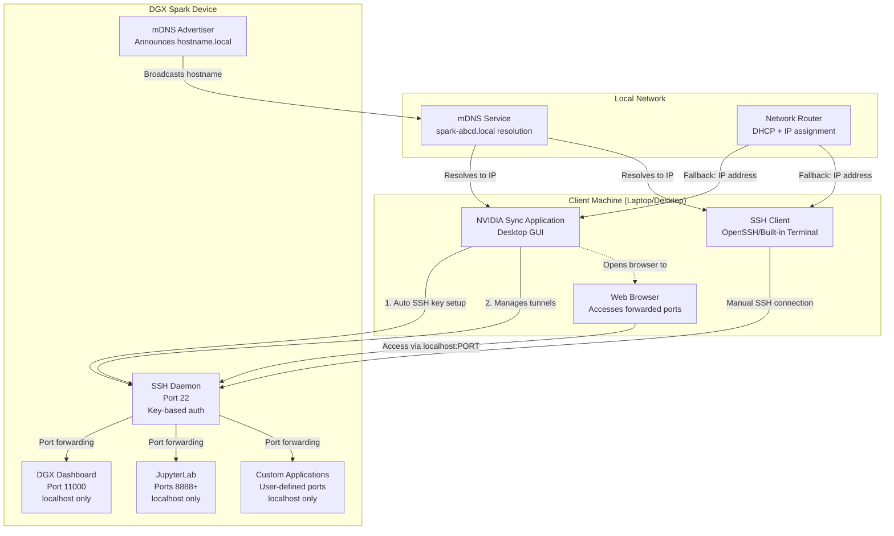
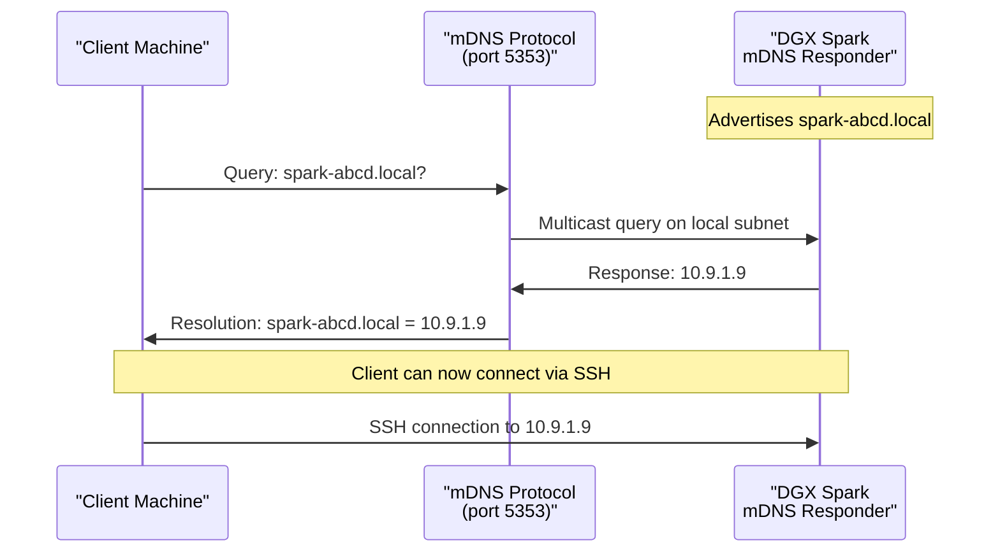
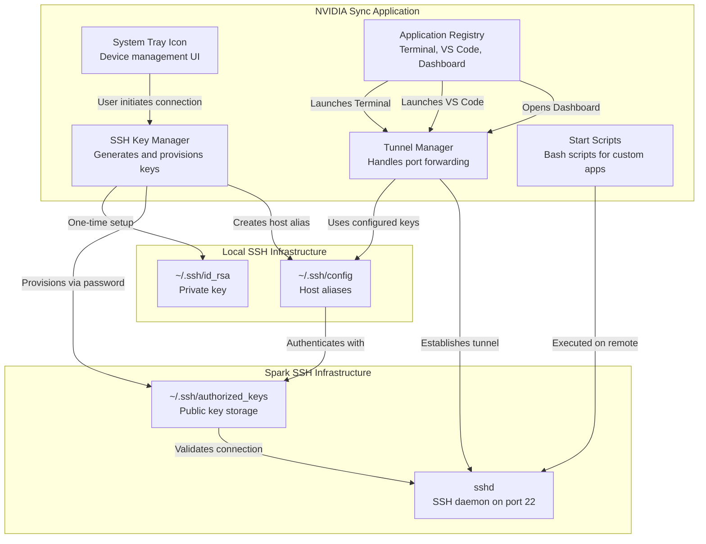
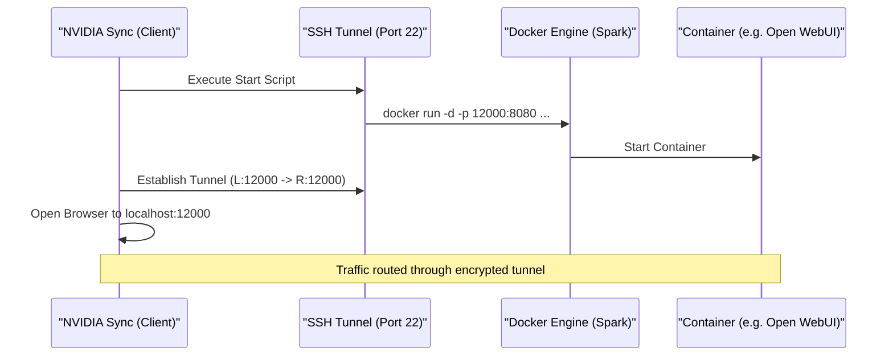

<!-- source: DeepWiki mcp.deepwiki.com · repo NVIDIA/dgx-spark-playbooks · page 2.2 Connecting to Your Spark · fetched 2026-10-26 -->

# Connecting to Your Spark

<details>
<summary>Relevant source files</summary>

The following files were used as context for generating this wiki page:

- [nvidia/connect-to-your-spark/README.md](nvidia/connect-to-your-spark/README.md)
- [nvidia/open-webui/README.md](nvidia/open-webui/README.md)

</details>


This page covers local network access methods for connecting to your DGX Spark device from a laptop or desktop computer on the same network. You will learn how to use NVIDIA Sync for streamlined device management, or configure manual SSH access for direct command-line control. Both methods enable terminal sessions, port forwarding, and remote application access.

For secure remote access from outside your local network, see [Setting Up Remote Access with Tailscale](2.3).

## Connection Architecture

The DGX Spark device provides multiple connection pathways depending on your workflow requirements. All methods operate over your local network and require the device to be on the same subnet as your client machine.

**Connection Overview Diagram**


**Sources:** [nvidia/connect-to-your-spark/README.md:14-66]()

## Network Discovery: mDNS Resolution

DGX Spark devices advertise their presence on the local network using mDNS (Multicast DNS), allowing hostname-based discovery without manual IP configuration. The hostname follows the pattern `spark-<identifier>.local`, where the identifier is printed on the Quick Start Guide included with your device [nvidia/connect-to-your-spark/README.md:38-41]().

**mDNS Resolution Sequence**


### Testing mDNS Availability

mDNS may not function in complex corporate networks with multicast filtering. Test hostname resolution before proceeding:

```bash
ping spark-abcd.local
```

Successful resolution shows IP address responses. If resolution fails, you must use the device's IP address directly, which can be found in Ubuntu's network settings or the DGX Dashboard [nvidia/connect-to-your-spark/README.md:132-138]().

**Sources:** [nvidia/connect-to-your-spark/README.md:38-41](), [nvidia/connect-to-your-spark/README.md:132-138]()

## NVIDIA Sync Connection Method

NVIDIA Sync is a desktop application that automates SSH key provisioning and manages persistent connections for development tools [nvidia/connect-to-your-spark/README.md:77-80]().

**NVIDIA Sync Component Architecture**


### Device Provisioning Workflow

When adding a DGX Spark device, NVIDIA Sync executes the following sequence:

1. **Key Generation**: Creates SSH key pair on your laptop [nvidia/connect-to-your-spark/README.md:152]().
2. **Password Authentication**: Uses provided password for initial connection only [nvidia/connect-to-your-spark/README.md:153]().
3. **Key Provisioning**: Adds public key to `~/.ssh/authorized_keys` on Spark [nvidia/connect-to-your-spark/README.md:154]().
4. **Alias Creation**: Creates a local SSH alias for future connections [nvidia/connect-to-your-spark/README.md:155]().
5. **Credential Disposal**: Discards username and password after setup [nvidia/connect-to-your-spark/README.md:156]().

**Sources:** [nvidia/connect-to-your-spark/README.md:73-160]()

## SSH Port Forwarding and Custom Apps

SSH tunneling (port forwarding) securely maps a port on your laptop to a port on the DGX Spark where an app is listening [nvidia/connect-to-your-spark/README.md:32-34]().

### Custom Application Integration

NVIDIA Sync allows users to define "Custom Ports" with associated bash start scripts. These scripts manage the lifecycle of Docker containers on the remote Spark device.

**Custom App Data Flow**


A typical start script, such as the one used for Open WebUI, follows this pattern [nvidia/open-webui/README.md:101-142]():
- **Cleanup Trap**: Uses `trap cleanup INT TERM HUP QUIT EXIT` to ensure containers stop when the tunnel closes [nvidia/open-webui/README.md:113]().
- **Container Management**: Checks if the container is already running or exists before attempting `docker run` [nvidia/open-webui/README.md:122-137]().
- **Persistence**: Keeps the script alive with a sleep loop to maintain the SSH session [nvidia/open-webui/README.md:141]().

**Sources:** [nvidia/connect-to-your-spark/README.md:32-36](), [nvidia/open-webui/README.md:99-142]()

## Manual SSH Connection Method

Manual SSH provides direct command-line control. Users can manually forward ports using the `-L` flag:

```bash
ssh -L <LOCAL_PORT>:localhost:<REMOTE_PORT> <USERNAME>@spark-abcd.local
```

| Service | Remote Port | Manual Forwarding Command |
|---------|-------------|---------------------------|
| DGX Dashboard | 11000 | `ssh -L 11000:localhost:11000 user@spark-abcd.local` |
| JupyterLab | 8888 | `ssh -L 8888:localhost:8888 user@spark-abcd.local` |
| Open WebUI | 8080 | `ssh -L 12000:localhost:8080 user@spark-abcd.local` |

**Sources:** [nvidia/connect-to-your-spark/README.md:32-36](), [nvidia/open-webui/README.md:132-135]()

## Troubleshooting

### Docker Permissions
If NVIDIA Sync fails to launch containers, ensure the user on the Spark device is in the `docker` group:
```bash
sudo usermod -aG docker $USER
newgrp docker
```
This allows running `docker ps` and other commands without `sudo`, which is required for NVIDIA Sync's automated scripts [nvidia/open-webui/README.md:59-70]().

### Connection Delays
After the first system setup, the device may take several minutes to become available on the network. If NVIDIA Sync fails, wait 3-4 minutes and retry [nvidia/connect-to-your-spark/README.md:158-160]().

**Sources:** [nvidia/connect-to-your-spark/README.md:158-160](), [nvidia/open-webui/README.md:51-70]()

---

