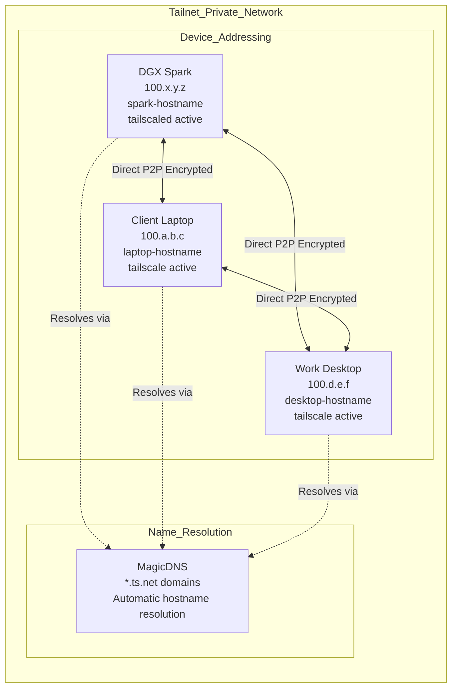
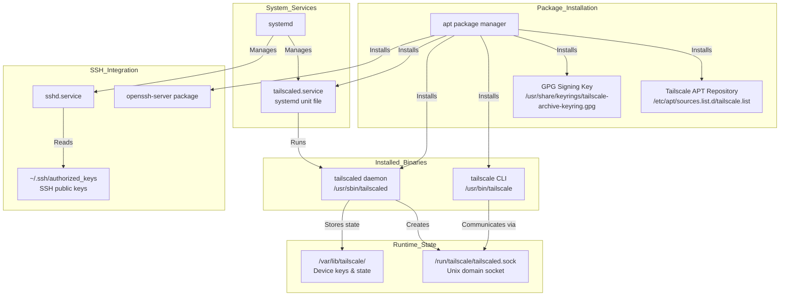
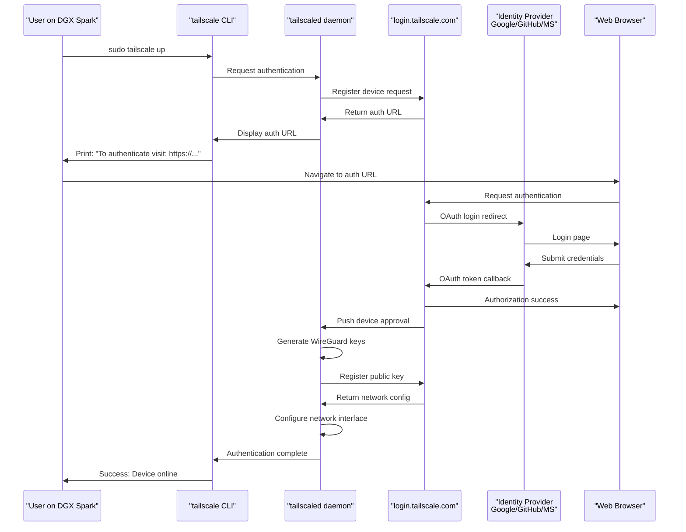
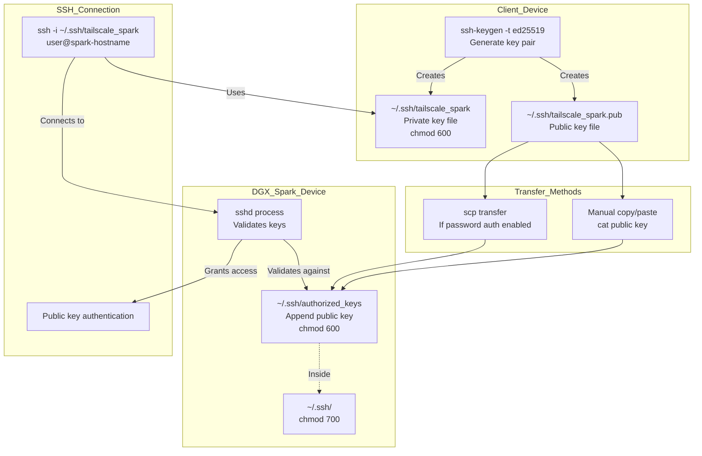
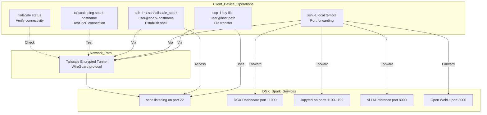

<!-- source: DeepWiki mcp.deepwiki.com · repo NVIDIA/dgx-spark-playbooks · page 2.3 Setting Up Remote Access with Tailscale · fetched 2026-10-26 -->

# Setting Up Remote Access with Tailscale

<details>
<summary>Relevant source files</summary>

The following files were used as context for generating this wiki page:

- [nvidia/nim-llm/README.md](nvidia/nim-llm/README.md)
- [nvidia/tailscale/README.md](nvidia/tailscale/README.md)
- [nvidia/vss/README.md](nvidia/vss/README.md)

</details>


## Purpose and Scope

This page documents the setup and configuration of Tailscale VPN on DGX Spark devices to enable secure remote access from anywhere. Tailscale creates an encrypted peer-to-peer mesh network (tailnet) that eliminates the need for port forwarding, dynamic DNS, or complex firewall configurations. After setup, users can SSH into their Spark device, access the DGX Dashboard, and reach containerized services using stable private IP addresses and hostnames regardless of physical network location.

For local network access using mDNS and SSH without VPN, see [Connecting to Your Spark](#2.2). For managing JupyterLab and system monitoring after establishing connectivity, see [DGX Dashboard](#2.4).

**Sources:** [nvidia/tailscale/README.md:1-43]()

## System Overview

Tailscale operates as a mesh VPN layer that sits between remote client devices and the DGX Spark infrastructure. Unlike traditional VPN architectures that route traffic through a central server, Tailscale establishes direct peer-to-peer connections between devices when possible, with automatic NAT traversal and relay fallback when direct connections cannot be established.

### Tailscale Network Architecture for DGX Spark Remote Access

```mermaid
graph TB
    subgraph "Remote_Locations"
        ["Remote Laptop<br/>Tailscale Client"] -- "Encrypted P2P Tunnel" --> TAILSCALED
        ["Work Desktop<br/>Tailscale Client"] -- "Encrypted P2P Tunnel" --> TAILSCALED
        ["Mobile Device<br/>Tailscale Client"] -- "Encrypted P2P Tunnel" --> TAILSCALED
    end
    
    subgraph "Tailscale_Control_Plane"
        COORD["Tailscale Coordination Server<br/>login.tailscale.com"]
        AUTH["Identity Provider<br/>Google/GitHub/Microsoft"]
    end
    
    subgraph "Home_Network"
        ROUTER["Home Router<br/>NAT Gateway"]
        
        subgraph "DGX_Spark_Device"
            TAILSCALED["tailscaled Service<br/>systemd unit"]
            SSHD["sshd<br/>OpenSSH Server"]
            DASHBOARD["DGX Dashboard<br/>Port 11000"]
            CONTAINERS["Docker Containers<br/>Inference/Development"]
        end
    end
    
    ["Remote Laptop<br/>Tailscale Client"] -->|"Auth via"| COORD
    ["Work Desktop<br/>Tailscale Client"] -->|"Auth via"| COORD
    ["Mobile Device<br/>Tailscale Client"] -->|"Auth via"| COORD
    TAILSCALED -->|"Register"| COORD
    
    COORD -->|"OAuth"| AUTH
    
    TAILSCALED --> SSHD
    TAILSCALED --> DASHBOARD
    TAILSCALED --> CONTAINERS
    
    ROUTER -->|"Outbound only"| COORD
```

The architecture eliminates the need for inbound port forwarding on the home router. All devices authenticate with the Tailscale coordination server, which facilitates peer discovery and key exchange. Once authenticated, devices establish encrypted tunnels directly to the Spark device, bypassing the router's NAT for inbound connections.

**Sources:** [nvidia/tailscale/README.md:28-42]()

## Network Topology and Address Assignment

Tailscale assigns each device on the tailnet a stable IP address from the `100.64.0.0/10` CGNAT range and provides DNS hostname resolution within the network.

### Tailnet IP Address Assignment and Mesh Connectivity



Key addressing characteristics:
- Stable IP addresses persist across network changes. [nvidia/tailscale/README.md:33-36]()
- Hostnames are derived from device names set during authentication. [nvidia/tailscale/README.md:33-36]()
- MagicDNS provides automatic name resolution without `/etc/hosts` modifications.
- All connections use WireGuard protocol for encryption.

**Sources:** [nvidia/tailscale/README.md:28-36](), [nvidia/tailscale/README.md:236-246]()

## Installation Components and File Structure

The Tailscale installation on DGX Spark (ARM64 architecture) involves multiple system components and configuration files.

### Tailscale Installation Components and File Dependencies



Installation creates system-level integration with the DGX OS through systemd service management. The `tailscaled` daemon runs continuously, managing network interfaces and encryption, while the `tailscale` CLI provides user-facing commands for configuration and status checking. [nvidia/tailscale/README.md:151-162]()

**Sources:** [nvidia/tailscale/README.md:116-149](), [nvidia/tailscale/README.md:98-121]()

## Authentication and Device Registration Flow

Tailscale uses OAuth-based authentication through external identity providers to establish device identity and authorization within the tailnet.

### Tailscale Authentication and Device Registration Sequence



The authentication flow separates device registration from user identity verification. The `tailscale up` command initiates registration, but actual authentication occurs out-of-band through a web browser using OAuth. [nvidia/tailscale/README.md:164-175]()

**Sources:** [nvidia/tailscale/README.md:164-175](), [nvidia/tailscale/README.md:213-230]()

## SSH Key Authentication Setup

While Tailscale provides network-level connectivity, SSH requires separate key-based authentication for secure shell access. [nvidia/tailscale/README.md:248-251]()

### SSH Key Generation and Authorization Setup



The SSH key setup is independent of Tailscale configuration but relies on Tailscale for network connectivity. The private key remains on the client device. The public key must be added to `~/.ssh/authorized_keys` on the Spark device with correct permissions. [nvidia/tailscale/README.md:248-287]()

**Sources:** [nvidia/tailscale/README.md:248-271](), [nvidia/tailscale/README.md:273-287]()

## Connection Workflow

Once configured, the complete connection workflow from a remote client to DGX Spark services follows this pattern:

### Remote Connection Workflow via Tailscale



Common connection patterns include:
- **Direct SSH**: `ssh -i ~/.ssh/tailscale_spark user@spark-hostname` for terminal access. [nvidia/tailscale/README.md:289-305]()
- **Port Forwarding**: Forwarding ports like 11000 for the DGX Dashboard. [nvidia/tailscale/README.md:338-344]()
- **File Transfer**: `scp` for data movement.

**Sources:** [nvidia/tailscale/README.md:273-305](), [nvidia/tailscale/README.md:338-344]()

## Installation Process

The complete installation process consists of four main phases:

### Phase 1: DGX Spark Setup
1. **Verify prerequisites**: Check Ubuntu version, internet connectivity, and sudo access. [nvidia/tailscale/README.md:81-96]()
2. **Install SSH server**: Ensure OpenSSH server is running via `systemctl`. [nvidia/tailscale/README.md:98-121]()
3. **Install Tailscale**: Add Tailscale APT repository and install the package. [nvidia/tailscale/README.md:123-149]()
4. **Authenticate device**: Run `sudo tailscale up` and complete OAuth flow. [nvidia/tailscale/README.md:164-175]()

### Phase 2: Client Device Setup
1. **Install Tailscale client**: Platform-specific installation (macOS App Store, Windows MSI, Linux APT). [nvidia/tailscale/README.md:177-211]()
2. **Authenticate client**: Connect using the same identity provider account. [nvidia/tailscale/README.md:213-230]()

### Phase 3: Connectivity Verification
1. **Check tailnet status**: Run `tailscale status` to verify both devices appear. [nvidia/tailscale/README.md:232-246]()
2. **Test P2P connectivity**: Use `tailscale ping <hostname>` to confirm direct connection. [nvidia/tailscale/README.md:232-246]()

### Phase 4: SSH Configuration
1. **Generate SSH keys**: Create an ed25519 key pair on the client device. [nvidia/tailscale/README.md:248-260]()
2. **Add public key**: Append to `~/.ssh/authorized_keys` on the Spark device. [nvidia/tailscale/README.md:262-271]()
3. **Test SSH connection**: Verify `ssh -i ~/.ssh/tailscale_spark user@spark-hostname` works. [nvidia/tailscale/README.md:273-287]()

**Sources:** [nvidia/tailscale/README.md:81-287]()

## Integration with DGX Spark Services

Tailscale provides the network layer for accessing all DGX Spark services remotely.

| Service | Local Port | Access Method | Example Command |
|---------|-----------|---------------|-----------------|
| SSH | 22 | Direct connection | `ssh user@spark-hostname` |
| DGX Dashboard | 11000 | Port forwarding | `ssh -L 11000:localhost:11000 user@spark-hostname` |
| JupyterLab | 1100-1199 | Port forwarding | `ssh -L 8888:localhost:1102 user@spark-hostname` |
| vLLM Inference | 8000 | Port forwarding | `ssh -L 8000:localhost:8000 user@spark-hostname` |
| Open WebUI | 3000 | Port forwarding | `ssh -L 3000:localhost:3000 user@spark-hostname` |
| Ollama | 11434 | Port forwarding | `ssh -L 11434:localhost:11434 user@spark-hostname` |

**Sources:** [nvidia/tailscale/README.md:338-344]()

## Security Considerations

Tailscale implements multiple security layers:
1. **Device Authentication**: OAuth-based registration through trusted identity providers. [nvidia/tailscale/README.md:164-175]()
2. **Network Encryption**: WireGuard protocol with automatic key rotation.
3. **SSH Authentication**: Separate key-based authentication layer for shell access. [nvidia/tailscale/README.md:248-251]()
4. **Service Isolation**: SSH required for accessing containerized services.

**Sources:** [nvidia/tailscale/README.md:28-36](), [nvidia/tailscale/README.md:248-251]()

## Troubleshooting

Common issues and resolutions when setting up Tailscale on DGX Spark:

| Symptom | Cause | Resolution |
|---------|-------|------------|
| `tailscale up` authentication fails | Network connectivity to `login.tailscale.com` blocked | Verify internet connectivity. [nvidia/tailscale/README.md:92]() |
| SSH connection refused | SSH daemon not running | Run `sudo systemctl enable ssh --now`. [nvidia/tailscale/README.md:117]() |
| SSH authentication failure | Public key not in `authorized_keys` | Verify key and permissions. [nvidia/tailscale/README.md:262-271]() |
| Cannot ping Spark hostname | DNS resolution failure | Use IP from `tailscale status`. [nvidia/tailscale/README.md:232-246]() |

**Sources:** [nvidia/tailscale/README.md:346-355]()

## Cleanup and Removal

To completely remove Tailscale from DGX Spark:
```bash
sudo tailscale down
sudo apt remove tailscale
```
Tailscale can be completely removed and all network routing automatically reverts to default settings. [nvidia/tailscale/README.md:75]()

**Sources:** [nvidia/tailscale/README.md:75](), [nvidia/tailscale/README.md:312-335]()

---

