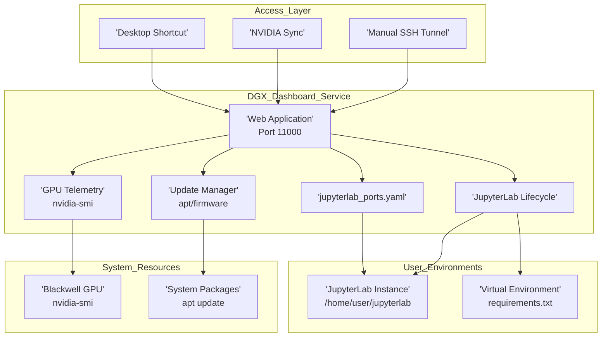
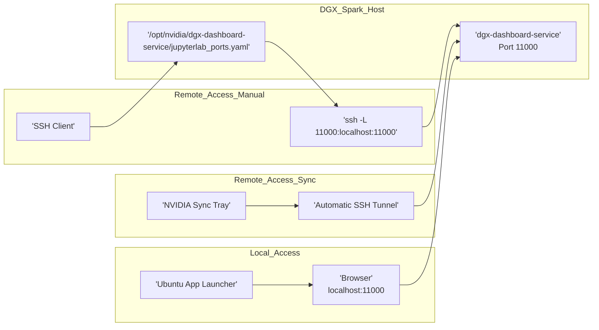

<!-- source: DeepWiki mcp.deepwiki.com · repo NVIDIA/dgx-spark-playbooks · page 2.4 DGX Dashboard · fetched 2026-10-26 -->

# DGX Dashboard

<details>
<summary>Relevant source files</summary>

The following files were used as context for generating this wiki page:

- [nvidia/dgx-dashboard/README.md](nvidia/dgx-dashboard/README.md)
- [nvidia/jax/README.md](nvidia/jax/README.md)
- [nvidia/sglang/README.md](nvidia/sglang/README.md)
- [nvidia/txt2kg/README.md](nvidia/txt2kg/README.md)
- [nvidia/unsloth/README.md](nvidia/unsloth/README.md)

</details>


The DGX Dashboard is a web-based management interface that provides system administration, GPU monitoring, and JupyterLab orchestration capabilities for DGX Spark devices. It serves as the primary tool for managing system updates, launching isolated development environments, and monitoring hardware resources on port 11000. [nvidia/dgx-dashboard/README.md:1-17]()

This page covers the dashboard's architecture, access methods, authentication flow, and JupyterLab management.

## Architecture Overview

The DGX Dashboard operates as a privileged system service with direct access to package management, firmware updates, and JupyterLab process orchestration. The service manages per-user JupyterLab instances with isolated port assignments and virtual environments. [nvidia/dgx-dashboard/README.md:17-21]()

### System Component Map
The following diagram maps high-level dashboard features to their underlying code-level entities and configuration files.


**Diagram 1: DGX Dashboard System Architecture**

Sources: [nvidia/dgx-dashboard/README.md:17-21](), [nvidia/dgx-dashboard/README.md:77-86]()

## Access Methods

Three distinct methods provide access to the dashboard, each with different network topology and authentication requirements. [nvidia/dgx-dashboard/README.md:52-54]()

### Access Method Topology
This diagram illustrates how external connections reach the `dgx-dashboard-service` via different transport mechanisms.


**Diagram 2: Access Method Topologies**

Sources: [nvidia/dgx-dashboard/README.md:56-101]()

### Port Discovery and Manual Tunneling
For manual remote access, users must discover their assigned JupyterLab port from a specific system configuration file. [nvidia/dgx-dashboard/README.md:77-81]()

1. **Port Discovery**: Run `cat /opt/nvidia/dgx-dashboard-service/jupyterlab_ports.yaml` to find the mapping for your username. [nvidia/dgx-dashboard/README.md:83-86]()
2. **Tunnel Creation**: 
   ```bash
   ssh -L 11000:localhost:11000 -L <ASSIGNED_PORT>:localhost:<ASSIGNED_PORT> <USERNAME>@<SPARK_DEVICE_IP>
   ```
   [nvidia/dgx-dashboard/README.md:92-93]()

## Authentication and Environment Management

### User Authentication
The dashboard uses system-level credentials for access. [nvidia/dgx-dashboard/README.md:102-108]()
* **Username**: DGX Spark system username.
* **Password**: System password.

### JupyterLab Lifecycle
The dashboard manages the lifecycle of JupyterLab instances, transitioning through `Starting`, `Preparing`, and `Running` states. [nvidia/dgx-dashboard/README.md:112-119]()

| Phase | Actions Performed |
|:---|:---|
| **Starting** | Process initialization. |
| **Preparing** | Creates `/home/<USERNAME>/jupyterlab` and sets up a Python virtual environment. |
| **Running** | JupyterLab server active on the assigned port. |

Sources: [nvidia/dgx-dashboard/README.md:116-123]()

### Virtual Environment Configuration
A default `requirements.txt` is automatically created in the working directory. Users can isolate environments by changing the working directory path in the dashboard interface and restarting the instance. [nvidia/dgx-dashboard/README.md:121-125]()

## System Monitoring and Updates

### GPU Telemetry
The dashboard provides a real-time monitoring panel for GPU utilization. This is particularly useful during heavy workloads like Stable Diffusion XL (SDXL) generation. [nvidia/dgx-dashboard/README.md:187-193]()

### System Maintenance
The dashboard is the primary interface for performing system updates, including:
* **Package Updates**: Orchestrating `apt` updates. [nvidia/dgx-dashboard/README.md:17-18]()
* **Firmware**: Managing system firmware upgrades. [nvidia/dgx-dashboard/README.md:17-18]()

> [!IMPORTANT]
> DGX Spark uses a Unified Memory Architecture (UMA). If memory pressure occurs, you can manually flush the buffer cache using:
> `sudo sh -c 'sync; echo 3 > /proc/sys/vm/drop_caches'`
> [nvidia/dgx-dashboard/README.md:233-238]()

## Sample AI Workload: SDXL
To verify the JupyterLab environment and GPU access, the dashboard provides a sample Stable Diffusion XL script. [nvidia/dgx-dashboard/README.md:126-128]()

**Code Entity Reference**: `nvidia/dgx-dashboard/assets/jupyter-cell.py` [nvidia/dgx-dashboard/README.md:39]()

The script utilizes the `diffusers` library and `torch.float16` to generate a 1024x1024 image on the Blackwell GPU. [nvidia/dgx-dashboard/README.md:135-182]()

## Troubleshooting

| Symptom | Potential Cause | Fix |
|:---|:---|:---|
| **Login Fails** | Incorrect system credentials | Ensure you are using the OS-level username/password. [nvidia/dgx-dashboard/README.md:106-108]() |
| **JupyterLab Startup Hang** | First-time setup delay | The first launch can take several minutes to build the venv. [nvidia/dgx-dashboard/README.md:118-119]() |
| **GPU Not Detected** | Driver or UMA cache issue | Flush buffer cache with `sync; echo 3 > /proc/sys/vm/drop_caches`. [nvidia/dgx-dashboard/README.md:237-238]() |
| **Remote Access Denied** | SSH Tunnel missing | Ensure both port 11000 and the user-specific Jupyter port are forwarded. [nvidia/dgx-dashboard/README.md:92-93]() |

Sources: [nvidia/dgx-dashboard/README.md:118-119](), [nvidia/dgx-dashboard/README.md:233-238]()

---

