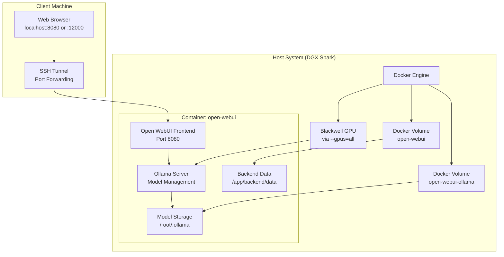
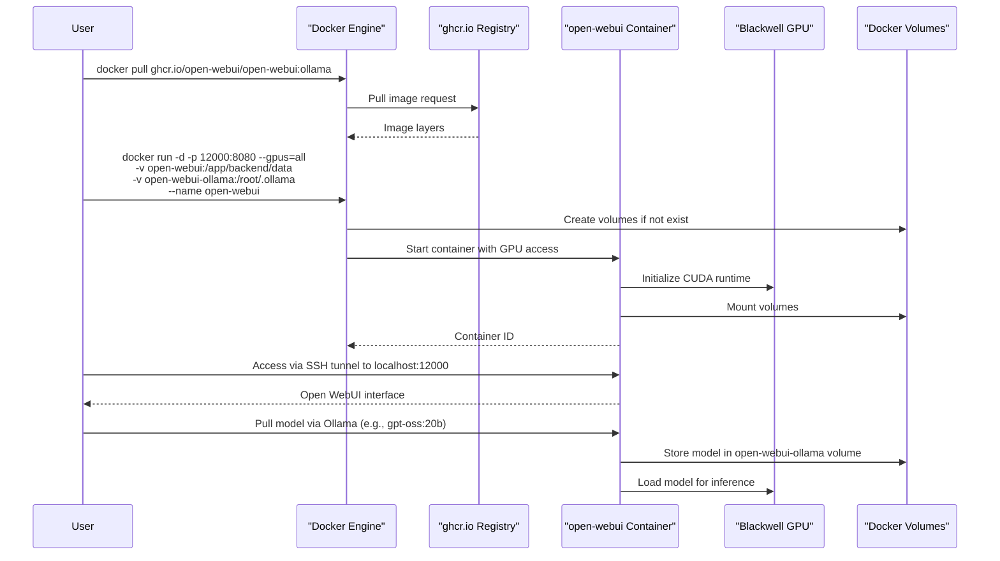
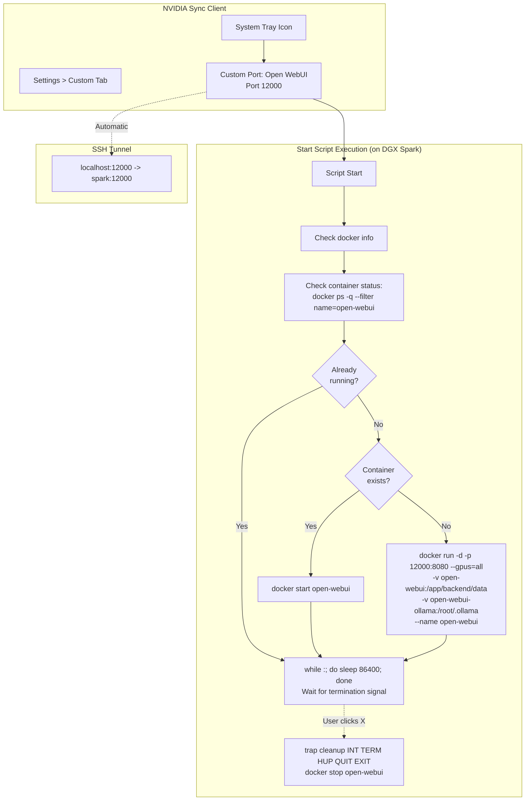
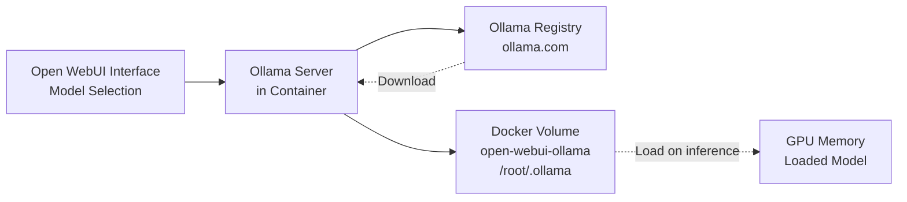

<!-- source: DeepWiki mcp.deepwiki.com · repo NVIDIA/dgx-spark-playbooks · page 2.5 Your First Application: Open WebUI · fetched 2026-10-26 -->

# Your First Application: Open WebUI

<details>
<summary>Relevant source files</summary>

The following files were used as context for generating this wiki page:

- [nvidia/connect-to-your-spark/README.md](nvidia/connect-to-your-spark/README.md)
- [nvidia/ollama/README.md](nvidia/ollama/README.md)
- [nvidia/open-webui/README.md](nvidia/open-webui/README.md)

</details>


## Purpose and Scope

This page guides you through deploying Open WebUI with Ollama as your first AI application on DGX Spark. It demonstrates core concepts including Docker container management, GPU passthrough, port forwarding, and persistent storage that apply to most applications in this repository. 

For information about SSH and network connectivity setup, see [Connecting to Your Spark](nvidia/connect-to-your-spark/README.md:1-43)(). For general system management and monitoring, see [DGX Dashboard](nvidia/connect-to-your-spark/README.md:122-122)(). For deploying other inference engines beyond Ollama, see [Inference Systems](nvidia/ollama/README.md:210-222)().

---

## System Overview

Open WebUI is a self-hosted web interface for interacting with large language models through a chat-based UI. This deployment uses the integrated Ollama variant, which packages both the Open WebUI frontend and the Ollama model server in a single container.

**Core Components:**

- **Open WebUI**: Web application serving the chat interface on port 8080 [nvidia/open-webui/README.md:132-132]().
- **Ollama**: Local model server handling model downloads, quantization, and inference [nvidia/open-webui/README.md:167-168]().
- **Docker Container**: `ghcr.io/open-webui/open-webui:ollama` image from GitHub Container Registry [nvidia/open-webui/README.md:77-77]().
- **Persistent Volumes**: `open-webui` (application data) and `open-webui-ollama` (model storage) [nvidia/open-webui/README.md:133-134]().
- **GPU Access**: NVIDIA Container Toolkit passes GPU through to container via `--gpus=all` flag [nvidia/open-webui/README.md:132-132]().

**Access Methods:**

1. **Direct Access**: Container exposes port 8080, accessible via SSH tunnel to `localhost:8080`.
2. **NVIDIA Sync**: Managed port forwarding to `localhost:12000` with automatic container lifecycle management [nvidia/open-webui/README.md:90-98]().

Sources: [nvidia/open-webui/README.md:1-40](), [nvidia/open-webui/README.md:132-135]()

---

## Architecture: Container Components



**Component Mapping to Docker Configuration:**

| Component | Docker Construct | Purpose |
|-----------|-----------------|---------|
| `open-webui` | Container name (`--name`) | Instance identifier for lifecycle management [nvidia/open-webui/README.md:135-135]() |
| `ghcr.io/open-webui/open-webui:ollama` | Image reference | Combined Open WebUI + Ollama distribution [nvidia/open-webui/README.md:106-106]() |
| `-p 12000:8080` | Port mapping | Exposes container port 8080 to host port 12000 [nvidia/open-webui/README.md:132-132]() |
| `--gpus=all` | GPU passthrough | Grants container access to Blackwell GPU [nvidia/open-webui/README.md:132-132]() |
| `-v open-webui:/app/backend/data` | Volume mount | Persists user accounts, chat history, settings [nvidia/open-webui/README.md:133-133]() |
| `-v open-webui-ollama:/root/.ollama` | Volume mount | Persists downloaded models and configurations [nvidia/open-webui/README.md:134-134]() |

Sources: [nvidia/open-webui/README.md:101-142]()

---

## Architecture: Deployment Flow



Sources: [nvidia/open-webui/README.md:76-78](), [nvidia/open-webui/README.md:132-135](), [nvidia/open-webui/README.md:170-175]()

---

## Deployment Option 1: Manual Docker

This approach directly uses Docker commands on the DGX Spark device. It requires SSH access and manual port forwarding.

### Prerequisites Verification

Ensure Docker group membership to avoid requiring `sudo` for every command [nvidia/open-webui/README.md:51-51]():

```bash
# Test Docker access
docker ps

# If permission denied, add user to docker group
sudo usermod -aG docker $USER
newgrp docker

# Verify access
docker ps
```

Sources: [nvidia/open-webui/README.md:49-70]()

### Container Deployment

Pull the image from GitHub Container Registry [nvidia/open-webui/README.md:77-77]():

```bash
docker pull ghcr.io/open-webui/open-webui:ollama
```

Start the container with GPU access and persistent volumes [nvidia/open-webui/README.md:132-135]():

```bash
docker run -d -p 8080:8080 --gpus=all \
  -v open-webui:/app/backend/data \
  -v open-webui-ollama:/root/.ollama \
  --name open-webui ghcr.io/open-webui/open-webui:ollama
```

**Runtime Configuration Flags:**

| Flag | Value | Effect |
|------|-------|--------|
| `-d` | N/A | Detached mode - container runs in background |
| `-p` | `8080:8080` | Maps container port 8080 to host port 8080 |
| `--gpus` | `all` | Grants access to all GPUs [nvidia/open-webui/README.md:132-132]() |
| `-v` | `open-webui:/app/backend/data` | Named volume for application data persistence [nvidia/open-webui/README.md:133-133]() |
| `-v` | `open-webui-ollama:/root/.ollama` | Named volume for Ollama model storage [nvidia/open-webui/README.md:134-134]() |
| `--name` | `open-webui` | Container identifier for lifecycle commands [nvidia/open-webui/README.md:135-135]() |

Sources: [nvidia/open-webui/README.md:72-81](), [nvidia/open-webui/README.md:132-135]()

### Port Forwarding Setup

Establish SSH tunnel from local machine to access the web interface [nvidia/connect-to-your-spark/README.md:32-36]():

```bash
# From your local machine, not on DGX Spark
ssh -L 8080:localhost:8080 <USERNAME>@<SPARK_HOSTNAME>.local
```

Access the interface at `http://localhost:8080` in your local browser.

Sources: [nvidia/connect-to-your-spark/README.md:18-41]()

---

## Deployment Option 2: NVIDIA Sync Custom Port

NVIDIA Sync automates container lifecycle management and port forwarding through a start script [nvidia/open-webui/README.md:90-91]().

### Start Script Architecture



Sources: [nvidia/open-webui/README.md:102-142]()

### Custom Port Configuration

Configure the custom port in NVIDIA Sync Settings [nvidia/open-webui/README.md:83-87]():

**Form Values:**

- **Name**: `Open WebUI` [nvidia/open-webui/README.md:96-96]()
- **Port**: `12000` [nvidia/open-webui/README.md:97-97]()
- **Auto open in browser**: Enabled [nvidia/open-webui/README.md:98-98]()
- **Start Script**: [nvidia/open-webui/README.md:102-142]()

**Key Script Components:**

| Script Section | Lines | Purpose |
|----------------|-------|---------|
| Signal handlers | [nvidia/open-webui/README.md:108-113]() | Trap termination signals to stop container cleanly |
| Docker availability check | [nvidia/open-webui/README.md:116-119]() | Verify Docker daemon is reachable |
| Container status logic | [nvidia/open-webui/README.md:122-137]() | Start existing or create new container as needed |
| Keep-alive loop | [nvidia/open-webui/README.md:141-141]() | Maintain script execution for tunnel lifetime |

Sources: [nvidia/open-webui/README.md:101-142]()

---

## Initial Configuration

### Administrator Account Creation

On first access, Open WebUI requires creating an initial administrator account [nvidia/open-webui/README.md:159-159]().

1. Click "Get Started" button in the interface [nvidia/open-webui/README.md:161-161]()
2. Fill out account creation form (username, email, password) [nvidia/open-webui/README.md:162-162]()
3. Click registration button to access the main interface [nvidia/open-webui/README.md:163-163]()

Sources: [nvidia/open-webui/README.md:157-164]()

### Model Download via Ollama

Models are downloaded through the UI and stored in the `open-webui-ollama` volume [nvidia/open-webui/README.md:167-168]().

**Example: Downloading `gpt-oss:20b`**

1. Click "Select a model" dropdown [nvidia/open-webui/README.md:170-170]()
2. Type model name in search field (e.g., `gpt-oss:20b`) [nvidia/open-webui/README.md:171-171]()
3. Click "Pull 'gpt-oss:20b' from Ollama.com" button [nvidia/open-webui/README.md:172-172]()
4. Monitor download progress and select once complete [nvidia/open-webui/README.md:173-174]()

**Model Storage Architecture:**



Sources: [nvidia/open-webui/README.md:165-175](), [nvidia/ollama/README.md:81-101]()

---

## Post-Deployment Operations

### Testing Inference

Verify the complete stack by sending a test prompt [nvidia/open-webui/README.md:177-178]():

1. Ensure model is selected in dropdown [nvidia/open-webui/README.md:174-174]()
2. Enter prompt: `Write me a haiku about GPUs` [nvidia/open-webui/README.md:180-180]()
3. Press Enter and observe response [nvidia/open-webui/README.md:181-181]()

Sources: [nvidia/open-webui/README.md:177-182]()

### Stopping the Application

To reclaim resources, stop the Open WebUI server [nvidia/open-webui/README.md:183-184]():

1. Click NVIDIA Sync system tray icon [nvidia/open-webui/README.md:187-187]()
2. Click the `x` icon on the right of the "Open WebUI" entry [nvidia/open-webui/README.md:188-188]()
3. This closes the tunnel and stops the Docker container [nvidia/open-webui/README.md:189-189]()

Sources: [nvidia/open-webui/README.md:183-190]()

---

## Troubleshooting

| Symptom | Cause | Resolution |
|---------|-------|------------|
| `Permission denied` on `docker ps` | User not in `docker` group | Execute `sudo usermod -aG docker $USER && newgrp docker` [nvidia/open-webui/README.md:59-64]() |
| Page fails to load on first launch | Model download in progress | Wait and refresh the page [nvidia/open-webui/README.md:154-154]() |
| `ollama` command not found | Ollama not installed | Run `curl -fsSL https://ollama.com/install.sh | sh` [nvidia/ollama/README.md:76-76]() |

Sources: [nvidia/open-webui/README.md:59-64](), [nvidia/open-webui/README.md:153-155](), [nvidia/ollama/README.md:61-76]()

---

