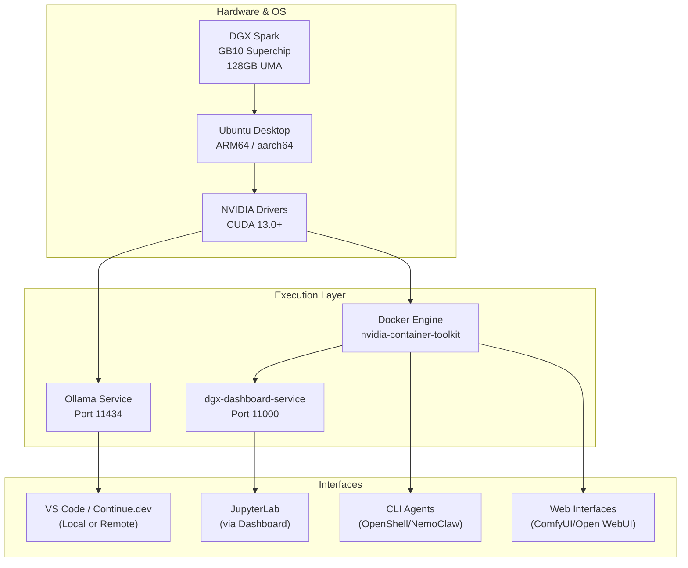
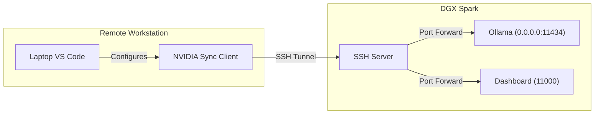

<!-- source: DeepWiki mcp.deepwiki.com · repo NVIDIA/dgx-spark-playbooks · page 3 Development Environments · fetched 2026-10-26 -->

# Development Environments

<details>
<summary>Relevant source files</summary>

The following files were used as context for generating this wiki page:

- [nvidia/comfy-ui/README.md](nvidia/comfy-ui/README.md)
- [nvidia/rag-ai-workbench/README.md](nvidia/rag-ai-workbench/README.md)
- [nvidia/vibe-coding/README.md](nvidia/vibe-coding/README.md)
- [nvidia/vscode/README.md](nvidia/vscode/README.md)

</details>


This page provides an overview of development tools and interfaces available for DGX Spark, including AI-assisted coding, interactive notebooks, and GPU-accelerated data science environments. These environments leverage the NVIDIA Grace Blackwell GB10 Superchip and its Unified Memory Architecture (UMA) for high-performance development.

For detailed setup instructions, see the child pages: [VS Code and Vibe Coding](#3.1), [JupyterLab](#3.2), [Optimized JAX](#3.3), [CUDA-X Data Science](#3.4), [LM Studio](#3.5), and [CLI Coding Agent and OpenShell Sandbox](#3.6).

## Architecture Overview

DGX Spark development environments are architected to support both local and remote workflows. The system utilizes containerization and specialized drivers to expose Blackwell GPU capabilities to high-level IDEs and frameworks.

### Development Environment Stack



Sources: [nvidia/vibe-coding/README.md:33-36](), [nvidia/vscode/README.md:61-63](), [nvidia/comfy-ui/README.md:37-46](), [nvidia/rag-ai-workbench/README.md:40-48]()

## Core Development Environments

### VS Code and Vibe Coding
DGX Spark supports "Vibe Coding"—using AI-assisted development tools like the **Continue** extension paired with local LLMs. You can install VS Code directly on the ARM64 Spark system or connect remotely from a workstation using **NVIDIA Sync**. By running **Ollama** with large models like `gpt-oss:120b`, the system acts as a high-performance private coding assistant.

For details, see [VS Code and Vibe Coding](#3.1).

### JupyterLab
Accessible via the **DGX Dashboard** at port `11000`, JupyterLab provides a managed environment for interactive Python development. It automatically handles GPU passthrough and per-user port assignments, making it the primary interface for rapid prototyping and experimentation.

For details, see [JupyterLab](#3.2).

### Optimized JAX
JAX on Spark is optimized using XLA (Accelerated Linear Algebra) to target Blackwell GPUs. This environment is typically deployed via Docker containers and includes the **marimo** reactive notebook interface for scientific computing and ML research.

For details, see [Optimized JAX](#3.3).

### CUDA-X Data Science
This environment focuses on the RAPIDS ecosystem, including `cuDF` for pandas-like GPU-accelerated dataframes and `cuML` for scikit-learn-like machine learning. It leverages the Unified Memory Architecture to process datasets larger than traditional VRAM limits.

For details, see [CUDA-X Data Science](#3.4).

### LM Studio and LM Link
For developers needing a headless LLM serving solution, **LM Studio** (`llmster`) can be deployed on Spark. Using **LM Link**, developers can establish encrypted tunnels to access these models from their local laptops as if the models were running locally.

For details, see [LM Studio](#3.5).

### CLI Coding Agents and Sandboxing
For autonomous development, Spark supports CLI-based agents like **OpenClaw** and **NemoClaw**. These agents operate within an **OpenShell** sandbox, providing a secure, kernel-level isolated environment for AI to execute code and manage system tasks without risking the host OS.

For details, see [CLI Coding Agent and OpenShell Sandbox](#3.6).

## Connectivity and Port Mapping

Most development tools on Spark expose web interfaces or APIs. Accessing these requires understanding the default port allocations:

| Service | Port | Access Method |
| :--- | :--- | :--- |
| **DGX Dashboard** | `11000` | System Management / JupyterLab |
| **Ollama API** | `11434` | VS Code / Continue / Open WebUI |
| **ComfyUI** | `8188` | Diffusion Workflows |
| **Open WebUI** | `8080` | LLM Chat Interface |
| **JupyterLab** | Dynamic | Assigned in `jupyterlab_ports.yaml` |

### Remote Access Logic



Sources: [nvidia/vibe-coding/README.md:64-78](), [nvidia/vscode/README.md:175-183](), [nvidia/comfy-ui/README.md:139-143]()

## Unified Memory Considerations
DGX Spark uses a **Unified Memory Architecture (UMA)**, allowing the GPU and CPU to share the system's 128GB of memory dynamically. While this allows running massive models like `gpt-oss:120b`, developers should occasionally manually flush the buffer cache to maintain optimal performance:

```bash
sudo sh -c 'sync; echo 3 > /proc/sys/vm/drop_caches'
```

Sources: [nvidia/vibe-coding/README.md:179-184](), [nvidia/comfy-ui/README.md:192-197]()

## Next Steps
- To set up your IDE, go to [VS Code and Vibe Coding](#3.1).
- To start a notebook, go to [JupyterLab](#3.2).
- To build RAG applications, see [RAG Applications in AI Workbench](#6.2).

---

