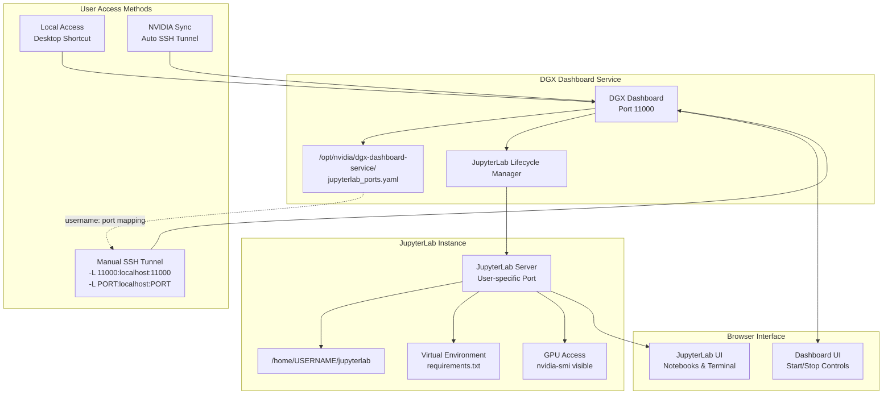
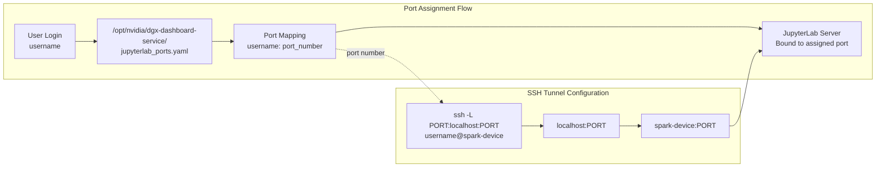
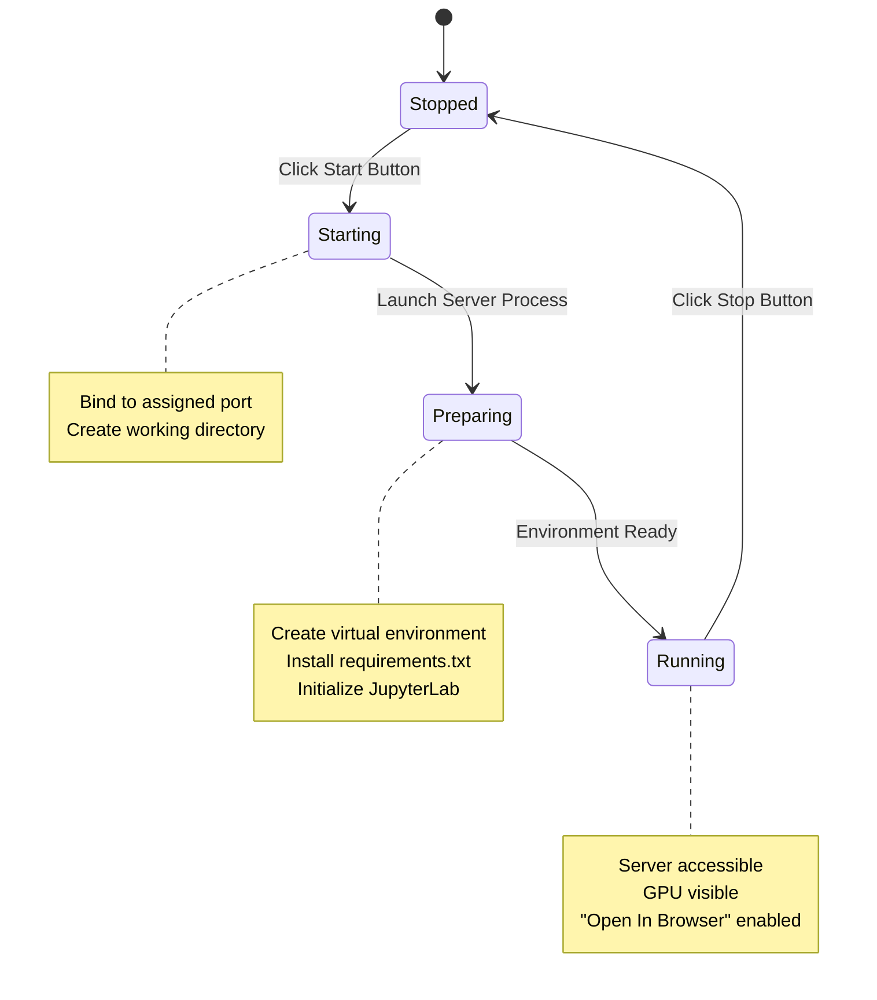
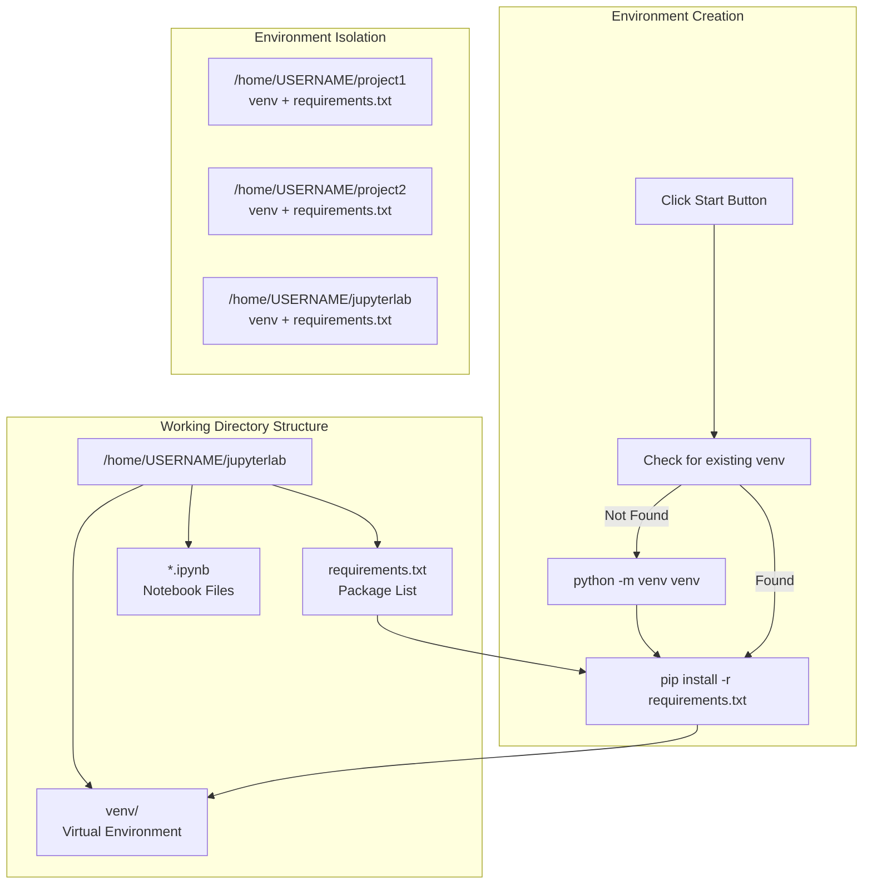
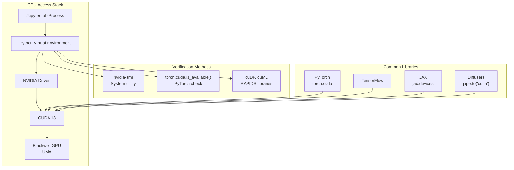
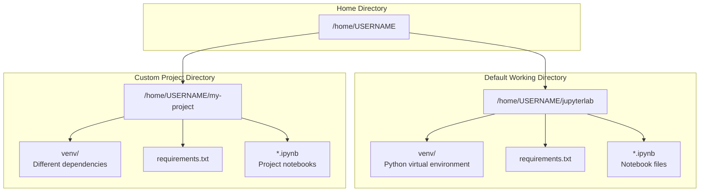

<!-- source: DeepWiki mcp.deepwiki.com · repo NVIDIA/dgx-spark-playbooks · page 3.2 JupyterLab · fetched 2026-10-26 -->

# JupyterLab

<details>
<summary>Relevant source files</summary>

The following files were used as context for generating this wiki page:

- [nvidia/dgx-dashboard/README.md](nvidia/dgx-dashboard/README.md)
- [nvidia/jax/README.md](nvidia/jax/README.md)
- [nvidia/sglang/README.md](nvidia/sglang/README.md)
- [nvidia/txt2kg/README.md](nvidia/txt2kg/README.md)
- [nvidia/unsloth/README.md](nvidia/unsloth/README.md)

</details>


This document describes how to access and use JupyterLab on DGX Spark through the DGX Dashboard. JupyterLab provides interactive Python development with GPU acceleration, isolated virtual environments per working directory, and user-specific port assignments. For information about the DGX Dashboard management interface, see [DGX Dashboard](#2.4). For alternative development environments, see [VS Code and Vibe Coding](#3.1), [Optimized JAX](#3.3), or [CUDA-X Data Science](#3.4).

## Purpose and Scope

JupyterLab on DGX Spark provides interactive notebook-based development with direct GPU access, managed through the DGX Dashboard web interface. Each user receives a dedicated port assignment and can create multiple isolated Python environments by switching working directories. This document covers JupyterLab access methods, virtual environment management, GPU configuration, and integration with the DGX Dashboard lifecycle.

## Architecture Overview

JupyterLab instances are managed by the DGX Dashboard service, which handles port allocation, virtual environment creation, and process lifecycle. Each user account is assigned a unique port for their JupyterLab server, enabling multiple users to run concurrent sessions without port conflicts.



**JupyterLab Architecture through DGX Dashboard**

The DGX Dashboard manages JupyterLab instances by reading port assignments from a YAML configuration file and orchestrating the server lifecycle through state transitions.

Sources: [nvidia/dgx-dashboard/README.md:15-18](), [nvidia/dgx-dashboard/README.md:77-81]()

## Port Assignment System

Each user account on the DGX Spark receives a dedicated port for their JupyterLab server, stored in `/opt/nvidia/dgx-dashboard-service/jupyterlab_ports.yaml`. This port assignment persists across sessions and is required for SSH tunnel configuration when accessing remotely.



**Port Allocation and SSH Tunnel Mapping**

To determine your assigned port:

```bash
cat /opt/nvidia/dgx-dashboard-service/jupyterlab_ports.yaml
```

The YAML file contains mappings like:

```yaml
username1: 8888
username2: 8889
username3: 8890
```

For manual SSH tunnel setup:

```bash
ssh -L 11000:localhost:11000 -L <ASSIGNED_PORT>:localhost:<ASSIGNED_PORT> <USERNAME>@<SPARK_DEVICE_IP>
```

Sources: [nvidia/dgx-dashboard/README.md:77-92]()

## Access Methods

### Local Access via Desktop Shortcut

When physically present at the Spark device or using remote desktop:

1. Launch Ubuntu app launcher from bottom left corner [nvidia/dgx-dashboard/README.md:61-61]()
2. Click the DGX Dashboard shortcut [nvidia/dgx-dashboard/README.md:62-62]()
3. Browser opens to `http://localhost:11000` [nvidia/dgx-dashboard/README.md:63-63]()
4. Enter system username and password [nvidia/dgx-dashboard/README.md:106-108]()

Sources: [nvidia/dgx-dashboard/README.md:56-64](), [nvidia/dgx-dashboard/README.md:106-108]()

### Remote Access via NVIDIA Sync

NVIDIA Sync provides automatic SSH tunnel management:

1. Click NVIDIA Sync icon in system tray [nvidia/dgx-dashboard/README.md:69-69]()
2. Select Spark device from list [nvidia/dgx-dashboard/README.md:70-70]()
3. Click "Connect" [nvidia/dgx-dashboard/README.md:71-71]()
4. Click "DGX Dashboard" button [nvidia/dgx-dashboard/README.md:72-72]()
5. Dashboard opens at `http://localhost:11000` via auto-created tunnel [nvidia/dgx-dashboard/README.md:73-73]()

The tunnel forwards both port 11000 (Dashboard) and the user's assigned JupyterLab port automatically.

Sources: [nvidia/dgx-dashboard/README.md:65-75]()

### Remote Access via Manual SSH Tunnel

For remote access without NVIDIA Sync:

```bash
# Step 1: Determine assigned port
ssh <USERNAME>@<SPARK_IP>
cat /opt/nvidia/dgx-dashboard-service/jupyterlab_ports.yaml
exit

# Step 2: Create tunnel with both ports
ssh -L 11000:localhost:11000 -L <ASSIGNED_PORT>:localhost:<ASSIGNED_PORT> <USERNAME>@<SPARK_IP>

# Step 3: Navigate to http://localhost:11000
```

Sources: [nvidia/dgx-dashboard/README.md:77-99]()

## JupyterLab Lifecycle Management

The DGX Dashboard manages JupyterLab instances through a state machine with automatic environment provisioning.



**JupyterLab State Transitions**

### Starting a JupyterLab Instance

From the DGX Dashboard:

1. Click "Start" button in the right panel [nvidia/dgx-dashboard/README.md:116-116]()
2. Monitor status transitions: `Starting` → `Preparing` → `Running` [nvidia/dgx-dashboard/README.md:117-117]()
3. Wait for "Running" status (first launch may take several minutes) [nvidia/dgx-dashboard/README.md:118-118]()
4. Click "Open In Browser" if pop-up was blocked [nvidia/dgx-dashboard/README.md:119-119]()

On first start, the following occurs automatically:
- Default working directory created at `/home/<USERNAME>/jupyterlab` [nvidia/dgx-dashboard/README.md:121-121]()
- Virtual environment provisioned with pip [nvidia/dgx-dashboard/README.md:121-121]()
- `requirements.txt` generated with installed packages [nvidia/dgx-dashboard/README.md:122-122]()

Sources: [nvidia/dgx-dashboard/README.md:112-122]()

### Stopping a JupyterLab Instance

To terminate a running session:

1. Return to DGX Dashboard tab
2. Click "Stop" button in JupyterLab panel [nvidia/dgx-dashboard/README.md:124-124]()
3. Status changes from "Running" to "Stopped"

Sources: [nvidia/dgx-dashboard/README.md:124-124]()

## Virtual Environment Management

Each working directory maintains an isolated Python virtual environment, enabling project-specific dependencies without conflicts.



**Virtual Environment Structure and Creation Flow**

### Changing Working Directory

To create a new isolated environment for a different project:

1. Click "Stop" button to halt current instance [nvidia/dgx-dashboard/README.md:124-124]()
2. Change the working directory path in the JupyterLab panel [nvidia/dgx-dashboard/README.md:124-124]()
3. Click "Start" button [nvidia/dgx-dashboard/README.md:124-124]()
4. A new virtual environment is created in the specified directory [nvidia/dgx-dashboard/README.md:124-124]()

Sources: [nvidia/dgx-dashboard/README.md:121-125]()

### Inspecting Installed Packages

The `requirements.txt` file lists all packages installed in the virtual environment:

```bash
# View from JupyterLab terminal
cat /home/<USERNAME>/jupyterlab/requirements.txt
```

Sources: [nvidia/dgx-dashboard/README.md:121-122]()

## GPU Access Configuration

JupyterLab instances have direct access to the Blackwell GPU through the NVIDIA driver stack. GPU availability can be verified within notebooks using standard NVIDIA utilities.



**GPU Access Architecture from JupyterLab**

### Verifying GPU Access

From a JupyterLab notebook cell:

```python
# System-level check
!nvidia-smi

# PyTorch check
import torch
print(f"CUDA available: {torch.cuda.is_available()}")
```

### GPU Memory Management on UMA

DGX Spark uses Unified Memory Architecture (UMA), enabling dynamic memory sharing between GPU and CPU [nvidia/dgx-dashboard/README.md:167-167](). Applications may require manual buffer cache flushing if memory pressure occurs [nvidia/dgx-dashboard/README.md:168-169]():

```bash
# From JupyterLab terminal
sudo sh -c 'sync; echo 3 > /proc/sys/vm/drop_caches'
```

Sources: [nvidia/dgx-dashboard/README.md:167-172](), [nvidia/jax/README.md:193-196](), [nvidia/unsloth/README.md:143-149]()

## Example Workflow: Stable Diffusion XL

The DGX Dashboard documentation provides a sample workflow demonstrating GPU-accelerated image generation in JupyterLab.

### Creating a New Notebook

1. In JupyterLab: `File` → `New` → `Notebook` [nvidia/dgx-dashboard/README.md:130-130]()
2. Select "Python 3 (ipykernel)" as the kernel [nvidia/dgx-dashboard/README.md:131-131]()
3. Create a new code cell [nvidia/dgx-dashboard/README.md:132-132]()

### Image Generation Code

The following example demonstrates GPU utilization with Stable Diffusion XL:

```python
import warnings
warnings.filterwarnings('ignore', message='.*cuda capability.*')
import tqdm.auto
tqdm.auto.tqdm = tqdm.std.tqdm

from diffusers import DiffusionPipeline
import torch
from PIL import Image
from datetime import datetime
from IPython.display import display

## --- Model setup ---
MODEL_ID = "stabilityai/stable-diffusion-xl-base-1.0"
dtype = torch.float16 if torch.cuda.is_available() else torch.float32

pipe = DiffusionPipeline.from_pretrained(
    MODEL_ID,
    torch_dtype=dtype,
    variant="fp16" if dtype==torch.float16 else None,
)
pipe = pipe.to("cuda" if torch.cuda.is_available() else "cpu")

## --- Prompt setup ---
prompt = "a cozy modern reading nook with a big window, soft natural light, photorealistic"
negative_prompt = "low quality, blurry, distorted, text, watermark"

## --- Generation settings ---
height = 1024
width = 1024
steps = 30
guidance = 7.0

## --- Generate ---
result = pipe(
    prompt=prompt,
    negative_prompt=negative_prompt,
    num_inference_steps=steps,
    guidance_scale=guidance,
    height=height,
    width=width,
)

## --- Save to file ---
image: Image.Image = result.images[0]
display(image)
image.save(f"sdxl_output.png")
print(f"Saved image as sdxl_output.png")
```

Run the cell with `Shift+Enter` [nvidia/dgx-dashboard/README.md:184-184](). The first execution downloads the model and may take several minutes [nvidia/dgx-dashboard/README.md:185-185]().

### Monitoring GPU Utilization

While the generation is running:

1. Switch to the DGX Dashboard browser tab [nvidia/dgx-dashboard/README.md:191-191]()
2. Observe GPU telemetry data in monitoring panels [nvidia/dgx-dashboard/README.md:110-110]()

Sources: [nvidia/dgx-dashboard/README.md:128-186]()

## File System Layout

JupyterLab working directories follow a consistent structure enabling reproducibility and environment isolation.



**JupyterLab File System Structure**

Each working directory is self-contained with its own virtual environment and dependencies, preventing package conflicts between projects [nvidia/dgx-dashboard/README.md:121-125]().

Sources: [nvidia/dgx-dashboard/README.md:121-125]()

## Integration with Other Development Tools

JupyterLab complements other development environments available on DGX Spark.

| Development Tool | Primary Use Case | Access Method | GPU Access |
|-----------------|------------------|---------------|------------|
| **JupyterLab** | Interactive notebooks, data exploration | DGX Dashboard | Yes, direct |
| **VS Code + Continue** | Code development, AI-assisted coding | SSH + Tailscale | Yes, via Docker |
| **JAX Container** | ML research, NumPy-like GPU computing | Docker port 8080 | Yes, via `--gpus all` |
| **SGLang** | High-performance LLM/VLM serving | Docker port 30000 | Yes, via `--gpus all` |

### Shared File Access

All development tools can access the same home directory files:

```bash
# Files created in JupyterLab
/home/<USERNAME>/jupyterlab/output.pkl

# Can be accessed from JAX container
docker run --gpus all -v /home/<USERNAME>:/workspace jax-on-spark
```

Sources: [nvidia/jax/README.md:117-121](), [nvidia/sglang/README.md:131-136]()

## Troubleshooting

### JupyterLab Won't Start

| Symptom | Cause | Fix |
|---------|-------|-----|
| Status stuck in "Starting" | Issue with current virtual environment | Change working directory path in Dashboard panel and start new instance [nvidia/dgx-dashboard/README.md:124-124]() |
| "Port already in use" error | Previous instance not cleaned up | Stop instance via Dashboard, wait 30 seconds, retry [nvidia/dgx-dashboard/README.md:124-124]() |

### GPU Memory Pressure

| Symptom | Cause | Fix |
|---------|-------|-----|
| Out of memory errors | Linux buffer cache consuming memory | Flush buffer cache: `sudo sync; sudo sh -c 'echo 3 > /proc/sys/vm/drop_caches'` [nvidia/dgx-dashboard/README.md:170-172]() |
| Performance degradation | VRAM contention | Set `OLLAMA_MAX_LOADED_MODELS=1` if using Ollama concurrently [nvidia/txt2kg/README.md:161-161]() |

Sources: [nvidia/dgx-dashboard/README.md:167-172](), [nvidia/txt2kg/README.md:161-162](), [nvidia/unsloth/README.md:143-149]()

## Cleanup and Rollback

### Removing JupyterLab Environments

To delete a JupyterLab working directory and its environment:

```bash
# Stop instance via Dashboard first
# Then from terminal:
rm -rf /home/<USERNAME>/jupyterlab
```

### Resetting to Default State

To return to a fresh JupyterLab setup:

1. Stop all running JupyterLab instances via Dashboard [nvidia/dgx-dashboard/README.md:124-124]()
2. Remove all working directories: `rm -rf /home/<USERNAME>/jupyterlab*`
3. Click "Start" in Dashboard to create new default environment [nvidia/dgx-dashboard/README.md:116-116]()

Sources: [nvidia/dgx-dashboard/README.md:116-124]()

---

