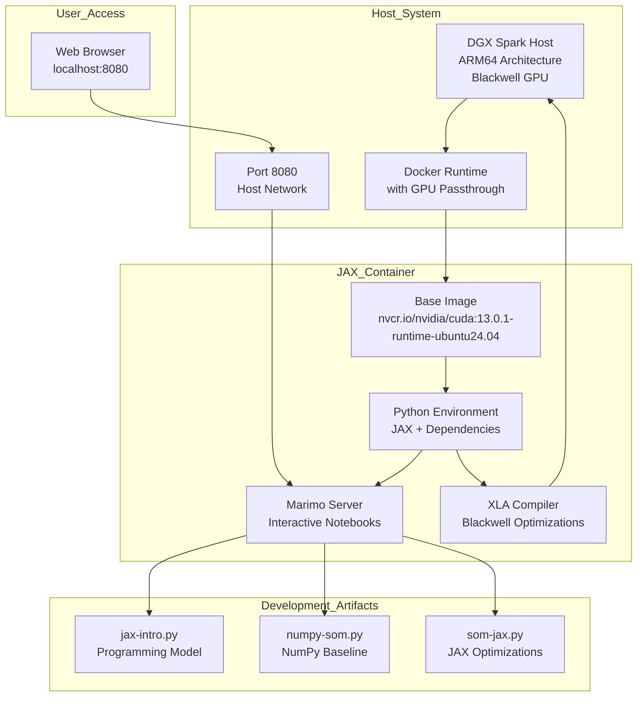
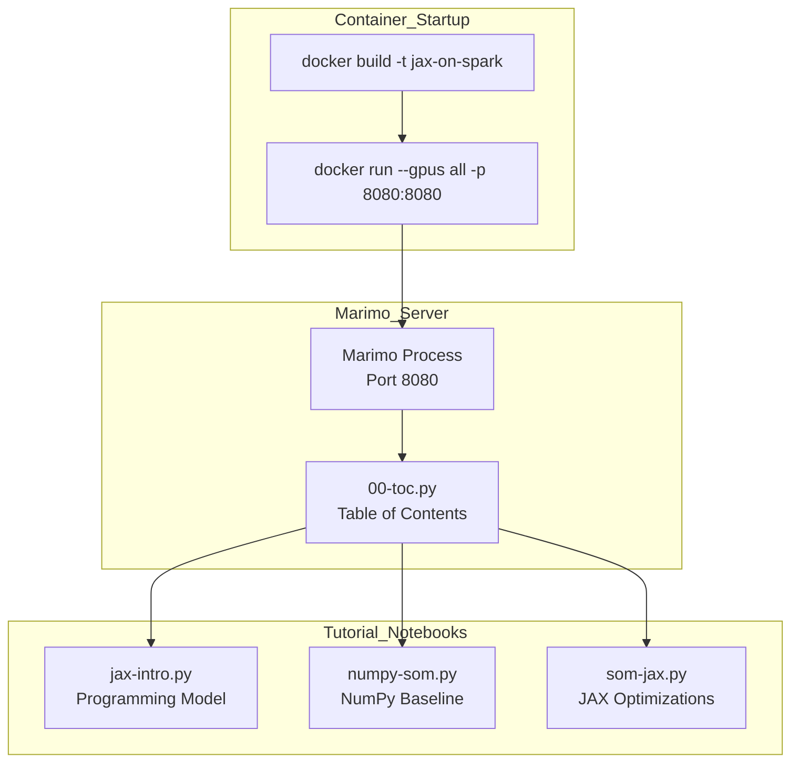

<!-- source: DeepWiki mcp.deepwiki.com · repo NVIDIA/dgx-spark-playbooks · page 3.3 Optimized JAX · fetched 2026-10-26 -->

# Optimized JAX

<details>
<summary>Relevant source files</summary>

The following files were used as context for generating this wiki page:

- [nvidia/dgx-dashboard/README.md](nvidia/dgx-dashboard/README.md)
- [nvidia/jax/README.md](nvidia/jax/README.md)
- [nvidia/jax/assets/00-toc.py](nvidia/jax/assets/00-toc.py)
- [nvidia/jax/assets/Dockerfile](nvidia/jax/assets/Dockerfile)
- [nvidia/jax/assets/jax-intro.py](nvidia/jax/assets/jax-intro.py)
- [nvidia/jax/assets/numpy-som.py](nvidia/jax/assets/numpy-som.py)
- [nvidia/jax/assets/som-jax.py](nvidia/jax/assets/som-jax.py)
- [nvidia/sglang/README.md](nvidia/sglang/README.md)
- [nvidia/txt2kg/README.md](nvidia/txt2kg/README.md)
- [nvidia/unsloth/README.md](nvidia/unsloth/README.md)

</details>


This document describes the JAX development environment on DGX Spark, which enables high-performance machine learning research using NumPy-like APIs with GPU acceleration via XLA compilation. The environment runs in a containerized setup with marimo notebooks for interactive development.

For general Python notebook development with GPU access, see [JupyterLab](#3.2). For GPU-accelerated data science with pandas/scikit-learn-like APIs, see [CUDA-X Data Science](#3.4).

## Architecture Overview

The JAX environment integrates into the DGX Spark development stack as a specialized container for ML research workflows. The setup prioritizes XLA optimization for Blackwell GPU architecture.

### JAX Container Architecture

The system maps host hardware resources into a containerized environment running the `marimo` reactive notebook server.



**Sources:** [nvidia/jax/README.md:1-198](), [nvidia/jax/assets/Dockerfile:21-33]()

### JAX Execution Model

JAX transforms NumPy-style code into optimized GPU kernels using the XLA (Accelerated Linear Algebra) backend.

```mermaid
graph LR
    subgraph "User_Code"
        NUMPY_CODE["NumPy-style Code<br/>jax.numpy arrays"]
        TRANSFORMS["Function Transforms<br/>jit/grad/vmap/pmap"]
    end
    
    subgraph "JAX_Runtime"
        TRACER["JAX Tracer<br/>Operation Graph"]
        DISPATCHER["Device Dispatcher<br/>GPU Selection"]
    end
    
    subgraph "XLA_Backend"
        GRAPH["XLA HLO Graph<br/>High-Level Ops"]
        OPTIMIZER["XLA Optimizer<br/>Fusion & Layout"]
        CODEGEN["Kernel Generator<br/>PTX/SASS"]
    end
    
    subgraph "Hardware"
        GPU["Blackwell GPU<br/>Tensor Cores"]
        UMA["Unified Memory Architecture"]
    end
    
    NUMPY_CODE --> TRANSFORMS
    TRANSFORMS --> TRACER
    TRACER --> DISPATCHER
    DISPATCHER --> GRAPH
    GRAPH --> OPTIMIZER
    OPTIMIZER --> CODEGEN
    CODEGEN --> GPU
    GPU --> UMA
```



**Sources:** [nvidia/jax/README.md:17-26](), [nvidia/jax/assets/jax-intro.py:39-43]()

## Container Configuration

The JAX environment is defined by a `Dockerfile` that configures ARM64-specific dependencies and XLA optimizations for Blackwell architecture.

### Base Image and Dependencies

The container builds from NVIDIA's CUDA 13.0.1 runtime image with Ubuntu 24.04, targeting ARM64 (AArch64) architecture. It uses the `uv` package manager for fast environment initialization.

[nvidia/jax/assets/Dockerfile:21-33]()

Key configuration elements:

| Component | Specification | Purpose |
|-----------|--------------|---------|
| Base Image | `nvcr.io/nvidia/cuda:13.0.1-runtime-ubuntu24.04` | CUDA 13.0 support for Blackwell [nvidia/jax/assets/Dockerfile:21]() |
| Architecture | ARM64 (AArch64) | DGX Spark processor architecture [nvidia/jax/README.md:82]() |
| Python | 3.12 | Modern JAX compatibility [nvidia/jax/assets/Dockerfile:29]() |
| JAX | `jax[cuda13]==0.7.2` | GPU-accelerated JAX with CUDA 13 support [nvidia/jax/assets/Dockerfile:29]() |
| Marimo | `0.16.5` | Reactive notebook interface [nvidia/jax/assets/Dockerfile:29]() |

**Sources:** [nvidia/jax/README.md:43-49](), [nvidia/jax/assets/Dockerfile:21-33]()

### Docker Runtime Configuration

The container requires specific runtime flags for GPU access and memory management:

```bash
docker run --gpus all --rm -it \
    --shm-size=1g \
    --ulimit memlock=-1 \
    --ulimit stack=67108864 \
    -p 8080:8080 \
    jax-on-spark
```

Runtime flag purposes:

| Flag | Value | Purpose |
|------|-------|---------|
| `--gpus all` | All GPUs | Enable GPU passthrough via NVIDIA Container Toolkit [nvidia/jax/README.md:117]() |
| `--shm-size` | 1g | Shared memory for inter-process communication [nvidia/jax/README.md:118]() |
| `--ulimit memlock` | -1 (unlimited) | Allow memory locking for GPU operations [nvidia/jax/README.md:118]() |
| `--ulimit stack` | 67108864 | Increase stack size for deep JAX traces [nvidia/jax/README.md:118]() |
| `-p 8080:8080` | Port mapping | Expose marimo notebook server [nvidia/jax/README.md:119]() |

**Sources:** [nvidia/jax/README.md:110-121]()

## Development Workflow

### Marimo Notebook Interface

The JAX environment uses `marimo` for interactive development. Unlike traditional notebooks, `marimo` is reactive; changing a cell automatically triggers updates in dependent cells.



**Sources:** [nvidia/jax/README.md:121-131](), [nvidia/jax/assets/00-toc.py:45-51](), [nvidia/jax/assets/Dockerfile:33]()

### Tutorial Progression

The tutorial notebooks follow an iterative optimization workflow:

| Notebook | File | Content | Purpose |
|----------|------|---------|---------|
| Introduction | `jax-intro.py` | JAX fundamentals, `jit`, `grad`, and immutable arrays [nvidia/jax/assets/jax-intro.py:39-43]() | Establish JAX fundamentals |
| NumPy Baseline | `numpy-som.py` | Self-organized map (SOM) training algorithm in NumPy [nvidia/jax/assets/numpy-som.py:47-51]() | Establish performance baseline |
| JAX Optimizations | `som-jax.py` | Porting SOM to JAX, using `jax.random`, and `jnp` [nvidia/jax/assets/som-jax.py:42-47]() | Demonstrate progressive optimization |

**Sources:** [nvidia/jax/README.md:55-58](), [nvidia/jax/README.md:133-166]()

## JAX Programming Model

### Function Transformations

JAX provides four primary function transformations:

*   `jit`: Compiles functions into fast GPU code via XLA [nvidia/jax/README.md:21]().
*   `grad`: Automatic differentiation for gradients [nvidia/jax/README.md:22]().
*   `vmap`: Automatic vectorization across batches [nvidia/jax/README.md:23]().
*   `pmap`: Parallel execution across multiple GPUs [nvidia/jax/README.md:24]().

### Immutable Array Updates

In JAX, arrays are immutable. Instead of in-place updates like `zna[3] = 5.0` in NumPy [nvidia/jax/assets/jax-intro.py:168-171](), JAX uses functional updates:

```python
# JAX functional update
za_1 = za.at[3].set(5.0)
```
**Sources:** [nvidia/jax/assets/jax-intro.py:180-184]()

## Performance Optimization Example

### Self-Organized Map (SOM) Implementation

The tutorial demonstrates progressive optimization using a SOM training algorithm as a case study. The process moves from standard NumPy [nvidia/jax/assets/numpy-som.py:151-191]() to JAX implementations that utilize GPU memory [nvidia/jax/assets/som-jax.py:103-106]().

### Optimization Techniques Applied

| Technique | Implementation | Impact |
|-----------|----------------|--------|
| Array replacement | Replace `numpy` with `jax.numpy` | Enable GPU execution [nvidia/jax/assets/som-jax.py:53-57]() |
| Random Number Generation | `jax.random.PRNGKey` | Purely functional, reproducible RNG for parallelization [nvidia/jax/assets/som-jax.py:63-67]() |
| Asynchronous Execution | `.block_until_ready()` | Ensures GPU computation finishes for accurate timing [nvidia/jax/assets/jax-intro.py:141-145]() |
| Device Placement | `jax.device_put()` | Explicitly moves data to GPU memory [nvidia/jax/assets/jax-intro.py:108-112]() |

**Sources:** [nvidia/jax/assets/som-jax.py:53-191](), [nvidia/jax/assets/jax-intro.py:108-145]()

## Memory Management

### Unified Memory Architecture Considerations

DGX Spark uses Unified Memory Architecture (UMA), where GPU and CPU share 128GB dynamically. This impacts JAX workloads, particularly regarding the Linux buffer cache.

**Problem:** Large file operations (like model downloads) populate the buffer cache, which UMA may count against total available memory, leading to OOM errors [nvidia/jax/README.md:191-197]().

**Solution:** Manually flush the buffer cache before running memory-intensive JAX workloads:

```bash
sudo sh -c 'sync; echo 3 > /proc/sys/vm/drop_caches'
```

**Sources:** [nvidia/jax/README.md:191-197](), [nvidia/txt2kg/README.md:166-172]()

## System Prerequisites

### Verification Steps

Before starting, confirm the system environment:

```bash
# Verify GPU access
nvidia-smi

# Verify ARM64 architecture  
uname -m

# Check Docker GPU support
docker run --gpus all --rm nvcr.io/nvidia/cuda:13.0.1-runtime-ubuntu24.04 nvidia-smi
```

**Sources:** [nvidia/jax/README.md:72-86]()

## Troubleshooting

| Symptom | Cause | Solution |
|---------|-------|----------|
| `nvidia-smi` not found | Missing NVIDIA drivers | Install NVIDIA drivers for ARM64 [nvidia/jax/README.md:187]() |
| Container fails to access GPU | Missing NVIDIA Container Toolkit | Install `nvidia-container-toolkit` [nvidia/jax/README.md:188]() |
| JAX only uses CPU | CUDA/JAX version mismatch | Ensure JAX is installed with `cuda13` support [nvidia/jax/README.md:189]() |
| Port 8080 unavailable | Port already in use | Use `-p 8081:8080` or kill process on 8080 [nvidia/jax/README.md:190]() |
| Out of memory | Buffer cache pressure | Flush cache with `sync; echo 3 > /proc/sys/vm/drop_caches` [nvidia/jax/README.md:191-197]() |

**Sources:** [nvidia/jax/README.md:181-197]()

## Build and Deployment

### Container Build and Launch

```bash
# Clone repository
git clone https://github.com/NVIDIA/dgx-spark-playbooks
cd dgx-spark-playbooks/nvidia/jax/assets

# Build container image
docker build -t jax-on-spark .

# Launch with GPU support
docker run --gpus all --rm -it \
    --shm-size=1g --ulimit memlock=-1 --ulimit stack=67108864 \
    -p 8080:8080 \
    jax-on-spark
```

**Sources:** [nvidia/jax/README.md:93-121]()

---

