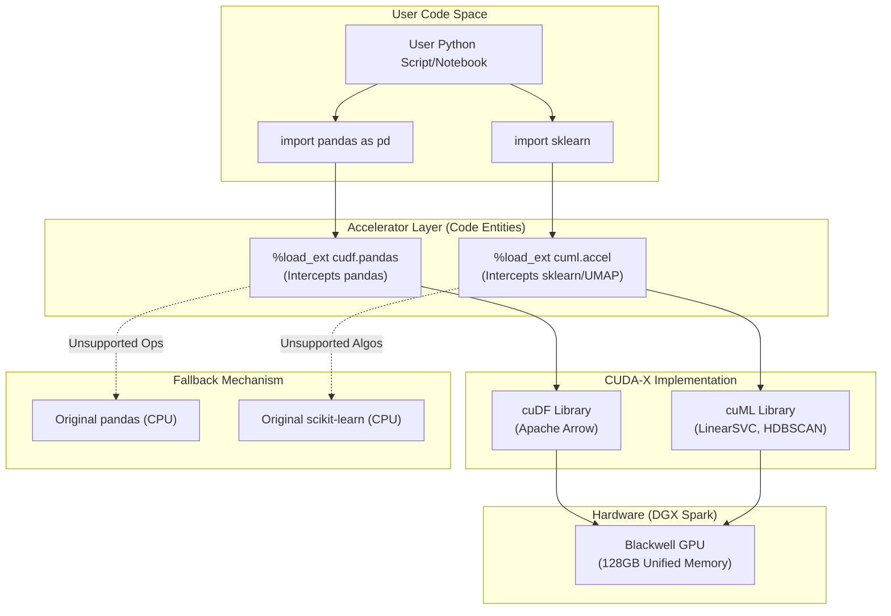
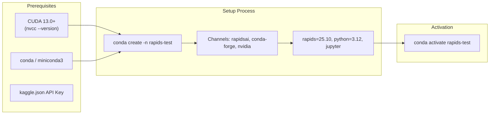
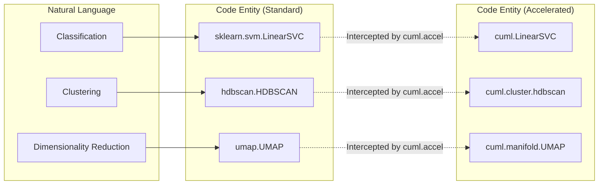

<!-- source: DeepWiki mcp.deepwiki.com · repo NVIDIA/dgx-spark-playbooks · page 3.4 CUDA-X Data Science · fetched 2026-10-26 -->

# CUDA-X Data Science

<details>
<summary>Relevant source files</summary>

The following files were used as context for generating this wiki page:

- [README.md](README.md)
- [nvidia/cuda-x-data-science/README.md](nvidia/cuda-x-data-science/README.md)
- [nvidia/cuda-x-data-science/assets/cudf_pandas_demo.ipynb](nvidia/cuda-x-data-science/assets/cudf_pandas_demo.ipynb)
- [nvidia/cuda-x-data-science/assets/cuml_sklearn_demo.ipynb](nvidia/cuda-x-data-science/assets/cuml_sklearn_demo.ipynb)

</details>


## Purpose and Scope

This page documents GPU-accelerated data science on DGX Spark using CUDA-X Data Science libraries (formerly RAPIDS). These libraries provide drop-in replacements for pandas (`cuDF`) and scikit-learn (`cuML`) operations, enabling zero-code-change acceleration of data processing and machine learning workflows. This playbook demonstrates how to maximize performance on the DGX Spark's Blackwell architecture using existing Python code.

**Sources:** [nvidia/cuda-x-data-science/README.md:1-24](), [nvidia/cuda-x-data-science/assets/cudf_pandas_demo.ipynb:10-18]()

---

## Overview

CUDA-X Data Science is an open-source collection of GPU-accelerated libraries that provides:

- **NVIDIA cuDF**: GPU-accelerated DataFrame operations compatible with the pandas API. It includes a "pandas accelerator mode" (`cudf.pandas`) for zero-code-change acceleration.
- **NVIDIA cuML**: GPU-accelerated machine learning algorithms compatible with the scikit-learn API, including LinearSVC, UMAP, and HDBSCAN.
- **Zero Code Changes**: Accelerated computing for existing workflows by simply loading a Jupyter magic extension.
- **Apache Arrow Backend**: Uses a columnar memory format for efficient GPU processing.

| Library | CPU Equivalent | Primary Use Cases | API Compatibility |
|---------|---------------|-------------------|-------------------|
| **cuDF** | pandas | DataFrame operations, string processing, data merging | pandas API |
| **cuML** | scikit-learn | LinearSVC, UMAP, HDBSCAN clustering | scikit-learn API |
| **cudf.pandas** | pandas | Automatic GPU acceleration with magic extension | 100% pandas API |

**Sources:** [nvidia/cuda-x-data-science/README.md:14-21](), [nvidia/cuda-x-data-science/assets/cudf_pandas_demo.ipynb:10-15](), [nvidia/cuda-x-data-science/assets/cuml_sklearn_demo.ipynb:18-22]()

---

## System Architecture

### Component Stack and Execution Flow

The following diagram illustrates how the CUDA-X libraries intercept standard Python calls and route them to the Blackwell GPU.



**Architecture Flow:**
1. **Interception**: The magic commands `%load_ext cudf.pandas` and `%load_ext cuml.accel` enable automatic dispatching of operations to the GPU.
2. **Execution**: Supported estimators and DataFrame operations are executed on the Blackwell GPU using high-speed memory.
3. **Fallback**: Any operations or algorithms not yet accelerated by RAPIDS seamlessly fall back to CPU execution (pandas/scikit-learn) without user intervention.

**Sources:** [nvidia/cuda-x-data-science/assets/cudf_pandas_demo.ipynb:10-15](), [nvidia/cuda-x-data-science/assets/cuml_sklearn_demo.ipynb:102-107](), [nvidia/cuda-x-data-science/README.md:14-24]()

---

## Installation and Environment Setup

### Environment Creation Workflow



### Setup Commands

**Step 1: Verify System Requirements**
Ensure CUDA 13 is installed and accessible.
```bash
nvcc --version
nvidia-smi
```

**Step 2: Create the Conda Environment**
Install the RAPIDS suite along with specific machine learning libraries used in the demos.
```bash
conda create -n rapids-test -c rapidsai -c conda-forge -c nvidia \
    rapids=25.10 python=3.12 'cuda-version=13.0' \
    jupyter hdbscan umap-learn
```

**Step 3: Prepare Data Credentials**
The demos require a Kaggle API key. Place the `kaggle.json` file in the `nvidia/cuda-x-data-science/assets` directory.

**Sources:** [nvidia/cuda-x-data-science/README.md:42-63]()

---

## Data Processing with cuDF

The `cudf_pandas_demo.ipynb` notebook demonstrates accelerating a workflow involving 4GB+ of string data (LinkedIn job postings).

### Key Code Entities and Performance

| Code Operation | Logic | Source |
|----------------|-------|--------|
| `%load_ext cudf.pandas` | Activates zero-code-change acceleration | [cudf_pandas_demo.ipynb:15]() |
| `pd.read_csv("job_summary.csv")` | GPU-accelerated CSV parsing | [cudf_pandas_demo.ipynb:245]() |
| `df['job_summary'].str.len()` | Massively parallel string length calculation | [cudf_pandas_demo.ipynb:336]() |
| `pd.merge(..., how="left")` | GPU-based hash joins | [cudf_pandas_demo.ipynb:568]() |
| `df.groupby(...).agg(...)` | High-throughput data aggregation | [cudf_pandas_demo.ipynb:706]() |

**Performance Highlight**: String operations on the Blackwell GPU often see speedups exceeding 200x compared to standard CPU-based pandas.

**Sources:** [nvidia/cuda-x-data-science/assets/cudf_pandas_demo.ipynb:10-18](), [nvidia/cuda-x-data-science/assets/cudf_pandas_demo.ipynb:336-706]()

---

## Machine Learning with cuML

The `cuml_sklearn_demo.ipynb` notebook illustrates GPU-accelerated classical machine learning for classification, clustering, and dimensionality reduction.

### Accelerator Mapping



### Usage in Notebooks
1. **Enable Acceleration**: Use `%load_ext cuml.accel` at the start of the session.
2. **Standard Import**: `from sklearn.svm import LinearSVC`.
3. **Execution**: Call `.fit()` and `.predict()` as usual; the computation is transparently offloaded to the GPU.

**Sources:** [nvidia/cuda-x-data-science/assets/cuml_sklearn_demo.ipynb:18-22](), [nvidia/cuda-x-data-science/assets/cuml_sklearn_demo.ipynb:102-114](), [nvidia/cuda-x-data-science/assets/cuml_sklearn_demo.ipynb:139-143]()

---

## Execution Instructions

### Local Execution
1. Activate the environment: `conda activate rapids-test`.
2. Launch Jupyter: `jupyter notebook cudf_pandas_demo.ipynb`.
3. Access via `localhost:8888` in your browser.

### Remote Execution (SSH Tunneling)
If accessing the DGX Spark remotely, forward the Jupyter port:
```bash
ssh -N -L 8888:localhost:8888 username@remote_host
```
- `-N`: Do not execute remote commands.
- `-L`: Local port forwarding.

**Sources:** [nvidia/cuda-x-data-science/README.md:68-84]()

---

## Troubleshooting and Risks

| Risk / Issue | Description | Mitigation |
|--------------|-------------|------------|
| **Network Issues** | Data download (Kaggle) may fail or be slow. | Ensure stable internet connection or manual download. |
| **API Failure** | Kaggle API key generation or placement. | Verify `kaggle.json` is in the notebook folder. |
| **Memory Limits** | Processing massive datasets. | DGX Spark's Unified Memory handles paging, but ensure enough swap/disk space. |
| **CUDA Version** | Library/Driver mismatch. | Use `nvidia-smi` to confirm Driver 580+ and CUDA 13.0. |

**Sources:** [nvidia/cuda-x-data-science/README.md:31-45]()

---

