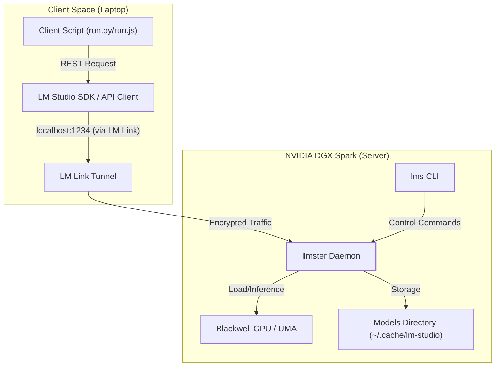
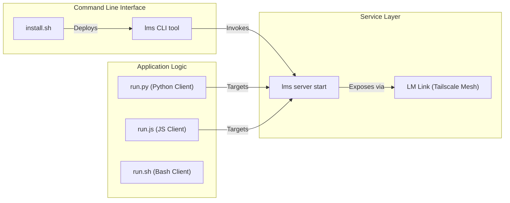

<!-- source: DeepWiki mcp.deepwiki.com · repo NVIDIA/dgx-spark-playbooks · page 3.5 LM Studio · fetched 2026-10-26 -->

# LM Studio

<details>
<summary>Relevant source files</summary>

The following files were used as context for generating this wiki page:

- [nvidia/lm-studio/README.md](nvidia/lm-studio/README.md)

</details>


LM Studio on DGX Spark provides a streamlined, headless environment for discovering, running, and serving Large Language Models (LLMs) with full GPU acceleration. By utilizing `llmster`—the terminal-native daemon for LM Studio—users can transform a DGX Spark into a high-performance LLM server accessible via REST APIs or the LM Studio SDK. Additionally, **LM Link** enables encrypted, remote access to these models, allowing a laptop to treat the Spark's GPU resources as if they were local, even across different networks.

## System Architecture and Data Flow

The deployment architecture consists of the `llmster` daemon running on the DGX Spark's NVIDIA DGX OS. The daemon manages model lifecycle (download, loading, and unloading) and exposes an OpenAI-compatible REST API. 

### Model Serving Logic
When a request is initiated from a client (e.g., a laptop), it can reach the Spark through two primary paths:
1.  **Direct LAN Access**: The server binds to `0.0.0.0` [nvidia/lm-studio/README.md:124-128](), allowing any device on the local network to reach the API via the Spark's IP address.
2.  **LM Link (Encrypted Mesh)**: Utilizing a Tailscale-powered mesh VPN, LM Link creates an end-to-end encrypted tunnel [nvidia/lm-studio/README.md:57-63](). This allows the client to address `localhost:1234` on their own machine, which the Link transparently routes to the Spark [nvidia/lm-studio/README.md:65-66]().

### Technical Data Flow Diagram
The following diagram illustrates the relationship between the CLI entities and the network flow.

"LM Studio Component Interaction"

Sources: [nvidia/lm-studio/README.md:17-35](), [nvidia/lm-studio/README.md:88-105](), [nvidia/lm-studio/README.md:141-146]()

## Implementation Details

### The llmster Daemon
The core of the headless deployment is `llmster`. It is installed via a shell script that configures the environment for ARM64 architecture [nvidia/lm-studio/README.md:88-98](). Once installed, the `lms` binary acts as the primary interface for managing the background process and model operations [nvidia/lm-studio/README.md:105-105]().

### Connectivity Options
The system supports multiple interaction patterns, summarized in the table below:

| Method | Configuration | Use Case |
| :--- | :--- | :--- |
| **Local API** | `lms server start --bind 0.0.0.0` | High-speed inference within the same LAN [nvidia/lm-studio/README.md:124-128]() |
| **LM Link** | `lmstudio.ai/link` | Secure remote access without port forwarding [nvidia/lm-studio/README.md:57-66]() |
| **SDK Access** | `run.js` / `run.py` | Programmatic integration into custom applications [nvidia/lm-studio/README.md:107-120]() |

### Code Entity Mapping
This diagram maps the physical command-line tools and scripts to their functional roles within the Spark environment.

"Code Entity to System Function Map"

Sources: [nvidia/lm-studio/README.md:88-105](), [nvidia/lm-studio/README.md:107-120](), [nvidia/lm-studio/README.md:124-128]()

## Deployment Workflow

### 1. Installation and Setup
The installation process targets the ARM64 DGX OS environment. The `llmster` daemon is lightweight and designed for headless operation, removing the need for a GUI or X11 forwarding [nvidia/lm-studio/README.md:88-93]().

### 2. Model Management
Models (such as gpt-oss 120B) are downloaded and stored locally on the Spark. Due to the Unified Memory Architecture (UMA) of the DGX Spark, LM Studio can leverage large memory pools (70GB+ recommended) to host high-parameter models [nvidia/lm-studio/README.md:46-49]().

### 3. Server Execution
The server is typically initialized with a specific bind address and port to facilitate network discovery:
```bash
lms server start --bind 0.0.0.0 --port 1234
```
[nvidia/lm-studio/README.md:127-127]()

### 4. Remote Integration (LM Link)
LM Link functions as a zero-config VPN. By signing into the same Link account on both the Spark and a laptop, the Spark's models are automatically advertised to the laptop's local LM Studio instance or any tool pointing to `localhost:1234` [nvidia/lm-studio/README.md:57-66]().

## Hardware and Software Prerequisites

| Requirement | Specification |
| :--- | :--- |
| **Architecture** | ARM64 / Blackwell GPU [nvidia/lm-studio/README.md:47-47]() |
| **GPU Memory** | 65GB minimum; 70GB+ recommended [nvidia/lm-studio/README.md:48-48]() |
| **Storage** | 65GB+ available space [nvidia/lm-studio/README.md:49-49]() |
| **OS** | NVIDIA DGX OS [nvidia/lm-studio/README.md:52-52]() |

Sources: [nvidia/lm-studio/README.md:44-56]()

---

