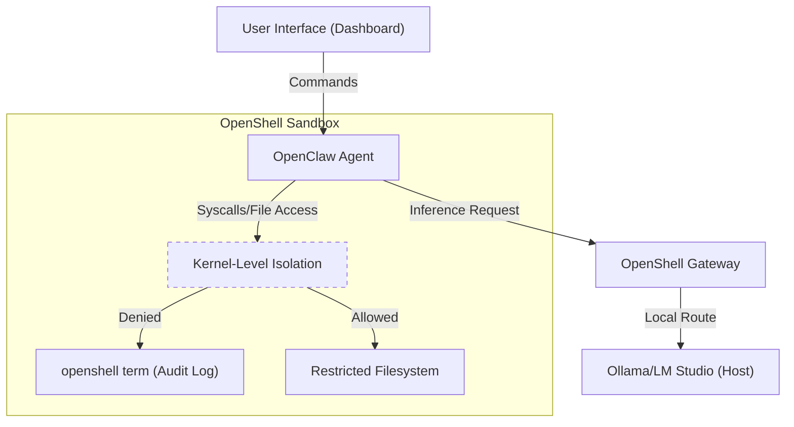
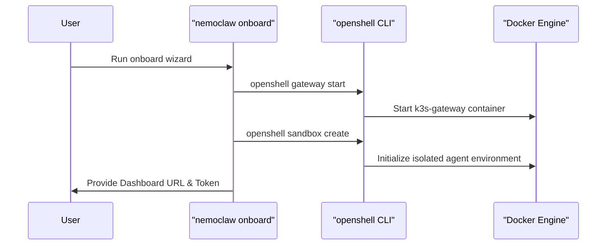

<!-- source: DeepWiki mcp.deepwiki.com · repo NVIDIA/dgx-spark-playbooks · page 3.6 CLI Coding Agent and OpenShell Sandbox · fetched 2026-10-26 -->

# CLI Coding Agent and OpenShell Sandbox

Relevant source files

The following files were used as context for generating this wiki page:

- [nvidia/nemoclaw/README.md](nvidia/nemoclaw/README.md)
- [nvidia/openclaw/README.md](nvidia/openclaw/README.md)
- [nvidia/openshell/README.md](nvidia/openshell/README.md)

The DGX Spark platform provides a high-performance environment for running autonomous AI coding agents. To mitigate the security risks associated with agents accessing local files and executing code, this playbook utilizes **OpenShell**, a kernel-level sandboxing runtime. By combining OpenShell with **OpenClaw** and **NemoClaw**, developers can deploy persistent, tool-using assistants that operate within strictly defined security policies while leveraging the Spark's 128GB of unified memory for large local models.

### System Architecture and Data Flow

The architecture transitions from a Natural Language Space (user intent) to a Code Entity Space (sandboxed execution). OpenShell acts as the mediation layer, enforcing declarative YAML policies on the agent's runtime.

**Agent Execution Pipeline**
1.  **User Input**: Commands provided via the OpenClaw Dashboard.
2.  **OpenShell Gateway**: A k3s-based controller running inside Docker that manages sandbox lifecycles [nvidia/openshell/README.md:73-74]().
3.  **Sandbox Environment**: An isolated container with restricted syscalls, filesystem access, and network egress [nvidia/openshell/README.md:20-22]().
4.  **Local Inference**: Requests are routed to **Ollama** or **LM Studio** running on the host, ensuring data privacy [nvidia/openclaw/README.md:109-111]().

**Entity Mapping: Intent to Execution**

| Intent | Code/System Entity | Implementation Detail |
| :--- | :--- | :--- |
| **Sandbox Management** | `openshell` CLI | Manages `gateway` and `sandbox` objects [nvidia/openshell/README.md:73-74]() |
| **Agent Logic** | `OpenClaw` | Persistent assistant with memory and skills [nvidia/openclaw/README.md:17-19]() |
| **Secure Onboarding** | `nemoclaw` | Plugin for automated setup and policy generation [nvidia/nemoclaw/README.md:29-31]() |
| **Inference Provider** | `Ollama` / `LM Studio` | Local LLM serving backends [nvidia/openclaw/README.md:113-115]() |

**Sources:** [nvidia/openshell/README.md:18-22](), [nvidia/openclaw/README.md:17-23](), [nvidia/nemoclaw/README.md:29-31]()

---

### Implementation Detail: OpenShell Sandboxing

OpenShell provides four distinct layers of isolation to protect the DGX Spark host system during agent execution.

#### Isolation Layers

| Layer | Mechanism | Scope |
| :--- | :--- | :--- |
| **Filesystem** | Declarative YAML Policies | Prevents R/W outside allowed paths; locked at creation [nvidia/nemoclaw/README.md:69-69]() |
| **Network** | Egress Filtering | Blocks unauthorized outbound connections; hot-reloadable [nvidia/nemoclaw/README.md:70-70]() |
| **Process** | Syscall Filtering | Blocks privilege escalation and dangerous syscalls [nvidia/nemoclaw/README.md:71-71]() |
| **Inference** | API Routing | Reroutes model calls to local backends (Ollama/LM Studio) [nvidia/nemoclaw/README.md:72-72]() |

**OpenShell Control Flow**

**Sources:** [nvidia/openshell/README.md:20-22](), [nvidia/openshell/README.md:80-81](), [nvidia/nemoclaw/README.md:67-72]()

---

### NemoClaw: Automated Agent Deployment

NemoClaw simplifies the deployment of OpenClaw within an OpenShell sandbox specifically for the DGX Spark. It includes a specialized `onboard` wizard to configure the environment.

#### Deployment Workflow
1.  **Cgroup Configuration**: DGX Spark requires `default-cgroupns-mode: host` in `/etc/docker/daemon.json` for the k3s-based gateway to initialize [nvidia/nemoclaw/README.md:140-152]().
2.  **Plugin Installation**: Uses `npm` to install the `nemoclaw` CLI tool [nvidia/nemoclaw/README.md:36-38]().
3.  **Wizard Execution**: The `nemoclaw onboard` command triggers the creation of the sandbox and policy files [nvidia/nemoclaw/README.md:37-38]().

**NemoClaw System Interaction**

**Sources:** [nvidia/nemoclaw/README.md:122-152](), [nvidia/nemoclaw/README.md:29-31]()

---

### Local Inference Integration

To maintain a "private-first" posture, the agents are configured to route all LLM requests to local backends on the DGX Spark.

*   **Ollama**: Recommended for simplified deployment and support for `gpt-oss` models using MXFP4 quantization [nvidia/openshell/README.md:100-101]().
*   **LM Studio**: Recommended for maximum raw performance via `llama.cpp` [nvidia/openclaw/README.md:115-119]().

#### Configuration for OpenClaw
When running the OpenClaw installer (`curl -fsSL https://openclaw.ai/install.sh`), users select **Quickstart** but **Skip** the initial model provider to manually route to `localhost:11434` (Ollama) or `localhost:1234` (LM Studio) once the sandbox is active [nvidia/openclaw/README.md:89-91]().

**Sources:** [nvidia/openclaw/README.md:75-107](), [nvidia/openclaw/README.md:109-125]()

---

### Security Best Practices

Despite sandboxing, AI agents pose inherent risks. The following measures are implemented within the playbooks:
1.  **Isolated Environment**: Run only on a clean DGX OS instance without sensitive host data [nvidia/openshell/README.md:27-29]().
2.  **Minimal Permissions**: OpenShell policies should follow the principle of least privilege, restricting network egress to specific model endpoints [nvidia/openshell/README.md:53-67]().
3.  **Real-time Monitoring**: Use `openshell term` to monitor denied connection attempts and `openshell logs` for debugging policy violations [nvidia/openshell/README.md:80-81]().

**Sources:** [nvidia/openshell/README.md:39-51](), [nvidia/openshell/README.md:108-112](), [nvidia/openclaw/README.md:38-55]()

---

