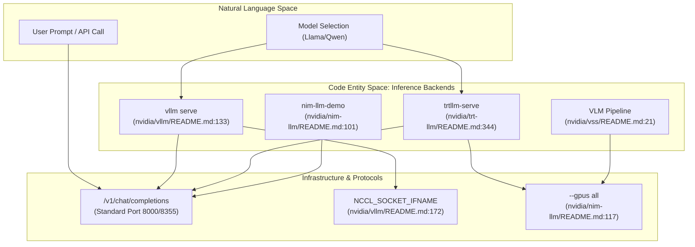
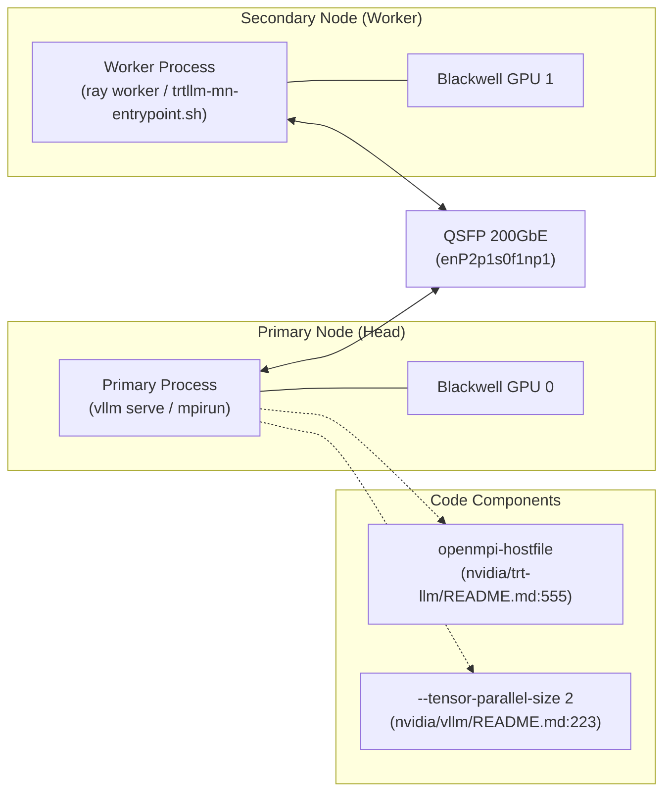

<!-- source: DeepWiki mcp.deepwiki.com · repo NVIDIA/dgx-spark-playbooks · page 4 Inference Systems · fetched 2026-10-26 -->

# Inference Systems

Relevant source files

The following files were used as context for generating this wiki page:

- [nvidia/nim-llm/README.md](nvidia/nim-llm/README.md)
- [nvidia/tailscale/README.md](nvidia/tailscale/README.md)
- [nvidia/trt-llm/README.md](nvidia/trt-llm/README.md)
- [nvidia/vllm/README.md](nvidia/vllm/README.md)
- [nvidia/vss/README.md](nvidia/vss/README.md)

## Purpose and Scope

This page provides a high-level overview of the inference engines available for serving Large Language Models (LLMs) and Vision-Language Models (VLMs) on DGX Spark. It introduces the core technologies—vLLM, TensorRT-LLM, NVIDIA NIM, SGLang, and Ollama—and helps users determine the best engine for their specific production or development requirements.

For detailed guides on each system, see the following child pages:
- [Choosing an Inference Engine](#4.1) — Comparison matrix and selection criteria.
- [vLLM](#4.2) — High-throughput serving with PagedAttention [nvidia/vllm/README.md:19-23]().
- [TensorRT-LLM](#4.3) — Low-latency optimization with TensorRT kernels [nvidia/trt-llm/README.md:36-40]().
- [NVIDIA NIM](#4.4) — Enterprise-ready microservices for rapid deployment [nvidia/nim-llm/README.md:23-27]().
- [Ollama and Open WebUI](#4.5) — Simplified local model management and chat interfaces.
- [SGLang](#4.6) — High-performance serving with FlashInfer backend.
- [Multi-modal Inference](#4.7) — Serving VLMs and diffusion models [nvidia/vss/README.md:17-21]().

---

## Inference Engine Overview

Inference engines on DGX Spark translate trained model weights into interactive services. These engines leverage the Blackwell GPU architecture and Unified Memory Architecture (UMA) to handle models ranging from small 8B parameter instructors to massive 405B parameter models across multi-node clusters.

### Core Engines

*   **vLLM**: Focuses on maximizing throughput using **PagedAttention** and **continuous batching** [nvidia/vllm/README.md:19-23](). It is ideal for high-concurrency environments and supports distributed inference via Ray clusters [nvidia/vllm/README.md:163-174]().
*   **TensorRT-LLM**: An open-source library for deep kernel-level optimizations. It provides the lowest possible latency by compiling models into optimized TensorRT engines [nvidia/trt-llm/README.md:36-40](). It supports advanced quantization formats like **NVFP4** and **MXFP4** [nvidia/trt-llm/README.md:78-80]().
*   **NVIDIA NIM**: Provides containerized microservices that are pre-optimized for NVIDIA hardware. NIMs are designed for "drop-in" production use with standardized APIs [nvidia/nim-llm/README.md:23-27]().
*   **Ollama**: Prioritizes ease of use and local development, utilizing the GGUF format for efficient execution on a variety of hardware configurations.
*   **SGLang**: A fast serving framework specifically optimized for complex prompting workflows and high-performance attention backends.

**Diagram: Inference System to Code Entity Mapping**

**Sources:** [nvidia/vllm/README.md:19-23](), [nvidia/trt-llm/README.md:36-40](), [nvidia/nim-llm/README.md:23-27](), [nvidia/vss/README.md:17-21]()

---

## Deployment Architectures

DGX Spark supports two primary deployment modes for inference: Single-Node and Multi-Node.

### Single-Node Inference
Most models up to 70B parameters (when quantized) can run on a single DGX Spark node. Engines typically run within Docker containers, mapping internal ports (e.g., 8000 for vLLM or 8355 for TRT-LLM) to the host for application access [nvidia/vllm/README.md:131-134](), [nvidia/trt-llm/README.md:64-65]().

### Multi-Node Distributed Inference
For ultra-large models like Llama-3.1-405B or Qwen3-235B, the workload is distributed across multiple Spark nodes using **Tensor Parallelism** [nvidia/vllm/README.md:222-225](), [nvidia/trt-llm/README.md:595-606](). This requires high-speed networking via QSFP cables and specialized orchestration:
*   **vLLM** uses a Ray cluster to manage distributed workers [nvidia/vllm/README.md:163-174]().
*   **TensorRT-LLM** utilizes Docker Swarm and OpenMPI for process synchronization [nvidia/trt-llm/README.md:488-523]().

**Diagram: Distributed Inference Flow**

**Sources:** [nvidia/vllm/README.md:163-174](), [nvidia/vllm/README.md:222-225](), [nvidia/trt-llm/README.md:488-523](), [nvidia/trt-llm/README.md:555-557]()

---

## Key Features and Compatibility

| Feature | vLLM | TensorRT-LLM | NVIDIA NIM |
| :--- | :--- | :--- | :--- |
| **Primary Goal** | Throughput & Memory [nvidia/vllm/README.md:19]() | Latency & Kernels [nvidia/trt-llm/README.md:36]() | Production Readiness [nvidia/nim-llm/README.md:23]() |
| **Quantization** | FP8, NVFP4, AWQ [nvidia/vllm/README.md:54-76]() | NVFP4, MXFP4, FP8 [nvidia/trt-llm/README.md:78-95]() | Pre-optimized [nvidia/nim-llm/README.md:27]() |
| **API Type** | OpenAI Compatible [nvidia/vllm/README.md:23]() | OpenAI Compatible [nvidia/trt-llm/README.md:64]() | OpenAI Compatible [nvidia/nim-llm/README.md:184]() |
| **Orchestration** | Ray Cluster [nvidia/vllm/README.md:163]() | Docker Swarm/MPI [nvidia/trt-llm/README.md:488]() | Kubernetes/Docker [nvidia/nim-llm/README.md:186]() |

### Memory Management
Due to the Blackwell architecture's Unified Memory, managing the system cache is critical. Users often need to clear the host buffer cache to free up memory for large model weights:
`sudo sh -c 'sync; echo 3 > /proc/sys/vm/drop_caches'` [nvidia/vllm/README.md:357-359]().

**Sources:** [nvidia/vllm/README.md:19-23](), [nvidia/vllm/README.md:54-76](), [nvidia/trt-llm/README.md:36-40](), [nvidia/trt-llm/README.md:78-95](), [nvidia/nim-llm/README.md:23-27](), [nvidia/vllm/README.md:357-359]()

---

