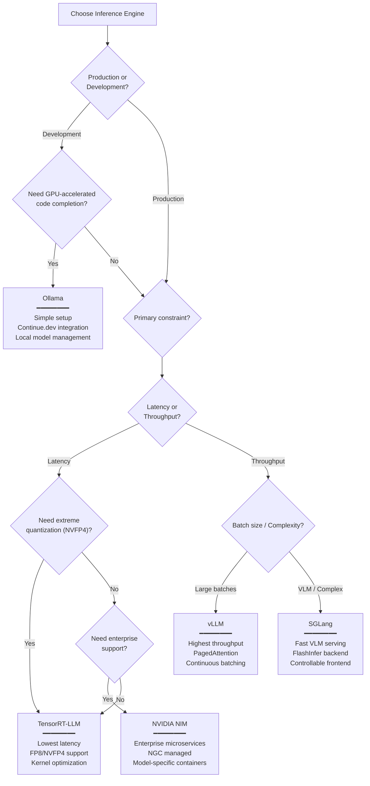
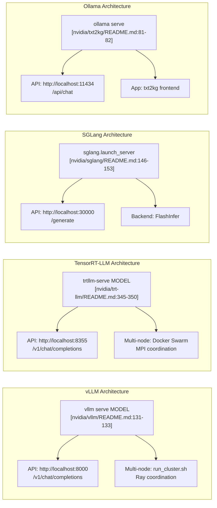
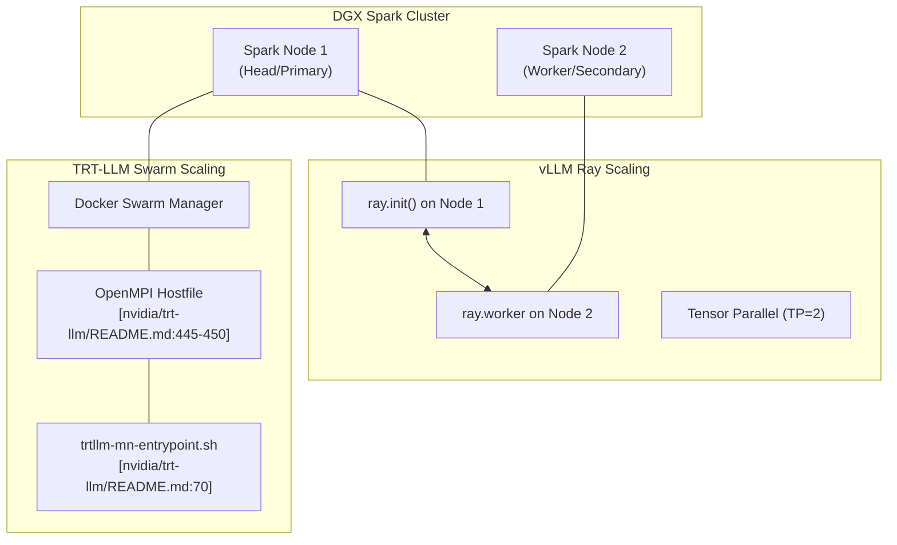

<!-- source: DeepWiki mcp.deepwiki.com · repo NVIDIA/dgx-spark-playbooks · page 4.1 Choosing an Inference Engine · fetched 2026-10-26 -->

# Choosing an Inference Engine

<details>
<summary>Relevant source files</summary>

The following files were used as context for generating this wiki page:

- [nvidia/dgx-dashboard/README.md](nvidia/dgx-dashboard/README.md)
- [nvidia/jax/README.md](nvidia/jax/README.md)
- [nvidia/sglang/README.md](nvidia/sglang/README.md)
- [nvidia/trt-llm/README.md](nvidia/trt-llm/README.md)
- [nvidia/txt2kg/README.md](nvidia/txt2kg/README.md)
- [nvidia/unsloth/README.md](nvidia/unsloth/README.md)
- [nvidia/vllm/README.md](nvidia/vllm/README.md)

</details>


## Purpose and Scope

This page compares the inference engines available on DGX Spark—vLLM, TensorRT-LLM, NVIDIA NIM, SGLang, and Ollama—to help you select the right one for your specific workload. The comparison focuses on throughput vs. latency tradeoffs, quantization support (including Blackwell-specific NVFP4), ease of deployment, and multi-node scaling capabilities.

---

## Engine Overview

DGX Spark supports five distinct inference engines, each optimized for different stages of the AI lifecycle:

| Engine | Primary Optimization | Target Use Case | API Compatibility |
|--------|---------------------|-----------------|-------------------|
| **vLLM** | Throughput | High-concurrency serving, batch processing | OpenAI-compatible |
| **TensorRT-LLM** | Latency | Low-latency inference, real-time applications | OpenAI-compatible |
| **NVIDIA NIM** | Enterprise Simplicity | Production deployments, managed services | OpenAI-compatible |
| **SGLang** | Speed & Control | High-throughput LLM/VLM serving with FlashInfer | OpenAI-compatible |
| **Ollama** | Developer Ease | Local development, prototyping, RAG | OpenAI-compatible |

Sources: [nvidia/vllm/README.md:17-23](), [nvidia/trt-llm/README.md:34-40](), [nvidia/sglang/README.md:18-22](), [nvidia/txt2kg/README.md:21-24]()

---

## Decision Framework

### Decision Tree: Selecting an Inference Engine



Sources: [nvidia/vllm/README.md:17-23](), [nvidia/trt-llm/README.md:34-40](), [nvidia/sglang/README.md:18-28](), [nvidia/txt2kg/README.md:21-24]()

---

## Technical Architecture Comparison

### Deployment Command and API Comparison



Sources: [nvidia/vllm/README.md:131-144](), [nvidia/trt-llm/README.md:345-350](), [nvidia/sglang/README.md:146-169](), [nvidia/txt2kg/README.md:81-113]()

---

## Quantization Support Matrix

Quantization is critical on DGX Spark to leverage the Blackwell architecture's performance.

| Quantization Format | vLLM | TensorRT-LLM | SGLang | Ollama | Memory Savings |
|---------------------|------|--------------|--------|--------|----------------|
| **FP16 / BF16** | ✅ | ✅ | ✅ | ✅ | Baseline |
| **FP8** | ✅ | ✅ | ✅ | ❌ | ~50% |
| **NVFP4 (Blackwell)**| ✅ | ✅ | ✅ | ❌ | ~75% |
| **INT4 (AWQ)** | ✅ | ✅ | ✅ | ✅ | ~75% |
| **GGUF** | ❌ | ❌ | ❌ | ✅ | Variable |

### Blackwell-Specific Support (NVFP4)
Both vLLM and TensorRT-LLM provide extensive support for `NVFP4` quantized models on Spark, such as:
* **Nemotron-3-Super-120B** [nvidia/vllm/README.md:56]()
* **Llama-3.3-70B-Instruct** [nvidia/trt-llm/README.md:83]()
* **Qwen3-32B** [nvidia/vllm/README.md:66]()

Sources: [nvidia/vllm/README.md:54-76](), [nvidia/trt-llm/README.md:76-96](), [nvidia/sglang/README.md:54-71]()

---

## Multi-Node Deployment Architecture

DGX Spark playbooks provide automation for scaling inference across multiple devices using QSFP connections.

### Scaling Strategies



### Capability Comparison

| Feature | vLLM (Ray) | TensorRT-LLM (MPI) |
|---------|------------|--------------------|
| **Orchestration** | `run_cluster.sh` | Docker Swarm |
| **Model Size** | Up to 405B (Quantized) | Up to 235B (NVFP4) |
| **Complexity** | Lower (Script-based) | Higher (Stack-based) |
| **Communication** | NCCL over Ray | NCCL over MPI |

Sources: [nvidia/vllm/README.md:9-10](), [nvidia/trt-llm/README.md:413-430](), [nvidia/trt-llm/README.md:95]()

---

## Performance Characteristics

### Key Features by Engine

*   **vLLM**: Uses **PagedAttention** to handle long sequences and **continuous batching** to keep GPUs fully utilized [nvidia/vllm/README.md:21-22]().
*   **TensorRT-LLM**: Achieves low latency through **kernel-level optimizations**, efficient memory layouts, and fused operations [nvidia/trt-llm/README.md:45-46]().
*   **SGLang**: Optimized for speed with a **FlashInfer** attention backend and co-designed frontend/backend for controllable generation [nvidia/sglang/README.md:18-22]().
*   **Ollama**: Optimized for ease of use in local RAG applications like **txt2kg**, using Subject-Predicate-Object extraction [nvidia/txt2kg/README.md:21-24]().

---

## Common Infrastructure Requirements

All engines on DGX Spark share the following system requirements:

*   **Architecture**: ARM64 (AArch64) processor [nvidia/jax/README.md:45]().
*   **GPU**: Blackwell architecture with CUDA 13.0+ [nvidia/vllm/README.md:41-42]().
*   **Memory Management**: Due to the **Unified Memory Architecture (UMA)**, users may need to manually flush the buffer cache if memory pressure occurs [nvidia/unsloth/README.md:143-149]().

```bash
# Manual flush for UMA buffer management
sudo sh -c 'sync; echo 3 > /proc/sys/vm/drop_caches'
```

Sources: [nvidia/vllm/README.md:41-45](), [nvidia/unsloth/README.md:143-149](), [nvidia/jax/README.md:45]()

---

