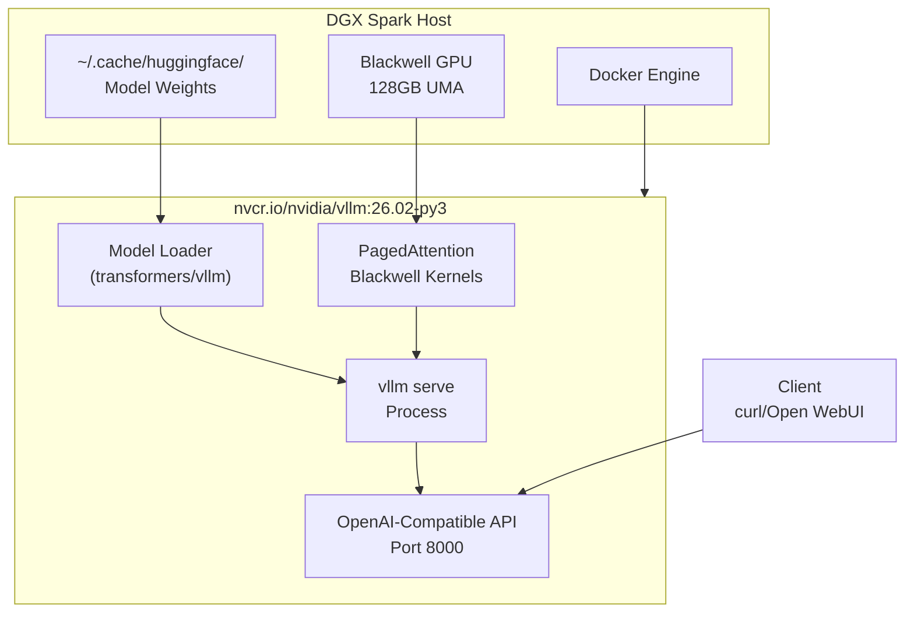
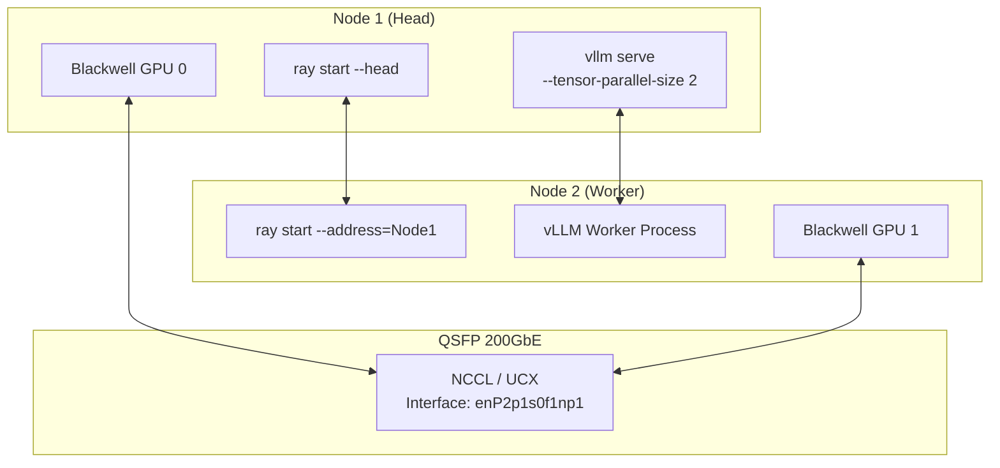

<!-- source: DeepWiki mcp.deepwiki.com · repo NVIDIA/dgx-spark-playbooks · page 4.2 vLLM · fetched 2026-10-26 -->

# vLLM

<details>
<summary>Relevant source files</summary>

The following files were used as context for generating this wiki page:

- [nvidia/trt-llm/README.md](nvidia/trt-llm/README.md)
- [nvidia/vllm/README.md](nvidia/vllm/README.md)

</details>


This page documents vLLM as a high-throughput LLM inference engine for DGX Spark. vLLM implements PagedAttention memory management, continuous batching, and OpenAI-compatible APIs for serving language models. The platform supports Blackwell architecture optimizations including FP8 and NVFP4 quantization for models ranging from 1.5B to 120B+ parameters on a single node, and up to 405B in multi-node configurations.

For fine-tuning models before inference, see [Fine-tuning Frameworks](). For alternative inference engines, see [TensorRT-LLM]() and [NVIDIA NIM]().

---

## Core Architecture

vLLM optimizes LLM inference through three key mechanisms: PagedAttention for memory efficiency, continuous batching for GPU utilization, and native support for advanced Blackwell data types (NVFP4/FP8).

### Memory Management with PagedAttention
PagedAttention manages key-value (KV) cache memory by dividing it into fixed-size blocks. This prevents memory fragmentation during autoregressive generation and enables efficient memory sharing between sequences. [nvidia/vllm/README.md:21-21]()

### Continuous Batching Strategy
New requests can be added to a batch already in process through continuous batching. This keeps GPUs fully utilized by not waiting for all sequences in a static batch to complete before starting new ones. [nvidia/vllm/README.md:22-22]()

### Blackwell Architecture Support
The vLLM implementation on DGX Spark is optimized for ARM64 and Blackwell GPUs, supporting high-performance quantization formats like NVFP4 and FP8 to maximize throughput and minimize memory footprint. [nvidia/vllm/README.md:27-29]()

**Sources:** [nvidia/vllm/README.md:15-23]()

---

## Model Support Matrix

The following models are verified for vLLM on DGX Spark. Many utilize NVFP4 (NVIDIA Floating Point 4-bit) to achieve high performance on Blackwell hardware.

| Model | Quantization | HF Handle |
|-------|-------------|-----------|
| **Nemotron-3-Super-120B** | NVFP4 | `nvidia/NVIDIA-Nemotron-3-Super-120B-A12B-NVFP4` |
| **Llama-3.3-70B-Instruct** | NVFP4 | `nvidia/Llama-3.3-70B-Instruct-NVFP4` |
| **Llama-3.1-8B-Instruct** | FP8 / NVFP4 | `nvidia/Llama-3.1-8B-Instruct-FP8` |
| **Qwen3-32B** | NVFP4 | `nvidia/Qwen3-32B-NVFP4` |
| **Qwen2.5-VL-7B-Instruct** | NVFP4 | `nvidia/Qwen2.5-VL-7B-Instruct-NVFP4` |
| **Phi-4-multimodal-instruct** | FP8 / NVFP4 | `nvidia/Phi-4-multimodal-instruct-NVFP4` |

> [!NOTE]
> Multimodal models like Phi-4 require the `--trust-remote-code` flag when launching the server. [nvidia/vllm/README.md:78-80]()

**Sources:** [nvidia/vllm/README.md:50-77]()

---

## Single-Node Deployment

Single-node deployment utilizes the official NVIDIA vLLM container optimized for DGX Spark.

### Container Architecture


**vLLM Container Entity Mapping**

**Sources:** [nvidia/vllm/README.md:113-134]()

### Deployment Steps

1.  **Configure Permissions**: Ensure your user is in the `docker` group to run commands without `sudo`. [nvidia/vllm/README.md:109-110]()
2.  **Pull Image**: Fetch the latest optimized container. [nvidia/vllm/README.md:118-123]()
    ```bash
    export LATEST_VLLM_VERSION=26.02-py3
    docker pull nvcr.io/nvidia/vllm:${LATEST_VLLM_VERSION}
    ```
3.  **Launch Server**: Run the container with GPU access. [nvidia/vllm/README.md:131-134]()
    ```bash
    docker run -it --gpus all -p 8000:8000 \
      nvcr.io/nvidia/vllm:${LATEST_VLLM_VERSION} \
      vllm serve "Qwen/Qwen2.5-Math-1.5B-Instruct"
    ```

### Testing the API
vLLM provides an OpenAI-compatible API at `/v1/chat/completions`. [nvidia/vllm/README.md:23-23]()

```bash
curl http://localhost:8000/v1/chat/completions \
-H "Content-Type: application/json" \
-d '{
    "model": "Qwen/Qwen2.5-Math-1.5B-Instruct",
    "messages": [{"role": "user", "content": "12*17"}],
    "max_tokens": 500
}'
```
**Sources:** [nvidia/vllm/README.md:144-151]()

---

## Multi-Node Deployment with Ray

For massive models like Llama-3.1-405B, vLLM uses a Ray cluster to distribute layers across multiple DGX Spark nodes using Tensor Parallelism (TP).

### Ray Cluster Architecture


**Multi-Node Ray Cluster Entity Mapping**

**Sources:** [nvidia/vllm/README.md:158-193]()

### Distributed Configuration
Multi-node communication requires binding to the high-speed QSFP network interface (`enP2p1s0f1np1`). Key environment variables include: [nvidia/vllm/README.md:162-171]()

*   `NCCL_SOCKET_IFNAME=enP2p1s0f1np1`: For GPU-to-GPU collective communication.
*   `UCX_NET_DEVICES=enP2p1s0f1np1`: For unified communication transport.
*   `VLLM_HOST_IP`: The local node IP address.

### Launching 405B Inference
To run Llama-3.1-405B (quantized), the Ray cluster must be initialized on both nodes using `run_cluster.sh`. [nvidia/vllm/README.md:174-184]()

Once the cluster is ready, launch the server from the head node: [nvidia/vllm/README.md:223-225]()
```bash
vllm serve meta-llama/Llama-3.1-405B-Instruct-AWQ-INT4 \
  --tensor-parallel-size 2 \
  --max-model-len 2048
```

**Sources:** [nvidia/vllm/README.md:158-225]()

---

## Performance and Memory Management

### Unified Memory Architecture (UMA)
DGX Spark's UMA allows the GPU to access system RAM dynamically. However, Linux page caches can sometimes conflict with large GPU allocations. If Out-of-Memory (OOM) errors occur despite available RAM, flush the system caches: [nvidia/vllm/README.md:353-359]()

```bash
sudo sh -c 'sync; echo 3 > /proc/sys/vm/drop_caches'
```

### Key Serving Parameters
Fine-tuning these parameters in `vllm serve` impacts performance and memory: [nvidia/vllm/README.md:246-267]()

| Parameter | Description | Recommendation |
|-----------|-------------|----------------|
| `--gpu-memory-utilization` | Fraction of GPU memory to reserve | 0.9 (default), 1.0 for 405B |
| `--max-model-len` | Maximum sequence length | Reduce if OOM occurs |
| `--max-num-seqs` | Max concurrent sequences | Reduce for very long context |

**Sources:** [nvidia/vllm/README.md:246-267](), [nvidia/vllm/README.md:353-359]()

---

## Troubleshooting

*   **Permissions**: If `docker ps` fails, ensure your user is added to the `docker` group via `sudo usermod -aG docker $USER`. [nvidia/vllm/README.md:106-109]()
*   **Gated Models**: Ensure `HF_TOKEN` is set for models like Llama-3.3. [nvidia/vllm/README.md:210-211]()
*   **Ray Connectivity**: Verify node communication using `ray status` inside the container. [nvidia/vllm/README.md:204-204]()
*   **Blackwell Support**: Ensure you are using CUDA 13.0+ and the `26.02-py3` (or later) container for full Blackwell optimization. [nvidia/vllm/README.md:42-45]()

**Sources:** [nvidia/vllm/README.md:336-359]()

---

