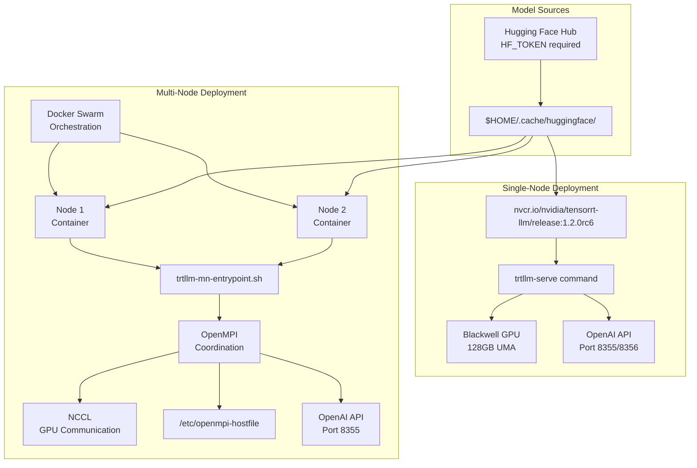
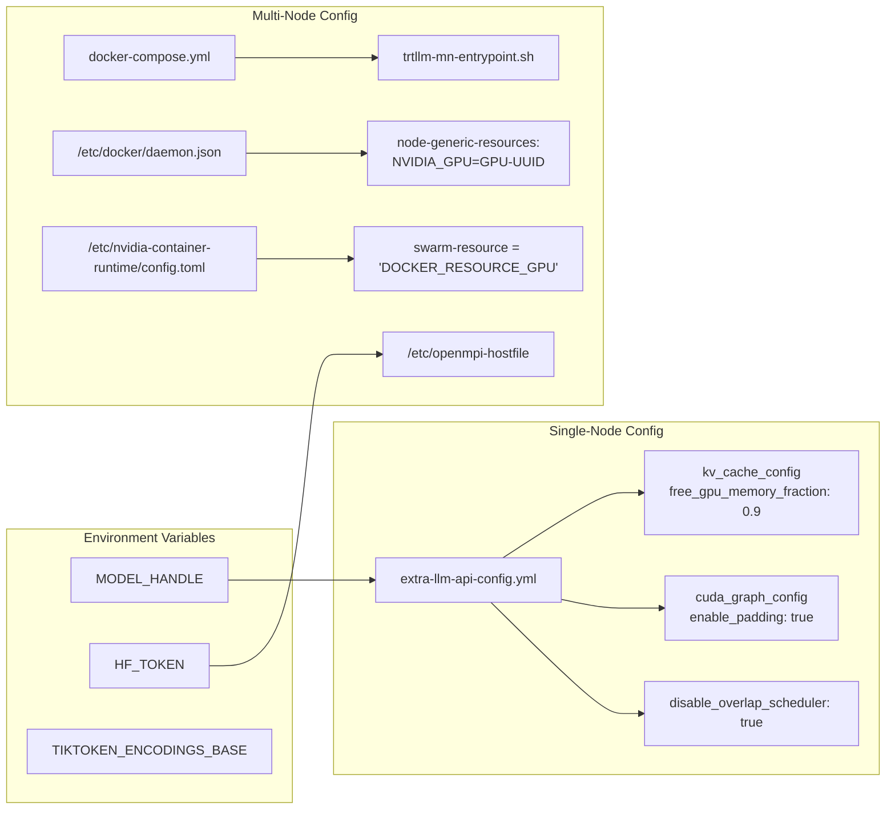
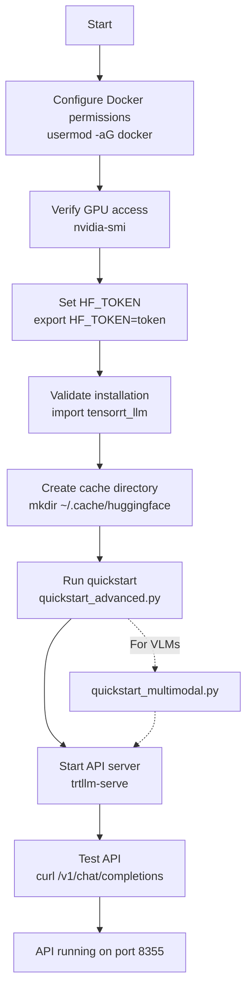
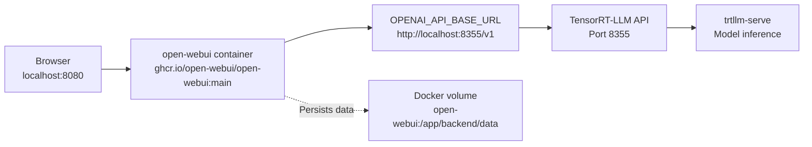

<!-- source: DeepWiki mcp.deepwiki.com · repo NVIDIA/dgx-spark-playbooks · page 4.3 TensorRT-LLM · fetched 2026-10-26 -->

# TensorRT-LLM

<details>
<summary>Relevant source files</summary>

The following files were used as context for generating this wiki page:

- [nvidia/trt-llm/README.md](nvidia/trt-llm/README.md)
- [nvidia/trt-llm/assets/trtllm-mn-entrypoint.sh](nvidia/trt-llm/assets/trtllm-mn-entrypoint.sh)
- [nvidia/vllm/README.md](nvidia/vllm/README.md)

</details>


## Purpose and Scope

This document covers TensorRT-LLM deployment on DGX Spark for optimized low-latency LLM inference. TensorRT-LLM is NVIDIA's inference optimization library that achieves superior latency through kernel fusion, efficient memory layouts, and advanced quantization techniques (FP8, NVFP4, MXFP4). This page documents both single-node and multi-node distributed deployment configurations.

For comparing TensorRT-LLM with other inference engines (vLLM, NIM, Ollama), see [Choosing an Inference Engine](#4.1). For multi-node networking setup, see [Connecting Two Sparks](#7.1). For deploying Open WebUI as a frontend, see [Ollama and Open WebUI](#4.5).

**Sources:** [nvidia/trt-llm/README.md:1-41](), [nvidia/trt-llm/README.md:72-101]()

---

## Architecture Overview

TensorRT-LLM provides two deployment architectures: single-node for models up to 120B parameters and multi-node for larger models requiring tensor parallelism.

### Deployment Architecture



**Single-Node Architecture:** The container runs `trtllm-serve` directly with the model handle, exposing an OpenAI-compatible API on port 8355 (LLM) or 8356 (VLM). Models are downloaded via `hf download` and cached locally. [nvidia/trt-llm/README.md:149-171](), [nvidia/trt-llm/README.md:320-394]()

**Multi-Node Architecture:** Docker Swarm deploys containers to multiple nodes with GPU resource advertising. The `trtllm-mn-entrypoint.sh` script installs an OpenSSH server and keeps containers alive for MPI access. [nvidia/trt-llm/assets/trtllm-mn-entrypoint.sh:23-59]() OpenMPI coordinates distributed inference using the hostfile, and NCCL handles GPU-to-GPU communication. The `trtllm-llmapi-launch` wrapper starts `trtllm-serve` with tensor parallelism (`--tp_size 2`). [nvidia/trt-llm/README.md:586-618]()

**Sources:** [nvidia/trt-llm/README.md:43-64](), [nvidia/trt-llm/README.md:413-523](), [nvidia/trt-llm/assets/trtllm-mn-entrypoint.sh:1-59]()

---

## Configuration Files and Scripts

### Key Configuration Entities



### Configuration File Details

| File | Purpose | Key Settings |
|------|---------|--------------|
| `extra-llm-api-config.yml` | TensorRT-LLM runtime config | `free_gpu_memory_fraction: 0.9`, `enable_padding: true`, `disable_overlap_scheduler: true` |
| `docker-compose.yml` | Multi-node service definition | Image, volumes, entrypoint script mount |
| `trtllm-mn-entrypoint.sh` | Multi-node container entrypoint | SSH server on port 2233, keeps container alive |
| `/etc/openmpi-hostfile` | MPI node registry | Contains IP addresses from `docker node ls` |
| `/etc/docker/daemon.json` | Docker daemon GPU config | `node-generic-resources` with GPU UUID |
| `/etc/nvidia-container-runtime/config.toml` | NVIDIA runtime config | `swarm-resource` line for GPU advertising |

**Sources:** [nvidia/trt-llm/README.md:335-348](), [nvidia/trt-llm/README.md:452-483](), [nvidia/trt-llm/README.md:514-523](), [nvidia/trt-llm/README.md:568-577](), [nvidia/trt-llm/assets/trtllm-mn-entrypoint.sh:21-44]()

---

## Single-Node Deployment Flow

### Deployment Process



### Command Mapping

| Step | Primary Command | Key Parameters |
|------|----------------|----------------|
| Docker permissions | `sudo usermod -aG docker $USER` | Add user to docker group [nvidia/trt-llm/README.md:125-126]() |
| GPU verification | `docker run --rm --gpus all $IMAGE nvidia-smi` | Test GPU passthrough [nvidia/trt-llm/README.md:139]() |
| Installation test | `python -c "import tensorrt_llm"` | Verify TRT-LLM import [nvidia/trt-llm/README.md:159]() |
| Model download | `hf download $MODEL_HANDLE` | Uses HF_TOKEN for auth [nvidia/trt-llm/README.md:320]() |
| Quickstart LLM | `python examples/llm-api/quickstart_advanced.py` | `--model_dir`, `--prompt`, `--max_tokens` [nvidia/trt-llm/README.md:188-192]() |
| Quickstart VLM | `python examples/llm-api/quickstart_multimodal.py` | `--model_dir`, `--modality`, `--media`, `--prompt` [nvidia/trt-llm/README.md:261-267]() |
| Serve model | `trtllm-serve "$MODEL_HANDLE"` | `--max_batch_size 64`, `--port 8355`, `--extra_llm_api_options` [nvidia/trt-llm/README.md:342-348]() |

**Sources:** [nvidia/trt-llm/README.md:112-171](), [nvidia/trt-llm/README.md:188-319](), [nvidia/trt-llm/README.md:320-394]()

---

## Multi-Node Deployment Flow

### Multi-Node Setup Process

```mermaid
graph TB
    START["Start"] --> NETWORK["Configure network<br/>QSFP cables, IP setup"]
    NETWORK --> DOCKER_PERMS["Configure Docker permissions<br/>Both nodes"]
    DOCKER_PERMS --> NGC_TOOLKIT["Install NGC Toolkit<br/>Both nodes"]
    NGC_TOOLKIT --> GPU_UUID["Get GPU UUID<br/>nvidia-smi -a | grep UUID"]
    GPU_UUID --> DAEMON_JSON["Edit /etc/docker/daemon.json<br/>Add node-generic-resources"]
    DAEMON_JSON --> CONFIG_TOML["Uncomment swarm-resource<br/>/etc/nvidia-container-runtime/config.toml"]
    CONFIG_TOML --> RESTART_DOCKER["Restart Docker daemon<br/>Both nodes"]
    RESTART_DOCKER --> SWARM_INIT["Initialize Swarm<br/>docker swarm init"]
    SWARM_INIT --> SWARM_JOIN["Join worker nodes<br/>docker swarm join"]
    SWARM_JOIN --> DOWNLOAD_ASSETS["Download assets<br/>trtllm-mn-entrypoint.sh<br/>docker-compose.yml"]
    DOWNLOAD_ASSETS --> CHMOD["Make executable<br/>chmod +x trtllm-mn-entrypoint.sh"]
    CHMOD --> DEPLOY_STACK["Deploy stack<br/>docker stack deploy"]
    DEPLOY_STACK --> CREATE_HOSTFILE["Create hostfile<br/>docker node ls > openmpi-hostfile"]
    CREATE_HOSTFILE --> COPY_HOSTFILE["Copy to container<br/>docker cp openmpi-hostfile"]
    COPY_HOSTFILE --> GENERATE_CONFIG["Generate config<br/>extra-llm-api-config.yml"]
    GENERATE_CONFIG --> DOWNLOAD_MODEL["Download model<br/>mpirun hf download"]
    DOWNLOAD_MODEL --> SERVE["Serve model<br/>mpirun trtllm-llmapi-launch"]
    SERVE --> TEST_API["Test API<br/>curl /v1/chat/completions"]
    TEST_API --> END["API running on port 8355"]
```



### MPI Command Structure

The multi-node deployment uses nested `mpirun` commands for distributed operations:

```bash
# Download model across nodes
mpirun -np 2 --hostfile /etc/openmpi-hostfile -x HF_TOKEN bash -c "huggingface-cli download $MODEL"

# Launch distributed server
mpirun -np 2 --hostfile /etc/openmpi-hostfile -x HF_TOKEN trtllm-llmapi-launch trtllm-serve $MODEL --tp_size 2
```

Key parameters for distributed serving:
- `--tp_size 2`: Tensor parallelism across 2 nodes [nvidia/trt-llm/README.md:609]()
- `--backend pytorch`: Use PyTorch backend [nvidia/trt-llm/README.md:611]()
- `--max_num_tokens 32768`: Maximum context length [nvidia/trt-llm/README.md:613]()
- `--max_batch_size 4`: Concurrent requests [nvidia/trt-llm/README.md:614]()
- `--extra_llm_api_options /tmp/extra-llm-api-config.yml`: Runtime config [nvidia/trt-llm/README.md:615]()

**Sources:** [nvidia/trt-llm/README.md:413-649](), [nvidia/trt-llm/assets/trtllm-mn-entrypoint.sh:1-59]()

---

## Model Support Matrix

### Supported Models and Quantization

TensorRT-LLM on DGX Spark supports multiple quantization formats optimized for Blackwell architecture:

| Quantization | Precision | Memory Efficiency | Supported Architectures |
|--------------|-----------|-------------------|------------------------|
| **NVFP4** | 4-bit NVIDIA format | Highest (4x reduction) | LLaMA, Qwen, Phi, Nemotron |
| **FP8** | 8-bit floating point | High (2x reduction) | LLaMA, Qwen, Phi |
| **MXFP4** | 4-bit mixed precision | Highest | GPT-OSS |

### Key Model Families

**Language Models (LLM):**
- **Nemotron-3-Super-120B** (NVFP4) [nvidia/trt-llm/README.md:78]()
- **Llama-3.1-8B-Instruct** (FP8/NVFP4) [nvidia/trt-llm/README.md:81-82]()
- **Llama-3.3-70B-Instruct** (NVFP4) [nvidia/trt-llm/README.md:83]()
- **Qwen3-8B/14B/32B** (FP8/NVFP4) [nvidia/trt-llm/README.md:84-88]()
- **Qwen3-235B-A22B** (NVFP4, requires 2 Sparks) [nvidia/trt-llm/README.md:95]()
- **GPT-OSS-20B/120B** (MXFP4) [nvidia/trt-llm/README.md:79-80]()

**Vision-Language Models (VLM):**
- **Phi-4-multimodal-instruct** (FP8/NVFP4) [nvidia/trt-llm/README.md:89-90]()

**Sources:** [nvidia/trt-llm/README.md:72-101]()

---

## API Interface

### OpenAI-Compatible Endpoints

TensorRT-LLM exposes an OpenAI-compatible API for seamless integration with existing tools:

| Endpoint | Port | Model Type | Notes |
|----------|------|------------|-------|
| `/v1/chat/completions` | 8355 | LLM | Standard chat completion [nvidia/trt-llm/README.md:386]() |
| `/v1/completions` | 8355 | LLM | Raw text completion |
| `/v1/chat/completions` | 8356 | VLM | Multimodal with images [nvidia/trt-llm/README.md:64]() |

### API Request Structure

```json
{
  "model": "nvidia/Llama-3.1-8B-Instruct-FP4",
  "messages": [
    {"role": "user", "content": "Paris is great because"}
  ],
  "max_tokens": 64
}
```

For VLM requests, the `content` field can include image URLs or base64-encoded images. The API is compatible with OpenAI client libraries and tools expecting the `/v1/chat/completions` endpoint. [nvidia/trt-llm/README.md:386-394](), [nvidia/trt-llm/README.md:619-628]()

**Sources:** [nvidia/trt-llm/README.md:64](), [nvidia/trt-llm/README.md:386-394](), [nvidia/trt-llm/README.md:619-628]()

---

## Integration with Open WebUI

### Open WebUI Connection Architecture



### Deployment Command

```bash
docker run -d \
  -e OPENAI_API_BASE_URL="http://localhost:8355/v1" \
  -v open-webui:/app/backend/data \
  --network host \
  --add-host=host.docker.internal:host-gateway \
  --name open-webui \
  --restart always \
  ghcr.io/open-webui/open-webui:main
```

Key configuration:
- `OPENAI_API_BASE_URL`: Points to TensorRT-LLM API endpoint [nvidia/trt-llm/README.md:691]()
- `--network host`: Enables access to localhost:8355 [nvidia/trt-llm/README.md:693]()
- `--add-host`: Docker internal hostname resolution [nvidia/trt-llm/README.md:694]()
- Volume mount: Persists chat history and configurations [nvidia/trt-llm/README.md:692]()

**Sources:** [nvidia/trt-llm/README.md:651-719]()

---

## Memory Management and UMA Considerations

### Unified Memory Architecture Handling

DGX Spark uses Unified Memory Architecture (UMA) with 128GB shared between CPU and GPU. TensorRT-LLM-specific considerations:

| Configuration | Purpose | Default Value |
|--------------|---------|---------------|
| `free_gpu_memory_fraction` | GPU memory allocation limit | 0.9 (90%) [nvidia/trt-llm/README.md:337]() |
| `ulimit memlock=-1` | Unlimited locked memory | Required for PyTorch |
| `ulimit stack=67108864` | Stack size (64MB) | Required for large models |
| `--ipc=host` | Shared memory namespace | Enables efficient IPC [nvidia/trt-llm/README.md:520]() |

### Manual Cache Flushing

Due to UMA architecture, buffer cache may need manual flushing during model downloads or first run:

```bash
sudo sh -c 'sync; echo 3 > /proc/sys/vm/drop_caches'
```

This command:
1. `sync`: Flushes file system buffers
2. `echo 3 > /proc/sys/vm/drop_caches`: Clears pagecache, dentries, and inodes [nvidia/trt-llm/README.md:752]()

**When to flush:** OOM errors during model loading, weight downloads, or initial inference despite sufficient total memory. [nvidia/trt-llm/README.md:314-318](), [nvidia/trt-llm/README.md:748-754]()

**Sources:** [nvidia/trt-llm/README.md:314-318](), [nvidia/trt-llm/README.md:337](), [nvidia/trt-llm/README.md:520](), [nvidia/trt-llm/README.md:748-754]()

---

## Quickstart Examples

### LLM Quickstart: quickstart_advanced.py

The `examples/llm-api/quickstart_advanced.py` script validates end-to-end inference setup:

```bash
python examples/llm-api/quickstart_advanced.py \
  --model_dir nvidia/Llama-3.1-8B-Instruct-FP4 \
  --prompt "Paris is great because" \
  --max_tokens 64
```

For GPT-OSS models, tiktoken encodings must be downloaded and pointed to via `TIKTOKEN_ENCODINGS_BASE`. [nvidia/trt-llm/README.md:215-224]()

### VLM Quickstart: quickstart_multimodal.py

The `examples/llm-api/quickstart_multimodal.py` script tests vision-language models:

```bash
python3 examples/llm-api/quickstart_multimodal.py \
  --model_dir nvidia/Qwen2.5-VL-7B-Instruct-FP4 \
  --modality image \
  --media "https://huggingface.co/datasets/YiYiXu/testing-images/resolve/main/seashore.png" \
  --prompt "What is happening in this image?"
```

For Phi-4-multimodal, LoRA loading is required with `--load_lora`. [nvidia/trt-llm/README.md:295]()

**Sources:** [nvidia/trt-llm/README.md:188-260](), [nvidia/trt-llm/README.md:261-311]()

---

## Troubleshooting

### Common Single-Node Issues

| Symptom | Cause | Resolution |
|---------|-------|------------|
| `Cannot access gated repo` | Missing HF token | Verify `echo $HF_TOKEN` and model access [nvidia/trt-llm/README.md:723]() |
| OOM during weight loading | Parallel loading pressure | `export TRT_LLM_DISABLE_LOAD_WEIGHTS_IN_PARALLEL=1` [nvidia/trt-llm/README.md:731]() |
| `CUDA out of memory` | Insufficient VRAM | Reduce `free_gpu_memory_fraction` from 0.9 [nvidia/trt-llm/README.md:337]() |
| `import tensorrt_llm` fails | Container runtime | Restart Docker: `sudo systemctl restart docker` [nvidia/trt-llm/README.md:741]() |

### Common Multi-Node Issues

| Symptom | Cause | Resolution |
|---------|-------|------------|
| MPI returns single hostname | Network connectivity | Verify both nodes reachable via ping [nvidia/trt-llm/README.md:745]() |
| Container exits immediately | Missing entrypoint script | Verify `trtllm-mn-entrypoint.sh` exists and is executable [nvidia/trt-llm/README.md:531]() |
| Docker state "Pending" | GPU not advertised | Verify `/etc/docker/daemon.json` and restart daemon [nvidia/trt-llm/README.md:465]() |

**Sources:** [nvidia/trt-llm/README.md:721-754]()

---

## Cleanup Procedures

### Single-Node Cleanup

Remove cached models and containers:
```bash
docker stop trtllm-server
docker rm trtllm-server
sudo rm -rf $HOME/.cache/huggingface/
```

### Multi-Node Cleanup

Stop and remove swarm stack:
```bash
docker stack rm trtllm-multinode
```

**Warning:** Cleanup removes all downloaded models and cached data. Re-downloading may be required for future use. [nvidia/trt-llm/README.md:396-411](), [nvidia/trt-llm/README.md:630-645]()

**Sources:** [nvidia/trt-llm/README.md:396-411](), [nvidia/trt-llm/README.md:630-645](), [nvidia/trt-llm/README.md:709-719]()

---

