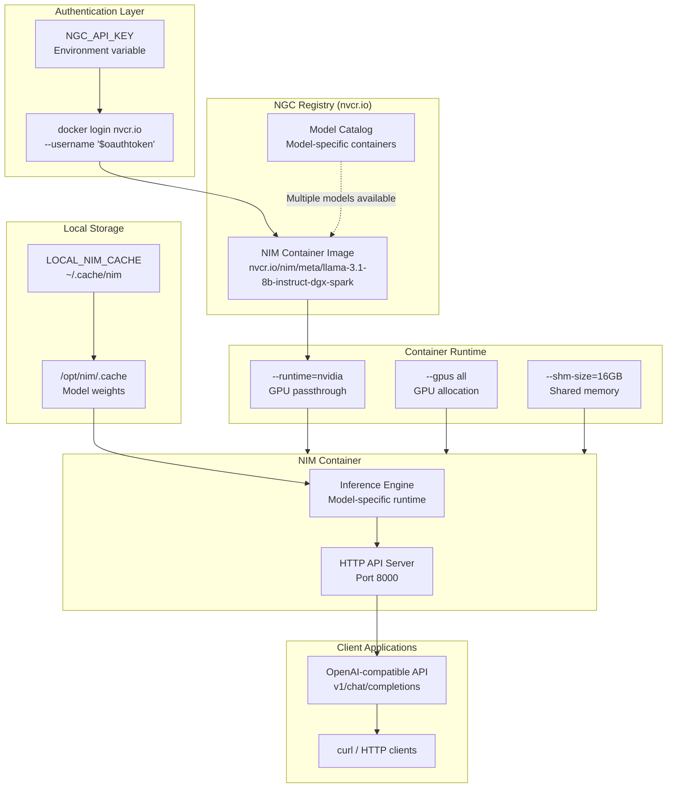
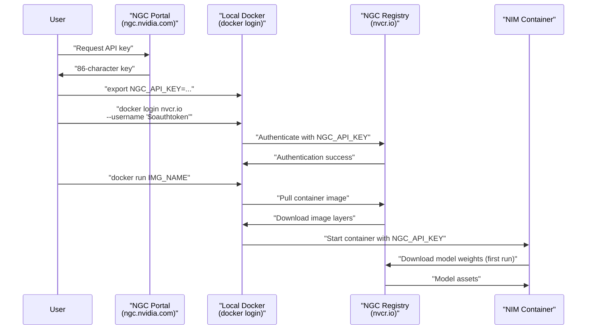
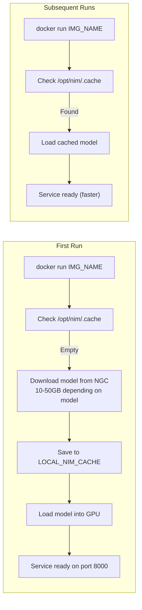
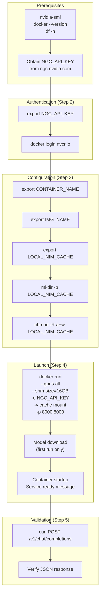

<!-- source: DeepWiki mcp.deepwiki.com · repo NVIDIA/dgx-spark-playbooks · page 4.4 NVIDIA NIM · fetched 2026-10-26 -->

# NVIDIA NIM

<details>
<summary>Relevant source files</summary>

The following files were used as context for generating this wiki page:

- [nvidia/nim-llm/README.md](nvidia/nim-llm/README.md)
- [nvidia/tailscale/README.md](nvidia/tailscale/README.md)
- [nvidia/vss/README.md](nvidia/vss/README.md)

</details>


This document describes NVIDIA NIM (NVIDIA Inference Microservices), a containerized inference system for serving large language models on DGX Spark devices. NIM provides enterprise-ready, model-specific microservices that expose OpenAI-compatible API endpoints for GPU-accelerated inference.

For information about choosing between different inference engines (vLLM, TensorRT-LLM, NIM, Ollama), see [Choosing an Inference Engine](#4.1). For alternative inference systems, see [vLLM](#4.2), [TensorRT-LLM](#4.3), and [Ollama and Open WebUI](#4.5).

---

## Architecture Overview

NVIDIA NIM delivers inference capabilities through pre-built, model-specific Docker containers distributed via NVIDIA GPU Cloud (NGC). Each NIM container packages a specific model with an optimized inference runtime, eliminating the need for manual model compilation or optimization steps [nvidia/nim-llm/README.md:23-27]().

### Container-Based Deployment Model

NIM containers follow a standardized structure that separates model assets from runtime components. The container image includes the inference engine and model metadata, while model weights are downloaded and cached locally on first run [nvidia/nim-llm/README.md:126-127](). This architecture enables rapid deployment and version management.

**NIM Container Architecture**



Sources: [nvidia/nim-llm/README.md:23-27](), [nvidia/nim-llm/README.md:91-94](), [nvidia/nim-llm/README.md:101-104](), [nvidia/nim-llm/README.md:116-124]()

### NGC Registry Integration

NIM containers are distributed through the NGC registry at `nvcr.io`. Authentication requires an NGC API key obtained from the NGC portal [nvidia/nim-llm/README.md:46-49](). The registry hosts model-specific containers optimized for DGX Spark's ARM64 architecture and Blackwell GPU [nvidia/nim-llm/README.md:27-28]().

| Component | Purpose | Configuration |
|-----------|---------|---------------|
| NGC API Key | Registry authentication | Set as `NGC_API_KEY` environment variable |
| Container Image | Model-specific runtime | Format: `nvcr.io/nim/<org>/<model>-dgx-spark:latest` |
| Model Cache | Local weight storage | Mounted at `/opt/nim/.cache` |
| Service Port | API endpoint | Exposed on port 8000 |

Sources: [nvidia/nim-llm/README.md:46-50](), [nvidia/nim-llm/README.md:91-94](), [nvidia/nim-llm/README.md:101-104](), [nvidia/nim-llm/README.md:122]()

---

## Container Configuration

### Environment Variables

NIM containers require specific environment variables for authentication and operation:

| Variable | Purpose | Example Value |
|----------|---------|---------------|
| `NGC_API_KEY` | NGC registry authentication | 86-character base64 string |
| `CONTAINER_NAME` | Container identifier | `nim-llm-demo` |
| `IMG_NAME` | Container image reference | `nvcr.io/nim/meta/llama-3.1-8b-instruct-dgx-spark:latest` |
| `LOCAL_NIM_CACHE` | Model cache directory | `~/.cache/nim` |

Sources: [nvidia/nim-llm/README.md:91-104]()

### Volume Mounts

The container requires a volume mount to persist downloaded model weights across container restarts. The local cache directory must have appropriate permissions to allow the container process to write model files [nvidia/nim-llm/README.md:106-109]().

```bash
# Cache directory setup from nvidia/nim-llm/README.md:103-109
export LOCAL_NIM_CACHE=~/.cache/nim
export LOCAL_NIM_WORKSPACE=~/.local/share/nim/workspace
mkdir -p "$LOCAL_NIM_WORKSPACE"
chmod -R a+w "$LOCAL_NIM_WORKSPACE"
mkdir -p "$LOCAL_NIM_CACHE"
chmod -R a+w "$LOCAL_NIM_CACHE"
```

The mount specification maps the local cache to the container's internal model storage:
- `-v "$LOCAL_NIM_CACHE:/opt/nim/.cache"` [nvidia/nim-llm/README.md:120]()
- `-v "$LOCAL_NIM_WORKSPACE:/opt/nim/workspace"` [nvidia/nim-llm/README.md:121]()

Sources: [nvidia/nim-llm/README.md:103-109](), [nvidia/nim-llm/README.md:120-121]()

### GPU and Resource Allocation

NIM containers require specific Docker runtime flags for GPU access and memory management [nvidia/nim-llm/README.md:116-124]():

| Flag | Purpose | Value |
|------|---------|-------|
| `--gpus all` | Allocate all available GPUs | All GPUs on device |
| `--shm-size` | Shared memory allocation | `16GB` minimum |
| `-p 8000:8000` | Port mapping | Exposes API to host |

Sources: [nvidia/nim-llm/README.md:116-124]()

---

## Authentication and Registry Access

### NGC API Key Generation

An NGC API key is required to pull NIM containers from the NGC registry. The key can be generated at [https://ngc.nvidia.com/setup/api-key](). The key format is an 86-character base64-encoded string ending with `==` [nvidia/nim-llm/README.md:46-49]().

**Authentication Flow**



Sources: [nvidia/nim-llm/README.md:46-49](), [nvidia/nim-llm/README.md:91-94](), [nvidia/nim-llm/README.md:116-124]()

### Docker Login Process

The NGC API key is used as a password with the special username `$oauthtoken` [nvidia/nim-llm/README.md:93]():

```bash
# From nvidia/nim-llm/README.md:92-93
export NGC_API_KEY="<YOUR_NGC_API_KEY>"
echo "$NGC_API_KEY" | docker login nvcr.io --username '$oauthtoken' --password-stdin
```

Sources: [nvidia/nim-llm/README.md:92-93]()

---

## Model Selection and Caching

### Available NIM Containers

NIM provides model-specific containers optimized for DGX Spark. Each container is tagged for the platform [nvidia/nim-llm/README.md:27-28]():

| Model | Container Image | Notes |
|-------|----------------|-------|
| Llama 3.1 8B Instruct | `nvcr.io/nim/meta/llama-3.1-8b-instruct-dgx-spark:latest` | Default example model [nvidia/nim-llm/README.md:102]() |
| Qwen3-32B | `nvcr.io/nim/teams/qwen/containers/qwen3-32b-dgx-spark` | High-parameter option [nvidia/nim-llm/README.md:27]() |

Sources: [nvidia/nim-llm/README.md:27-28](), [nvidia/nim-llm/README.md:102]()

### Model Caching Mechanism

On first container startup, NIM downloads model weights to the mounted cache directory. Subsequent runs use the cached weights, significantly reducing startup time [nvidia/nim-llm/README.md:126-127]().

**Model Download and Caching Flow**



Sources: [nvidia/nim-llm/README.md:50-53](), [nvidia/nim-llm/README.md:120-127]()

### Disk Space Requirements

Model cache requirements vary by model size. Typical requirements range from 10-50GB per model [nvidia/nim-llm/README.md:50](). Users should verify available disk space before deployment:

```bash
# From nvidia/nim-llm/README.md:52
df -h ~
```

Sources: [nvidia/nim-llm/README.md:50-52]()

---

## API Interface

### OpenAI-Compatible Endpoints

NIM exposes an OpenAI-compatible HTTP API on port 8000. The primary endpoint for chat interactions is `/v1/chat/completions` [nvidia/nim-llm/README.md:136]().

| Endpoint | Method | Purpose |
|----------|--------|---------|
| `/v1/chat/completions` | POST | Generate chat completions [nvidia/nim-llm/README.md:136]() |

Sources: [nvidia/nim-llm/README.md:135-136]()

### Request and Response Validation

Test the deployed service with a basic completion request [nvidia/nim-llm/README.md:135-157]():

```bash
# From nvidia/nim-llm/README.md:135-157
curl -X 'POST' \
    'http://0.0.0.0:8000/v1/chat/completions' \
    -H 'accept: application/json' \
    -H 'Content-Type: application/json' \
    -d '{
      "model": "meta/llama-3.1-8b-instruct",
      "messages": [
        {"role":"system", "content":"detailed thinking on"},
        {"role":"user", "content":"Can you write me a song?"}
      ],
      "max_tokens": 15
    }'
```

Expected output is a JSON response containing generated text [nvidia/nim-llm/README.md:161]().

Sources: [nvidia/nim-llm/README.md:135-161]()

---

## Deployment Workflow

### Complete Deployment Process

**NIM Deployment Steps**



Sources: [nvidia/nim-llm/README.md:70-161]()

### Container Launch

The primary launch command uses Docker with GPU acceleration [nvidia/nim-llm/README.md:116-124]():

```bash
docker run -it --rm --name=$CONTAINER_NAME \
  --gpus all \
  --shm-size=16GB \
  -e NGC_API_KEY=$NGC_API_KEY \
  -v "$LOCAL_NIM_CACHE:/opt/nim/.cache" \
  -v "$LOCAL_NIM_WORKSPACE:/opt/nim/workspace" \
  -p 8000:8000 \
  $IMG_NAME
```

Sources: [nvidia/nim-llm/README.md:116-124]()

---

## Integration and Cleanup

### Remote Access Integration

NIM endpoints can be accessed securely over a remote network using Tailscale. Once Tailscale is authenticated on the Spark device [nvidia/tailscale/README.md:171](), the HTTP endpoint on port 8000 can be reached via the Spark's Tailscale IP or hostname [nvidia/tailscale/README.md:42-43]().

Sources: [nvidia/tailscale/README.md:42-43](), [nvidia/tailscale/README.md:171]()

### Cleanup and Rollback

Stop and remove the container to free GPU resources [nvidia/nim-llm/README.md:171-172]():

```bash
docker stop $CONTAINER_NAME
docker rm $CONTAINER_NAME
```

To free disk space, remove the cached models [nvidia/nim-llm/README.md:177]():

```bash
rm -rf "$LOCAL_NIM_CACHE"
```

Sources: [nvidia/nim-llm/README.md:171-177]()

---

## Troubleshooting

| Symptom | Cause | Fix |
|---------|--------|-----|
| Container fails to start with GPU error | NVIDIA Container Toolkit not configured | Configure `nvidia-ctk` and restart Docker [nvidia/nim-llm/README.md:195]() |
| "Invalid credentials" during docker login | Incorrect NGC API key format | Verify API key from NGC portal [nvidia/nim-llm/README.md:196]() |
| Model download hangs or fails | Network connectivity or insufficient disk space | Check `df -h` and internet connection [nvidia/nim-llm/README.md:197]() |
| API returns 404 or connection refused | Container not fully started or wrong port | Wait for startup completion, verify port 8000 [nvidia/nim-llm/README.md:198]() |
| Permission denied for Docker | User not in docker group | Run `sudo usermod -aG docker $USER` [nvidia/nim-llm/README.md:83-84]() |

Sources: [nvidia/nim-llm/README.md:83-84](), [nvidia/nim-llm/README.md:193-199]()

---

