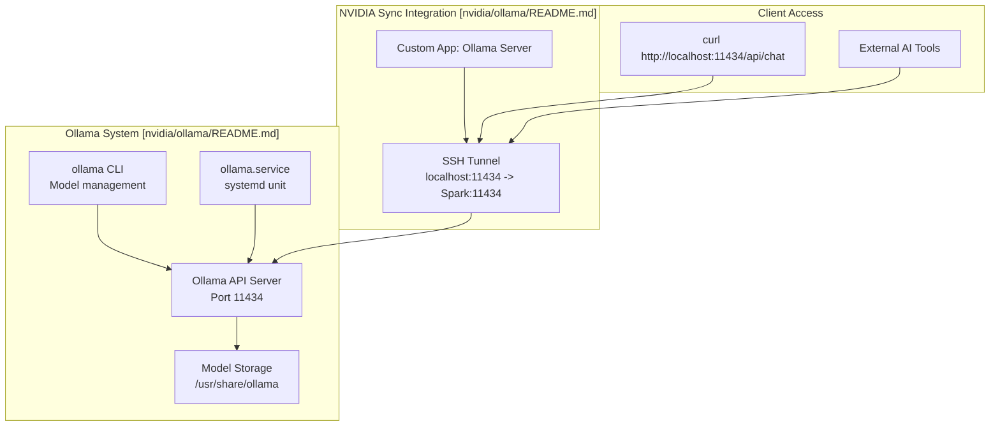
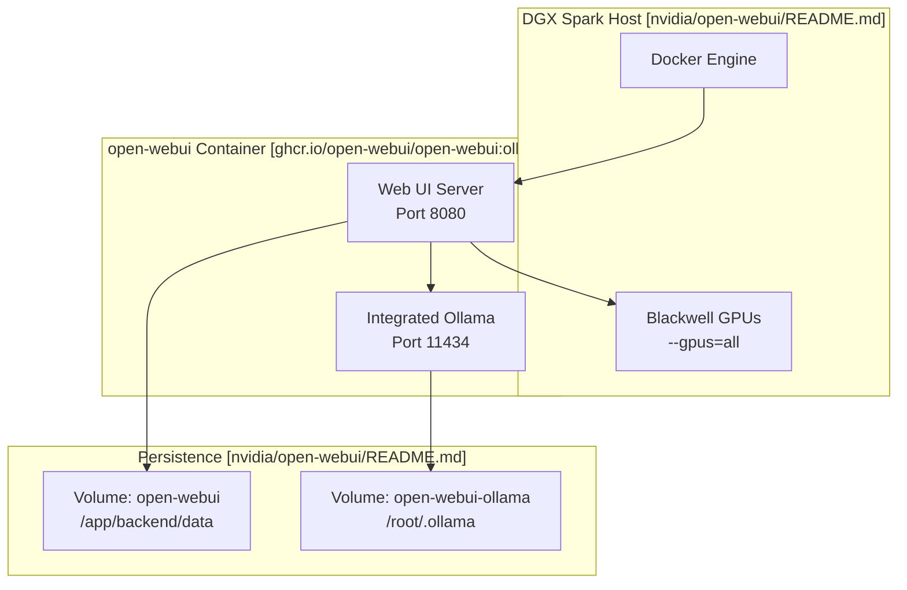

<!-- source: DeepWiki mcp.deepwiki.com · repo NVIDIA/dgx-spark-playbooks · page 4.5 Ollama and Open WebUI · fetched 2026-10-26 -->

# Ollama and Open WebUI

<details>
<summary>Relevant source files</summary>

The following files were used as context for generating this wiki page:

- [nvidia/connect-to-your-spark/README.md](nvidia/connect-to-your-spark/README.md)
- [nvidia/ollama/README.md](nvidia/ollama/README.md)
- [nvidia/open-webui/README.md](nvidia/open-webui/README.md)

</details>


## Purpose and Scope

This document covers Ollama as an inference engine and its integration with Open WebUI for chat-based interaction with language models on DGX Spark. Ollama provides simplified local model management with an OpenAI-compatible API, optimized for ease of use and rapid deployment. This page focuses on Ollama's architecture, deployment via NVIDIA Sync, and integration with Open WebUI as a user interface layer.

For production-optimized inference with throughput focus, see [vLLM](#4.2). For latency-optimized inference, see [TensorRT-LLM](#4.3). For enterprise microservices, see [NVIDIA NIM](#4.4).

## Ollama Architecture

Ollama is a lightweight inference server that simplifies running large language models locally. It provides automatic model quantization, a built-in model registry, and an HTTP API.

### Core Components



**Ollama System Architecture and Connectivity**

The Ollama server typically runs as a systemd service [`ollama.service`] that exposes an HTTP API on port 11434 [nvidia/ollama/README.md:112-123](). While the server runs on the DGX Spark, NVIDIA Sync's Custom App feature allows users to map `localhost:11434` on their laptop directly to the Spark device via an SSH tunnel [nvidia/ollama/README.md:127-135]().

Sources: [nvidia/ollama/README.md:15-21](), [nvidia/ollama/README.md:112-135]()

### API Endpoints

Ollama exposes several REST API endpoints for interaction:

| Endpoint | Purpose | Example |
|----------|---------|---------|
| `/api/chat` | Chat completion (OpenAI-compatible) | `curl http://localhost:11434/api/chat` |
| `/api/tags` | List downloaded models | `curl http://localhost:11434/api/tags` |
| `/api/pull` | Download new models | Handled via CLI or API |

Sources: [nvidia/ollama/README.md:142-184]()

## Installation and Configuration

### Native Installation

Ollama is installed on the DGX Spark using the official installation script:

```bash
curl -fsSL https://ollama.com/install.sh | sh
```

This script installs the Ollama binary and configures the systemd service [nvidia/ollama/README.md:70-79]().

### Model Management

Models are pulled directly to the Spark device's storage. For Blackwell GPUs, optimized models like Qwen2.5 are recommended:

```bash
ollama pull qwen2.5:32b
```

Sources: [nvidia/ollama/README.md:81-88]()

## Open WebUI Deployment

Open WebUI is a web-based chat interface that integrates with Ollama. It provides a ChatGPT-like experience running entirely on the DGX Spark.

### Containerized Deployment

Open WebUI is deployed as a Docker container, often using an image that includes an integrated Ollama instance.



**Open WebUI Container Architecture**

Sources: [nvidia/open-webui/README.md:105-137](), [nvidia/open-webui/README.md:18-23]()

### NVIDIA Sync Deployment Script

NVIDIA Sync automates the deployment of Open WebUI using a "Custom Port" configuration [nvidia/open-webui/README.md:88-145](). The start script manages the container lifecycle:

```bash
# Snippet of logic from the start script
if [ -n "$(docker ps -aq --filter "name=^${NAME}$")" ]; then
    docker start "${NAME}"
else
    docker run -d -p 12000:8080 --gpus=all \
      -v open-webui:/app/backend/data \
      -v open-webui-ollama:/root/.ollama \
      --name "${NAME}" "${IMAGE}"
fi
```

This script ensures that:
1. The container runs with all available GPUs (`--gpus=all`) [nvidia/open-webui/README.md:132]().
2. Data is persisted in Docker volumes (`open-webui` and `open-webui-ollama`) [nvidia/open-webui/README.md:133-134]().
3. The Web UI is mapped to port 12000 on the host [nvidia/open-webui/README.md:132]().

Sources: [nvidia/open-webui/README.md:101-142]()

## Integration and Usage

### Accessing the Interface

Once deployed via NVIDIA Sync, the interface is accessible on the user's laptop at `http://localhost:12000` [nvidia/open-webui/README.md:151]().

### First-Time Setup

1. **Admin Account**: Users must create a local administrator account upon first launch [nvidia/open-webui/README.md:157-163]().
2. **Model Retrieval**: Models can be pulled directly through the Web UI by searching the Ollama library (e.g., `gpt-oss:20b`) [nvidia/open-webui/README.md:165-174]().

### API Usage via Tunnel

For developers who want to use Ollama's API from their local machine (e.g., in a Python script or VS Code extension), the NVIDIA Sync tunnel provides a direct link to the Spark's inference engine [nvidia/ollama/README.md:139-151]().

```bash
curl http://localhost:11434/api/chat -d '{
  "model": "qwen2.5:32b",
  "messages": [{"role": "user", "content": "Write me a haiku."}],
  "stream": false
}'
```

Sources: [nvidia/ollama/README.md:142-151]()

## Configuration Reference

### Port Assignments

| Port | Purpose | Source |
|------|---------|--------|
| 11434 | Native Ollama API | [nvidia/ollama/README.md:120]() |
| 8080 | Open WebUI (Internal Container Port) | [nvidia/open-webui/README.md:132]() |
| 12000 | Open WebUI (NVIDIA Sync Host Port) | [nvidia/open-webui/README.md:97]() |

### Cleanup and Rollback

To remove Ollama from the DGX Spark:
```bash
sudo systemctl stop ollama
sudo systemctl disable ollama
sudo rm /usr/local/bin/ollama
sudo rm -rf /usr/share/ollama
sudo userdel ollama
```

Sources: [nvidia/ollama/README.md:199-206]()

To stop Open WebUI:
Click the `x` icon in the NVIDIA Sync "Custom" section to close the tunnel and stop the container [nvidia/open-webui/README.md:183-189]().

---

