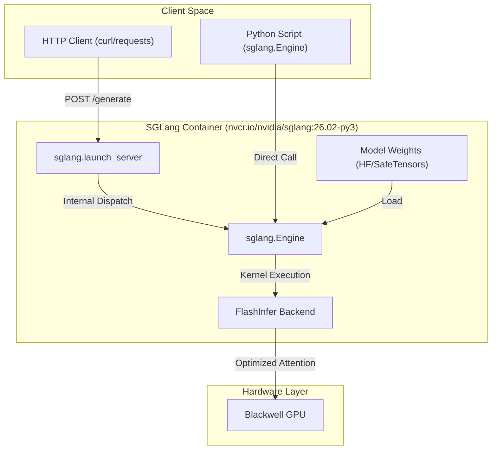
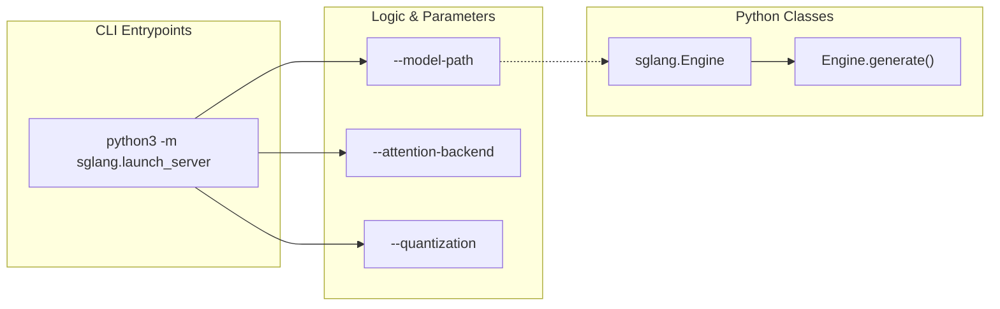

<!-- source: DeepWiki mcp.deepwiki.com · repo NVIDIA/dgx-spark-playbooks · page 4.6 SGLang · fetched 2026-10-26 -->

# SGLang

<details>
<summary>Relevant source files</summary>

The following files were used as context for generating this wiki page:

- [nvidia/dgx-dashboard/README.md](nvidia/dgx-dashboard/README.md)
- [nvidia/jax/README.md](nvidia/jax/README.md)
- [nvidia/sglang/README.md](nvidia/sglang/README.md)
- [nvidia/sglang/assets/offline-inference.py](nvidia/sglang/assets/offline-inference.py)
- [nvidia/txt2kg/README.md](nvidia/txt2kg/README.md)
- [nvidia/unsloth/README.md](nvidia/unsloth/README.md)

</details>


SGLang is a high-performance serving framework designed for Large Language Models (LLMs) and Vision Language Models (VLMs). It optimizes inference by co-designing the backend runtime and the frontend language, enabling faster and more controllable model interactions [nvidia/sglang/README.md:18-22](). On DGX Spark, SGLang utilizes the `flashinfer` attention backend to maximize throughput on Blackwell architecture [nvidia/sglang/README.md:141-153]().

## System Architecture

The SGLang deployment on DGX Spark consists of an optimized NGC container environment that interfaces with the Blackwell GPU. The system supports two primary operational modes: **Server Mode**, which exposes an OpenAI-compatible HTTP API, and **Offline Inference Mode**, which uses the `sglang.Engine` for direct Python-based execution [nvidia/sglang/README.md:26-28]().

### Inference Flow and Components

The following diagram illustrates the data flow from a client request through the SGLang runtime components to the GPU hardware.

**SGLang Runtime and Data Flow**

Sources: [nvidia/sglang/README.md:119-123](), [nvidia/sglang/README.md:141-153](), [nvidia/sglang/assets/offline-inference.py:18-27]()

## Implementation Details

### Server Deployment
The server is initiated using the `sglang.launch_server` module. Key parameters for Spark optimization include:
*   `--attention-backend flashinfer`: Specifically chosen for high-performance attention kernels on NVIDIA hardware [nvidia/sglang/README.md:152-152]().
*   `--mem-fraction-static 0.75`: Reserves 75% of GPU memory for the KV cache and model weights, leaving room for dynamic allocations [nvidia/sglang/README.md:153-153]().
*   `--tp 1`: Configures Tensor Parallelism (set to 1 for single-device Spark setups) [nvidia/sglang/README.md:151-151]().

### Model Support Matrix
SGLang on Spark supports a variety of optimized formats, including FP8 and NVFP4 (ModelOpt) for Blackwell [nvidia/sglang/README.md:52-70]().

| Model Category | Example HF Handle | Quantization |
| :--- | :--- | :--- |
| **Llama-3.1-8B** | `nvidia/Llama-3.1-8B-Instruct-FP4` | NVFP4 [nvidia/sglang/README.md:59-59]() |
| **Llama-3.3-70B** | `nvidia/Llama-3.3-70B-Instruct-FP4` | NVFP4 [nvidia/sglang/README.md:60-60]() |
| **Qwen3-32B** | `nvidia/Qwen3-32B-FP4` | NVFP4 [nvidia/sglang/README.md:65-65]() |
| **Phi-4-Multimodal** | `nvidia/Phi-4-multimodal-instruct-FP8` | FP8 [nvidia/sglang/README.md:66-66]() |

Sources: [nvidia/sglang/README.md:52-71]()

## Code Entity Mapping

The following diagram bridges the high-level serving concepts to the specific code entities and CLI arguments used in the playbook.

**Code Entity and CLI Mapping**

Sources: [nvidia/sglang/README.md:146-153](), [nvidia/sglang/assets/offline-inference.py:18-26]()

## Operational Instructions

### 1. Launching the Server
The server must be launched within the SGLang container with GPU access enabled.

```bash
python3 -m sglang.launch_server \
  --model-path deepseek-ai/DeepSeek-V2-Lite \
  --host 0.0.0.0 \
  --port 30000 \
  --trust-remote-code \
  --tp 1 \
  --attention-backend flashinfer \
  --mem-fraction-static 0.75 &
```
[nvidia/sglang/README.md:146-153]()

### 2. Offline Inference Implementation
For batch processing or embedded applications, the `sglang.Engine` class is used directly.

```python
import sglang as sgl

def main():
    llm = sgl.Engine(model_path="deepseek-ai/DeepSeek-V2-Lite", trust_remote_code=True)
    prompt = "What does NVIDIA love?"
    sampling_params = {"temperature": 0.7, "max_new_tokens": 100}
    output = llm.generate(prompt, sampling_params)
    print(f"Output: {output}")
```
[nvidia/sglang/assets/offline-inference.py:18-27]()

## Troubleshooting and Memory Management

Due to the **Unified Memory Architecture (UMA)** on DGX Spark, memory pressure can occur when switching models or during heavy inference loads if the Linux buffer cache consumes significant GPU-addressable memory [nvidia/sglang/README.md:213-216]().

| Issue | Resolution |
| :--- | :--- |
| **VRAM Exhaustion** | Flush the buffer cache using: `sudo sh -c 'sync; echo 3 > /proc/sys/vm/drop_caches'` [nvidia/sglang/README.md:218-220]() |
| **Connection Refused** | Ensure the container is started with `-p 30000:30000` and the server has finished initializing (check `/health` endpoint) [nvidia/sglang/README.md:132-136](), [nvidia/sglang/README.md:159-159]() |
| **NVFP4 Model Load Failure** | Ensure the `--quantization modelopt_fp4` flag is included in the launch command [nvidia/sglang/README.md:71-71]() |

Sources: [nvidia/sglang/README.md:71-71](), [nvidia/sglang/README.md:132-159](), [nvidia/sglang/README.md:213-220]()

---

