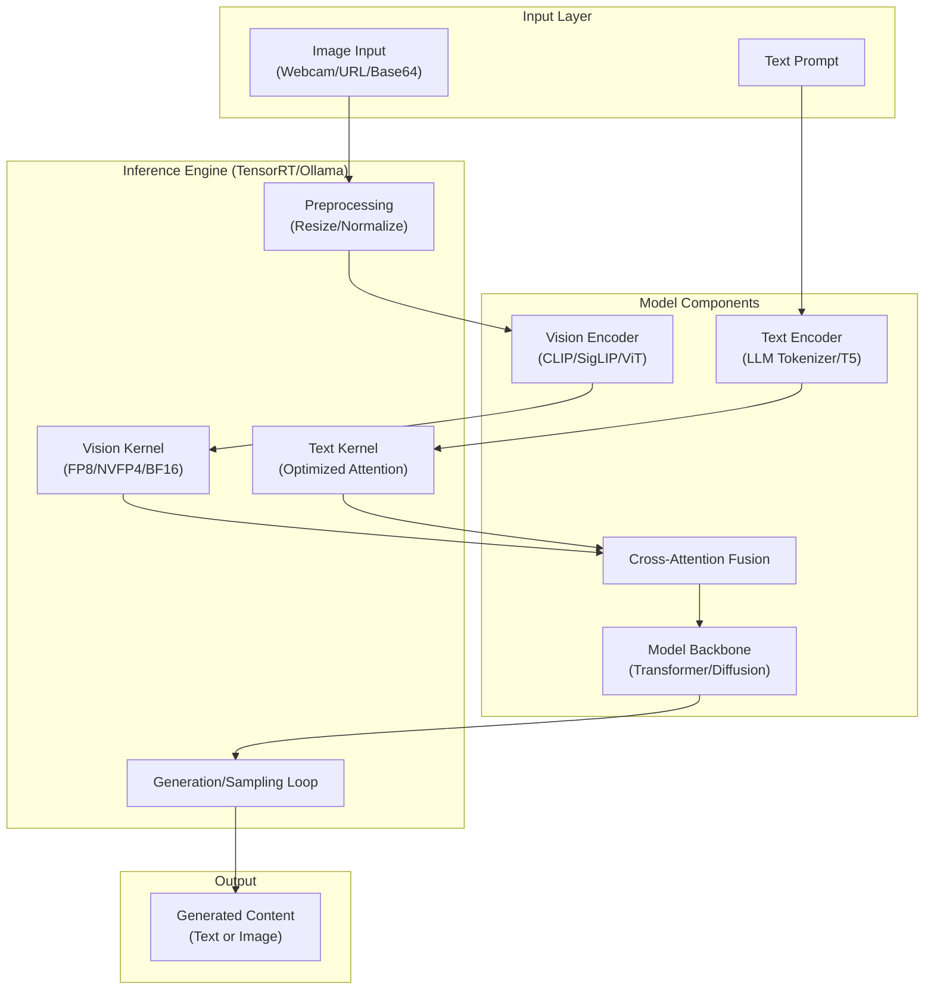
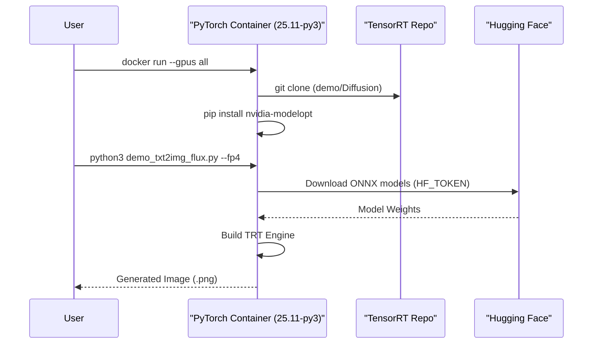

<!-- source: DeepWiki mcp.deepwiki.com · repo NVIDIA/dgx-spark-playbooks · page 4.7 Multi-modal Inference · fetched 2026-10-26 -->

# Multi-modal Inference

<details>
<summary>Relevant source files</summary>

The following files were used as context for generating this wiki page:

- [nvidia/connect-two-sparks/README.md](nvidia/connect-two-sparks/README.md)
- [nvidia/live-vlm-webui/README.md](nvidia/live-vlm-webui/README.md)
- [nvidia/multi-modal-inference/README.md](nvidia/multi-modal-inference/README.md)
- [nvidia/nccl/README.md](nvidia/nccl/README.md)
- [nvidia/nemotron/README.md](nvidia/nemotron/README.md)
- [nvidia/portfolio-optimization/README.md](nvidia/portfolio-optimization/README.md)
- [nvidia/single-cell/README.md](nvidia/single-cell/README.md)
- [nvidia/single-cell/assets/scRNA_analysis_preprocessing.ipynb](nvidia/single-cell/assets/scRNA_analysis_preprocessing.ipynb)

</details>


This page covers deploying and using Vision-Language Models (VLMs) and diffusion models for image and video understanding and generation tasks on DGX Spark. For text-only LLM inference, see [vLLM]() and [TensorRT-LLM](). For fine-tuning vision-language models, see [Vision-Language Model Fine-tuning]().

## Purpose and Scope

Multi-modal inference combines different data types, such as **text, images, and audio**, within a single model pipeline to generate or interpret richer outputs [nvidia/multi-modal-inference/README.md:17-18](). Instead of processing one input type at a time, these systems use shared representations for tasks like **text-to-image generation**, **image captioning**, or **vision-language reasoning** [nvidia/multi-modal-inference/README.md:18-19]().

**Covered topics:**
- Deployment of Flux.1 and SDXL diffusion models using TensorRT [nvidia/multi-modal-inference/README.md:24-26]().
- Real-time VLM interaction with webcam streaming via WebRTC [nvidia/live-vlm-webui/README.md:21-23]().
- Optimized VLM serving with TensorRT-LLM [nvidia/trt-llm/README.md:261-311]().
- Quantization formats (FP16, BF16, FP8, FP4) for multi-modal workloads [nvidia/multi-modal-inference/README.md:25-26]().

## Architecture Overview

Multi-modal systems on DGX Spark leverage the Blackwell GPU architecture for parallel processing across modalities [nvidia/multi-modal-inference/README.md:20-21]().

### Multi-modal Inference Flow



Sources: [nvidia/multi-modal-inference/README.md:17-21](), [nvidia/live-vlm-webui/README.md:21-24](), [nvidia/trt-llm/README.md:261-311]()

## Diffusion Model Inference (TensorRT)

TensorRT is used to run optimized versions of Flux.1 and SDXL diffusion models. This involves using the `demo_txt2img_flux.py` and `demo_txt2img_xl.py` scripts from the TensorRT repository [nvidia/multi-modal-inference/README.md:49-53]().

### Supported Precision Formats

| Model Variant | Precision | Command Flag | VRAM Requirement |
|---------------|-----------|--------------|------------------|
| Flux.1 Dev | BF16 | `--bf16` | High |
| Flux.1 Dev | FP8 | `--fp8 --quantization-level 4` | Medium |
| Flux.1 Dev | FP4 | `--fp4` | Low |
| Flux.1 Schnell | FP16 | Native Export | >48GB [nvidia/multi-modal-inference/README.md:164-165]() |
| Flux.1 Schnell | FP8 | `--fp8` | Medium |

Sources: [nvidia/multi-modal-inference/README.md:138-187]()

### Implementation Workflow



Sources: [nvidia/multi-modal-inference/README.md:92-158]()

## Real-time VLM Interaction

The `live-vlm-webui` tool provides a universal interface for real-time VLM interaction using WebRTC-based video streaming [nvidia/live-vlm-webui/README.md:21-23]().

### System Components

- **Frontend**: Web browser accessing `https://<SPARK_IP>:8090` [nvidia/live-vlm-webui/README.md:55]().
- **Backend**: Ollama (recommended), vLLM, SGLang, or NIM [nvidia/live-vlm-webui/README.md:57-62]().
- **Protocol**: WebRTC for low-latency video transmission [nvidia/live-vlm-webui/README.md:23]().

### Deployment with Ollama

1. **Install Ollama**: `curl -fsSL https://ollama.com/install.sh | sh` [nvidia/live-vlm-webui/README.md:93]().
2. **Download VLM**: `ollama pull gemma3:4b` or `qwen2.5-vl:7b` [nvidia/live-vlm-webui/README.md:105-109]().
3. **Launch UI**: `pip install live-vlm-webui && live-vlm-webui` [nvidia/live-vlm-webui/README.md:128-137]().

Sources: [nvidia/live-vlm-webui/README.md:87-145]()

## Memory Management and UMA

Multi-modal workloads are highly memory-intensive on DGX Spark.

### Memory Allocation Considerations
- **Diffusion Models**: Flux.1 Schnell in FP16 requires more than 48GB of VRAM [nvidia/multi-modal-inference/README.md:164-165]().
- **VLM Inference**: Qwen2.5-VL-7B-Instruct-FP8/FP4 variants are optimized for the Blackwell architecture [nvidia/trt-llm/README.md:106-107]().
- **Unified Memory**: DGX Spark's UMA allows dynamic sharing, but high VRAM requirements can still lead to Out-Of-Memory (OOM) errors during native model exports [nvidia/multi-modal-inference/README.md:61]().

### Buffer Management
To prevent memory fragmentation and clear the OS page cache before loading large multi-modal models:
```bash
sudo sh -c 'sync; echo 3 > /proc/sys/vm/drop_caches'
```
Sources: [nvidia/trt-llm/README.md:314-319](), [nvidia/multi-modal-inference/README.md:43]()

## Integration with Applications

### Open WebUI Multi-modal Setup
Open WebUI can be configured to use separate ports for standard LLMs and VLMs.

```bash
# Example routing logic
OPENAI_API_BASE_URLS="http://localhost:8355/v1;http://localhost:8356/v1"
```
By convention, port **8356** is often used for VLM inference servers like `trtllm-serve` to avoid conflicts with text-only servers on **8355** [nvidia/trt-llm/README.md:76]().

### Application Port Convention

| Service | Port | Description |
|---------|------|-------------|
| Text LLM (vLLM/TRT-LLM) | 8355 | Standard chat completions |
| VLM (TRT-LLM/Ollama) | 8356 | Image/Video understanding |
| Live VLM WebUI | 8090 | WebRTC streaming interface |
| Open WebUI | 8080 | Unified frontend |

Sources: [nvidia/trt-llm/README.md:76](), [nvidia/live-vlm-webui/README.md:55]()

## Troubleshooting

| Issue | Cause | Solution |
|-------|-------|----------|
| `OOM during Flux export` | FP16 requires >48GB VRAM | Use FP8 or FP4 quantization [nvidia/multi-modal-inference/README.md:164-165](). |
| `Webcam access denied` | HTTP used instead of HTTPS | Access via `https://<SPARK_IP>:8090` [nvidia/live-vlm-webui/README.md:191](). |
| `Permission denied (Docker)` | User not in docker group | Run `sudo usermod -aG docker $USER && newgrp docker` [nvidia/multi-modal-inference/README.md:88-89](). |
| `HF Model access error` | Missing token or permissions | Configure `export HF_TOKEN=<token>` and ensure access to Black Forest Labs models [nvidia/multi-modal-inference/README.md:41-42](). |

Sources: [nvidia/multi-modal-inference/README.md:59-62](), [nvidia/live-vlm-webui/README.md:191-204]()

---

