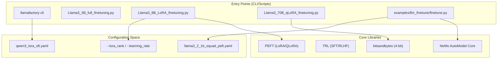
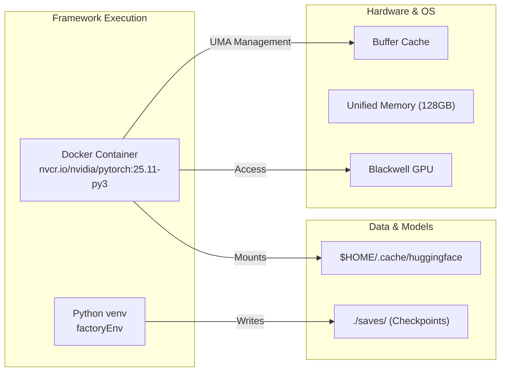

<!-- source: DeepWiki mcp.deepwiki.com · repo NVIDIA/dgx-spark-playbooks · page 5 Fine-tuning Frameworks · fetched 2026-10-26 -->

# Fine-tuning Frameworks

Relevant source files

The following files were used as context for generating this wiki page:

- [nvidia/llama-factory/README.md](nvidia/llama-factory/README.md)
- [nvidia/multi-agent-chatbot/README.md](nvidia/multi-agent-chatbot/README.md)
- [nvidia/nemo-fine-tune/README.md](nvidia/nemo-fine-tune/README.md)
- [nvidia/pytorch-fine-tune/README.md](nvidia/pytorch-fine-tune/README.md)

## Purpose and Scope

This document provides an overview of fine-tuning options available on DGX Spark for adapting pre-trained models to specific tasks and datasets. Fine-tuning allows users to customize Large Language Models (LLMs), Vision-Language Models (VLMs), and Diffusion models to domain-specific requirements using the Blackwell GPU architecture and Unified Memory Architecture (UMA) [nvidia/pytorch-fine-tune/README.md:24-33](), [nvidia/nemo-fine-tune/README.md:13-21]().

This is a **parent page**. For detailed implementation guides, refer to the following child pages:
- [Choosing a Fine-tuning Framework](#5.1) — Comparison of LLaMA Factory, PyTorch, NeMo, and Unsloth.
- [LLaMA Factory](#5.2) — Quick experimentation with SFT, LoRA, QLoRA, and RLHF via CLI or WebUI [nvidia/llama-factory/README.md:15-20]().
- [PyTorch Fine-tuning](#5.3) — Flexible scripts supporting LoRA, QLoRA, and full fine-tuning [nvidia/pytorch-fine-tune/README.md:113-125]().
- [NeMo AutoModel](#5.4) — Enterprise-scale fine-tuning with distributed training and FP8 precision [nvidia/nemo-fine-tune/README.md:13-21]().
- [Unsloth Fine-tuning](#5.5) — Accelerated training using custom Triton kernels.
- [FLUX.1 Dreambooth LoRA](#5.6) — Fine-tuning diffusion models for custom image generation.
- [Vision-Language Model Fine-tuning](#5.7) — Adapting VLMs like Qwen2.5-VL and InternVL3.

---

## Fine-tuning Architecture and Code Entities

The following diagram maps the natural language concepts of the fine-tuning workflow to the specific code entities and scripts found in the repository.

### Logic to Code Mapping

**Sources**: [nvidia/pytorch-fine-tune/README.md:113-125](), [nvidia/nemo-fine-tune/README.md:156-164](), [nvidia/llama-factory/README.md:125-132]()

---

## Framework Overview

The DGX Spark playbooks provide several paths for model adaptation depending on the user's requirements for ease-of-use versus granular control.

### Framework Comparison Table

| Framework | Best For | Key Script/Entry Point | Optimization Features |
| :--- | :--- | :--- | :--- |
| **LLaMA Factory** | Rapid Prototyping | `llamafactory-cli` | Unified YAML, WebUI, Multi-model support [nvidia/llama-factory/README.md:15-20]() |
| **PyTorch** | Custom Research | `Llama3_8B_LoRA_finetuning.py` | Native PEFT, DeepSpeed/FSDP support [nvidia/pytorch-fine-tune/README.md:113-125]() |
| **NeMo** | Enterprise Scale | `finetune.py` | FP8 precision, Distributed Training [nvidia/nemo-fine-tune/README.md:13-21]() |
| **Unsloth** | Max Performance | `unsloth` kernels | 2x faster, 70% less memory |

### System Entity Relationship
This diagram illustrates how the fine-tuning frameworks interact with the DGX Spark system resources.

**Sources**: [nvidia/pytorch-fine-tune/README.md:83-90](), [nvidia/llama-factory/README.md:87-90](), [nvidia/multi-agent-chatbot/README.md:148-153]()

---

## Common Fine-tuning Techniques

The playbooks support several methodologies for adapting models on DGX Spark:

1.  **Full Supervised Fine-tuning (SFT)**: Updates all parameters. Best for smaller models like Llama 3.2 3B [nvidia/pytorch-fine-tune/README.md:121]().
2.  **LoRA (Low-Rank Adaptation)**: Parameter-efficient method that injects trainable rank decomposition matrices. Supported for models up to 70B [nvidia/pytorch-fine-tune/README.md:123]().
3.  **QLoRA (Quantized LoRA)**: Reduces memory requirements by using 4-bit quantization for the base model while keeping adapters in high precision. Ideal for large 70B models on a single Spark node [nvidia/pytorch-fine-tune/README.md:124]().
4.  **FP8 Training**: High-performance training using 8-bit floating point precision, specifically optimized for Blackwell GPUs via NeMo AutoModel [nvidia/nemo-fine-tune/README.md:13-21]().

---

## Memory Management on DGX Spark

DGX Spark uses a **Unified Memory Architecture (UMA)**, allowing the GPU and CPU to share the 128GB system memory [nvidia/multi-agent-chatbot/README.md:148-150](). However, fine-tuning large models (especially 70B variants) can still hit limits.

**Best Practices for Fine-tuning Memory**:
*   **Flush Buffer Cache**: Manually clear the system cache between runs using `sudo sh -c 'sync; echo 3 > /proc/sys/vm/drop_caches'` [nvidia/multi-agent-chatbot/README.md:151-153]().
*   **Gradient Checkpointing**: Use the `--gradient_checkpointing` flag in PyTorch scripts to trade compute for memory [nvidia/pytorch-fine-tune/README.md:155]().
*   **Batch Size Tuning**: Reduce `per_device_train_batch_size` or increase `gradient_accumulation_steps` if OOM (Out of Memory) occurs [nvidia/llama-factory/README.md:205]().

**Sources**: [nvidia/multi-agent-chatbot/README.md:148-153](), [nvidia/pytorch-fine-tune/README.md:155](), [nvidia/llama-factory/README.md:205]()

---

