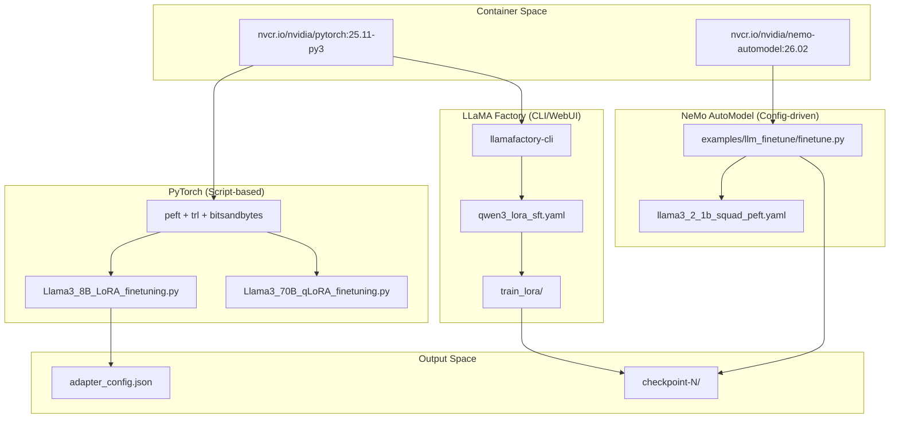
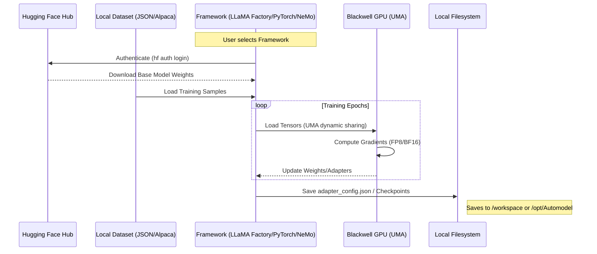

<!-- source: DeepWiki mcp.deepwiki.com · repo NVIDIA/dgx-spark-playbooks · page 5.1 Choosing a Fine-tuning Framework · fetched 2026-10-26 -->

# Choosing a Fine-tuning Framework

Relevant source files

The following files were used as context for generating this wiki page:

- [nvidia/llama-factory/README.md](nvidia/llama-factory/README.md)
- [nvidia/multi-agent-chatbot/README.md](nvidia/multi-agent-chatbot/README.md)
- [nvidia/nemo-fine-tune/README.md](nvidia/nemo-fine-tune/README.md)
- [nvidia/pytorch-fine-tune/README.md](nvidia/pytorch-fine-tune/README.md)

## Purpose and Scope

This document compares the primary fine-tuning frameworks available on DGX Spark: **LLaMA Factory**, **PyTorch**, and **NeMo AutoModel**. It provides technical guidance on selecting the appropriate framework based on requirements for ease-of-use, flexibility, scale, and supported techniques. For implementation details on each framework, see the respective leaf pages in Section 5.

Sources: [nvidia/pytorch-fine-tune/README.md:1-34](), [nvidia/nemo-fine-tune/README.md:1-22](), [nvidia/llama-factory/README.md:1-26]()

---

## Framework Overview

Three distinct fine-tuning frameworks are available in the playbooks repository, each targeting different developer profiles and use cases:

| Framework | Primary Focus | Interface | Precision Support |
|-----------|--------------|-----------|-------------------|
| **LLaMA Factory** | Rapid experimentation | CLI + WebUI | BF16, FP16, INT4 |
| **PyTorch** | Custom research/scripts | Python scripts | BF16, FP16, FP32 |
| **NeMo AutoModel** | Production scale & Multi-node | YAML + Python | FP8, BF16, FP16 |

**LLaMA Factory** simplifies the training process for a wide range of architectures (LLaMA, Mistral, Qwen) using a unified interface for SFT, RLHF, and QLoRA [nvidia/llama-factory/README.md:16-20](). It is ideal for users who want to adapt models without writing extensive training code.

**PyTorch Fine-tune** provides the highest degree of flexibility by using the `transformers`, `peft`, `datasets`, and `trl` libraries directly [nvidia/pytorch-fine-tune/README.md:95-96](). It includes optimized scripts for Llama 3.1/3.2 models ranging from 3B to 70B parameters [nvidia/pytorch-fine-tune/README.md:119-124]().

**NeMo AutoModel** is designed for enterprise-scale fine-tuning. It supports distributed training across single GPU to multi-node clusters and includes optimized kernels for ARM64 architecture and Blackwell GPUs [nvidia/nemo-fine-tune/README.md:17-18](). It specifically offers FP8 precision optimizations for Blackwell systems [nvidia/nemo-fine-tune/README.md:21-22]().

Sources: [nvidia/llama-factory/README.md:16-26](), [nvidia/pytorch-fine-tune/README.md:28-34](), [nvidia/nemo-fine-tune/README.md:17-22]()

---

## Framework Architecture and Code Entities

The following diagram maps the logical components of each framework to the specific code entities and containers used in the playbooks.

**Fine-tuning Framework Implementation Map**

Sources: [nvidia/llama-factory/README.md:130-142](), [nvidia/pytorch-fine-tune/README.md:80-124](), [nvidia/nemo-fine-tune/README.md:100-164]()

---

## Training Technique Support Matrix

DGX Spark's 128GB Unified Memory Architecture (UMA) allows for various fine-tuning strategies depending on model size and framework capabilities.

| Technique | LLaMA Factory | PyTorch | NeMo AutoModel | DGX Spark Benefit |
|-----------|---------------|---------|----------------|-------------------|
| **Full SFT** | ✅ Supported | ✅ `Llama3_3B_full_finetuning.py` | ✅ Supported | UMA allows larger models for full SFT |
| **LoRA** | ✅ Supported | ✅ `Llama3_8B_LoRA_finetuning.py` | ✅ Supported | Efficient parameter updates |
| **QLoRA** | ✅ Supported | ✅ `Llama3_70B_qLoRA_finetuning.py` | ✅ Supported | Fine-tune 70B models in 128GB RAM |
| **FP8 Training** | ❌ Limited | ❌ Limited | ✅ Native Support | Blackwell-specific acceleration |
| **Multi-Node** | ❌ No | ✅ Docker Swarm/FSDP | ✅ Native Distributed | Scale across multiple Sparks |

**Full Supervised Fine-tuning (SFT)**: Updates all parameters. Recommended for models up to 8B parameters on a single Spark node [nvidia/pytorch-fine-tune/README.md:121]().

**LoRA/QLoRA**: Parameter-efficient methods. QLoRA (4-bit quantization) is mandatory for fine-tuning 70B models like Llama 3.1 70B on a single DGX Spark node [nvidia/pytorch-fine-tune/README.md:124]().

**Distributed Training**: NeMo AutoModel is the preferred framework for multi-node setups, though PyTorch supports distributed runs via Docker Swarm and FSDP (Fully Sharded Data Parallel) [nvidia/pytorch-fine-tune/README.md:9-19](), [nvidia/nemo-fine-tune/README.md:17-18]().

Sources: [nvidia/pytorch-fine-tune/README.md:119-124](), [nvidia/nemo-fine-tune/README.md:17-22](), [nvidia/llama-factory/README.md:16-20]()

---

## Data Flow and Execution Logic

The following diagram illustrates how data flows from Hugging Face through the selected framework to produce a fine-tuned artifact on the DGX Spark filesystem.

**Fine-tuning Data Flow**

Sources: [nvidia/pytorch-fine-tune/README.md:98-113](), [nvidia/nemo-fine-tune/README.md:134-164](), [nvidia/llama-factory/README.md:135-143]()

---

## Selection Guidelines

### 1. Choose LLaMA Factory if:
* You want a **WebUI** or a simple **CLI** for quick experimentation [nvidia/llama-factory/README.md:16-20]().
* You need to perform **RLHF** or use architectures like **Mistral/Qwen** with minimal setup [nvidia/llama-factory/README.md:18-19]().
* You are comfortable with a virtual environment (`venv`) based setup [nvidia/llama-factory/README.md:68]().

### 2. Choose PyTorch if:
* You need to **customize the training loop** or use specific `trl` or `peft` features [nvidia/pytorch-fine-tune/README.md:33-37]().
* You are working with **Llama 3.1/3.2** specifically and want standalone scripts [nvidia/pytorch-fine-tune/README.md:119-124]().
* You prefer working inside the standard **NVIDIA PyTorch Container** (`nvcr.io/nvidia/pytorch:25.11-py3`) [nvidia/pytorch-fine-tune/README.md:80]().

### 3. Choose NeMo AutoModel if:
* You require **FP8 precision** to maximize performance on Blackwell GPUs [nvidia/nemo-fine-tune/README.md:21-22]().
* You are planning to scale to **multi-node clusters** [nvidia/nemo-fine-tune/README.md:17-18]().
* You prefer a **YAML-driven** configuration for reproducibility [nvidia/nemo-fine-tune/README.md:154-164]().
* You need a dedicated container with pre-installed **NeMo** optimizations [nvidia/nemo-fine-tune/README.md:100]().

---

## System Resource Considerations

DGX Spark uses a **Unified Memory Architecture (UMA)**. This allows the GPU to access system RAM dynamically. However, users must be aware of the following:

* **Buffer Flushing**: If memory issues occur, manually flush the buffer cache using `sudo sh -c 'sync; echo 3 > /proc/sys/vm/drop_caches'` [nvidia/multi-agent-chatbot/README.md:151-152]().
* **Disk Space**: Fine-tuning requires significant storage (>50GB) for base models and checkpoints [nvidia/llama-factory/README.md:48]().
* **Docker Permissions**: All frameworks require the user to be in the `docker` group to manage containers effectively [nvidia/pytorch-fine-tune/README.md:70-73](), [nvidia/nemo-fine-tune/README.md:90-95]().

Sources: [nvidia/multi-agent-chatbot/README.md:148-152](), [nvidia/llama-factory/README.md:48-50](), [nvidia/pytorch-fine-tune/README.md:60-76]()

---

