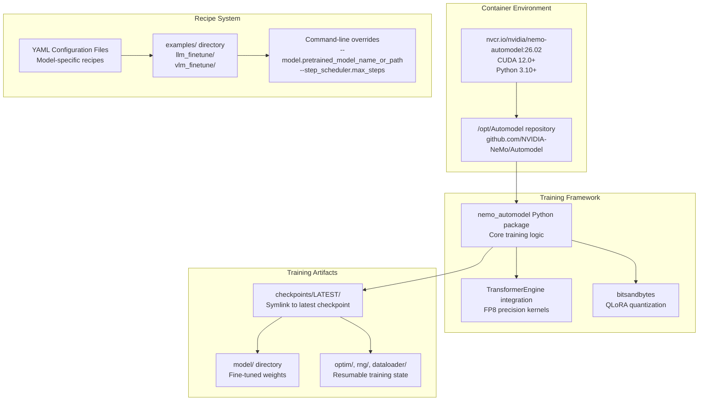
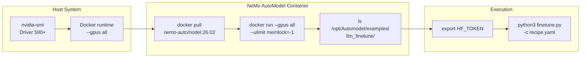
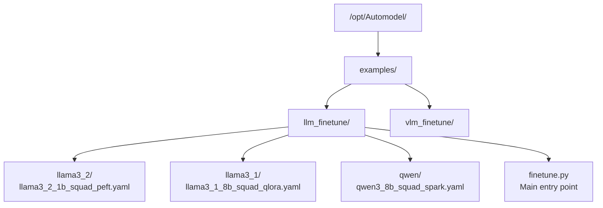
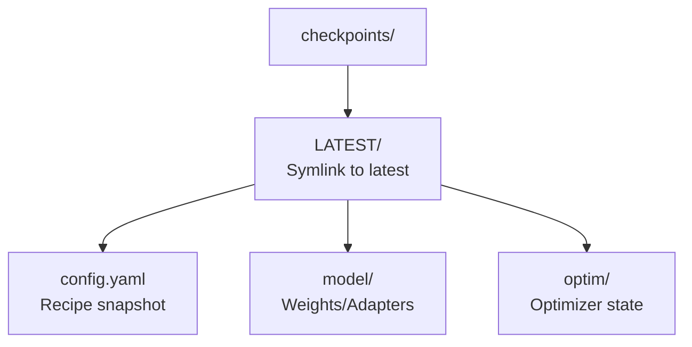

<!-- source: DeepWiki mcp.deepwiki.com · repo NVIDIA/dgx-spark-playbooks · page 5.4 NeMo AutoModel · fetched 2026-10-26 -->

# NeMo AutoModel

<details>
<summary>Relevant source files</summary>

The following files were used as context for generating this wiki page:

- [nvidia/llama-factory/README.md](nvidia/llama-factory/README.md)
- [nvidia/nemo-fine-tune/README.md](nvidia/nemo-fine-tune/README.md)

</details>


This page documents NVIDIA NeMo AutoModel, an enterprise-scale fine-tuning framework for large language models (LLMs) and vision-language models (VLMs) on DGX Spark devices. NeMo AutoModel provides GPU-accelerated training with distributed capabilities, FP8 precision optimizations, and native Hugging Face model support without conversion delays.

For comparison of fine-tuning frameworks and guidance on selecting between NeMo AutoModel, LLaMA Factory, or PyTorch, see [Choosing a Fine-tuning Framework](#5.1). For image generation fine-tuning, see [Unsloth Fine-tuning](#5.5). For VLM-specific workflows, see [Vision-Language Model Fine-tuning](#5.7).

**Sources:** [nvidia/nemo-fine-tune/README.md:1-43]()

---

## Purpose and Scope

NeMo AutoModel targets production-scale fine-tuning workloads requiring:
- **Distributed training**: Single GPU to multi-node clusters with tensor parallelism [nvidia/nemo-fine-tune/README.md:17-17]().
- **Memory efficiency**: FP8 precision, gradient checkpointing, and packed sequence training [nvidia/nemo-fine-tune/README.md:21-21]().
- **Enterprise features**: Reproducible recipes, checkpoint management, and HF Hub integration [nvidia/nemo-fine-tune/README.md:17-21]().
- **ARM64 optimization**: Optimized kernels specifically designed for ARM64 architecture and Blackwell GPU systems [nvidia/nemo-fine-tune/README.md:17-17]().

The framework supports supervised fine-tuning (SFT), parameter-efficient fine-tuning (PEFT) with LoRA/QLoRA, and full fine-tuning for models ranging from 1B to 70B+ parameters [nvidia/nemo-fine-tune/README.md:21-21]().

**Sources:** [nvidia/nemo-fine-tune/README.md:15-31]()

---

## System Architecture

NeMo AutoModel consists of the container environment, the training framework, configuration recipes, and checkpoint artifacts.



**System Layers:**

| Layer | Purpose | Key Components |
|-------|---------|----------------|
| **Container Environment** | Provides CUDA, PyTorch, and dependencies | `nvcr.io/nvidia/nemo-automodel:26.02` [nvidia/nemo-fine-tune/README.md:100-100]() |
| **Training Framework** | Executes distributed training with optimizations | `nemo_automodel` package, TransformerEngine, bitsandbytes [nvidia/nemo-fine-tune/README.md:17-21]() |
| **Recipe System** | Manages training configurations and parameters | YAML files in `examples/`, CLI overrides [nvidia/nemo-fine-tune/README.md:154-164]() |
| **Artifacts** | Stores checkpoints and training state | `checkpoints/LATEST/` directory structure [nvidia/nemo-fine-tune/README.md:281-302]() |

The framework executes via `python3 examples/llm_finetune/finetune.py` with configuration sourced from YAML recipes and command-line overrides [nvidia/nemo-fine-tune/README.md:159-164]().

**Sources:** [nvidia/nemo-fine-tune/README.md:100-164](), [nvidia/nemo-fine-tune/README.md:281-302]()

---

## Installation and Launch Workflow

NeMo AutoModel uses a pre-built Docker container for DGX Spark Blackwell architecture.



**Launch Steps:**

1. **Pull Image**: `docker pull nvcr.io/nvidia/nemo-automodel:26.02` [nvidia/nemo-fine-tune/README.md:100-100]().
2. **Container Launch**: `docker run --gpus all --ulimit memlock=-1 -it --rm nvcr.io/nvidia/nemo-automodel:26.02` [nvidia/nemo-fine-tune/README.md:108-113]().
3. **Verify Recipes**: Navigate to `/opt/Automodel` and list examples [nvidia/nemo-fine-tune/README.md:121-125]().
4. **Auth**: Export `HF_TOKEN` for gated models like Llama-3.1 [nvidia/nemo-fine-tune/README.md:138-141]().

The `--ulimit memlock=-1` and `--ulimit stack=67108864` flags are required for high-performance memory management on Blackwell systems [nvidia/nemo-fine-tune/README.md:110-111]().

**Sources:** [nvidia/nemo-fine-tune/README.md:100-141]()

---

## Recipe Directory Structure

Training recipes are organized by model family and training method (PEFT vs SFT).



**Recipe Categories:**

| Path | Contents | Purpose |
|------|----------|---------|
| `examples/llm_finetune/llama3_2/` | Llama 3.2 configs | PEFT recipes for 1B/3B models [nvidia/nemo-fine-tune/README.md:160-160]() |
| `examples/llm_finetune/llama3_1/` | Llama 3.1 configs | QLoRA recipes for 8B/70B models [nvidia/nemo-fine-tune/README.md:203-203]() |
| `examples/llm_finetune/qwen/` | Qwen configs | Optimized recipes for Qwen3-8B on Spark [nvidia/nemo-fine-tune/README.md:226-226]() |

**Sources:** [nvidia/nemo-fine-tune/README.md:125-226]()

---

## Training Execution Patterns

NeMo AutoModel supports parameter-efficient fine-tuning (PEFT) and full supervised fine-tuning (SFT).

**Example: LoRA Fine-tuning**
```bash
python3 examples/llm_finetune/finetune.py \
  -c examples/llm_finetune/llama3_2/llama3_2_1b_squad_peft.yaml \
  --model.pretrained_model_name_or_path meta-llama/Llama-3.1-8B \
  --packed_sequence.packed_sequence_size 1024 \
  --step_scheduler.max_steps 20
```
[nvidia/nemo-fine-tune/README.md:159-164]()

**Key Parameters:**
- `--model.pretrained_model_name_or_path`: Selects the model from Hugging Face [nvidia/nemo-fine-tune/README.md:167-167]().
- `--packed_sequence.packed_sequence_size`: Enables packed sequence training for higher throughput [nvidia/nemo-fine-tune/README.md:168-168]().
- `--step_scheduler.max_steps`: Controls training duration [nvidia/nemo-fine-tune/README.md:169-169]().

**Comparison of Methods:**

| Method | Recipe Example | Use Case |
|--------|----------------|----------|
| **LoRA** | `llama3_2_1b_squad_peft.yaml` | PEFT for 8B models [nvidia/nemo-fine-tune/README.md:160-160]() |
| **QLoRA** | `llama3_1_8b_squad_qlora.yaml` | Memory-constrained 70B models [nvidia/nemo-fine-tune/README.md:203-203]() |
| **Full SFT** | `qwen3_8b_squad_spark.yaml` | Maximum performance/adaptation [nvidia/nemo-fine-tune/README.md:226-226]() |

**Sources:** [nvidia/nemo-fine-tune/README.md:159-226]()

---

## Checkpoint Management

Checkpoints are stored in a structured directory containing the model weights and training state.



**Checkpoint Contents:**
- `model/`: Contains the fine-tuned weights or adapters [nvidia/nemo-fine-tune/README.md:295-295]().
- `optim/`: Stores optimizer states for resuming training [nvidia/nemo-fine-tune/README.md:296-296]().
- `config.yaml`: A snapshot of the exact configuration used for the run [nvidia/nemo-fine-tune/README.md:294-294]().

**Sources:** [nvidia/nemo-fine-tune/README.md:281-302]()

---

## Troubleshooting

| Symptom | Cause | Fix |
|---------|-------|-----|
| Permission denied for Docker | User not in docker group | `sudo usermod -aG docker $USER` [nvidia/nemo-fine-tune/README.md:93-94]() |
| CUDA Out of Memory | Batch size too large | Reduce `--step_scheduler.local_batch_size` [nvidia/nemo-fine-tune/README.md:386-386]() |
| Gated model access error | Missing HF_TOKEN | `export HF_TOKEN=<token>` [nvidia/nemo-fine-tune/README.md:138-141]() |
| UMA Memory allocation failure | Buffer cache full | `sync; echo 3 > /proc/sys/vm/drop_caches` [nvidia/nemo-fine-tune/README.md:391-391]() |

**Sources:** [nvidia/nemo-fine-tune/README.md:72-391]()

---

