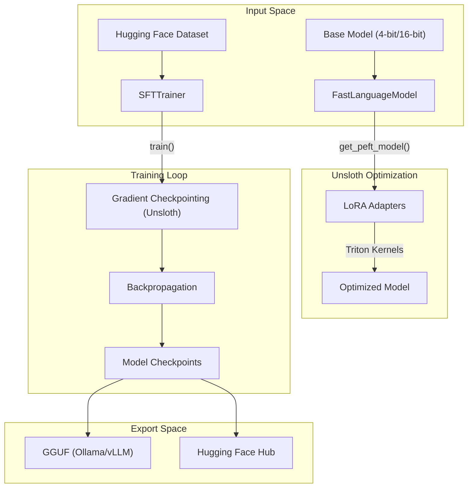
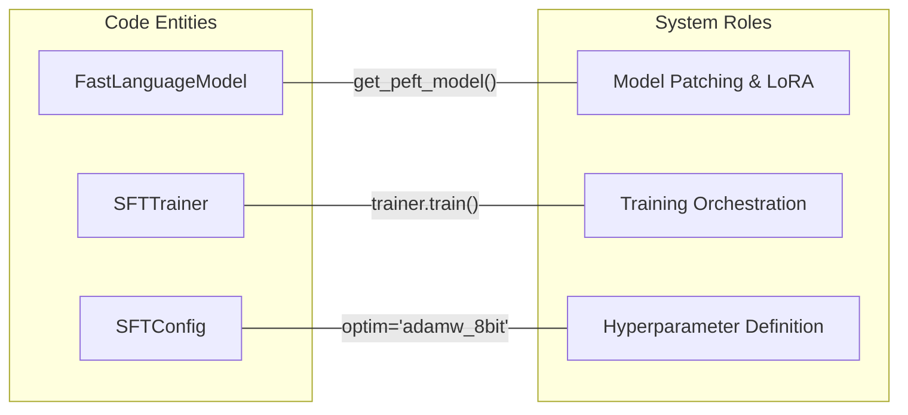

<!-- source: DeepWiki mcp.deepwiki.com · repo NVIDIA/dgx-spark-playbooks · page 5.5 Unsloth Fine-tuning · fetched 2026-10-26 -->

# Unsloth Fine-tuning

<details>
<summary>Relevant source files</summary>

The following files were used as context for generating this wiki page:

- [nvidia/dgx-dashboard/README.md](nvidia/dgx-dashboard/README.md)
- [nvidia/jax/README.md](nvidia/jax/README.md)
- [nvidia/sglang/README.md](nvidia/sglang/README.md)
- [nvidia/spark-reachy-photo-booth/README.md](nvidia/spark-reachy-photo-booth/README.md)
- [nvidia/spark-reachy-photo-booth/assets/architecture-diagram.png](nvidia/spark-reachy-photo-booth/assets/architecture-diagram.png)
- [nvidia/spark-reachy-photo-booth/assets/setup.jpg](nvidia/spark-reachy-photo-booth/assets/setup.jpg)
- [nvidia/spark-reachy-photo-booth/assets/teaser.jpg](nvidia/spark-reachy-photo-booth/assets/teaser.jpg)
- [nvidia/txt2kg/README.md](nvidia/txt2kg/README.md)
- [nvidia/unsloth/README.md](nvidia/unsloth/README.md)
- [nvidia/unsloth/assets/test_unsloth.py](nvidia/unsloth/assets/test_unsloth.py)

</details>


Accelerated Large Language Model (LLM) fine-tuning on DGX Spark is powered by Unsloth, a framework that utilizes custom Triton kernels to significantly increase training throughput while reducing VRAM overhead. This playbook enables efficient adaptation of models like Llama 3.1, Mistral, and Phi-3.5 using Parameter-Efficient Fine-Tuning (PEFT) techniques such as LoRA and QLoRA.

## Overview

Unsloth provides a performance-first approach to fine-tuning on Blackwell architecture, claiming up to 2× faster training on single GPUs and substantial memory reductions [nvidia/unsloth/README.md:17-17](). The implementation focuses on:
*   **Kernel-level optimizations**: Hand-optimized math and Triton-based compute kernels [nvidia/unsloth/README.md:18-18]().
*   **Memory Efficiency**: Support for 4-bit and 16-bit dynamic quantization to retain accuracy while fitting larger models or batch sizes [nvidia/unsloth/README.md:19-19]().
*   **Broad Compatibility**: Support for major model families including Llama, Mistral, Qwen, and DeepSeek [nvidia/unsloth/README.md:20-20]().

### Data Flow and System Architecture

The fine-tuning process involves loading a pre-quantized base model, applying PEFT adapters, and executing a supervised fine-tuning (SFT) loop.

**Fine-tuning Execution Flow**

Sources: [nvidia/unsloth/README.md:18-21](), [nvidia/unsloth/assets/test_unsloth.py:48-90]()

## Implementation Details

The fine-tuning implementation is centered around the `FastLanguageModel` and `FastModel` classes provided by the Unsloth library [nvidia/unsloth/assets/test_unsloth.py:18-18]().

### Model Loading and Patching
Models are loaded with specific optimizations for the Blackwell GPU. The `FastModel.from_pretrained` function handles the initial loading, often utilizing 4-bit quantization to prevent Out-Of-Memory (OOM) errors [nvidia/unsloth/assets/test_unsloth.py:48-55]().

### PEFT Configuration
The system applies LoRA (Low-Rank Adaptation) by patching specific target modules. In the provided validation script, the following parameters are utilized:
*   **Rank (r)**: 16 [nvidia/unsloth/assets/test_unsloth.py:60-60]().
*   **Target Modules**: Includes `q_proj`, `k_proj`, `v_proj`, `o_proj`, `gate_proj`, `up_proj`, and `down_proj` [nvidia/unsloth/assets/test_unsloth.py:61-62]().
*   **Gradient Checkpointing**: Set to `"unsloth"`, which uses 30% less VRAM than standard implementations [nvidia/unsloth/assets/test_unsloth.py:66-67]().

**Code Entity Mapping: Unsloth Framework**

Sources: [nvidia/unsloth/assets/test_unsloth.py:18-20](), [nvidia/unsloth/assets/test_unsloth.py:58-89]()

## Deployment and Execution

Unsloth is deployed on DGX Spark using the NVIDIA PyTorch container (`nvcr.io/nvidia/pytorch:25.11-py3`) [nvidia/unsloth/README.md:79-84]().

### Setup Steps
1.  **Container Launch**: Start the container with GPU access and optimized memory limits (`--ulimit memlock=-1`) [nvidia/unsloth/README.md:84-85]().
2.  **Dependency Installation**: Install `unsloth`, `unsloth_zoo`, and `bitsandbytes` [nvidia/unsloth/README.md:90-92]().
3.  **Validation**: Execute `test_unsloth.py` to confirm the Triton kernels are correctly patching the environment for "2x faster free finetuning" [nvidia/unsloth/README.md:110-114]().

### Configuration Reference

| Parameter | Default/Example | Description |
| :--- | :--- | :--- |
| `max_seq_length` | 2048 | Maximum context window for training [nvidia/unsloth/assets/test_unsloth.py:22-22]() |
| `load_in_4bit` | `True` | Enables BitsAndBytes 4-bit quantization [nvidia/unsloth/assets/test_unsloth.py:51-51]() |
| `optim` | `adamw_8bit` | Uses 8-bit AdamW optimizer to save VRAM [nvidia/unsloth/assets/test_unsloth.py:86-86]() |
| `per_device_train_batch_size` | 2 | Number of samples per GPU per step [nvidia/unsloth/assets/test_unsloth.py:80-80]() |

Sources: [nvidia/unsloth/README.md:84-92](), [nvidia/unsloth/assets/test_unsloth.py:22-88]()

## Troubleshooting and Memory Management

Due to the Unified Memory Architecture (UMA) on DGX Spark, memory pressure can occur if the Linux buffer cache consumes resources required by the GPU [nvidia/unsloth/README.md:144-145]().

**Manual Memory Flush Command:**
```bash
sudo sh -c 'sync; echo 3 > /proc/sys/vm/drop_caches'
```
[nvidia/unsloth/README.md:147-149]()

Common issues include:
*   **Triton Compiler Mismatches**: May occur if versions are inconsistent between the container and the installed library [nvidia/unsloth/README.md:54-54]().
*   **CUDA Toolkit Errors**: Ensure `nvcc --version` reports CUDA 13.0 for compatibility with Blackwell optimizations [nvidia/unsloth/README.md:42-42](), [nvidia/unsloth/README.md:68-70]().

Sources: [nvidia/unsloth/README.md:42-70](), [nvidia/unsloth/README.md:144-149]()

---

