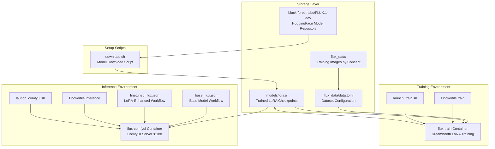
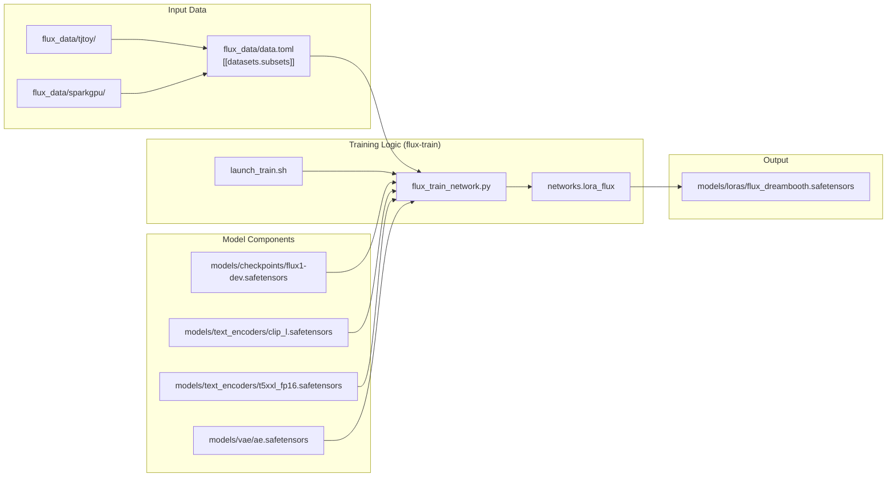
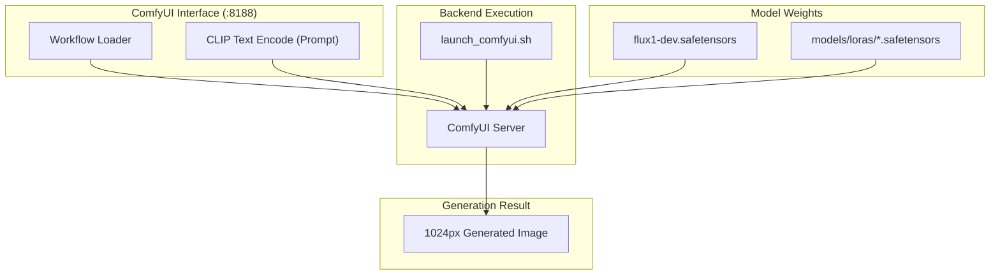

<!-- source: DeepWiki mcp.deepwiki.com · repo NVIDIA/dgx-spark-playbooks · page 5.6 FLUX.1 Dreambooth LoRA · fetched 2026-10-26 -->

# FLUX.1 Dreambooth LoRA

<details>
<summary>Relevant source files</summary>

The following files were used as context for generating this wiki page:

- [nvidia/flux-finetuning/README.md](nvidia/flux-finetuning/README.md)
- [nvidia/flux-finetuning/assets/README.md](nvidia/flux-finetuning/assets/README.md)
- [nvidia/flux-finetuning/assets/launch_train.sh](nvidia/flux-finetuning/assets/launch_train.sh)

</details>


## Purpose and Scope

This document describes the FLUX.1 Dreambooth LoRA fine-tuning system for customizing the FLUX.1-dev 12B diffusion model to generate images with user-defined concepts, characters, and styles. The system implements Low-Rank Adaptation (LoRA) fine-tuning using the Dreambooth technique, enabling efficient training on DGX Spark's 128GB unified memory architecture.

This page covers the technical architecture, training pipeline, inference integration with ComfyUI, and configuration of the FLUX.1 fine-tuning system.

**Sources:** [nvidia/flux-finetuning/README.md:1-21](), [nvidia/flux-finetuning/README.md:41-52]()

## System Overview

The FLUX.1 Dreambooth LoRA system fine-tunes the FLUX.1-dev 12B model to learn custom concepts from small image datasets (5-10 images per concept). The system loads multiple large models simultaneously in unified memory: the Diffusion Transformer, CLIP Text Encoder, T5 Text Encoder, and Autoencoder. Training produces LoRA weight adapters that can be applied during inference to generate high-resolution images (1024px+) incorporating the learned concepts.

The system is split into two Docker-based environments: a training container for Dreambooth LoRA fine-tuning and an inference container running ComfyUI with the trained LoRA weights for visual workflow-based generation.

**Key Capabilities:**
- Multi-concept training (e.g., "tjtoy" toy and "sparkgpu" GPU) from small image datasets. [nvidia/flux-finetuning/README.md:27-28]()
- LoRA fine-tuning reducing memory requirements compared to full fine-tuning. [nvidia/flux-finetuning/README.md:17-20]()
- High-resolution (1024px) image generation during training and inference. [nvidia/flux-finetuning/README.md:21-29]()
- ComfyUI integration for visual workflow composition. [nvidia/flux-finetuning/README.md:30-30]()
- Docker containerization for reproducible environments. [nvidia/flux-finetuning/README.md:31-31]()

**Sources:** [nvidia/flux-finetuning/README.md:13-32]()

## System Architecture

### Component Overview Diagram



This diagram shows the file structure and container relationships. The storage layer contains HuggingFace models, training data organized by concept, and trained LoRA weights. Two separate Docker environments handle training and inference, with shared access to the LoRA checkpoint directory.

**Sources:** [nvidia/flux-finetuning/README.md:72-90](), [nvidia/flux-finetuning/README.md:96-106](), [nvidia/flux-finetuning/README.md:144-152]()

### Training Pipeline and Code Entities



The training pipeline uses `accelerate launch` to execute `flux_train_network.py`. It utilizes the `networks.lora_flux` module to inject low-rank matrices into the base model. Configuration is managed via `flux_data/data.toml`.

**Sources:** [nvidia/flux-finetuning/assets/launch_train.sh:18-52](), [nvidia/flux-finetuning/assets/README.md:128-143]()

### Inference Workflow Architecture



ComfyUI provides a node-based visual interface for image generation. The system loads two workflow configurations: `base_flux.json` for generation without LoRA, and `finetuned_flux.json` for generation with trained LoRA weights applied.

**Sources:** [nvidia/flux-finetuning/README.md:106-113](), [nvidia/flux-finetuning/assets/README.md:76-85]()

## Key Components

### Directory Structure

| Directory/File | Purpose |
|----------------|---------|
| `assets/` | Working directory for Docker operations |
| `assets/flux_data/` | Training image datasets organized by concept |
| `assets/flux_data/data.toml` | Dataset configuration with concept definitions |
| `assets/models/loras/` | Storage for trained LoRA checkpoint files |
| `assets/download.sh` | Script to download FLUX.1-dev from HuggingFace |
| `assets/Dockerfile.train` | Training container definition |
| `assets/Dockerfile.inference` | ComfyUI inference container definition |
| `assets/launch_train.sh` | Training container launch script |
| `assets/launch_comfyui.sh` | ComfyUI container launch script |

**Sources:** [nvidia/flux-finetuning/assets/README.md:48-60](), [nvidia/flux-finetuning/assets/README.md:128-139]()

### Dataset Configuration Format

The `data.toml` file defines training datasets using TOML format. Each subset represents one concept to be learned. The `image_dir` points to a directory containing 5-10 images. The `class_tokens` field specifies the trigger phrase, typically formatted as `<concept_name> <class_type>`.

**Example Configuration:**
- **TJToy Concept**: `image_dir = "flux_data/tjtoy"`, `class_tokens = "tjtoy toy"` [nvidia/flux-finetuning/README.md:128-129]()
- **SparkGPU Concept**: `image_dir = "flux_data/sparkgpu"`, `class_tokens = "sparkgpu gpu"` [nvidia/flux-finetuning/README.md:133-134]()

**Sources:** [nvidia/flux-finetuning/README.md:140-143](), [nvidia/flux-finetuning/assets/README.md:141-143]()

## Training Execution

### Model Download Process

The FLUX.1-dev model is gated on HuggingFace. Users must accept terms on the model card and generate a `HF_TOKEN`. The `download.sh` script downloads the following:
- `flux1-dev.safetensors` (~23.8GB) [nvidia/flux-finetuning/assets/README.md:43-43]()
- `ae.safetensors` (~335MB) [nvidia/flux-finetuning/assets/README.md:44-44]()
- `clip_l.safetensors` (~246MB) [nvidia/flux-finetuning/assets/README.md:45-45]()
- `t5xxl_fp16.safetensors` (~9.8GB) [nvidia/flux-finetuning/assets/README.md:46-46]()

**Sources:** [nvidia/flux-finetuning/README.md:80-90](), [nvidia/flux-finetuning/assets/README.md:21-46]()

### Training Parameters

The `launch_train.sh` script defines the training environment and hyperparameters:
- **Optimizer**: `Prodigy` [nvidia/flux-finetuning/assets/launch_train.sh:36-36]()
- **Network Dim/Alpha**: `256` [nvidia/flux-finetuning/assets/launch_train.sh:33-34]()
- **Precision**: `bf16` [nvidia/flux-finetuning/assets/launch_train.sh:43-43]()
- **Epochs**: `100` (Default for ~90 mins) [nvidia/flux-finetuning/assets/launch_train.sh:41-41]()
- **Gradient Checkpointing**: Enabled to save memory [nvidia/flux-finetuning/assets/launch_train.sh:39-39]()
- **Caching**: Latents and text encoder outputs are cached to disk to accelerate training [nvidia/flux-finetuning/assets/launch_train.sh:49-52]()

**Sources:** [nvidia/flux-finetuning/assets/launch_train.sh:18-52]()

## Memory Management

### Unified Memory and Cache Management

DGX Spark's architecture allows simultaneous loading of multiple large models. However, it is critical to manage the system buffer cache when switching between heavy training and inference tasks.

**Buffer Cache Flushing:**
To reclaim memory after stopping a container:
```bash
sudo sh -c 'sync; echo 3 > /proc/sys/vm/drop_caches'
```
This is recommended after interrupting the ComfyUI server or completing a training run.

**Sources:** [nvidia/flux-finetuning/README.md:116-121](), [nvidia/flux-finetuning/assets/README.md:101-104]()

## Troubleshooting

| Symptom | Cause | Fix |
|---------|-------|-----|
| Docker permission denied | User not in docker group | `sudo usermod -aG docker $USER` then `newgrp docker` [nvidia/flux-finetuning/README.md:65-70]() |
| Gated model error | No HF access | Accept terms on HuggingFace model card and export `HF_TOKEN` [nvidia/flux-finetuning/README.md:82-85]() |
| Out of Memory | Cache saturation | Run the `drop_caches` command provided in the Memory Management section [nvidia/flux-finetuning/README.md:118-121]() |
| `torchaudio` import errors | Optional dependency | Can be safely ignored during ComfyUI launch [nvidia/flux-finetuning/README.md:103-103]() |

**Sources:** [nvidia/flux-finetuning/README.md:55-71](), [nvidia/flux-finetuning/README.md:116-121](), [nvidia/flux-finetuning/assets/README.md:77-78]()

---

