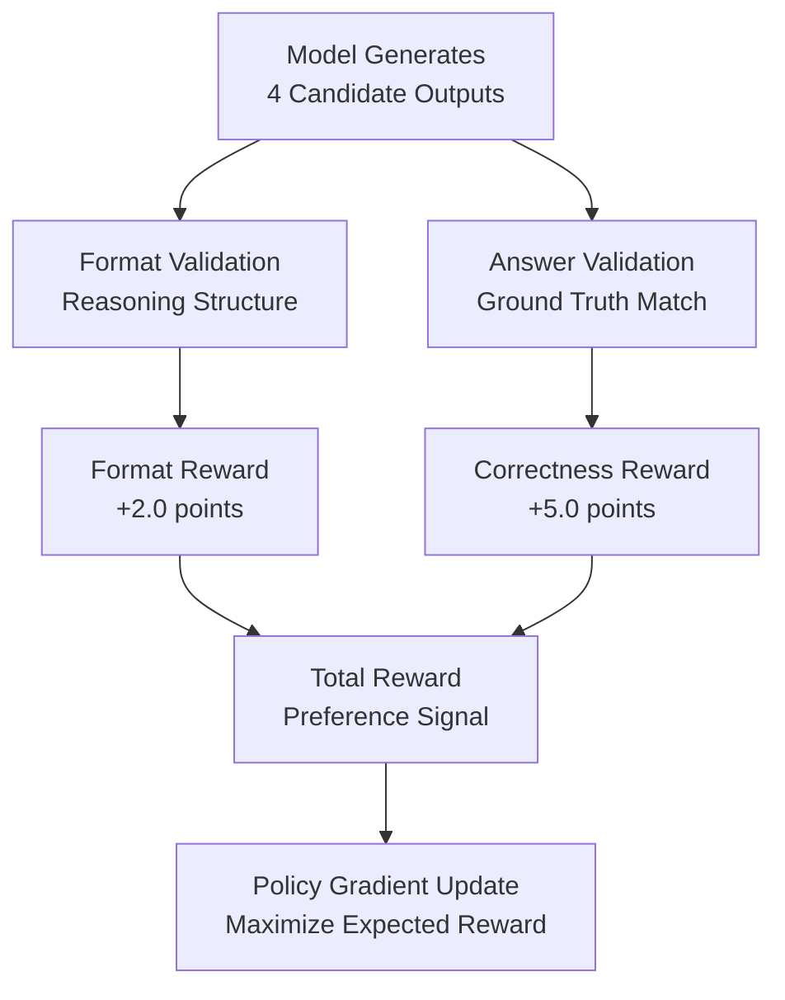
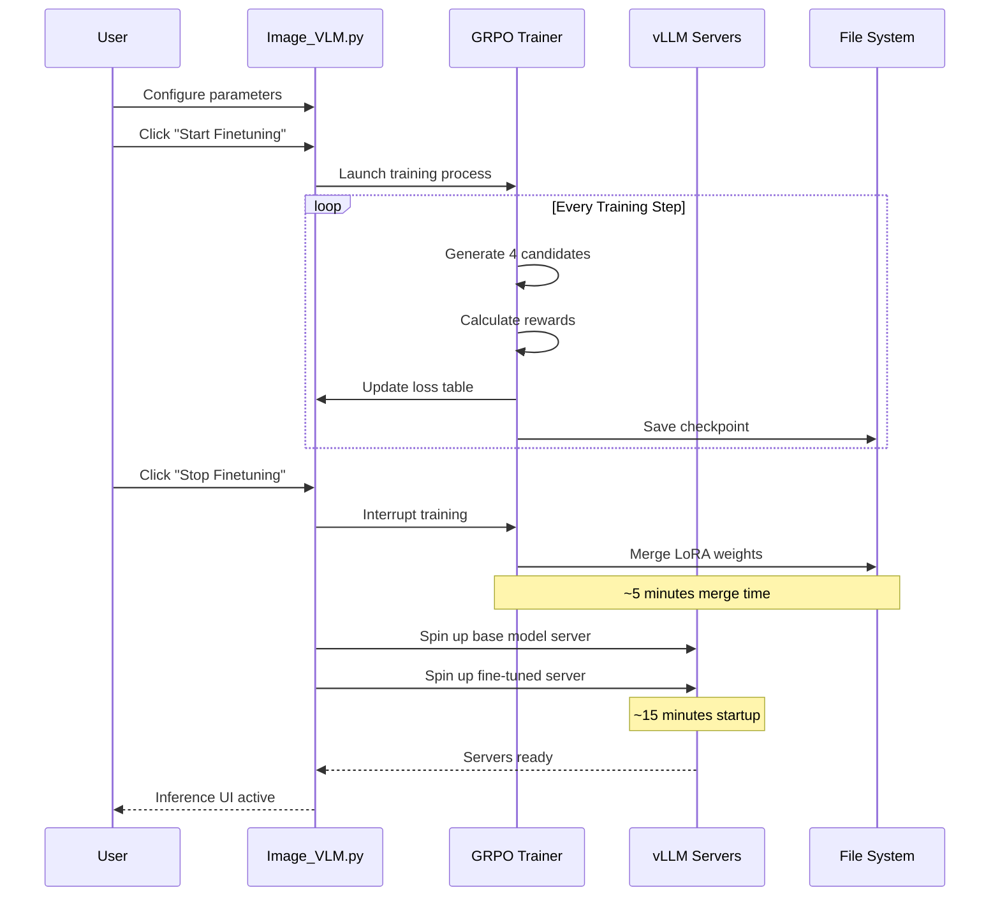

<!-- source: DeepWiki mcp.deepwiki.com · repo NVIDIA/dgx-spark-playbooks · page 5.7 Vision-Language Model Fine-tuning · fetched 2026-10-26 -->

# Vision-Language Model Fine-tuning

<details>
<summary>Relevant source files</summary>

The following files were used as context for generating this wiki page:

- [nvidia/flux-finetuning/README.md](nvidia/flux-finetuning/README.md)

</details>


## Purpose and Scope

This document covers fine-tuning Vision-Language Models (VLMs) on DGX Spark for multimodal understanding tasks. VLMs combine visual encoders with language models to process and reason about images and videos. This playbook demonstrates two distinct fine-tuning workflows:

1.  **Image VLM Fine-tuning**: Using Qwen2.5-VL-7B with GRPO (Generalized Reward Preference Optimization) for image classification and reasoning tasks.
2.  **Video VLM Fine-tuning**: Using InternVL3-8B with LoRA for temporal video understanding and structured metadata generation.

For text-to-image generation fine-tuning (FLUX.1), see [FLUX.1 Dreambooth LoRA](#5.6). For general text-only LLM fine-tuning, see [PyTorch Fine-tuning](#5.3).

Sources: [nvidia/vlm-finetuning/README.md:1-24]()

---

## Architecture Overview

VLM fine-tuning on DGX Spark leverages the Unified Memory Architecture (UMA) to load multiple large components simultaneously: visual encoders, language model layers, and training data. The two workflows diverge in training techniques and inference strategies but share containerization and UI patterns.

### Complete VLM Fine-tuning Ecosystem

```mermaid
graph TB
    subgraph "Models"
        Qwen["Qwen2.5-VL-7B-Instruct<br/>Image Understanding"]
        Intern["InternVL3-8B<br/>Video Understanding"]
    end
    
    subgraph "Training Techniques"
        GRPO["GRPO Training<br/>Preference Optimization<br/>Reasoning Rewards"]
        LoRA["LoRA Fine-tuning<br/>Parameter-Efficient<br/>Layer Selection"]
    end
    
    subgraph "Datasets"
        ImageData["Wildfire Dataset<br/>Satellite Imagery<br/>Binary Classification"]
        VideoData["Dashcam Dataset<br/>videos/*.mp4<br/>metadata.jsonl"]
    end
    
    subgraph "Inference Engines"
        vLLM_Inf["vLLM Server<br/>Optimized Inference<br/>Base + Fine-tuned"]
        HF_Inf["HuggingFace Direct<br/>Transformers Library<br/>Video Frame Processing"]
    end
    
    subgraph "Interactive UIs"
        StreamlitImage["Image_VLM.py<br/>:8501<br/>Training + Inference"]
        StreamlitVideo["Video_VLM.py<br/>:8501<br/>Inference Only"]
        JupyterTrain["video_vlm.ipynb<br/>:8888<br/>Training Only"]
    end
    
    subgraph "Storage"
        SavedModel["saved_model/<br/>Checkpoints<br/>Merged LoRA Weights"]
        Cache["~/.cache/huggingface/<br/>Base Model Weights"]
    end
    
    Qwen --> GRPO
    Intern --> LoRA
    
    ImageData --> GRPO
    VideoData --> LoRA
    
    GRPO --> SavedModel
    LoRA --> SavedModel
    
    SavedModel --> vLLM_Inf
    SavedModel --> HF_Inf
    Cache --> vLLM_Inf
    Cache --> HF_Inf
    
    vLLM_Inf --> StreamlitImage
    HF_Inf --> StreamlitVideo
    
    GRPO -.Training UI.-> StreamlitImage
    LoRA -.Training UI.-> JupyterTrain
    
    style "Training Techniques" fill:#e3f2fd
    style "Inference Engines" fill:#fff9c4
    style "Interactive UIs" fill:#f3e5f5
```

**Key Architectural Distinctions:**

| Aspect | Image VLM (Qwen2.5-VL) | Video VLM (InternVL3) |
| :--- | :--- | :--- |
| Training Method | GRPO (preference optimization) | LoRA (parameter-efficient) |
| Training Interface | Streamlit interactive UI | Jupyter notebook |
| Inference Engine | vLLM (optimized serving) | HuggingFace Transformers (direct) |
| Input Processing | Single image per inference | 12-16 frames per video |
| Output Format | Reasoning steps + answer | Structured JSON metadata |
| Training Duration | 30-60 mins (100 steps) to 16 hrs (1000 steps) | 24+ hours for production quality |

Sources: [nvidia/vlm-finetuning/README.md:20-24](), [nvidia/vlm-finetuning/README.md:110-324]()

---

## Image VLM Fine-tuning: Qwen2.5-VL with GRPO

### Workflow Architecture

```mermaid
graph LR
    subgraph "Data Preparation"
        KaggleDS["Kaggle Dataset<br/>wildfire-prediction-dataset"]
        DataDir["ui_image/data/<br/>Satellite Images<br/>Unzipped"]
    end
    
    subgraph "Base Model"
        QwenBase["Qwen2.5-VL-7B-Instruct<br/>~/.cache/huggingface/<br/>hf download"]
    end
    
    subgraph "Training Phase"
        StreamlitUI["Image_VLM.py<br/>Training Section<br/>Parameter Configuration"]
        GRPOTrainer["GRPO Engine<br/>Reward Calculation<br/>Format + Correctness"]
        LossMonitor["Live Loss Table<br/>Step Tracking<br/>Reward Metrics"]
    end
    
    subgraph "Model Merging"
        LoRAMerge["LoRA Weight Merge<br/>Adapter → Base<br/>~5 minutes"]
        Checkpoint["saved_model/checkpoint-*/"]
    end
    
    subgraph "Inference Phase"
        vLLMBase["vLLM Server<br/>Base Model<br/>Port Assignment"]
        vLLMFT["vLLM Server<br/>Fine-tuned Model<br/>Port Assignment"]
        SideBySide["Side-by-Side Comparison<br/>Chat Interface<br/>Image Upload"]
    end
    
    KaggleDS --> DataDir
    QwenBase --> StreamlitUI
    DataDir --> StreamlitUI
    
    StreamlitUI --> GRPOTrainer
    GRPOTrainer --> LossMonitor
    GRPOTrainer --> LoRAMerge
    
    LoRAMerge --> Checkpoint
    
    QwenBase --> vLLMBase
    Checkpoint --> vLLMFT
    
    vLLMBase --> SideBySide
    vLLMFT --> SideBySide
    
    style "Training Phase" fill:#e3f2fd
    style "Inference Phase" fill:#fff9c4
```

Sources: [nvidia/vlm-finetuning/README.md:110-217]()

### GRPO Training Configuration

GRPO (Generalized Reward Preference Optimization) trains the model to generate reasoning chains and provides rewards based on output quality. The `Image_VLM.py` Streamlit interface exposes the following configuration parameters:

#### Fine-tuning Method Selection

| Parameter | Options | Description |
| :--- | :--- | :--- |
| `Finetuning Method` | Full Finetuning, LoRA | Training approach |
| `LoRA Rank` | 8-64 | Adapter dimension |
| `LoRA Alpha` | 8-64 | Scaling factor |
| `Layer Selection` | Toggle checkboxes | Vision encoder, language model layers |

#### Training Hyperparameters

| Parameter | Range | Purpose |
| :--- | :--- | :--- |
| `Steps` | 1-1000 | Total training iterations |
| `Batch Size` | 1, 2, 4, 8, 16 | Samples per gradient update |
| `Learning Rate` | 1e-6 to 1e-2 | Optimizer step size |
| `Optimizer` | AdamW, Adafactor | Weight update algorithm |

#### GRPO-Specific Rewards



The GRPO training process generates 4 candidate outputs per sample and assigns rewards:
*   **Format Reward (2.0)**: Awarded when the model produces proper reasoning markdown structure.
*   **Correctness Reward (5.0)**: Awarded when the final answer matches ground truth.
*   **Number of Generations (4)**: Multiple candidates enable preference ranking.

Sources: [nvidia/vlm-finetuning/README.md:170-191]()

### Training Execution Flow



The training process displays live metrics in a table on the Streamlit UI, including loss values, training step numbers, and GRPO reward scores. Training can be interrupted with the "Stop Finetuning" button, though this may not guarantee proper checkpoint storage.

Sources: [nvidia/vlm-finetuning/README.md:167-199]()

---

## Video VLM Fine-tuning: InternVL3

### Workflow Architecture

Video VLM fine-tuning processes temporal sequences rather than single images, requiring specialized data preparation and training approaches.

```mermaid
graph TB
    subgraph "Dataset Structure"
        VideoDir["dataset/videos/<br/>*.mp4 files"]
        Metadata["dataset/metadata.jsonl<br/>Structured JSON rows"]
    end
    
    subgraph "Model Preparation"
        InternBase["InternVL3-8B<br/>~/.cache/huggingface/<br/>hf download"]
    end
    
    subgraph "Training Pipeline"
        JupyterNB["video_vlm.ipynb<br/>:8888<br/>Jupyter Notebook"]
        FrameSampler["Frame Extraction<br/>12-16 frames/video<br/>Uniform Temporal Sampling"]
        LoRATrainer["LoRA Fine-tuning<br/>Efficient Parameter Updates"]
        MetricsLog["Training Metrics<br/>Continuous Notebook Output"]
    end
    
    subgraph "Trained Model"
        VideoCheckpoint["saved_model/InternVL3 + LoRA<br/>24+ hours training"]
    end
    
    subgraph "Inference Pipeline"
        StreamlitVideo["Video_VLM.py<br/>:8501<br/>Inference Only"]
        VideoGallery["Dashcam Gallery<br/>Video Selection"]
        HFLoader["HuggingFace Transformers<br/>Direct Model Loading"]
        StructuredOutput["Structured JSON Output<br/>Database Export"]
    end
    
    VideoDir --> JupyterNB
    Metadata --> JupyterNB
    InternBase --> JupyterNB
    
    JupyterNB --> FrameSampler
    FrameSampler --> LoRATrainer
    LoRATrainer --> MetricsLog
    LoRATrainer --> VideoCheckpoint
    
    VideoCheckpoint --> HFLoader
    InternBase --> HFLoader
    
    HFLoader --> StreamlitVideo
    VideoGallery --> StreamlitVideo
    StreamlitVideo --> StructuredOutput
    
    style "Training Pipeline" fill:#e3f2fd
    style "Inference Pipeline" fill:#fff9c4
```

Sources: [nvidia/vlm-finetuning/README.md:218-324]()

### Dataset Preparation

Video VLM training requires a structured dataset with video files and corresponding metadata.

**Required Directory Structure:**
```
dataset/
├── videos/
│   ├── video1.mp4
│   ├── video2.mp4
│   └── ...
└── metadata.jsonl
```

The `metadata.jsonl` file contains structured JSON data for each video, with each row representing one training example. This structured format trains the model to generate database-compatible outputs.

Sources: [nvidia/vlm-finetuning/README.md:226-236]()

### Training Configuration

Training is performed through `video_vlm.ipynb` accessed via Jupyter notebook at port 8888. Key parameters:

| Parameter | Value/Range | Purpose |
| :--- | :--- | :--- |
| `Model` | InternVL3-8B | Base architecture |
| `Video Frames` | 12-16 frames | Temporal sampling density |
| `Sampling Mode` | Uniform | Frame selection strategy |
| `LoRA Configuration` | Rank/Alpha customizable | Parameter-efficient updates |
| `Dataset Path` | User-configurable | Location of video dataset |
| `Training Duration` | 24+ hours | Minimum for production quality |

The notebook requires setting the dataset path in the appropriate cell:
```python
dataset_path = "/path/to/your/dataset"
```

Training metrics are displayed continuously in the notebook output, enabling real-time monitoring.

Sources: [nvidia/vlm-finetuning/README.md:274-298]()

---

## Docker Container Architecture

Both image and video VLM workflows share the same Docker container, built with unified dependencies.

### Container Build Process

```mermaid
graph TB
    subgraph "Build Arguments"
        HFToken["HF_TOKEN<br/>Environment Variable<br/>Gated Model Access"]
    end
    
    subgraph "Dockerfile"
        BaseImage["Base Image<br/>PyTorch Container<br/>CUDA Support"]
        Dependencies["Dependencies<br/>transformers, vLLM<br/>FFmpeg, Decord<br/>Streamlit, Jupyter"]
        TokenInject["Token Injection<br/>--build-arg HF_TOKEN"]
    end
    
    subgraph "Built Image"
        VLMDemo["vlm_demo<br/>Unified Container<br/>Image + Video Support"]
    end
    
    subgraph "Launch Configuration"
        LaunchScript["launch.sh<br/>GPU Passthrough<br/>Volume Mounts<br/>Port Mapping"]
        Container["Running Container<br/>/vlm_finetuning/<br/>Working Directory"]
    end
    
    HFToken --> TokenInject
    BaseImage --> Dependencies
    Dependencies --> TokenInject
    TokenInject --> VLMDemo
    
    VLMDemo --> LaunchScript
    LaunchScript --> Container
    
    style "Built Image" fill:#e3f2fd
    style "Running Container" fill:#fff9c4
```

**Build Command:**
```bash
docker build --build-arg HF_TOKEN=$HF_TOKEN -t vlm_demo .
```

**Launch Script:** `launch.sh` handles GPU passthrough, volume mounts for persistent storage, and port mappings for Streamlit (8501) and Jupyter (8888).

Sources: [nvidia/vlm-finetuning/README.md:85-108]()

### Volume Mount Strategy

The container mounts critical directories to enable model caching and checkpoint persistence:

| Host Path | Container Path | Purpose |
| :--- | :--- | :--- |
| `$HOME/.cache/huggingface/` | `/root/.cache/huggingface/` | Model weight caching |
| `./assets/` | `/vlm_finetuning/` | Working directory |
| `./saved_model/` | `/vlm_finetuning/saved_model/` | Training checkpoints |

Sources: [nvidia/vlm-finetuning/README.md:98-108]()

---

## Unified Memory Architecture Considerations

DGX Spark's Unified Memory Architecture (UMA) enables both VLM workflows but requires careful memory management. The 128GB UMA allows simultaneous loading of visual encoders, language model weights (7B-8B parameters), and training data batches.

### Memory Flush Requirement

Due to UMA's dynamic buffer caching, applications may encounter memory issues even when total capacity is sufficient. Manual buffer cache flushing is required after stopping GPU-intensive processes:

```bash
sudo sh -c 'sync; echo 3 > /proc/sys/vm/drop_caches'
```

This command should be executed:
1.  After interrupting the Streamlit UI during training.
2.  After shutting down a Jupyter kernel.
3.  Before launching vLLM inference servers.
4.  When switching between image and video VLM workflows.

The `sync` command flushes file system buffers to disk, while `echo 3 > /proc/sys/vm/drop_caches` clears page cache, dentries, and inodes.

Sources: [nvidia/vlm-finetuning/README.md:327-333](), [nvidia/flux-finetuning/README.md:116-120](), [nvidia/flux-finetuning/README.md:177-183]()

---

## Performance Characteristics

### Image VLM Training Time

| Configuration | Steps | Duration | Quality |
| :--- | :--- | :--- | :--- |
| Quick test | 100 | 30-60 minutes | Reasonable |
| Default | 100 | 2 hours | Good |
| High quality | 1000 | 16 hours | Best |

The playbook achieves best accuracy with ~1000 steps of training.

### Video VLM Training Time

Video VLM requires significantly longer training due to spatio-temporal complexity:
*   **Minimum**: 24 hours
*   **Production**: 48+ hours
*   **Factors**: Video frame count, dataset size, temporal sampling density.

Sources: [nvidia/vlm-finetuning/README.md:47-56](), [nvidia/vlm-finetuning/README.md:155-199](), [nvidia/vlm-finetuning/README.md:257-324]()

---

## Prerequisites and Setup

### System Requirements

*   DGX Spark device with Blackwell GPU.
*   No other GPU processes running during training/inference.
*   Sufficient disk space for model weights (~30GB), datasets, and checkpoints.
*   NVIDIA Docker with GPU passthrough configured.
*   HuggingFace token with gated model access (Qwen2.5-VL is gated).

### Docker Group Configuration

Add user to `docker` group to avoid `sudo` requirement:

```bash
sudo usermod -aG docker $USER
newgrp docker
```

Sources: [nvidia/vlm-finetuning/README.md:36-43](), [nvidia/vlm-finetuning/README.md:60-75]()

---

