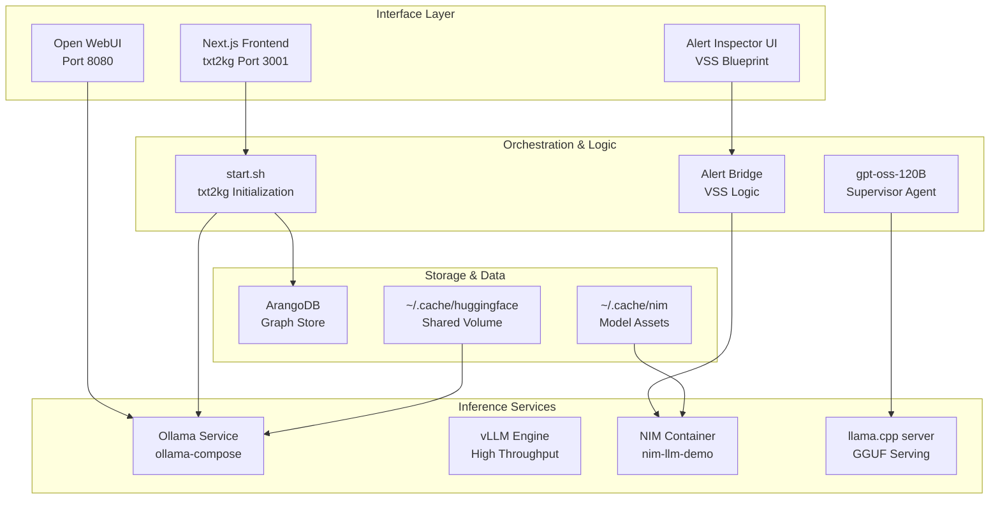
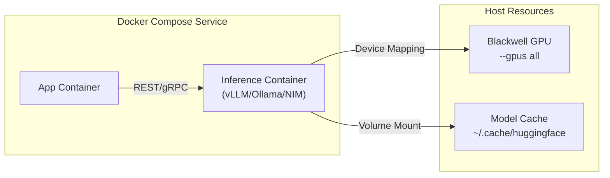

<!-- source: DeepWiki mcp.deepwiki.com · repo NVIDIA/dgx-spark-playbooks · page 6 End-to-End Applications · fetched 2026-10-26 -->

# End-to-End Applications

Relevant source files

The following files were used as context for generating this wiki page:

- [nvidia/multi-agent-chatbot/README.md](nvidia/multi-agent-chatbot/README.md)
- [nvidia/nim-llm/README.md](nvidia/nim-llm/README.md)
- [nvidia/pytorch-fine-tune/README.md](nvidia/pytorch-fine-tune/README.md)
- [nvidia/tailscale/README.md](nvidia/tailscale/README.md)
- [nvidia/vss/README.md](nvidia/vss/README.md)

This document covers complete application examples that demonstrate how to combine inference engines, fine-tuning frameworks, and specialized microservices into integrated solutions on DGX Spark. These applications leverage the 128GB Unified Memory Architecture (UMA) to run complex, multi-model workflows locally.

For details on the underlying components, see [Inference Systems](#4), [Fine-tuning Frameworks](#5), and [Development Environments](#3).

---

## Architecture Overview

End-to-end applications on DGX Spark typically integrate multiple layers, from data ingestion to user interface, often orchestrated via Docker Compose.

### Logical Service Mapping
This diagram bridges the "Natural Language Space" of application features to the "Code Entity Space" found in the playbooks.

**Sources:** [nvidia/txt2kg/README.md:14-81](), [nvidia/multi-agent-chatbot/README.md:17-33](), [nvidia/nim-llm/README.md:96-109](), [nvidia/vss/README.md:13-22]()

---

## Application Catalog

### Chat Interfaces
Deploy interactive environments for model interaction. This includes [Ollama and Open WebUI](#4.5) for a ChatGPT-like experience and [Chat Interfaces](#6.1) for generative image workflows. These interfaces often serve as the primary entry point for testing fine-tuned models.
For details, see [Chat Interfaces](#6.1).

### RAG Applications in AI Workbench
Build Retrieval Augmented Generation (RAG) systems using NVIDIA AI Workbench. This playbook focuses on the "Inference-Storage-UI" pipeline, where documents are indexed into vector databases and retrieved to provide context for LLM queries.
For details, see [RAG Applications in AI Workbench](#6.2).

### Multi-Agent Chatbot
Deploy a system where a supervisor agent (e.g., `gpt-oss-120B`) orchestrates specialized agents for coding, RAG, and image understanding.
- **Supervisor**: Powered by `gpt-oss-120B` [nvidia/multi-agent-chatbot/README.md:20-20]().
- **Tooling**: Uses MCP (Model Context Protocol) servers as tools [nvidia/multi-agent-chatbot/README.md:32-32]().
- **Memory**: Utilizes ~120GB of the 128GB UMA [nvidia/multi-agent-chatbot/README.md:41-42]().
For details, see [Multi-Agent Chatbot](#6.3).

### Video Search and Summarization (VSS)
Deploy NVIDIA's VSS AI Blueprint to transform raw video into actionable insights.
- **Pipelines**: Includes VLM pipelines (Cosmos-Reason2-8B) and optional DeepStream CV pipelines [nvidia/vss/README.md:21-21]().
- **Deployment**: Supports "Event Reviewer" (completely local) or "Standard VSS" (hybrid with remote endpoints) [nvidia/vss/README.md:152-161]().
For details, see [Video Search and Summarization](#6.4).

### Text to Knowledge Graph
Convert unstructured text into structured knowledge graphs using LLMs and ArangoDB.
- **Extraction**: Uses Ollama (`ollama-compose`) for GPU-accelerated triple extraction [nvidia/txt2kg/README.md:69-72]().
- **Visualization**: Interactive 2D/3D graph rendering using Three.js WebGPU [nvidia/txt2kg/README.md:14-18]().
For details, see [Text to Knowledge Graph](#6.5).

### Live VLM WebUI and Nemotron
Real-time vision-language model inference. This application features WebRTC streaming for webcam feeds and runs high-efficiency models like Nemotron-3-Nano MoE via `llama.cpp`.
For details, see [Live VLM WebUI and Nemotron](#6.6).

### Spark Reachy Photo Booth
A multimodal robotics application. It integrates LLMs, image generation (diffusion models), and speech microservices to control a Reachy Mini robot on DGX Spark.
For details, see [Spark Reachy Photo Booth](#6.7).

### Scientific Computing Applications
GPU-accelerated workloads beyond LLMs, including:
- **Finance**: Portfolio optimization with `cuOpt` and `cuML`.
- **Bioinformatics**: Single-cell RNA sequencing via `RAPIDS-singlecell`.
- **Folding**: Protein structure prediction.
For details, see [Scientific Computing Applications](#6.8).

### Isaac Sim and Isaac Lab
Robotics simulation and reinforcement learning. This playbook guides the source-build and execution of NVIDIA Isaac Sim and Isaac Lab on the ARM64 Blackwell architecture of DGX Spark.
For details, see [Isaac Sim and Isaac Lab](#6.9).

---

## Common Deployment Patterns

### Containerized Service Orchestration
Most applications use Docker Compose to manage dependencies. A critical pattern is the reservation of GPU resources and shared volume mounting for model weights.

**Sources:** [nvidia/txt2kg/README.md:69-81](), [nvidia/nim-llm/README.md:116-124](), [nvidia/pytorch-fine-tune/README.md:83-90]()

### UMA Memory Management
Because DGX Spark uses Unified Memory Architecture, applications may occasionally face memory pressure if the Linux buffer cache is not managed.
- **Symptom**: Memory issues even when within 128GB capacity [nvidia/multi-agent-chatbot/README.md:148-150]().
- **Fix**: Manually flush the buffer cache using:
  `sudo sh -c 'sync; echo 3 > /proc/sys/vm/drop_caches'` [nvidia/multi-agent-chatbot/README.md:151-153]().

**Sources:** [nvidia/multi-agent-chatbot/README.md:148-153](), [nvidia/txt2kg/README.md:149-165]()

---

