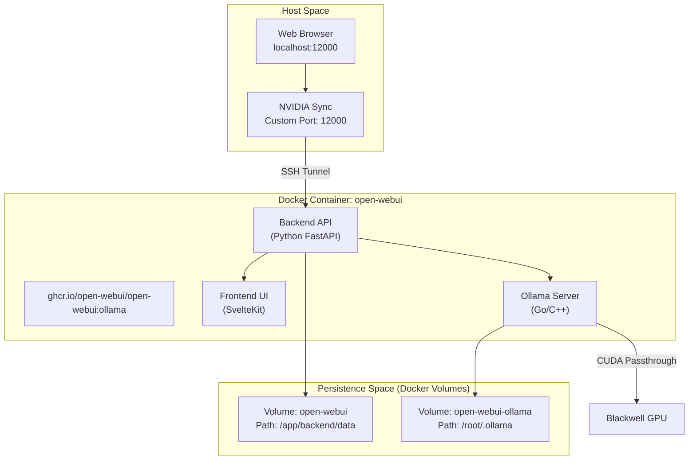
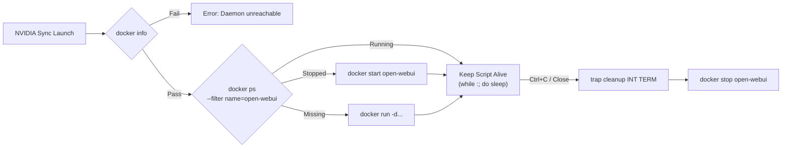
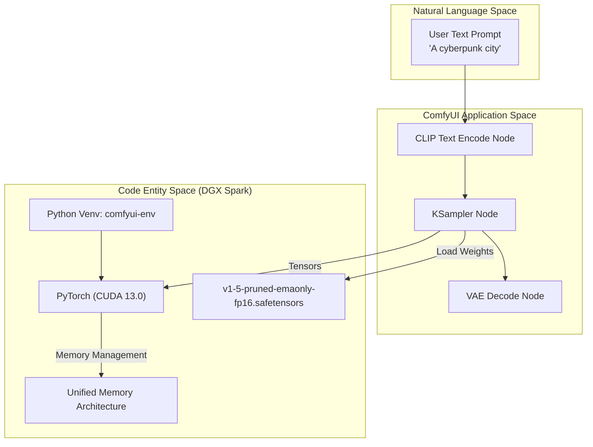

<!-- source: DeepWiki mcp.deepwiki.com · repo NVIDIA/dgx-spark-playbooks · page 6.1 Chat Interfaces · fetched 2026-10-26 -->

# Chat Interfaces

<details>
<summary>Relevant source files</summary>

The following files were used as context for generating this wiki page:

- [nvidia/comfy-ui/README.md](nvidia/comfy-ui/README.md)
- [nvidia/connect-to-your-spark/README.md](nvidia/connect-to-your-spark/README.md)
- [nvidia/open-webui/README.md](nvidia/open-webui/README.md)
- [nvidia/rag-ai-workbench/README.md](nvidia/rag-ai-workbench/README.md)
- [nvidia/vscode/README.md](nvidia/vscode/README.md)

</details>


This page covers the deployment and technical implementation of chat interfaces on DGX Spark, specifically focusing on **Open WebUI** for LLM interactions and **ComfyUI** for node-based generative AI workflows. These interfaces serve as the primary frontend for interacting with models served by various inference backends.

## Overview

Chat interfaces on DGX Spark act as a bridge between the user and the high-performance inference engines running on the Blackwell GPU. They are typically deployed as containerized applications or within Python virtual environments to ensure isolation and reproducibility.

| Interface | Primary Use Case | Deployment Method | Default Port |
|-----------|------------------|-------------------|--------------|
| **Open WebUI** | Conversational AI, RAG, Model Management | Docker Container | 8080 |
| **ComfyUI** | Node-based Image/Video Generation | Host Python Venv | 8188 |

**Sources:** [nvidia/open-webui/README.md:1-23](), [nvidia/comfy-ui/README.md:1-25]()

---

## Open WebUI Architecture

Open WebUI is deployed using a specialized Docker image that includes an integrated **Ollama** server. This allows for a self-contained "all-in-one" AI interface that manages both the UI and the model lifecycle.

### Data Flow and Persistence

The following diagram maps the logical components to their specific code-level entities and storage volumes used in the deployment.

**Open WebUI System Mapping**


**Implementation Details:**
- **Container Name**: `open-webui` [nvidia/open-webui/README.md:105]()
- **Image**: `ghcr.io/open-webui/open-webui:ollama` [nvidia/open-webui/README.md:106]()
- **GPU Access**: Enabled via `--gpus=all` flag in the `docker run` command [nvidia/open-webui/README.md:132]().
- **Volumes**: 
    - `open-webui`: Persists the local administrator account and chat history [nvidia/open-webui/README.md:133]().
    - `open-webui-ollama`: Persists large model weights (e.g., `gpt-oss:20b`) downloaded from the Ollama registry [nvidia/open-webui/README.md:134]().

**Sources:** [nvidia/open-webui/README.md:101-142](), [nvidia/open-webui/README.md:170-175]()

### NVIDIA Sync Lifecycle Management

To streamline access, Open WebUI is often managed via an NVIDIA Sync "Custom Port" script. This script ensures idempotency (not starting multiple instances) and handles clean shutdowns.

**Lifecycle Script Logic**


**Key Functions/Commands:**
- `cleanup()`: Function trapped to signals `INT`, `TERM`, `HUP`, `QUIT`, `EXIT` to ensure the container stops when the NVIDIA Sync tunnel is closed [nvidia/open-webui/README.md:108-113]().
- `docker run`: Executed with `-p 12000:8080` to map the standard Open WebUI port to the NVIDIA Sync preferred port [nvidia/open-webui/README.md:132]().

**Sources:** [nvidia/open-webui/README.md:101-142]()

---

## ComfyUI Implementation

ComfyUI is installed directly on the host within a Python virtual environment to leverage the Blackwell architecture's native performance and Unified Memory Architecture (UMA).

### Technical Stack
- **Entry Point**: `main.py` [nvidia/comfy-ui/README.md:55]()
- **Runtime**: Python 3.8+ [nvidia/comfy-ui/README.md:43]()
- **Acceleration**: PyTorch with CUDA 13.0 support [nvidia/comfy-ui/README.md:99]()
- **Default Port**: 8188 [nvidia/comfy-ui/README.md:48]()

### Model Management and Data Flow
ComfyUI workflows connect functional "nodes" (Loaders, Samplers, Encoders) to process tensors through diffusion models.

**ComfyUI Node-to-Code Mapping**


**Implementation Steps:**
1. **Environment Setup**: Creation of `comfyui-env` using `python3 -m venv` [nvidia/comfy-ui/README.md:88]().
2. **GPU Optimization**: Installation of `torch` and `torchvision` via the index URL `https://download.pytorch.org/whl/cu130` to target Blackwell's CUDA 13.0 capabilities [nvidia/comfy-ui/README.md:99]().
3. **Model Storage**: Checkpoints are stored in `models/checkpoints/` [nvidia/comfy-ui/README.md:128]().
4. **Execution**: The server is launched using `python main.py --listen 0.0.0.0` to allow external access [nvidia/comfy-ui/README.md:140]().

**Sources:** [nvidia/comfy-ui/README.md:83-143]()

---

## System Integration and Memory Management

Both interfaces run on DGX Spark's **Unified Memory Architecture (UMA)**. This enables dynamic sharing between CPU and GPU memory, which is critical for large models like Stable Diffusion XL or 20B+ parameter LLMs.

### UMA Buffer Management
When switching between large models in Open WebUI or ComfyUI, users may need to manually clear the system cache to ensure the UMA manager can reallocate memory effectively.

**Command:**
```bash
sudo sh -c 'sync; echo 3 > /proc/sys/vm/drop_caches'
```
**Sources:** [nvidia/comfy-ui/README.md:193-198]()

### Troubleshooting Connectivity

| Symptom | Code/System Entity | Resolution |
|---------|-------------------|------------|
| Web interface inaccessible | Firewall / Port 8188 or 12000 | Ensure `--listen 0.0.0.0` is used for host-run apps [nvidia/comfy-ui/README.md:189](). |
| Permission Denied | `docker.sock` | Add user to `docker` group via `sudo usermod -aG docker $USER` [nvidia/open-webui/README.md:62](). |
| PyTorch CUDA unavailable | `nvcc` / `nvidia-smi` | Verify `torch` was installed with the correct `--index-url` [nvidia/comfy-ui/README.md:187](). |

**Sources:** [nvidia/comfy-ui/README.md:183-191](), [nvidia/open-webui/README.md:59-64]()

---

