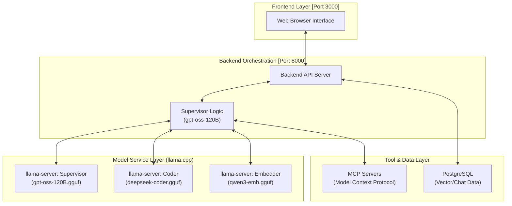
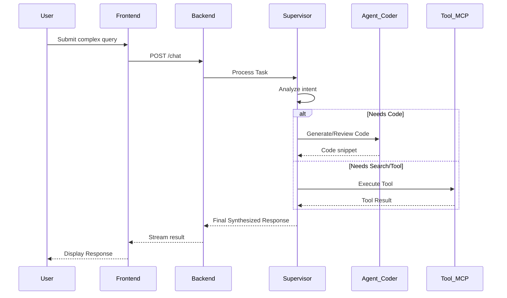

<!-- source: DeepWiki mcp.deepwiki.com · repo NVIDIA/dgx-spark-playbooks · page 6.3 Multi-Agent Chatbot · fetched 2026-10-26 -->

# Multi-Agent Chatbot

<details>
<summary>Relevant source files</summary>

The following files were used as context for generating this wiki page:

- [nvidia/multi-agent-chatbot/README.md](nvidia/multi-agent-chatbot/README.md)
- [nvidia/multi-agent-chatbot/assets/Dockerfile.llamacpp](nvidia/multi-agent-chatbot/assets/Dockerfile.llamacpp)
- [nvidia/pytorch-fine-tune/README.md](nvidia/pytorch-fine-tune/README.md)

</details>


## Purpose and Scope

This document covers the deployment and architecture of multi-agent chatbot systems on DGX Spark. Multi-agent chatbots orchestrate multiple specialized LLM instances ("agents") to handle complex workflows that require reasoning chains, tool usage, and coordinated decision-making. 

The DGX Spark platform, with its 128GB of unified memory, is uniquely suited to run multiple Large Language Models (LLMs) and Vision-Language Models (VLMs) in parallel, enabling sophisticated local agent interactions [nvidia/multi-agent-chatbot/README.md:17-18]().

For basic chat interfaces without orchestration, see [Chat Interfaces](#6.1). For document-based question answering, see [RAG Applications in AI Workbench](#6.2).

**Sources:** [nvidia/multi-agent-chatbot/README.md:1-22]()

---

## System Overview

The multi-agent system implemented in this playbook utilizes a hierarchical orchestration strategy. A high-parameter "Supervisor" agent (typically **gpt-oss-120B**) manages specialized downstream agents for coding, retrieval-augmented generation (RAG), and image understanding [nvidia/multi-agent-chatbot/README.md:20-22]().

### Core Components and Memory Usage
Due to the high memory requirements of running multiple large models, this system utilizes approximately 120GB of the 128GB available on DGX Spark [nvidia/multi-agent-chatbot/README.md:41]().

| Component | Implementation | Memory Impact |
|-----------|----------------|---------------|
| **Supervisor Agent** | gpt-oss-120B (GGUF) | ~63GB [nvidia/multi-agent-chatbot/README.md:89]() |
| **Coding Agent** | Deepseek-Coder:6.7B-Instruct | ~7GB [nvidia/multi-agent-chatbot/README.md:89]() |
| **Embedding Model** | Qwen3-Embedding-4B | ~4GB [nvidia/multi-agent-chatbot/README.md:89]() |
| **Inference Backend** | `llama-server` (llama.cpp) | Shared UMA [nvidia/multi-agent-chatbot/assets/Dockerfile.llamacpp:76]() |

### Code-to-System Mapping
The following diagram bridges the logical agent roles to the specific containerized services and model files defined in the deployment configuration.



**Sources:** [nvidia/multi-agent-chatbot/README.md:20-32](), [nvidia/multi-agent-chatbot/README.md:81-108](), [nvidia/multi-agent-chatbot/assets/Dockerfile.llamacpp:70-77]()

---

## Deployment Implementation

### Containerization Strategy
The system uses a custom `Dockerfile.llamacpp` to build a specialized inference server for the DGX Spark's Blackwell architecture (Compute Capability 12.1/121) [nvidia/multi-agent-chatbot/assets/Dockerfile.llamacpp:26-37](). 

Key build flags for Spark optimization include:
- `GGML_CUDA_ENABLE_UNIFIED_MEMORY=1`: Enables the server to leverage the Spark's Unified Memory Architecture [nvidia/multi-agent-chatbot/assets/Dockerfile.llamacpp:39]().
- `GGML_CUDA=ON`: Ensures GPU acceleration for inference [nvidia/multi-agent-chatbot/assets/Dockerfile.llamacpp:39]().

### Data Flow and Initialization
The deployment follows a sequential lifecycle:

1. **Model Acquisition**: `model_download.sh` pulls GGUF files from HuggingFace [nvidia/multi-agent-chatbot/README.md:84-85]().
2. **Service Orchestration**: `docker compose` launches the model servers, backend, and frontend [nvidia/multi-agent-chatbot/README.md:96]().
3. **Tool Integration**: The Supervisor agent utilizes **MCP (Model Context Protocol)** servers as tools to interact with external data or code environments [nvidia/multi-agent-chatbot/README.md:32]().



**Sources:** [nvidia/multi-agent-chatbot/README.md:20-32](), [nvidia/multi-agent-chatbot/README.md:119-122](), [nvidia/multi-agent-chatbot/assets/Dockerfile.llamacpp:36-40]()

---

## Memory Management and UMA

Because the multi-agent system pushes the limits of the 128GB capacity, it relies heavily on the **Unified Memory Architecture (UMA)** of the DGX Spark [nvidia/multi-agent-chatbot/README.md:148](). 

### Buffer Flushing
If memory issues occur due to applications not yet fully optimized for dynamic UMA sharing, the system cache can be manually flushed to free up pages:
```bash
sudo sh -c 'sync; echo 3 > /proc/sys/vm/drop_caches'
```
[nvidia/multi-agent-chatbot/README.md:151-152]()

### Resource Cleanup
To free resources for other playbooks (like [Fine-tuning Frameworks](#5)), the following command sequence is used to tear down the multi-agent stack and remove persistent volumes:
```bash
docker compose -f docker-compose.yml -f docker-compose-models.yml down
docker volume rm "$(basename "$PWD")_postgres_data"
```
[nvidia/multi-agent-chatbot/README.md:130-133]()

**Sources:** [nvidia/multi-agent-chatbot/README.md:147-154](), [nvidia/multi-agent-chatbot/README.md:123-133]()

---

## Use Case: RAG Agent Integration
The system includes a specialized RAG agent that can process uploaded documents (e.g., the NVIDIA Blackwell Whitepaper) [nvidia/multi-agent-chatbot/README.md:120]().

1. **Ingestion**: Documents are uploaded via the "Upload Documents" UI [nvidia/multi-agent-chatbot/README.md:121]().
2. **Embedding**: The `qwen3-embedding-4b` model generates vector representations [nvidia/multi-agent-chatbot/README.md:89]().
3. **Retrieval**: The Supervisor routes retrieval tasks to the RAG agent, which queries the PostgreSQL vector store to provide context for the final response [nvidia/multi-agent-chatbot/README.md:30-32]().

**Sources:** [nvidia/multi-agent-chatbot/README.md:119-122](), [nvidia/multi-agent-chatbot/README.md:89]()

---

