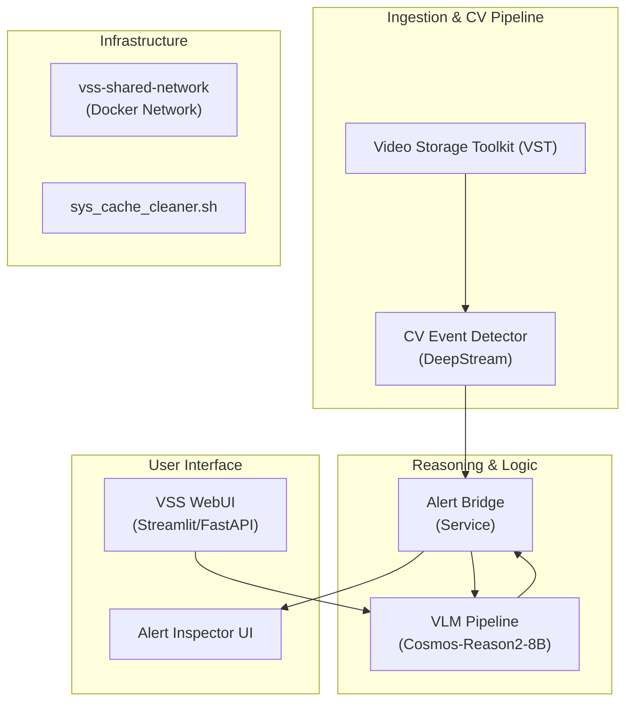
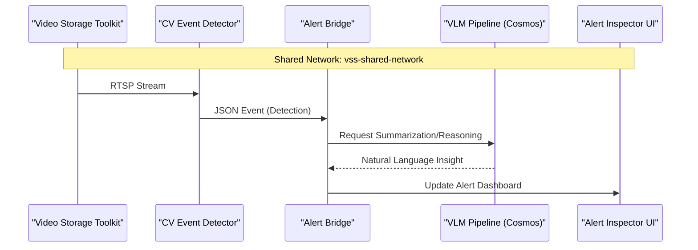

<!-- source: DeepWiki mcp.deepwiki.com · repo NVIDIA/dgx-spark-playbooks · page 6.4 Video Search and Summarization · fetched 2026-10-26 -->

# Video Search and Summarization

<details>
<summary>Relevant source files</summary>

The following files were used as context for generating this wiki page:

- [nvidia/nim-llm/README.md](nvidia/nim-llm/README.md)
- [nvidia/tailscale/README.md](nvidia/tailscale/README.md)
- [nvidia/vss/README.md](nvidia/vss/README.md)

</details>


**Purpose**: This page documents the Video Search and Summarization (VSS) Agent, an end-to-end application that performs content analysis, indexing, and summarization of video data on DGX Spark. VSS combines vision-language models (VLMs) with inference optimization to enable semantic video search and automated summarization workflows.

**Scope**: This page covers the VSS application architecture, its integration with inference engines and VLM capabilities, deployment patterns, and typical use cases. It specifically highlights the deployment of NVIDIA's VSS AI Blueprint on Blackwell architecture.

---

## System Overview

VSS is an end-to-end application that enables semantic search and summarization across video content. The system transforms raw video content into real-time actionable insights with video summarization, Q&A, and real-time alerts [nvidia/vss/README.md:17-18]().

### Core Capabilities

| Capability | Description | Technology Stack |
|------------|-------------|------------------|
| **Video Frame Extraction** | Temporal sampling and frame preprocessing | FFmpeg, Decord [nvidia/vlm-finetuning/README.md:286-295]() |
| **Visual Understanding** | Scene analysis, object detection, activity recognition | Vision-Language Models (VLMs) like Cosmos-Reason2-8B [nvidia/vss/README.md:158-159]() |
| **Semantic Indexing** | Embedding generation for searchable video segments | Transformer models, vector databases |
| **Natural Language Summarization** | Automated summary generation from video content | LLMs (Llama 3.1) with visual grounding [nvidia/vss/README.md:158-159]() |
| **Real-time Alerts** | Automated video analysis and event review | Alert Bridge, Alert Inspector UI [nvidia/vss/README.md:21-22]() |

### VSS Application Architecture

The following diagram maps high-level system components to the specific code entities and services defined in the VSS Blueprint.



**Sources**: [nvidia/vss/README.md:21-22](), [nvidia/vss/README.md:123-133](), [nvidia/vss/README.md:158-159]()

---

## Deployment Scenarios

The VSS Blueprint supports two primary deployment patterns on DGX Spark hardware [nvidia/vss/README.md:21-22]().

### 1. VSS Event Reviewer (Completely Local)
This scenario is optimized for DGX Spark's local processing capabilities, keeping all data and inference on-device.

*   **VLM**: Local Cosmos-Reason2-8B [nvidia/vss/README.md:158-159]()
*   **LLM/Embedding**: Not used in this mode [nvidia/vss/README.md:158-159]()
*   **CV Pipeline**: Local DeepStream-based detection [nvidia/vss/README.md:158-159]()
*   **Location**: `deploy/docker/event_reviewer/` [nvidia/vss/README.md:172-173]()

### 2. Standard VSS (Hybrid)
A hybrid deployment utilizing local vision processing and potentially remote LLM endpoints for high-parameter reasoning.

*   **VLM**: Local Cosmos-Reason2-8B [nvidia/vss/README.md:158-159]()
*   **LLM**: Remote (70B) or Local (8B Llama 3.1) [nvidia/vss/README.md:158-159]()
*   **Embedding**: Remote or Local endpoints [nvidia/vss/README.md:158-159]()

**Sources**: [nvidia/vss/README.md:156-161]()

---

## Technical Implementation

### Infrastructure Requirements
VSS on Spark requires specific driver and CUDA versions to support the Blackwell architecture and Cosmos VLM performance requirements.

*   **Driver**: 580.95.05 or higher [nvidia/vss/README.md:34-35]()
*   **CUDA**: 13.0 [nvidia/vss/README.md:35-36]()
*   **Storage**: >10GB recommended in `/tmp/` for video processing [nvidia/vss/README.md:40-41]()

### Data Flow: Event Reviewer Workflow
The following diagram bridges the logical data flow with the specific services and configuration files used in the `event_reviewer` deployment.



**Sources**: [nvidia/vss/README.md:21-22](), [nvidia/vss/README.md:131-133](), [nvidia/vss/README.md:45-46]()

---

## Memory and Performance Optimization

### System Cache Management
Because VLM and CV pipelines are memory-intensive, the VSS deployment includes a dedicated cache cleaner script to optimize memory usage during container operations [nvidia/vss/README.md:118-119]().

**Execution**:
```bash
sudo sh deploy/scripts/sys_cache_cleaner.sh
```
[nvidia/vss/README.md:123-124]()

### Shared Networking
To minimize data transfer latency between the CV detector, the Video Storage Toolkit, and the VLM pipeline, a dedicated Docker bridge network is used [nvidia/vss/README.md:127-129]().

**Command**:
```bash
docker network create vss-shared-network
```
[nvidia/vss/README.md:132-133]()

---

## Model Serving and NIM Integration

VSS can leverage NVIDIA NIM (NVIDIA Inference Microservices) for serving the LLM components. NIM provides a containerized, OpenAI-compatible HTTP endpoint optimized for DGX Spark [nvidia/nim-llm/README.md:23-27]().

### NIM Configuration for VSS
When using a local Llama 3.1 8B NIM for summarization tasks within VSS, the following environment setup is typical:

| Parameter | Value | Source |
|-----------|-------|--------|
| **Image** | `nvcr.io/nim/meta/llama-3.1-8b-instruct-dgx-spark:latest` | [nvidia/nim-llm/README.md:102]() |
| **Cache** | `~/.cache/nim` | [nvidia/nim-llm/README.md:103]() |
| **Port** | `8000` | [nvidia/nim-llm/README.md:122]() |
| **SHM Size** | `16GB` | [nvidia/nim-llm/README.md:118]() |

**Sources**: [nvidia/nim-llm/README.md:101-124]()

---

## Remote Access and Review

For remote monitoring of the **Alert Inspector UI** or **VSS WebUI**, Tailscale provides an encrypted peer-to-peer mesh network [nvidia/tailscale/README.md:31-33](). This allows security personnel or administrators to review video alerts from any location without port forwarding [nvidia/tailscale/README.md:41-43]().

**Sources**: [nvidia/tailscale/README.md:31-43]()

---

## Troubleshooting

| Symptom | Cause | Fix |
|---------|-------|-----|
| Permission denied on `docker ps` | User not in docker group | `sudo usermod -aG docker $USER` [nvidia/vss/README.md:91-92]() |
| `vss-shared-network` error | Network already exists | `docker network rm vss-shared-network` [nvidia/vss/README.md:136-137]() |
| VLM startup hangs | Large model download | Check internet speed; Cosmos Reason 2 is a large asset [nvidia/vss/README.md:52-53]() |
| NIM GPU error | Container Toolkit missing | `sudo nvidia-ctk runtime configure --runtime=docker` [nvidia/nim-llm/README.md:195-199]() |

**Sources**: [nvidia/vss/README.md:88-137](), [nvidia/nim-llm/README.md:191-199]()

---

