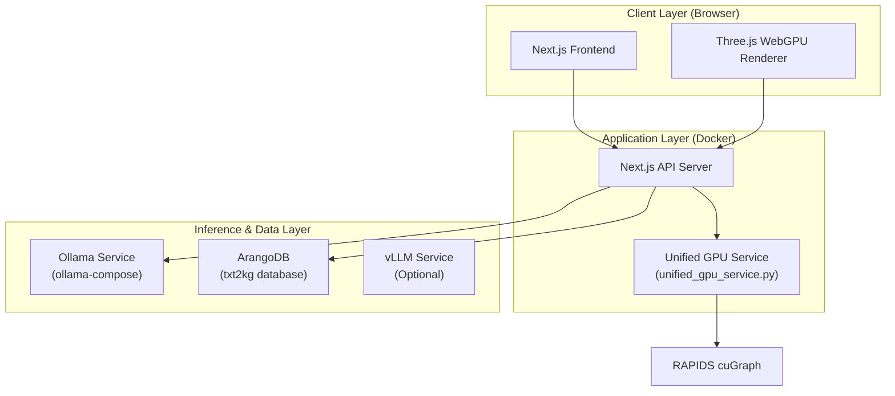
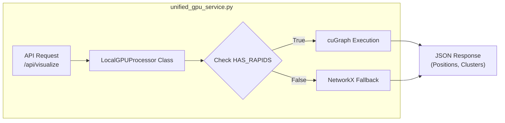

<!-- source: DeepWiki mcp.deepwiki.com · repo NVIDIA/dgx-spark-playbooks · page 6.5 Text to Knowledge Graph · fetched 2026-10-26 -->

# Text to Knowledge Graph

<details>
<summary>Relevant source files</summary>

The following files were used as context for generating this wiki page:

- [LICENSE-3rd-party](LICENSE-3rd-party)
- [nvidia/dgx-dashboard/README.md](nvidia/dgx-dashboard/README.md)
- [nvidia/jax/README.md](nvidia/jax/README.md)
- [nvidia/sglang/README.md](nvidia/sglang/README.md)
- [nvidia/txt2kg/README.md](nvidia/txt2kg/README.md)
- [nvidia/txt2kg/assets/README.md](nvidia/txt2kg/assets/README.md)
- [nvidia/txt2kg/assets/deploy/README.md](nvidia/txt2kg/assets/deploy/README.md)
- [nvidia/txt2kg/assets/deploy/compose/docker-compose.complete.yml](nvidia/txt2kg/assets/deploy/compose/docker-compose.complete.yml)
- [nvidia/txt2kg/assets/deploy/compose/docker-compose.vllm.yml](nvidia/txt2kg/assets/deploy/compose/docker-compose.vllm.yml)
- [nvidia/txt2kg/assets/deploy/compose/docker-compose.yml](nvidia/txt2kg/assets/deploy/compose/docker-compose.yml)
- [nvidia/txt2kg/assets/deploy/services/gpu-viz/Dockerfile](nvidia/txt2kg/assets/deploy/services/gpu-viz/Dockerfile)
- [nvidia/txt2kg/assets/deploy/services/gpu-viz/README.md](nvidia/txt2kg/assets/deploy/services/gpu-viz/README.md)
- [nvidia/txt2kg/assets/deploy/services/gpu-viz/requirements.txt](nvidia/txt2kg/assets/deploy/services/gpu-viz/requirements.txt)
- [nvidia/txt2kg/assets/deploy/services/gpu-viz/unified_gpu_service.py](nvidia/txt2kg/assets/deploy/services/gpu-viz/unified_gpu_service.py)
- [nvidia/txt2kg/assets/frontend/README.md](nvidia/txt2kg/assets/frontend/README.md)
- [nvidia/txt2kg/assets/start.sh](nvidia/txt2kg/assets/start.sh)
- [nvidia/unsloth/README.md](nvidia/unsloth/README.md)

</details>


## Purpose and Scope

This document describes the Text to Knowledge Graph (`txt2kg`) application, which converts unstructured text documents into structured knowledge graphs using Large Language Models (LLMs) and ArangoDB. The application provides an end-to-end pipeline for document ingestion, knowledge triple extraction, graph storage, and interactive GPU-accelerated visualization using Three.js WebGPU.

For chat-based interactions with models, see [Chat Interfaces](6.1). For document question-answering with semantic search, see [RAG Applications in AI Workbench](6.2).

Sources: [nvidia/txt2kg/README.md:1-24](), [nvidia/txt2kg/assets/README.md:1-6]()

## Overview

The `txt2kg` playbook transforms unstructured text (Markdown, Text, CSV) into structured knowledge graphs. By representing information as nodes (entities) and edges (relationships), the system enables complex relationship traversal and superior downstream GraphRAG performance compared to traditional vector-only RAG approaches.

### Key Components

| Component | Technology | Role |
|-----------|------------|------|
| **LLM Inference** | **Ollama** (Default) / **vLLM** | Extracts subject-predicate-object triples from text chunks. |
| **Graph Database** | **ArangoDB** | Stores entities and relationships with support for BM25 search and relationship traversal. |
| **Visualization** | **Three.js WebGPU** | Interactive 2D/3D graph rendering in the browser. |
| **Frontend** | **Next.js** | Web interface for document management, graph editing, and querying. |
| **GPU Acceleration**| **cuGraph / RAPIDS** | Optional backend for large-scale graph layout and clustering. |

Sources: [nvidia/txt2kg/README.md:21-36](), [nvidia/txt2kg/assets/README.md:39-67]()

## System Architecture

The application is fully containerized and orchestrated via Docker Compose. It leverages the DGX Spark Unified Memory Architecture (UMA) to run larger models (e.g., Llama 3.1 70B) which produce higher-quality triples.


**Figure 1: Text to Knowledge Graph System Architecture**

Sources: [nvidia/txt2kg/README.md:76-89](), [nvidia/txt2kg/assets/deploy/compose/docker-compose.complete.yml:1-130](), [nvidia/txt2kg/assets/deploy/services/gpu-viz/README.md:11-25]()

## Knowledge Extraction Pipeline

The core workflow involves processing documents into a queryable graph format.

1.  **Document Upload**: Users upload files via the web UI at `http://localhost:3001`.
2.  **Chunking**: Documents are automatically segmented into chunks for LLM processing.
3.  **Triple Extraction**: The system uses **Ollama** (running `llama3.1:8b` by default) to extract subject-predicate-object relationships.
4.  **Storage**: Triples are stored in **ArangoDB**. The database is initialized with a `txt2kg` collection using deterministic keys to prevent duplicate entities.
5.  **GraphRAG**: Users ask questions; the system performs graph traversal in ArangoDB to enrich the LLM context with entity relationships.

Sources: [nvidia/txt2kg/README.md:115-135](), [nvidia/txt2kg/assets/deploy/compose/docker-compose.complete.yml:51-63](), [nvidia/txt2kg/assets/README.md:70-79]()

## GPU-Accelerated Visualization

While the standard frontend uses Three.js for rendering, the playbook includes an optional **Unified GPU Graph Visualization Service** for advanced large-scale graph processing.

### Unified GPU Service (`unified_gpu_service.py`)
This FastAPI-based service provides high-performance graph algorithms by wrapping **RAPIDS cuGraph**.

| Feature | GPU Implementation | CPU Fallback |
|---------|--------------------|--------------|
| **Layout** | `cugraph.force_atlas2` | NetworkX |
| **Clustering** | `cugraph.leiden` / `louvain` | Scikit-learn |
| **Centrality** | `cugraph.pagerank` | NetworkX |


**Figure 2: GPU Visualization Service Logic Flow**

Sources: [nvidia/txt2kg/assets/deploy/services/gpu-viz/unified_gpu_service.py:62-104](), [nvidia/txt2kg/assets/deploy/services/gpu-viz/unified_gpu_service.py:135-181](), [nvidia/txt2kg/assets/deploy/services/gpu-viz/README.md:11-19]()

## Deployment on DGX Spark

### Quick Start
The deployment is managed by a `start.sh` script which handles environment checks and Docker orchestration.

```bash
cd dgx-spark-playbooks/nvidia/txt2kg/assets
./start.sh
```
Sources: [nvidia/txt2kg/README.md:67-82]()

### Service Configuration
The default setup uses the following environment variables within the `docker-compose` environment:

*   `OLLAMA_BASE_URL`: `http://ollama:11434/v1` [nvidia/txt2kg/assets/deploy/compose/docker-compose.complete.yml:20]()
*   `ARANGODB_URL`: `http://arangodb:8529` [nvidia/txt2kg/assets/deploy/compose/docker-compose.complete.yml:9]()
*   `OLLAMA_FLASH_ATTENTION`: `1` [nvidia/txt2kg/assets/deploy/compose/docker-compose.complete.yml:104]()
*   `OLLAMA_GPU_MEMORY_FRACTION`: `0.9` [nvidia/txt2kg/assets/deploy/compose/docker-compose.complete.yml:112]()

### Model Management
To use larger models enabled by Spark's Unified Memory (e.g., 70B models), execute:
```bash
docker exec ollama-compose ollama pull llama3.1:70b
```
Sources: [nvidia/txt2kg/README.md:95-101]()

## Performance Optimization and Troubleshooting

### Memory Management
DGX Spark uses Unified Memory Architecture (UMA). If memory pressure occurs when switching between large models, the buffer cache should be manually flushed:
```bash
sudo sync; sudo sh -c 'echo 3 > /proc/sys/vm/drop_caches'
```
Sources: [nvidia/txt2kg/README.md:161-172]()

### Ollama Tuning
For optimal performance on Blackwell GPUs, the following environment variables are recommended:
*   `OLLAMA_FLASH_ATTENTION=1`: Enables faster attention kernels.
*   `OLLAMA_KV_CACHE_TYPE=q8_0`: Reduces VRAM usage for the KV cache with minimal accuracy loss.
*   `OLLAMA_KEEP_ALIVE=30m`: Prevents frequent model unloading.

Sources: [nvidia/txt2kg/README.md:159-161](), [nvidia/txt2kg/assets/deploy/compose/docker-compose.complete.yml:103-110]()

### GPU Visualization Service
The `unified_gpu_service.py` runs on port `8080` and uses the `nvcr.io/nvidia/pyg:25.08-py3` container, which includes pre-installed RAPIDS libraries. It can be verified via the `/api/health` endpoint.

Sources: [nvidia/txt2kg/assets/deploy/services/gpu-viz/Dockerfile:1-39](), [nvidia/txt2kg/assets/deploy/services/gpu-viz/README.md:181-193]()

---

