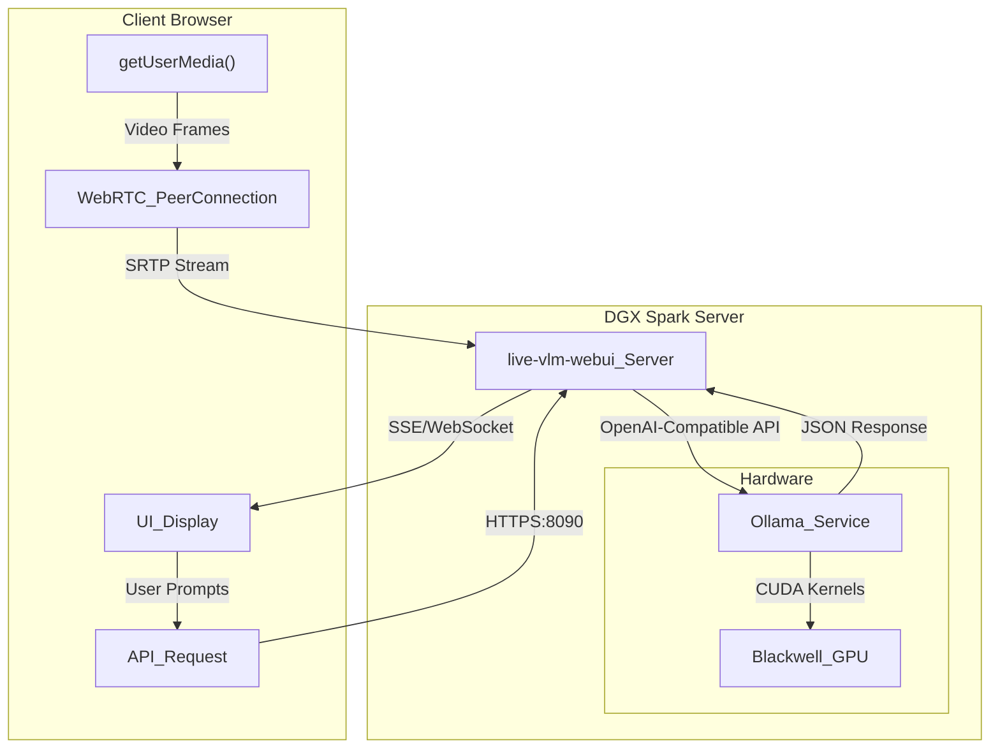
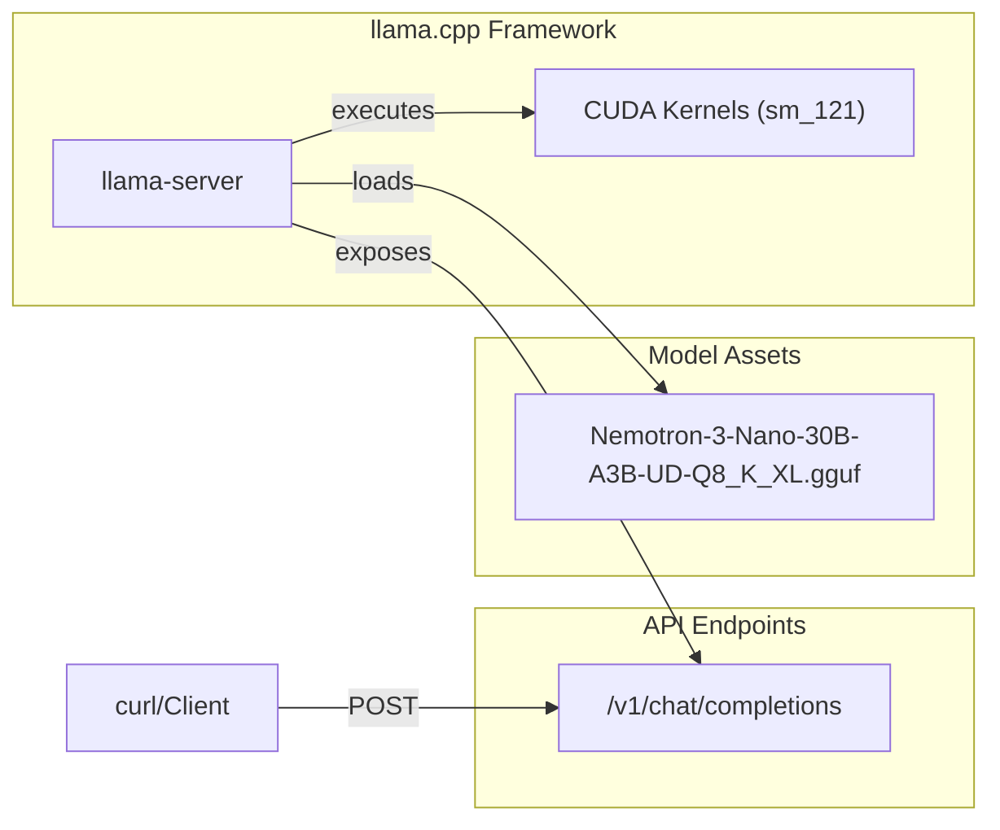

<!-- source: DeepWiki mcp.deepwiki.com · repo NVIDIA/dgx-spark-playbooks · page 6.6 Live VLM WebUI and Nemotron · fetched 2026-10-26 -->

# Live VLM WebUI and Nemotron

Relevant source files

The following files were used as context for generating this wiki page:

- [nvidia/live-vlm-webui/README.md](nvidia/live-vlm-webui/README.md)
- [nvidia/nemotron/README.md](nvidia/nemotron/README.md)
- [nvidia/portfolio-optimization/README.md](nvidia/portfolio-optimization/README.md)
- [nvidia/single-cell/README.md](nvidia/single-cell/README.md)
- [nvidia/single-cell/assets/scRNA_analysis_preprocessing.ipynb](nvidia/single-cell/assets/scRNA_analysis_preprocessing.ipynb)

This section covers the deployment of real-time Vision-Language Model (VLM) inference using WebRTC for low-latency streaming and the execution of the Nemotron-3-Nano Mixture of Experts (MoE) model using the `llama.cpp` framework.

## Live VLM WebUI

The Live VLM WebUI is a universal interface designed for real-time interaction with VLMs. It leverages WebRTC to stream webcam frames from a client browser to the DGX Spark, where a VLM backend (such as Ollama or vLLM) processes the frames and returns natural language analysis [nvidia/live-vlm-webui/README.md:17-23]().

### System Architecture and Data Flow

The application functions as a bridge between the user's hardware (webcam) and the Blackwell GPU's inference capabilities.

1.  **Stream Initialization**: The client browser establishes a secure HTTPS connection (required for camera access) and initiates a WebRTC stream to the server on port 8090 [nvidia/live-vlm-webui/README.md:133-143]().
2.  **Frame Capture**: Video frames are captured and sent to the `live-vlm-webui` server [nvidia/live-vlm-webui/README.md:21-23]().
3.  **Inference Request**: The server forwards these frames along with customizable prompts to a VLM backend, typically **Ollama** running locally [nvidia/live-vlm-webui/README.md:57-58]().
4.  **GPU Acceleration**: The VLM backend utilizes the Blackwell GPU to perform vision-language reasoning [nvidia/live-vlm-webui/README.md:99-99]().
5.  **Feedback Loop**: Analysis is streamed back to the WebUI for real-time display [nvidia/live-vlm-webui/README.md:29-29]().

### Implementation Components

| Component | Description | Citation |
| :--- | :--- | :--- |
| **Ollama** | Local model serving engine for VLMs like `gemma3:4b` or `qwen2.5-vl` | [nvidia/live-vlm-webui/README.md:87-97]() |
| **WebRTC Server** | Handles low-latency video ingestion and synchronization | [nvidia/live-vlm-webui/README.md:142-142]() |
| **SSL Handler** | Auto-generates self-signed certificates to satisfy browser security for `getUserMedia()` | [nvidia/live-vlm-webui/README.md:141-141]() |
| **GPU Monitor** | Integrated real-time monitoring of Blackwell GPU utilization | [nvidia/live-vlm-webui/README.md:31-31]() |

### VLM WebUI Logic Flow
The following diagram illustrates how the `live-vlm-webui` command orchestrates the connection between the browser and the inference backend.

**Title: WebRTC to VLM Backend Flow**

Sources: [nvidia/live-vlm-webui/README.md:17-34](), [nvidia/live-vlm-webui/README.md:87-110](), [nvidia/live-vlm-webui/README.md:133-157]()

---

## Nemotron-3-Nano with llama.cpp

Nemotron-3-Nano-30B-A3B is a Mixture of Experts (MoE) model with 30 billion total parameters, of which only 3 billion are active during any single inference pass [nvidia/nemotron/README.md:17-17](). This architecture is specifically optimized for the DGX Spark's GB10 GPU using `llama.cpp` to provide high-throughput inference with built-in reasoning capabilities [nvidia/nemotron/README.md:17-19]().

### Compilation and Optimization

To run Nemotron efficiently, `llama.cpp` is built from source with specific optimizations for the Blackwell architecture.

*   **Compute Architecture**: The build targets `sm_121` (Blackwell) to ensure CUDA kernels are optimized for the specific hardware [nvidia/nemotron/README.md:100-104]().
*   **Quantization**: The model uses `Q8_K_XL` (8-bit) quantization to balance model weights (~38GB) against the available VRAM on the GB10 [nvidia/nemotron/README.md:111-115]().
*   **Layer Offloading**: The `--n-gpu-layers 99` flag ensures the entire MoE architecture resides in GPU memory for maximum performance [nvidia/nemotron/README.md:131-131]().

### Inference Server Configuration

The `llama-server` binary provides an OpenAI-compatible endpoint [nvidia/nemotron/README.md:122-124]().

**Title: Nemotron llama-server Entity Map**

Sources: [nvidia/nemotron/README.md:100-106](), [nvidia/nemotron/README.md:111-118](), [nvidia/nemotron/README.md:127-134]()

### Reasoning and Tool Calling
Nemotron-3-Nano supports a "thinking mode" where it generates `reasoning_content` before the final `content` [nvidia/nemotron/README.md:172-174](). This is handled via specific chat templates within the GGUF file that `llama-server` interprets to manage multi-turn reasoning and potential tool invocations [nvidia/nemotron/README.md:19-20]().

### Deployment Parameters
The server is typically launched with the following configuration to maximize DGX Spark utilization:
*   `--ctx-size 8192`: Standard context, expandable to 1M tokens [nvidia/nemotron/README.md:132-132]().
*   `--host 0.0.0.0`: Enables network-wide access for integration with other Spark playbooks [nvidia/nemotron/README.md:137-137]().

Sources: [nvidia/nemotron/README.md:13-28](), [nvidia/nemotron/README.md:136-142](), [nvidia/nemotron/README.md:152-192]()

---

