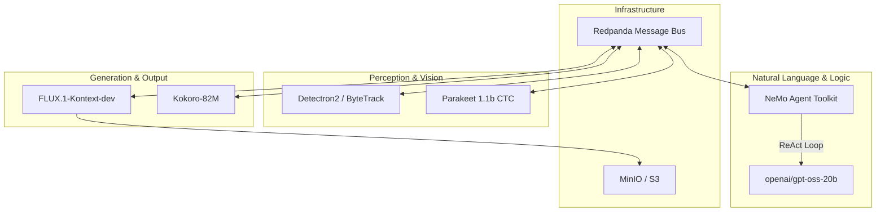
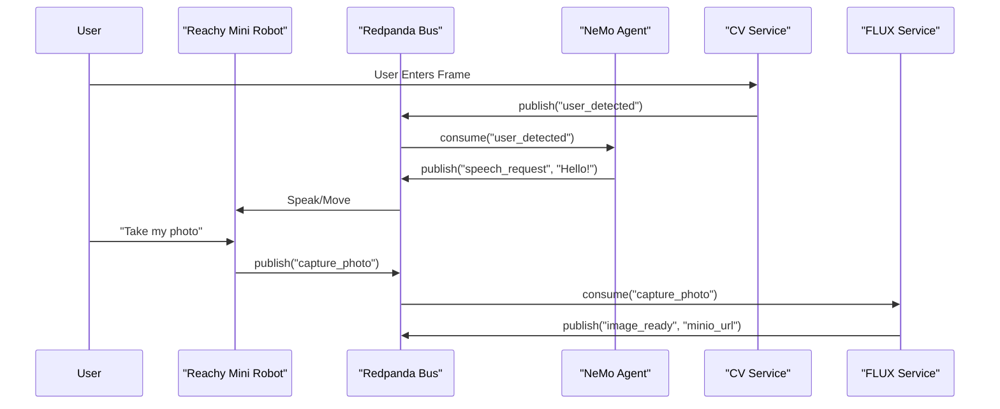

<!-- source: DeepWiki mcp.deepwiki.com · repo NVIDIA/dgx-spark-playbooks · page 6.7 Spark Reachy Photo Booth · fetched 2026-10-26 -->

# Spark Reachy Photo Booth

<details>
<summary>Relevant source files</summary>

The following files were used as context for generating this wiki page:

- [nvidia/spark-reachy-photo-booth/README.md](nvidia/spark-reachy-photo-booth/README.md)
- [nvidia/spark-reachy-photo-booth/assets/architecture-diagram.png](nvidia/spark-reachy-photo-booth/assets/architecture-diagram.png)
- [nvidia/spark-reachy-photo-booth/assets/setup.jpg](nvidia/spark-reachy-photo-booth/assets/setup.jpg)
- [nvidia/spark-reachy-photo-booth/assets/teaser.jpg](nvidia/spark-reachy-photo-booth/assets/teaser.jpg)
- [nvidia/unsloth/assets/test_unsloth.py](nvidia/unsloth/assets/test_unsloth.py)

</details>


The Spark & Reachy Photo Booth is an interactive, event-driven demonstration that integrates the **NVIDIA DGX Spark™** with the **Reachy Mini** (or Reachy Mini Lite) robot to showcase a multimodal AI experience [nvidia/spark-reachy-photo-booth/README.md:25-39](). The system performs real-time processing of natural language, computer vision, and high-fidelity image generation entirely on local edge hardware [nvidia/spark-reachy-photo-booth/README.md:41-43]().

## System Capabilities
The photo booth implements several advanced AI features:
*   **Multimodal Agent:** Orchestrated via the `NeMo Agent Toolkit` using a ReAct loop [nvidia/spark-reachy-photo-booth/README.md:27-28]().
*   **LLM Inference:** Driven by `openai/gpt-oss-20b` optimized with `TensorRT-LLM` [nvidia/spark-reachy-photo-booth/README.md:28-28]().
*   **Voice Interaction:** Automatic Speech Recognition (ASR) via `nvidia/riva-parakeet-ctc-1.1B` and Text-to-Speech (TTS) via `hexgrad/Kokoro-82M` [nvidia/spark-reachy-photo-booth/README.md:29-29]().
*   **Image Generation:** Image-to-image restyling using `black-forest-labs/FLUX.1-Kontext-dev` [nvidia/spark-reachy-photo-booth/README.md:30-30]().
*   **Computer Vision:** User position tracking utilizing `facebookresearch/detectron2` and `FoundationVision/ByteTrack` [nvidia/spark-reachy-photo-booth/README.md:31-31]().
*   **Data Management:** `MinIO` handles storage and sharing of captured and generated images via QR codes [nvidia/spark-reachy-photo-booth/README.md:32-32]().

Sources: [nvidia/spark-reachy-photo-booth/README.md:25-43]()

## Architecture and Data Flow

The system is composed of several microservices communicating through a **Redpanda** message bus [nvidia/spark-reachy-photo-booth/README.md:34-36](). This decoupled architecture allows the robot to handle physical interactions while the DGX Spark processes heavy inference workloads in parallel.

### Logical Service Architecture
The following diagram maps the high-level system components to the specific models and software entities defined in the codebase.

**System Entity Mapping**

Sources: [nvidia/spark-reachy-photo-booth/README.md:27-36](), [nvidia/spark-reachy-photo-booth/README.md:84-84]()

### Request-Response Flow
When a user interacts with the photo booth, the data flows through the message bus to trigger specific AI behaviors.

**Interaction Flow Diagram**

Sources: [nvidia/spark-reachy-photo-booth/README.md:25-36]()

## Deployment and Configuration

### Environment Setup
The deployment requires an NVIDIA API Key for NIM microservices and a Hugging Face token for model access [nvidia/spark-reachy-photo-booth/README.md:62-63]().

1.  **Clone the Repository:**
    ```bash
    git clone https://github.com/NVIDIA/spark-reachy-photo-booth.git
    cd spark-reachy-photo-booth
    ```
    [nvidia/spark-reachy-photo-booth/README.md:109-111]()

2.  **Configure Environment Variables:**
    Copy the example file and set `NVIDIA_API_KEY` and `HF_TOKEN` [nvidia/spark-reachy-photo-booth/README.md:119-124]().
    ```bash
    cp .env.example .env
    ```

3.  **Accept Model Licenses:**
    Users must manually accept the license agreements for `FLUX.1-Kontext-dev` and `FLUX.1-Kontext-dev-onnx` on Hugging Face [nvidia/spark-reachy-photo-booth/README.md:128-128]().

### Hardware Integration
The system expects a Reachy Mini robot connected to the same network as the DGX Spark. The Spark acts as the central compute node, serving the following containers:
*   **TensorRT-LLM:** For high-performance LLM serving [nvidia/spark-reachy-photo-booth/README.md:84-84]().
*   **Riva/Parakeet:** For low-latency speech-to-text [nvidia/spark-reachy-photo-booth/README.md:84-84]().
*   **FLUX.1-Kontext NIM:** For optimized image generation [nvidia/spark-reachy-photo-booth/README.md:84-84]().

Sources: [nvidia/spark-reachy-photo-booth/README.md:52-64](), [nvidia/spark-reachy-photo-booth/README.md:119-128]()

## Technical Implementation Details

### Model Quantization and Optimization
The LLM and Image Generation components leverage DGX Spark's architecture through specific optimizations:
*   **TensorRT-LLM:** Used for the `gpt-oss-20b` model to maximize throughput on the Spark's GPUs [nvidia/spark-reachy-photo-booth/README.md:28-28]().
*   **ONNX/NIM:** The FLUX models are served via NIM containers or ONNX runtimes to utilize hardware acceleration [nvidia/spark-reachy-photo-booth/README.md:84-84]().

### Image Storage and Sharing
Captured photos are stored in **MinIO**. The system can generate QR codes pointing to the `EXTERNAL_MINIO_BASE_URL` defined in the `.env` file, allowing users to download their AI-augmented photos directly to their mobile devices [nvidia/spark-reachy-photo-booth/README.md:32-32](), [nvidia/spark-reachy-photo-booth/README.md:125-125]().

Sources: [nvidia/spark-reachy-photo-booth/README.md:28-32](), [nvidia/spark-reachy-photo-booth/README.md:84-84](), [nvidia/spark-reachy-photo-booth/README.md:125-125]()

---

