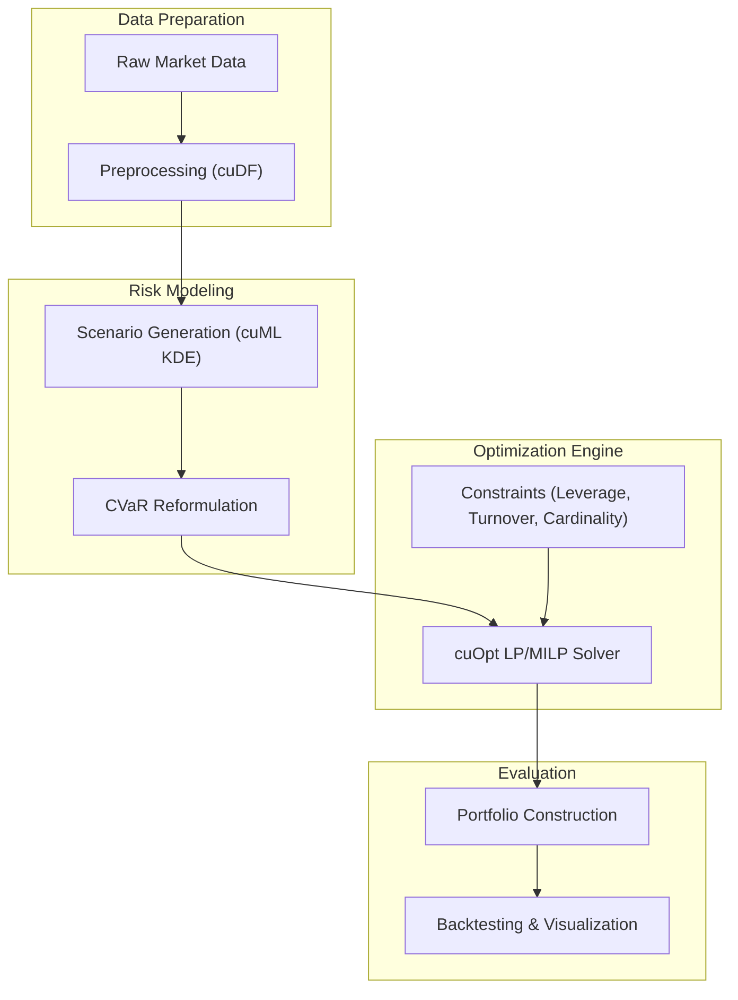
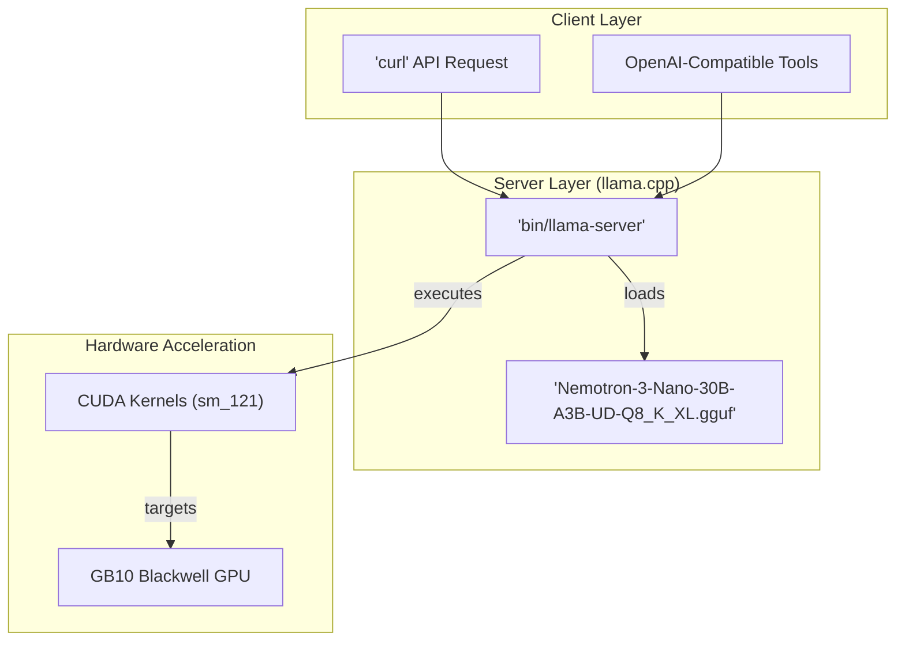

<!-- source: DeepWiki mcp.deepwiki.com · repo NVIDIA/dgx-spark-playbooks · page 6.8 Scientific Computing Applications · fetched 2026-10-26 -->

# Scientific Computing Applications

Relevant source files

The following files were used as context for generating this wiki page:

- [nvidia/live-vlm-webui/README.md](nvidia/live-vlm-webui/README.md)
- [nvidia/nemotron/README.md](nvidia/nemotron/README.md)
- [nvidia/portfolio-optimization/README.md](nvidia/portfolio-optimization/README.md)
- [nvidia/portfolio-optimization/assets/README.md](nvidia/portfolio-optimization/assets/README.md)
- [nvidia/portfolio-optimization/assets/assets/arch_diagram.png](nvidia/portfolio-optimization/assets/assets/arch_diagram.png)
- [nvidia/portfolio-optimization/assets/assets/cvar.png](nvidia/portfolio-optimization/assets/assets/cvar.png)
- [nvidia/portfolio-optimization/assets/cvar_basic.ipynb](nvidia/portfolio-optimization/assets/cvar_basic.ipynb)
- [nvidia/portfolio-optimization/assets/setup/CONTRIBUTING.md](nvidia/portfolio-optimization/assets/setup/CONTRIBUTING.md)
- [nvidia/portfolio-optimization/assets/setup/LICENSE](nvidia/portfolio-optimization/assets/setup/LICENSE)
- [nvidia/portfolio-optimization/assets/setup/LICENSE-3rd-party.txt](nvidia/portfolio-optimization/assets/setup/LICENSE-3rd-party.txt)
- [nvidia/single-cell/README.md](nvidia/single-cell/README.md)
- [nvidia/single-cell/assets/scRNA_analysis_preprocessing.ipynb](nvidia/single-cell/assets/scRNA_analysis_preprocessing.ipynb)

This section details GPU-accelerated scientific computing workflows on the NVIDIA DGX Spark, focusing on high-performance optimization, genomics, and structural biology. These playbooks leverage the Blackwell architecture's unified memory and specialized kernels to accelerate high-dimensional numerical problems.

## Portfolio Optimization with cuOpt and cuML

This application demonstrates an end-to-end GPU-accelerated workflow for solving large-scale portfolio optimization problems using the **Mean-CVaR (Conditional Value-at-Risk)** model [nvidia/portfolio-optimization/README.md:17-17](). Portfolio Optimization (PO) involves high-dimensional, non-linear numerical optimization to balance risk and return across thousands of assets [nvidia/portfolio-optimization/README.md:19-19]().

### Implementation Details
The pipeline uses a combination of specialized libraries to handle the computational heavy lifting:
*   **cuOpt LP/MILP Solvers:** Used for GPU-accelerated optimization of the risk-return tradeoff [nvidia/portfolio-optimization/README.md:24-24]().
*   **NVIDIA cuML:** Implements GPU-accelerated **Kernel Density Estimation (KDE)** to model asset return distributions and generate scenarios [nvidia/portfolio-optimization/README.md:25-26]().
*   **cuFolio:** A purpose-built library for quantitative finance that integrates `cuOpt`, `cuML`, and `cuGraph` [nvidia/portfolio-optimization/assets/README.md:10-10]().

The workflow reformulates the risk-return tradeoff as a scenario-based linear program where problem size scales with the number of scenarios, making GPU acceleration critical for near real-time execution [nvidia/portfolio-optimization/README.md:17-17](), [nvidia/portfolio-optimization/README.md:47-47]().

### Portfolio Optimization Data Flow
The diagram below illustrates the flow from raw financial data to an optimized portfolio.

**Diagram: Portfolio Optimization Pipeline**

Sources: [nvidia/portfolio-optimization/README.md:23-28](), [nvidia/portfolio-optimization/assets/README.md:14-21]()

## Single-Cell RNA Sequencing Analysis

Single-cell RNA sequencing (scRNA-seq) allows researchers to study gene activity at the individual cell level. These datasets are high-dimensional and require significant compute power to process sparse count matrices [nvidia/single-cell/README.md:17-17]().

### Key Components and Workflow
The playbook utilizes the **RAPIDS-singlecell** library, which provides a GPU-accelerated implementation of the **scverse** ecosystem (specifically the **Scanpy** API) [nvidia/single-cell/README.md:19-19]().

1.  **Memory Management:** The workflow uses the **RAPIDS Memory Manager (RMM)**. Users can choose between `pool_allocator` (when data fits in VRAM) or `managed_memory` (for oversubscription/unified memory) [nvidia/single-cell/assets/scRNA_analysis_preprocessing.ipynb:77-77]().
2.  **Preprocessing:** Data loading into `AnnData` objects, Quality Control (QC) visualization, and filtering [nvidia/single-cell/assets/scRNA_analysis_preprocessing.ipynb:16-22]().
3.  **Clustering & Visualization:**
    *   **PCA:** Principal Component Analysis for dimensionality reduction [nvidia/single-cell/assets/scRNA_analysis_preprocessing.ipynb:24-24]().
    *   **Nearest Neighbors:** GPU implementation computes the **exact graph**, unlike the approximate search used in CPU-based Scanpy [nvidia/single-cell/README.md:36-36]().
    *   **UMAP/t-SNE:** Non-linear dimensionality reduction for visualization [nvidia/single-cell/assets/scRNA_analysis_preprocessing.ipynb:25-28]().

### System Architecture Mapping
The following diagram bridges the biological analysis steps to the specific code entities and libraries used on DGX Spark.

**Diagram: scRNA-seq Code Entity Mapping**

```mermaid
graph LR
    subgraph "Python / scverse API"
        AN["AnnData Object"]
        SC["Scanpy API"]
    end

    subgraph "GPU Accelerated Backend"
        RSC["'rapids_singlecell' (rsc)"]
        RMM["'rmm' (Memory Manager)"]
        CU["'cupy' (cp)"]
    end

    subgraph "Processing Logic"
        AN --> RSC
        RSC --> CU
        RMM --> CU
        SC -- "Orchestration" --> RSC
    end

    subgraph "Operations"
        RSC -- "calls" --> PCA["'rsc.pp.pca'"]
        RSC -- "calls" --> NBR["'rsc.pp.neighbors'"]
        RSC -- "calls" --> UMAP["'rsc.tl.umap'"]
    end
```

Sources: [nvidia/single-cell/assets/scRNA_analysis_preprocessing.ipynb:59-63](), [nvidia/single-cell/assets/scRNA_analysis_preprocessing.ipynb:89-97](), [nvidia/single-cell/README.md:35-36]()

## Inference for Scientific Reasoning

The repository includes support for **Nemotron-3-Nano-30B-A3B**, an NVIDIA language model featuring a Mixture of Experts (MoE) architecture [nvidia/nemotron/README.md:17-17](). While primarily a language model, its specialized "thinking mode" and reasoning capabilities are applied to scientific problem-solving and step-by-step logic [nvidia/nemotron/README.md:19-19](), [nvidia/nemotron/README.md:195-202]().

### Technical Implementation
*   **llama.cpp Backend:** The model is run using `llama.cpp`, which compiles CUDA kernels specifically for the Blackwell `sm_121` compute architecture [nvidia/nemotron/README.md:100-104]().
*   **MoE Efficiency:** The model has 30 billion parameters but only 3 billion are active during inference, allowing it to fit within the GPU memory of a single DGX Spark node (~38GB VRAM for Q8 quantization) [nvidia/nemotron/README.md:17-17](), [nvidia/nemotron/README.md:112-112]().

### Scientific Reasoning Service Mapping
This diagram shows how the `llama-server` interacts with the hardware and the API.

**Diagram: Nemotron-3-Nano Inference Stack**

Sources: [nvidia/nemotron/README.md:100-104](), [nvidia/nemotron/README.md:127-134](), [nvidia/nemotron/README.md:154-162]()

## Summary of Scientific Playbooks

| Application | Primary Libraries | Key Hardware Feature |
| :--- | :--- | :--- |
| **Portfolio Optimization** | `cuOpt`, `cuML`, `cuFolio` | Parallel Linear Programming solvers |
| **scRNA Sequencing** | `RAPIDS-singlecell`, `RMM` | Unified Memory for sparse matrices |
| **Scientific Reasoning** | `llama.cpp`, `CUDA` | MoE architecture on Blackwell |

Sources: [nvidia/portfolio-optimization/README.md:24-26](), [nvidia/single-cell/README.md:19-19](), [nvidia/nemotron/README.md:17-19]()

---

