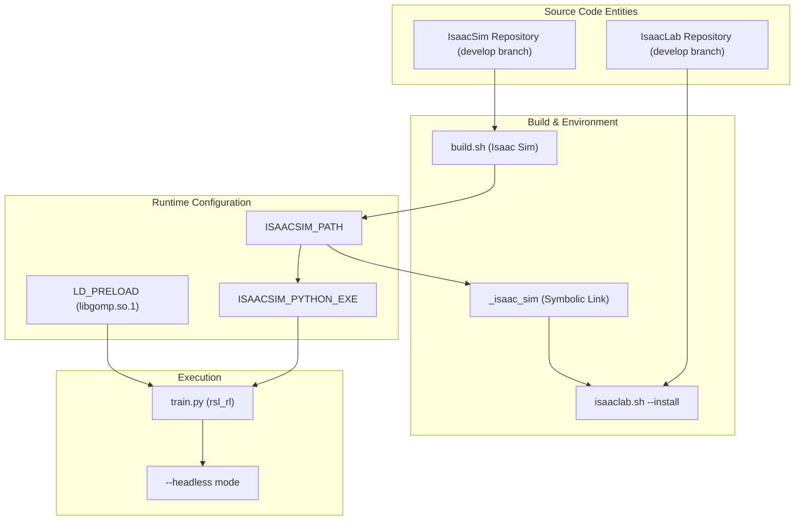
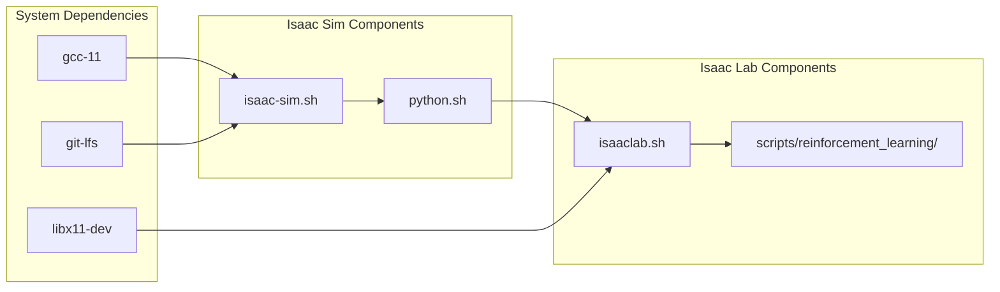

<!-- source: DeepWiki mcp.deepwiki.com · repo NVIDIA/dgx-spark-playbooks · page 6.9 Isaac Sim and Isaac Lab · fetched 2026-10-26 -->

# Isaac Sim and Isaac Lab

Relevant source files

The following files were used as context for generating this wiki page:

- [nvidia/isaac/README.md](nvidia/isaac/README.md)
- [nvidia/multi-agent-chatbot/assets/frontend/package-lock.json](nvidia/multi-agent-chatbot/assets/frontend/package-lock.json)
- [nvidia/multi-agent-chatbot/assets/frontend/package.json](nvidia/multi-agent-chatbot/assets/frontend/package.json)
- [nvidia/txt2kg/assets/deploy/services/sentence-transformers/requirements.txt](nvidia/txt2kg/assets/deploy/services/sentence-transformers/requirements.txt)

This page provides a technical guide for building and running NVIDIA Isaac Sim and Isaac Lab from source on the DGX Spark platform. Isaac Sim is a robotics simulation toolkit built on NVIDIA Omniverse, while Isaac Lab is a reinforcement learning (RL) framework optimized for robotics training.

## Overview

Isaac Sim utilizes GPU-accelerated physics to provide photorealistic and physically accurate simulations [nvidia/isaac/README.md:18-20](). Isaac Lab extends these capabilities by providing a unified framework for reinforcement learning, featuring pre-built environments for tasks such as locomotion and manipulation [nvidia/isaac/README.md:18-20]().

On DGX Spark, these tools are built from source to leverage the Grace Blackwell architecture and ARM64-specific optimizations [nvidia/isaac/README.md:24-24](), [nvidia/isaac/README.md:37-37]().

### System Architecture and Data Flow

The following diagram illustrates the relationship between the source repositories, the build artifacts, and the execution environment on DGX Spark.

**Isaac Simulation and Training Stack**

Sources: [nvidia/isaac/README.md:83-83](), [nvidia/isaac/README.md:98-98](), [nvidia/isaac/README.md:109-110](), [nvidia/isaac/README.md:150-150](), [nvidia/isaac/README.md:179-179]()

## Isaac Sim Installation

The installation requires specific toolchains and large file handling via Git LFS.

### 1. Toolchain Setup
Isaac Sim requires the GCC 11 compiler on DGX OS [nvidia/isaac/README.md:42-42]().
* **Command:** `sudo apt install -y gcc-11 g++-11` [nvidia/isaac/README.md:69-69]()
* **Configuration:** Alternatives are set to prioritize version 11 for the `gcc` and `g++` commands [nvidia/isaac/README.md:70-71]().

### 2. Source Acquisition
The repository is cloned using the `develop` branch for early developer access [nvidia/isaac/README.md:83-83](). Git LFS is required to pull the heavy simulation assets [nvidia/isaac/README.md:89-90]().

### 3. Build Process
The `build.sh` script compiles the engine for the `linux-aarch64` architecture [nvidia/isaac/README.md:98-98](), [nvidia/isaac/README.md:109-109]().
* **Artifact Location:** `_build/linux-aarch64/release` [nvidia/isaac/README.md:109-109]()
* **Success Indicator:** "BUILD (RELEASE) SUCCEEDED" [nvidia/isaac/README.md:101-101]()

**Component Interaction Map**

Sources: [nvidia/isaac/README.md:69-72](), [nvidia/isaac/README.md:110-110](), [nvidia/isaac/README.md:119-119](), [nvidia/isaac/README.md:160-160](), [nvidia/isaac/README.md:166-166]()

## Isaac Lab Configuration

Isaac Lab sits on top of Isaac Sim and requires a symbolic link to the Sim installation to resolve dependencies.

### Environment Integration
A symbolic link named `_isaac_sim` must be created within the Isaac Lab directory pointing to the `ISAACSIM_PATH` [nvidia/isaac/README.md:150-150](). This allows the `isaaclab.sh` script to locate the underlying Omniverse binaries.

### Dependency Installation
Isaac Lab requires several X11 and OpenGL development libraries to build UI components like `imgui_bundle` from source [nvidia/isaac/README.md:156-161]():
* `libx11-dev`, `libxrandr-dev`, `libxinerama-dev`, `libxcursor-dev`, `libxi-dev`, `libgl1-mesa-dev`.

## Running Reinforcement Learning Tasks

Training is typically performed using the `rsl_rl` library integrated into Isaac Lab.

### Execution Modes
| Mode | Command Flag | Description |
| :--- | :--- | :--- |
| **Headless** | `--headless` | Optimized for DGX Spark performance; no GUI rendering [nvidia/isaac/README.md:179-179](). |
| **Visualized** | (None) | Real-time monitoring of the agent within the Isaac Sim environment [nvidia/isaac/README.md:188-189](). |

### Runtime Requirements
To avoid threading issues with OpenMP, `libgomp.so.1` must be preloaded [nvidia/isaac/README.md:178-178]().

**Example Task:** `Isaac-Velocity-Rough-H1-v0` (Humanoid Locomotion) [nvidia/isaac/README.md:179-179]().

## Technical Reference

### Key Environment Variables
| Variable | Purpose |
| :--- | :--- |
| `ISAACSIM_PATH` | Path to the release build: `_build/linux-aarch64/release` [nvidia/isaac/README.md:109-109]() |
| `ISAACSIM_PYTHON_EXE` | Path to the Isaac Sim-bundled Python environment: `${ISAACSIM_PATH}/python.sh` [nvidia/isaac/README.md:110-110]() |
| `LD_PRELOAD` | Used to load `/lib/aarch64-linux-gnu/libgomp.so.1` [nvidia/isaac/README.md:118-118]() |

### Build Specifications
* **Architecture:** linux-aarch64 [nvidia/isaac/README.md:109-109]()
* **Storage Requirement:** ~50GB [nvidia/isaac/README.md:38-38]()
* **Typical Build Time:** 10-15 minutes [nvidia/isaac/README.md:54-54]()

Sources: [nvidia/isaac/README.md:38-38](), [nvidia/isaac/README.md:54-54](), [nvidia/isaac/README.md:109-110](), [nvidia/isaac/README.md:118-118]()

---

