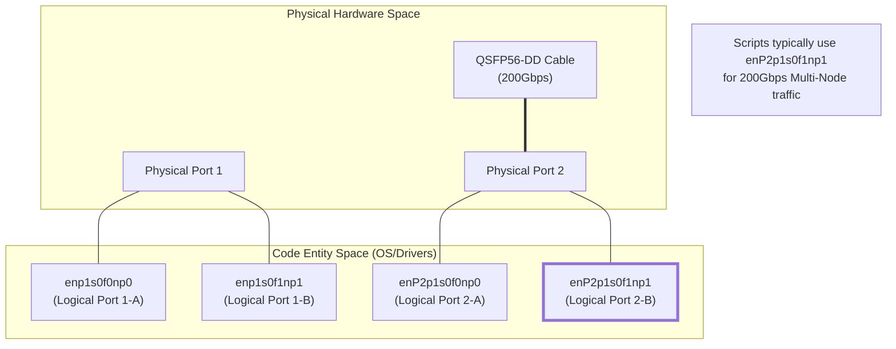
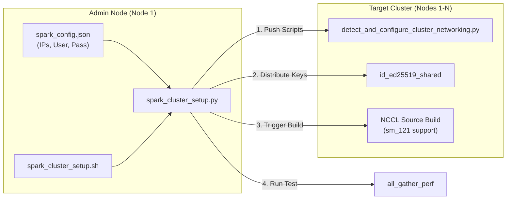

<!-- source: DeepWiki mcp.deepwiki.com · repo NVIDIA/dgx-spark-playbooks · page 7 Multi-Node Setups · fetched 2026-10-26 -->

# Multi-Node Setups

Relevant source files

The following files were used as context for generating this wiki page:

- [nvidia/connect-two-sparks/README.md](nvidia/connect-two-sparks/README.md)
- [nvidia/multi-modal-inference/README.md](nvidia/multi-modal-inference/README.md)
- [nvidia/multi-sparks-through-switch/README.md](nvidia/multi-sparks-through-switch/README.md)
- [nvidia/multi-sparks-through-switch/assets/spark_cluster_setup/README.md](nvidia/multi-sparks-through-switch/assets/spark_cluster_setup/README.md)
- [nvidia/multi-sparks-through-switch/assets/spark_cluster_setup/spark_cluster_setup.py](nvidia/multi-sparks-through-switch/assets/spark_cluster_setup/spark_cluster_setup.py)
- [nvidia/multi-sparks-through-switch/assets/spark_cluster_setup/spark_cluster_setup.sh](nvidia/multi-sparks-through-switch/assets/spark_cluster_setup/spark_cluster_setup.sh)
- [nvidia/nccl/README.md](nvidia/nccl/README.md)

This document provides a high-level guide for connecting and configuring multiple NVIDIA DGX Spark devices for distributed inference and training. Multi-node configurations allow workloads to scale beyond the 128GB unified memory of a single node, enabling the execution of massive models like Llama-3.1-405B or high-throughput parallel processing.

For detailed implementation guides, see the following child pages:
- **[Connecting Two Sparks](#7.1)** — Physical and network setup for direct QSFP connection.
- **[Multi-Sparks Through a Switch](#7.2)** — Automated cluster setup for 3+ nodes using `spark_cluster_setup.py`.
- **[vLLM Ray Cluster](#7.3)** — Distributed LLM inference using Ray.
- **[TensorRT-LLM Distributed Inference](#7.4)** — High-performance distributed inference via Docker Swarm or MPI.
- **[NCCL Configuration](#7.5)** — Optimization of the NVIDIA Collective Communications Library for Blackwell architecture.

---

## Multi-Node Connectivity Options

DGX Spark supports two primary physical connectivity patterns for multi-node clusters: direct back-to-back connection and switched fabric.

| Setup Type | Hardware Required | Use Case | Scalability |
|------------|-------------------|----------|-------------|
| **Direct Connect** | 1x QSFP Cable | 2-node inference/fine-tuning | Fixed (2 nodes) |
| **Switched Fabric** | 1x QSFP Cable per node + QSFP Switch | Large-scale clusters (3+ nodes) | High (limited by switch ports) |

### Physical to Code Mapping (Direct Connect)

The following diagram bridges physical hardware components to the logical interface names used in scripts like `run_cluster.sh` or `spark_cluster_setup.py`.

**Sources:** [nvidia/connect-two-sparks/README.md:83-101](), [nvidia/multi-sparks-through-switch/README.md:97-113]()

---

## Automated Cluster Setup

For clusters involving three or more nodes, or for users preferring automation, the repository provides a Python-based orchestration suite. The `spark_cluster_setup.py` script automates the detection of network topology, IP assignment via Netplan, and passwordless SSH configuration.

### Cluster Orchestration Workflow

**Key Automation Entities:**
- `spark_config.json`: Defines node credentials and management IPs [nvidia/multi-sparks-through-switch/assets/spark_cluster_setup/README.md:21-37]().
- `spark_cluster_setup.sh`: Wrapper that manages the Python virtual environment and dependencies [nvidia/multi-sparks-through-switch/assets/spark_cluster_setup/spark_cluster_setup.sh:20-32]().
- `NCCL_ENV`: Sets critical paths for `CUDA_HOME`, `MPI_HOME`, and `NCCL_HOME` to ensure Blackwell compatibility [nvidia/multi-sparks-through-switch/assets/spark_cluster_setup/spark_cluster_setup.py:56-56]().

**Sources:** [nvidia/multi-sparks-through-switch/assets/spark_cluster_setup/README.md:58-64](), [nvidia/multi-sparks-through-switch/assets/spark_cluster_setup/spark_cluster_setup.py:38-56]()

---

## Distributed Runtime Comparison

Different inference engines utilize different distributed backends. Choosing the right one depends on the model architecture and required throughput.

| Engine | Distributed Backend | Coordination Method | Key Scaling Parameter |
|--------|---------------------|---------------------|----------------------|
| **vLLM** | Ray | Ray Head/Worker | `--tensor-parallel-size 2` |
| **TensorRT-LLM** | MPI / Docker Swarm | `mpirun` + SSH | `--tp_size 2` |
| **PyTorch/NeMo** | NCCL / Torchrun | Master/Worker | `devices=2`, `num_nodes=2` |

For details on Ray setup, see [vLLM Ray Cluster](#7.3). For Docker Swarm and MPI details, see [TensorRT-LLM Distributed Inference](#7.4).

---

## High-Performance GPU Communication (NCCL)

The NVIDIA Collective Communications Library (NCCL) is the backbone of multi-node performance on Spark. To achieve 200Gbps line rate between nodes, NCCL must be built from source with Blackwell (`sm_121`) support.

### NCCL Setup Requirements:
1. **Blackwell Support**: Build using `NVCC_GENCODE="-gencode=arch=compute_121,code=sm_121"` [nvidia/nccl/README.md:72-72]().
2. **Interface Selection**: Export `NCCL_SOCKET_IFNAME` and `UCX_NET_DEVICES` pointing to the active QSFP interface (e.g., `enp1s0f1np1`) [nvidia/nccl/README.md:141-143]().
3. **Topology Detection**: Use `ibdev2netdev` to identify "Up" logical interfaces before running tests [nvidia/nccl/README.md:92-109]().

For the full optimization guide, see [NCCL Configuration](#7.5).

**Sources:** [nvidia/nccl/README.md:13-26](), [nvidia/nccl/README.md:62-79]()

---

