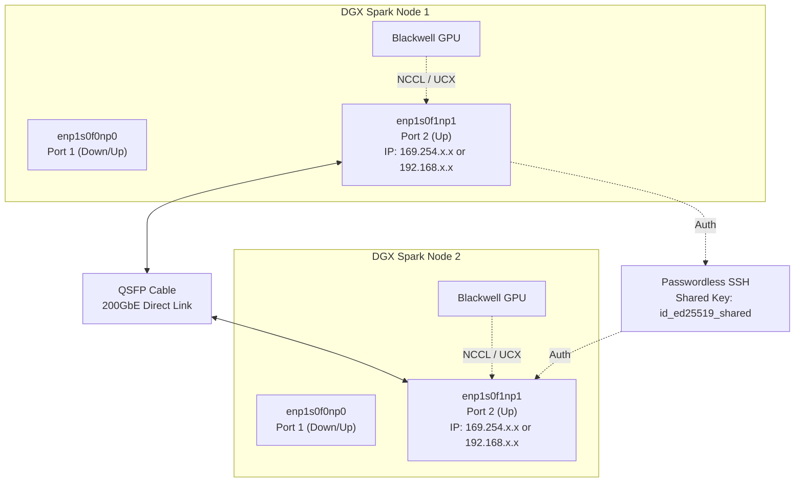
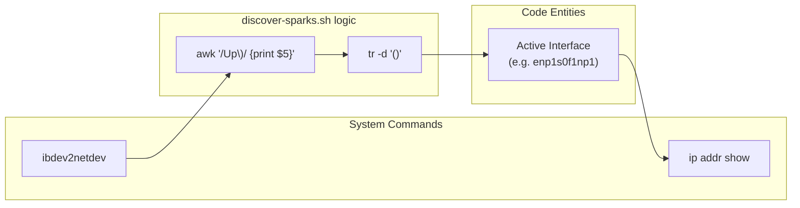
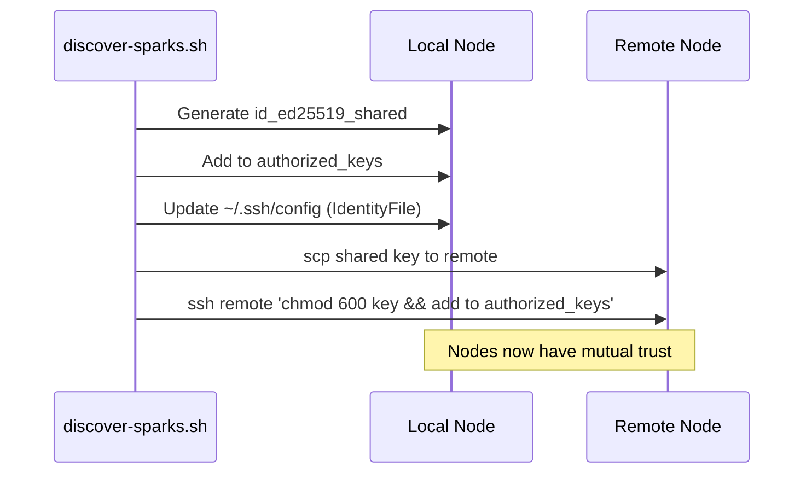

<!-- source: DeepWiki mcp.deepwiki.com · repo NVIDIA/dgx-spark-playbooks · page 7.1 Connecting Two Sparks · fetched 2026-10-26 -->

# Connecting Two Sparks

<details>
<summary>Relevant source files</summary>

The following files were used as context for generating this wiki page:

- [nvidia/connect-two-sparks/README.md](nvidia/connect-two-sparks/README.md)
- [nvidia/connect-two-sparks/assets/cx7-netplan.yaml](nvidia/connect-two-sparks/assets/cx7-netplan.yaml)
- [nvidia/connect-two-sparks/assets/discover-sparks](nvidia/connect-two-sparks/assets/discover-sparks)
- [nvidia/multi-modal-inference/README.md](nvidia/multi-modal-inference/README.md)
- [nvidia/nccl/README.md](nvidia/nccl/README.md)

</details>


This document covers the physical and network setup required to connect two DGX Spark devices for distributed workloads. This includes QSFP cable connection, network interface configuration, passwordless SSH authentication, and connectivity verification. This setup is a prerequisite for distributed systems such as vLLM Ray clusters, TensorRT-LLM multi-node deployments, and NCCL-based distributed training.

---

## Overview

Multi-node DGX Spark configurations enable distributed inference and training by connecting two devices via high-speed 200GbE direct QSFP connections. This creates a low-latency network link for tensor parallelism and model partitioning across Blackwell GPUs. The setup involves:

1. Physical QSFP cable connection between devices.
2. Network interface identification and IP assignment (Automatic or Manual).
3. Passwordless SSH configuration for automated orchestration.
4. Validation via NCCL communication tests or standard network tools.

**Architecture Diagram: Two-Node Topology**



Sources: [nvidia/connect-two-sparks/README.md:15-25](), [nvidia/nccl/README.md:15-20](), [nvidia/connect-two-sparks/assets/discover-sparks:98-102]()

---

## Hardware Requirements and Physical Connection

### Prerequisites
- Two DGX Spark systems with Blackwell GPU architecture [nvidia/connect-two-sparks/README.md:35-39]().
- One QSFP cable for direct 200GbE connection [nvidia/connect-two-sparks/README.md:36-36]().
- Identical usernames on both systems (e.g., `nvidia`) [nvidia/connect-two-sparks/README.md:39-39]().

### Physical Setup
Connect the QSFP cable between any QSFP interface on each device. Each physical port on the ConnectX-7 (CX-7) adapter has two names (e.g., `enp1s0f1np1` and `enP2p1s0f1np1`). Users are advised to use the `enp1<...>` naming convention [nvidia/connect-two-sparks/README.md:83-101]().

**Interface Detection Diagram**



Sources: [nvidia/connect-two-sparks/README.md:91-97](), [nvidia/connect-two-sparks/assets/discover-sparks:34-39](), [nvidia/nccl/README.md:92-109]()

---

## Network Configuration Options

There are three primary methods to configure the network interfaces for the 200GbE link.

### Option 1: Automatic Link-Local (Netplan)
Best for single-cable setups. It uses IPv4 link-local addressing (169.254.x.x).
- **File**: `/etc/netplan/40-cx7.yaml`
- **Implementation**: Set `link-local: [ ipv4 ]` for `enp1s0f0np0` and `enp1s0f1np1` [nvidia/connect-two-sparks/README.md:118-127]().

### Option 2: Manual Static IP (Netplan)
Required for multi-cable setups to ensure all four interfaces (including the `enP2p` aliases) are addressed for full bandwidth [nvidia/connect-two-sparks/README.md:107-110]().
- **Node 1 Example**: `192.168.100.10/24` on `enp1s0f0np0` [nvidia/connect-two-sparks/README.md:141-161]().
- **Node 2 Example**: `192.168.100.11/24` on `enp1s0f0np0` [nvidia/connect-two-sparks/README.md:172-193]().

### Option 3: Manual Command Line (Non-persistent)
Quick setup using `ip addr add` and `ip link set ... up` [nvidia/connect-two-sparks/README.md:225-237]().

---

## SSH and Node Discovery

To enable distributed execution, nodes must trust each other via passwordless SSH. The `discover-sparks.sh` script automates this process using mDNS/Avahi.

### Automated Discovery Flow
The script `discover-sparks.sh` performs the following steps:
1. **Interface Detection**: Uses `ibdev2netdev` to find interfaces in the "Up" state [nvidia/connect-two-sparks/assets/discover-sparks:34-43]().
2. **Service Discovery**: Uses `avahi-browse -r -t _ssh._tcp` to find other Spark devices on the high-speed network [nvidia/connect-two-sparks/assets/discover-sparks:55-67]().
3. **Key Generation**: Creates a shared key `~/.ssh/id_ed25519_shared` [nvidia/connect-two-sparks/assets/discover-sparks:98-102]().
4. **Distribution**: Copies the shared key to all discovered nodes and updates `~/.ssh/config` to use this key by default for all hosts [nvidia/connect-two-sparks/assets/discover-sparks:119-159]().

**SSH Configuration Sequence**



Sources: [nvidia/connect-two-sparks/assets/discover-sparks:97-164]()

---

## Validating the Connection (NCCL)

Once networking and SSH are established, the NVIDIA Collective Communication Library (NCCL) is used to validate the high-bandwidth link.

### Step 1: Build NCCL and Tests
NCCL must be built with Blackwell support (`sm_121`) on both nodes [nvidia/nccl/README.md:62-79]().
```bash
make -j src.build NVCC_GENCODE="-gencode=arch=compute_121,code=sm_121"
```

### Step 2: Run Performance Test
Use `mpirun` to execute the `all_gather_perf` test across both nodes. You must specify the active interface via environment variables [nvidia/nccl/README.md:131-150]().

| Variable | Value | Purpose |
| :--- | :--- | :--- |
| `UCX_NET_DEVICES` | `enp1s0f1np1` | Directs UCX to use the CX-7 interface |
| `NCCL_SOCKET_IFNAME` | `enp1s0f1np1` | Directs NCCL socket traffic |
| `OMPI_MCA_btl_tcp_if_include` | `enp1s0f1np1` | Includes interface for OpenMPI TCP |

**Execution Command**:
```bash
mpirun -np 2 -H <IP_Node1>:1,<IP_Node2>:1 \
  --mca plm_rsh_agent "ssh -o StrictHostKeyChecking=no" \
  -x LD_LIBRARY_PATH=$LD_LIBRARY_PATH \
  $HOME/nccl-tests/build/all_gather_perf -b 16G -e 16G -f 2
```
Sources: [nvidia/nccl/README.md:140-164]()

---

## Troubleshooting

| Issue | Potential Cause | Solution |
| :--- | :--- | :--- |
| `ibdev2netdev` shows all "Down" | Physical connection or driver issue | Reseat QSFP cable; reboot both systems [nvidia/connect-two-sparks/README.md:99-101](). |
| `mpirun` hangs | SSH authentication failure | Verify `ssh <remote_ip>` works without a password [nvidia/nccl/README.md:187-187](). |
| Low bandwidth in tests | Single cable with partial config | If using two cables, ensure all four interface names are assigned IPs [nvidia/nccl/README.md:133-135](). |
| `avahi-browse` fails | Missing dependencies | Install `avahi-utils` [nvidia/connect-two-sparks/assets/discover-sparks:49-53](). |

Sources: [nvidia/connect-two-sparks/README.md:99-110](), [nvidia/nccl/README.md:133-189](), [nvidia/connect-two-sparks/assets/discover-sparks:49-53]()

---

