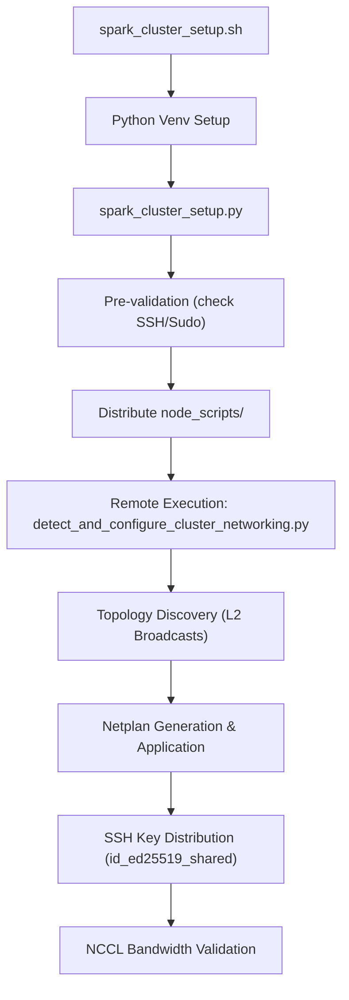
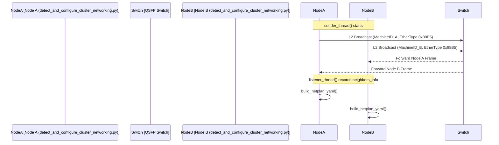

<!-- source: DeepWiki mcp.deepwiki.com · repo NVIDIA/dgx-spark-playbooks · page 7.2 Multi-Sparks Through a Switch · fetched 2026-10-26 -->

# Multi-Sparks Through a Switch

<details>
<summary>Relevant source files</summary>

The following files were used as context for generating this wiki page:

- [nvidia/multi-sparks-through-switch/README.md](nvidia/multi-sparks-through-switch/README.md)
- [nvidia/multi-sparks-through-switch/assets/cx7-netplan-link-local.yaml](nvidia/multi-sparks-through-switch/assets/cx7-netplan-link-local.yaml)
- [nvidia/multi-sparks-through-switch/assets/spark_cluster_setup/README.md](nvidia/multi-sparks-through-switch/assets/spark_cluster_setup/README.md)
- [nvidia/multi-sparks-through-switch/assets/spark_cluster_setup/config/spark_config_b2b.json](nvidia/multi-sparks-through-switch/assets/spark_cluster_setup/config/spark_config_b2b.json)
- [nvidia/multi-sparks-through-switch/assets/spark_cluster_setup/config/spark_config_ring.json](nvidia/multi-sparks-through-switch/assets/spark_cluster_setup/config/spark_config_ring.json)
- [nvidia/multi-sparks-through-switch/assets/spark_cluster_setup/config/spark_config_switch.json](nvidia/multi-sparks-through-switch/assets/spark_cluster_setup/config/spark_config_switch.json)
- [nvidia/multi-sparks-through-switch/assets/spark_cluster_setup/node_scripts/detect_and_configure_cluster_networking.py](nvidia/multi-sparks-through-switch/assets/spark_cluster_setup/node_scripts/detect_and_configure_cluster_networking.py)
- [nvidia/multi-sparks-through-switch/assets/spark_cluster_setup/requirements.txt](nvidia/multi-sparks-through-switch/assets/spark_cluster_setup/requirements.txt)
- [nvidia/multi-sparks-through-switch/assets/spark_cluster_setup/spark_cluster_setup.py](nvidia/multi-sparks-through-switch/assets/spark_cluster_setup/spark_cluster_setup.py)
- [nvidia/multi-sparks-through-switch/assets/spark_cluster_setup/spark_cluster_setup.sh](nvidia/multi-sparks-through-switch/assets/spark_cluster_setup/spark_cluster_setup.sh)

</details>


This page details the automated setup for connecting three or more NVIDIA DGX Spark devices using a QSFP switch. This configuration enables high-speed inter-node communication at 200Gbps per node, supporting distributed workloads such as multi-node inference and fine-tuning [nvidia/multi-sparks-through-switch/README.md:21-26]().

## Overview

The setup process utilizes a suite of automation scripts to handle network interface discovery, IP assignment, passwordless SSH configuration, and NCCL (NVIDIA Collective Communications Library) validation [nvidia/multi-sparks-through-switch/assets/spark_cluster_setup/README.md:59-64](). While manual configuration is possible, the `spark_cluster_setup.py` utility streamlines the deployment for clusters of any size [nvidia/multi-sparks-through-switch/README.md:38-40]().

### Hardware Requirements
*   **Three or more DGX Spark systems** updated to the latest OS and Firmware [nvidia/multi-sparks-through-switch/README.md:40-48]().
*   **QSFP Switch** with at least 200Gbps ports (QSFP56-DD or QSFP56) [nvidia/multi-sparks-through-switch/README.md:41-41]().
*   **QSFP Cables** (one per Spark) [nvidia/multi-sparks-through-switch/README.md:42-44]().

**Sources:** [nvidia/multi-sparks-through-switch/README.md:21-48](), [nvidia/multi-sparks-through-switch/assets/spark_cluster_setup/README.md:59-64]()

## Automated Setup Implementation

The automation is driven by `spark_cluster_setup.sh`, which wraps a Python-based orchestration engine [nvidia/multi-sparks-through-switch/assets/spark_cluster_setup/spark_cluster_setup.sh:30-30](). The orchestration logic executes commands across the cluster nodes using `paramiko` for SSH and `scp` for file distribution [nvidia/multi-sparks-through-switch/assets/spark_cluster_setup/spark_cluster_setup.py:21-25]().

### Configuration Workflow

The user provides a JSON configuration file containing management IP addresses and credentials for all nodes in the cluster [nvidia/multi-sparks-through-switch/assets/spark_cluster_setup/README.md:15-37]().

**Cluster Setup Orchestration Logic**

**Sources:** [nvidia/multi-sparks-through-switch/assets/spark_cluster_setup/spark_cluster_setup.sh:20-30](), [nvidia/multi-sparks-through-switch/assets/spark_cluster_setup/spark_cluster_setup.py:46-47](), [nvidia/multi-sparks-through-switch/assets/spark_cluster_setup/README.md:59-64]()

## Network Discovery and Topology

The core of the network configuration is the `detect_and_configure_cluster_networking.py` script, which is pushed to and executed on every node [nvidia/multi-sparks-through-switch/assets/spark_cluster_setup/spark_cluster_setup.py:46-47](). It uses raw AF_PACKET sockets to send and receive L2 discovery frames [nvidia/multi-sparks-through-switch/assets/spark_cluster_setup/node_scripts/detect_and_configure_cluster_networking.py:89-94]().

### Key Code Entities

| Entity | Role |
| :--- | :--- |
| `DISCOVERY_INTERFACES` | List of interfaces (`enp1s0f0np0`, `enp1s0f1np1`) used for L2 broadcasts [node_scripts/detect_and_configure_cluster_networking.py:30-30](). |
| `ETHERTYPE` | Custom EtherType `0x88B5` used for topology discovery frames [node_scripts/detect_and_configure_cluster_networking.py:50-50](). |
| `DISCOVERY_MAGIC` | Unique byte string `TOPO_DISCOVER_2NODE_V2` to identify cluster frames [node_scripts/detect_and_configure_cluster_networking.py:53-53](). |
| `sender_thread` | Periodically broadcasts the node's `machine_id` (lowest MAC) [node_scripts/detect_and_configure_cluster_networking.py:118-145](). |
| `listener_thread` | Captures neighbor info to build a map of the physical topology [node_scripts/detect_and_configure_cluster_networking.py:159-216](). |

**Discovery Data Flow**

**Sources:** [nvidia/multi-sparks-through-switch/assets/spark_cluster_setup/node_scripts/detect_and_configure_cluster_networking.py:30-222]()

## Execution and Validation

To deploy the cluster, the user executes the wrapper script with a JSON config file.

### Configuration Example
For a 4-node switch setup, the `spark_config_switch.json` file must be populated with management details for all units [nvidia/multi-sparks-through-switch/assets/spark_cluster_setup/config/spark_config_switch.json:1-28]().

### Deployment Commands
```bash
# Full automated setup
bash spark_cluster_setup.sh -c config/spark_config_switch.json --run-setup

# Run only NCCL bandwidth tests
bash spark_cluster_setup.sh -c config/spark_config_switch.json --run-nccl-test
```
[nvidia/multi-sparks-through-switch/assets/spark_cluster_setup/README.md:43-54]()

### NCCL Validation
The script validates the high-speed interconnect by running NCCL tests. It expects a minimum bandwidth of **175 Gbps** for standard switch topologies or **80 Gbps** if a ring topology is detected [nvidia/multi-sparks-through-switch/assets/spark_cluster_setup/spark_cluster_setup.py:53-54](). The environment is configured to use the Spark-specific NCCL build located at `$HOME/nccl_spark_cluster/build/` [nvidia/multi-sparks-through-switch/assets/spark_cluster_setup/spark_cluster_setup.py:56-56]().

**Sources:** [nvidia/multi-sparks-through-switch/assets/spark_cluster_setup/spark_cluster_setup.py:53-56](), [nvidia/multi-sparks-through-switch/assets/spark_cluster_setup/README.md:43-54]()

## Troubleshooting Link Speed

A common issue in switch-based setups is auto-negotiation failing to reach the full 200Gbps speed [nvidia/multi-sparks-through-switch/README.md:117-117]().

1.  **Verify Speed:** Run `sudo ethtool <interface> | grep Speed` on all nodes [nvidia/multi-sparks-through-switch/README.md:121-126]().
2.  **Manual Configuration:** If speed is 100Gbps or lower, auto-negotiation must be disabled on the switch side, and the port must be manually set to 200Gbps (e.g., `200G-baseCR4`) [nvidia/multi-sparks-through-switch/README.md:117-118]().
3.  **Interface Up Status:** Use `ibdev2netdev` to ensure logical interfaces (e.g., `enp1s0f1np1`) are in the `Up` state [nvidia/multi-sparks-through-switch/README.md:104-109]().

**Sources:** [nvidia/multi-sparks-through-switch/README.md:104-126]()

---

