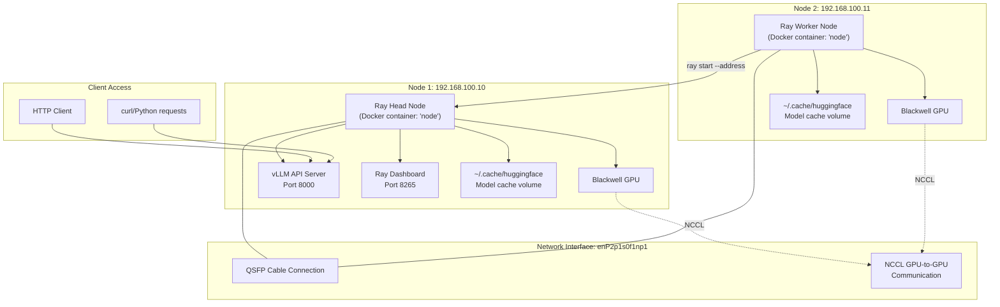
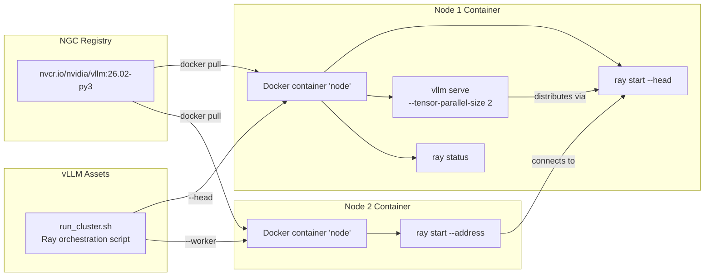
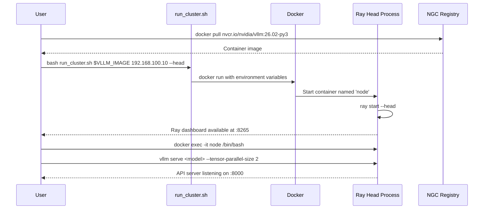
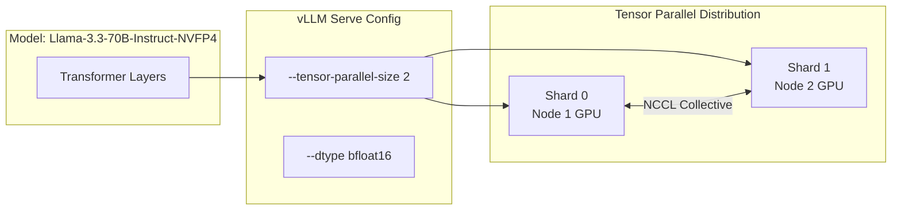

<!-- source: DeepWiki mcp.deepwiki.com · repo NVIDIA/dgx-spark-playbooks · page 7.3 vLLM Ray Cluster · fetched 2026-10-26 -->

# vLLM Ray Cluster

<details>
<summary>Relevant source files</summary>

The following files were used as context for generating this wiki page:

- [nvidia/trt-llm/README.md](nvidia/trt-llm/README.md)
- [nvidia/vllm/README.md](nvidia/vllm/README.md)

</details>


## Purpose and Scope

This page describes how to configure a distributed Ray cluster for vLLM inference across two DGX Spark nodes using tensor parallelism. This enables serving large language models (70B+ parameters) that require GPU resources from multiple devices by distributing model weights and computation.

For single-node vLLM deployment, see [vLLM](#4.2). For physical network setup between Spark devices, see [Connecting Two Sparks](#7.1). For TensorRT-LLM multi-node deployment using Docker Swarm or MPI, see [TensorRT-LLM Distributed Inference](#7.4).

Sources: [nvidia/vllm/README.md:1-11](), [nvidia/vllm/README.md:117-128]()

## Architecture Overview

The vLLM Ray cluster architecture consists of a head node that coordinates the cluster and serves the OpenAI-compatible API endpoint, and worker nodes that provide additional GPU resources for tensor parallelism.

### Ray Cluster Topology

Title: Distributed vLLM Ray Cluster Topology


**Ray Cluster Communication Flow**: The head node runs the Ray coordinator and the `vllm serve` process. Worker nodes connect to the head via the Ray protocol to register Blackwell GPU resources. Tensor-parallel operations distribute model layers across both GPUs, with NCCL handling inter-GPU communication over the high-speed QSFP network interface.

Sources: [nvidia/vllm/README.md:158-194](), [nvidia/vllm/README.md:217-225]()

### Container and Script Components

Title: vLLM Multi-Node Code Entity Mapping


**Deployment Script Workflow**: The `run_cluster.sh` script launches the latest NGC vLLM container (e.g., `26.02-py3`) on each node. On the head node, it starts Ray in head mode. On worker nodes, it connects to the head's Ray cluster using the provided IP address. The `vllm serve` command is then executed on the head node with `--tensor-parallel-size 2`.

Sources: [nvidia/vllm/README.md:113-124](), [nvidia/vllm/README.md:158-194]()

## Network Configuration

### Required Environment Variables

The Ray cluster requires specific environment variables to coordinate network communication across distributed components. These variables ensure all frameworks (NCCL, UCX, GLOO, Ray) use the correct high-speed network interface.

| Environment Variable | Purpose | Value |
|---------------------|---------|-------|
| `MN_IF_NAME` | Multi-node network interface name | `enP2p1s0f1np1` |
| `VLLM_HOST_IP` | Node's IP address for vLLM binding | Head: `192.168.100.10`<br/>Worker: `192.168.100.11` |
| `UCX_NET_DEVICES` | UCX communication library interface | `$MN_IF_NAME` |
| `NCCL_SOCKET_IFNAME` | NCCL collective operations interface | `$MN_IF_NAME` |
| `OMPI_MCA_btl_tcp_if_include` | OpenMPI TCP transport interface | `$MN_IF_NAME` |
| `GLOO_SOCKET_IFNAME` | Gloo collective operations interface | `$MN_IF_NAME` |
| `TP_SOCKET_IFNAME` | Tensor parallelism communication interface | `$MN_IF_NAME` |
| `RAY_memory_monitor_refresh_ms` | Ray memory monitoring interval (0=disabled) | `0` |
| `MASTER_ADDR` | Ray head node address | `192.168.100.10` |

Sources: [nvidia/vllm/README.md:162-193]()

## Deployment Procedures

### Prerequisites

Before deploying the Ray cluster, ensure:
- Physical network connectivity is established between Spark devices via QSFP.
- Passwordless SSH is configured between nodes.
- Docker is installed and the user is added to the `docker` group on both nodes [nvidia/vllm/README.md:109-111]().
- The latest vLLM container image is pulled on both nodes [nvidia/vllm/README.md:123-124]().
- Hugging Face authentication is configured for model downloads.

Sources: [nvidia/vllm/README.md:39-48](), [nvidia/vllm/README.md:109-124]()

### Head Node Startup

The head node initialization sequence:

Title: Head Node Initialization Sequence


**Head Node Command Sequence**:

```bash
# Export environment variables
export MN_IF_NAME=enP2p1s0f1np1
export VLLM_IMAGE=nvcr.io/nvidia/vllm:26.02-py3

# Start Ray head node
bash run_cluster.sh $VLLM_IMAGE 192.168.100.10 --head ~/.cache/huggingface \
-e VLLM_HOST_IP=192.168.100.10 \
-e UCX_NET_DEVICES=$MN_IF_NAME \
-e NCCL_SOCKET_IFNAME=$MN_IF_NAME \
-e OMPI_MCA_btl_tcp_if_include=$MN_IF_NAME \
-e GLOO_SOCKET_IFNAME=$MN_IF_NAME \
-e TP_SOCKET_IFNAME=$MN_IF_NAME \
-e RAY_memory_monitor_refresh_ms=0 \
-e MASTER_ADDR=192.168.100.10
```

Sources: [nvidia/vllm/README.md:158-174]()

### Worker Node Startup

The worker node joins the existing Ray cluster:

```bash
# Export environment variables (same as head)
export MN_IF_NAME=enP2p1s0f1np1
export VLLM_IMAGE=nvcr.io/nvidia/vllm:26.02-py3

# Start Ray worker node
bash run_cluster.sh $VLLM_IMAGE 192.168.100.10 --worker ~/.cache/huggingface \
-e VLLM_HOST_IP=192.168.100.11 \
-e UCX_NET_DEVICES=$MN_IF_NAME \
-e NCCL_SOCKET_IFNAME=$MN_IF_NAME \
-e OMPI_MCA_btl_tcp_if_include=$MN_IF_NAME \
-e GLOO_SOCKET_IFNAME=$MN_IF_NAME \
-e TP_SOCKET_IFNAME=$MN_IF_NAME \
-e RAY_memory_monitor_refresh_ms=0 \
-e MASTER_ADDR=192.168.100.10
```

Sources: [nvidia/vllm/README.md:177-193]()

### Cluster Verification

After both nodes are started, verify cluster status from the head node:

```bash
# Check Ray cluster composition
docker exec node ray status
```

Expected output indicates 2 nodes with available Blackwell GPU resources.

Sources: [nvidia/vllm/README.md:196-204]()

## Model Serving Configuration

### Tensor Parallelism and Model Loading

When running with `--tensor-parallel-size 2`, vLLM uses Ray to orchestrate model loading across both nodes. The `PagedAttention` mechanism and continuous batching work across the distributed setup to maximize throughput.

Title: Distributed Model Execution


Sources: [nvidia/vllm/README.md:19-23](), [nvidia/vllm/README.md:217-225]()

### Supported Models for Multi-Node

The following high-parameter models are ideal for multi-node Ray clusters on DGX Spark:

| Model | Quantization | HF Handle |
|-------|--------------|-----------|
| **Nemotron-3-Super-120B** | NVFP4 | `nvidia/NVIDIA-Nemotron-3-Super-120B-A12B-NVFP4` |
| **GPT-OSS-120B** | MXFP4 | `openai/gpt-oss-120b` |
| **Llama-3.3-70B-Instruct** | NVFP4 | `nvidia/Llama-3.3-70B-Instruct-NVFP4` |

Sources: [nvidia/vllm/README.md:54-76]()

### Launching 405B Inference Server (Optional)

For extremely large models like Llama 3.1 405B, significant memory constraints apply even across two nodes. vLLM must be configured with strict limits:

```bash
# Launching quantized 405B on two nodes
vllm serve "hugging-quants/Meta-Llama-3.1-405B-Instruct-AWQ-INT4" \
--tensor-parallel-size 2 \
--max-model-len 256 \
--gpu-memory-utilization 1.0 \
--max-num-seqs 1 \
--max_num_batched_tokens 256
```

Sources: [nvidia/vllm/README.md:246-267]()

## Monitoring and Management

### Ray Dashboard
The Ray dashboard is accessible at `http://192.168.100.10:8265` on the head node. It provides real-time visualization of:
- Node status and Blackwell GPU utilization.
- Ray actor placement (vLLM workers).
- System logs and resource usage.

Sources: [nvidia/vllm/README.md:320-331]()

### Troubleshooting

- **Connection Refused**: Ensure the worker node can reach the head node's IP (192.168.100.10) on the QSFP interface.
- **NCCL Timeout**: Verify `NCCL_SOCKET_IFNAME` is set correctly to the multi-node interface (`enP2p1s0f1np1`).
- **Memory Errors**: DGX Spark uses Unified Memory Architecture (UMA). If memory errors occur, flush the buffer cache: `sudo sh -c 'sync; echo 3 > /proc/sys/vm/drop_caches'`.

Sources: [nvidia/vllm/README.md:343-359]()

---

