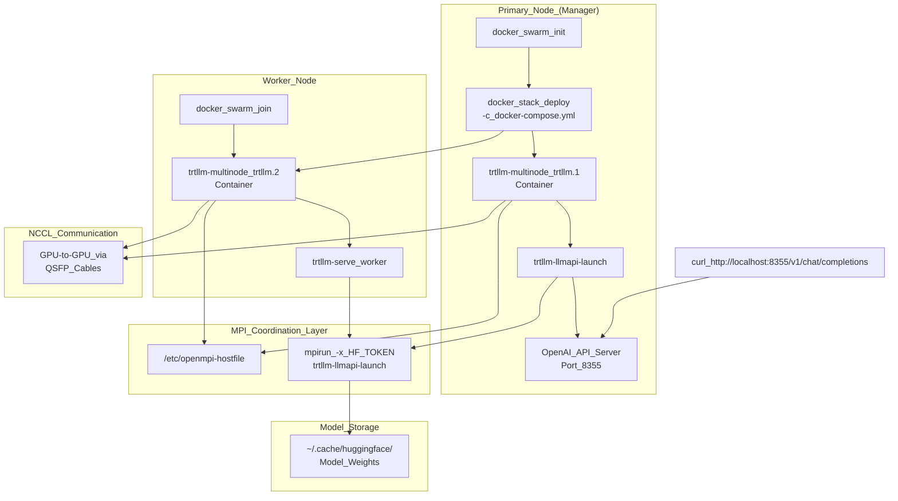
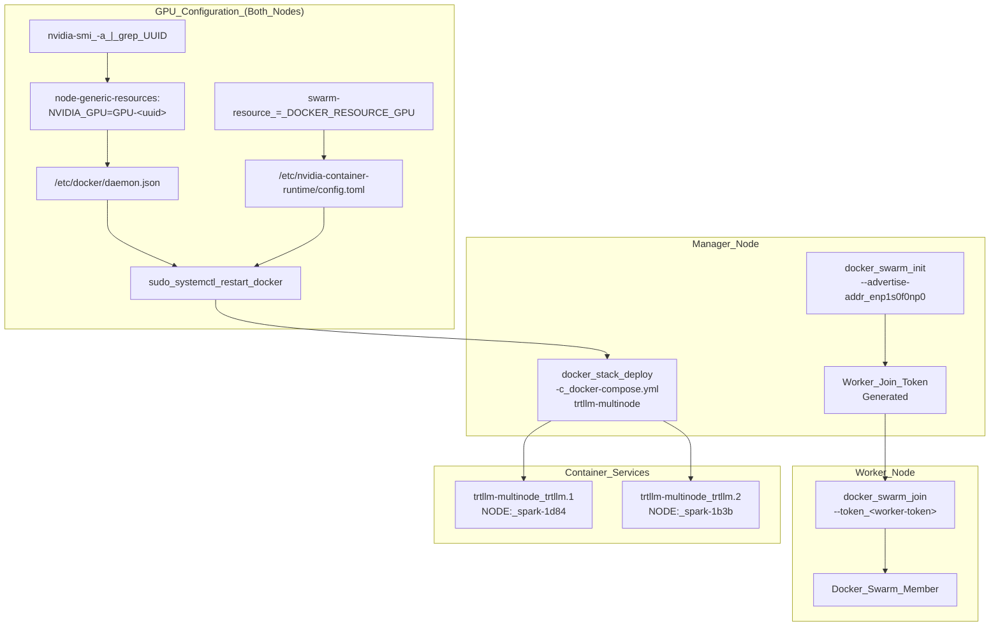
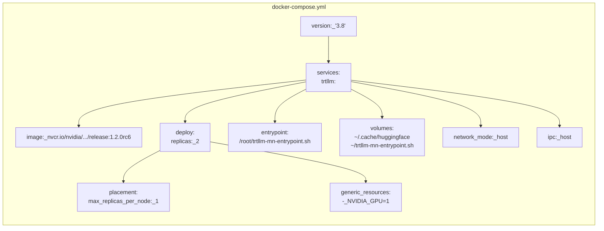
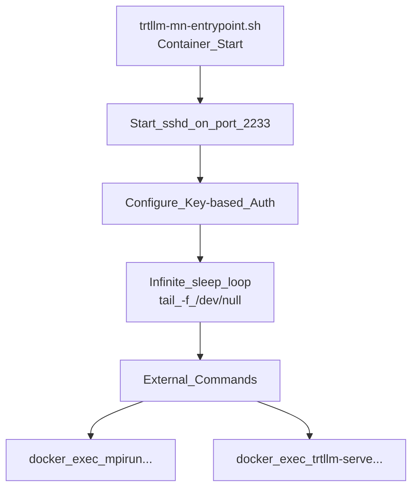
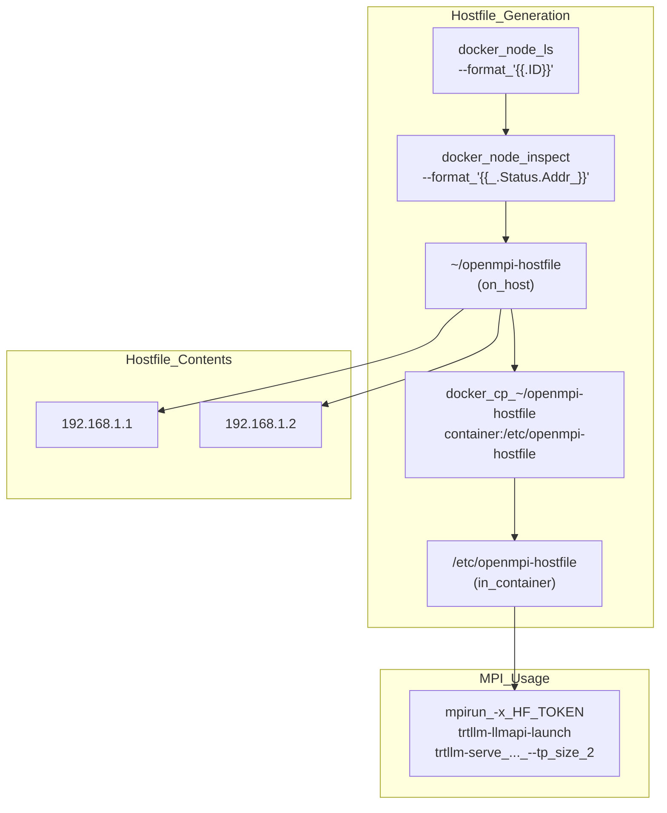
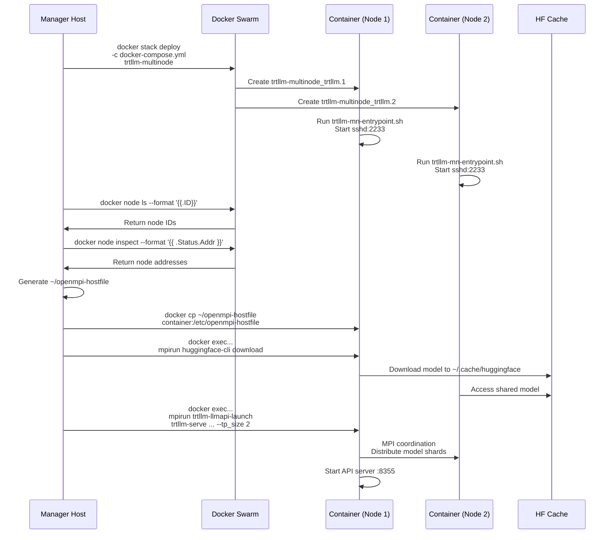
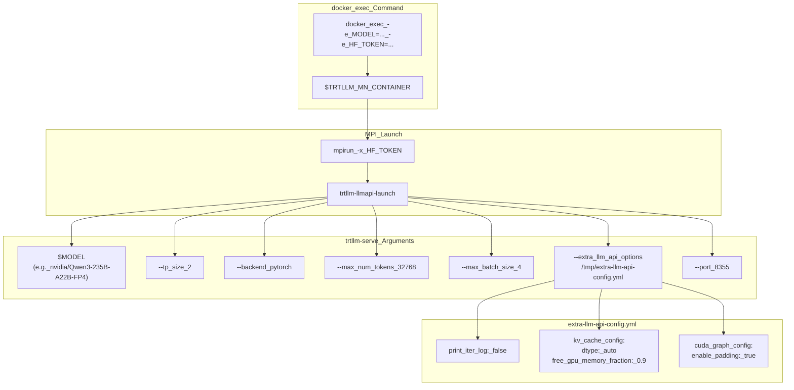
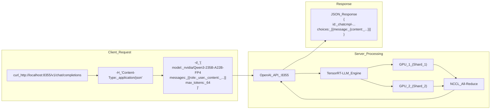
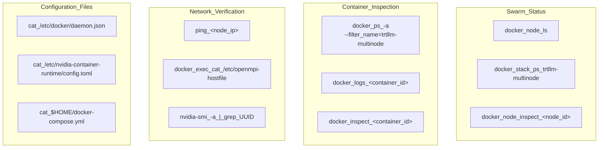

<!-- source: DeepWiki mcp.deepwiki.com · repo NVIDIA/dgx-spark-playbooks · page 7.4 TensorRT-LLM Distributed Inference · fetched 2026-10-26 -->

# TensorRT-LLM Distributed Inference

<details>
<summary>Relevant source files</summary>

The following files were used as context for generating this wiki page:

- [nvidia/trt-llm/README.md](nvidia/trt-llm/README.md)
- [nvidia/trt-llm/assets/trtllm-mn-entrypoint.sh](nvidia/trt-llm/assets/trtllm-mn-entrypoint.sh)
- [nvidia/vllm/README.md](nvidia/vllm/README.md)

</details>


## Purpose and Scope

This document describes the distributed inference capabilities of TensorRT-LLM across multiple DGX Spark devices. It covers Docker Swarm orchestration, MPI-based coordination, tensor parallelism configuration, and multi-node model serving. This configuration is essential for running extremely large models, such as the 235B parameter Qwen3 or 120B parameter Nemotron-3, which exceed the memory capacity of a single Blackwell GPU. [nvidia/trt-llm/README.md:1-46](), [nvidia/trt-llm/README.md:74-96]()

For single-node TensorRT-LLM inference, see [TensorRT-LLM](#4.3). For physical network connectivity between Spark devices, see [Connecting Two Sparks](#7.1). For NCCL tuning and GPU communication optimization, see [TensorRT-LLM Distributed Inference](#7.4). For distributed vLLM inference using Ray clusters, see [Multi-Sparks Through a Switch](#7.2).

Sources: [nvidia/trt-llm/README.md:1-96]()

---

## Architecture Overview

TensorRT-LLM distributed inference uses Docker Swarm for container orchestration and OpenMPI for inter-process communication. The system enables tensor parallelism by splitting model weights across multiple GPU nodes and coordinating inference through MPI collectives and NCCL. [nvidia/trt-llm/README.md:36-40](), [nvidia/trt-llm/README.md:543-564]()

### Distributed Inference Pattern



**Distributed Inference Architecture**: Docker Swarm manages container placement across nodes. The primary node runs `docker stack deploy` with `docker-compose.yml` to launch containers on both manager and worker nodes. Each container runs the same image `nvcr.io/nvidia/tensorrt-llm/release:1.2.0rc6` but is coordinated through MPI. The `/etc/openmpi-hostfile` contains all node addresses. The `mpirun` command launches `trtllm-llmapi-launch trtllm-serve` with `--tp_size 2` for tensor parallelism. NCCL handles GPU-to-GPU communication over QSFP cables. Only the primary node exposes the OpenAI-compatible API on port 8355. [nvidia/trt-llm/README.md:149-150](), [nvidia/trt-llm/README.md:543-607]()

Sources: [nvidia/trt-llm/README.md:149-150](), [nvidia/trt-llm/README.md:543-607]()

---

## Infrastructure Components

### Docker Swarm Setup

Docker Swarm provides the orchestration layer for distributed container deployment. The setup requires specific GPU resource advertising and runtime configuration. [nvidia/trt-llm/README.md:441-486]()



**Docker Swarm Infrastructure**: The `docker swarm init` command on the manager node creates a cluster and generates a worker join token. Worker nodes execute `docker swarm join` with this token. Both nodes require `/etc/docker/daemon.json` with `node-generic-resources` containing the GPU UUID from `nvidia-smi`. The `/etc/nvidia-container-runtime/config.toml` must have the `swarm-resource` line uncommented. After configuration, `sudo systemctl restart docker` applies changes. The `docker stack deploy` command deploys services defined in `docker-compose.yml`, creating replicas on both nodes. [nvidia/trt-llm/README.md:441-486](), [nvidia/trt-llm/README.md:489-541]()

Sources: [nvidia/trt-llm/README.md:441-541]()

---

### Container Configuration

The distributed deployment relies on two key files: `docker-compose.yml` for service definition and `trtllm-mn-entrypoint.sh` for container initialization.

#### docker-compose.yml Structure



The `docker-compose.yml` defines a service named `trtllm` with 2 replicas, ensuring one container per node through `max_replicas_per_node: 1`. Each container requests 1 GPU through `generic_resources`. The `entrypoint` points to `/root/trtllm-mn-entrypoint.sh` which is mounted from the host. The `network_mode: host` and `ipc: host` settings enable efficient MPI communication. [nvidia/trt-llm/README.md:520-526]()

Sources: [nvidia/trt-llm/README.md:520-526]()

#### Entrypoint Script Flow



The `trtllm-mn-entrypoint.sh` script prepares the environment for multi-node MPI execution. It installs and starts an SSH server on port 2233, configures root login and public key authentication, and disables host key checking to allow seamless MPI communication between containers. [nvidia/trt-llm/assets/trtllm-mn-entrypoint.sh:21-56]()

Sources: [nvidia/trt-llm/assets/trtllm-mn-entrypoint.sh:1-59](), [nvidia/trt-llm/README.md:514-518]()

---

### MPI Hostfile Generation

The MPI hostfile enables OpenMPI to coordinate processes across containers. [nvidia/trt-llm/README.md:543-557]()



**MPI Hostfile Creation**: The command `docker node ls --format '{{.ID}}' | xargs -n1 docker node inspect --format '{{ .Status.Addr }}'` extracts all Swarm node IP addresses and writes them to `~/openmpi-hostfile`. The `docker cp` command copies this file into the primary container at `/etc/openmpi-hostfile`. When `mpirun` executes `trtllm-llmapi-launch`, it uses this hostfile to spawn processes across both nodes with `--tp_size 2` for tensor parallelism. [nvidia/trt-llm/README.md:543-564]()

Sources: [nvidia/trt-llm/README.md:543-564]()

---

## Deployment Process

### Service Stack Deployment

The deployment sequence follows a specific order to ensure proper container orchestration and configuration. [nvidia/trt-llm/README.md:520-607]()



**Deployment Sequence**: After `docker stack deploy` creates containers on both nodes, each runs `trtllm-mn-entrypoint.sh` to start SSH daemons. The host generates `/etc/openmpi-hostfile` by querying Swarm node addresses and copies it into containers. Model download uses `mpirun huggingface-cli download` to fetch weights into `~/.cache/huggingface/`. Finally, `mpirun trtllm-llmapi-launch trtllm-serve` with `--tp_size 2` starts the inference server, distributing model shards across GPUs via tensor parallelism. [nvidia/trt-llm/README.md:520-607]()

Sources: [nvidia/trt-llm/README.md:520-607]()

---

## Model Serving Configuration

### trtllm-serve Command Structure

The `trtllm-serve` command orchestrates distributed model serving with specific configuration for tensor parallelism and API settings. [nvidia/trt-llm/README.md:594-607]()



**Command Structure**: The `docker exec` command passes environment variables `MODEL` and `HF_TOKEN` to the container. The `mpirun -x HF_TOKEN` propagates the token to all MPI processes. `trtllm-llmapi-launch` wraps `trtllm-serve` for multi-node coordination. The `--tp_size 2` parameter enables tensor parallelism across 2 GPUs. The `--backend pytorch` specifies the execution backend. The `--extra_llm_api_options` points to `/tmp/extra-llm-api-config.yml` containing KV cache settings with `free_gpu_memory_fraction: 0.9` and CUDA graph configuration with `enable_padding: true`. The `--port 8355` exposes the OpenAI-compatible API. [nvidia/trt-llm/README.md:566-607]()

Sources: [nvidia/trt-llm/README.md:566-607]()

---

### Tensor Parallelism Configuration

Tensor parallelism splits model layers across multiple GPUs for models that exceed single-GPU capacity. [nvidia/trt-llm/README.md:36-40]()

| Parameter | Value | Purpose |
|-----------|-------|---------|
| `--tp_size` | `2` | Number of GPUs for tensor parallelism (matches number of Spark nodes) |
| `--backend` | `pytorch` | Execution backend for weight loading and inference |
| `--max_num_tokens` | `32768` | Maximum sequence length supported |
| `--max_batch_size` | `4` | Maximum concurrent requests per batch |
| `free_gpu_memory_fraction` | `0.9` | Fraction of GPU memory allocated to KV cache |

The `--tp_size 2` configuration enables serving models like `nvidia/Qwen3-235B-A22B-FP4` that require 2 GPUs. NCCL handles communication between GPU shards. The `--backend pytorch` allows direct loading of Hugging Face model weights without pre-conversion. [nvidia/trt-llm/README.md:594-606]()

Sources: [nvidia/trt-llm/README.md:594-606]()

---

## API Server Interface

### OpenAI-Compatible Endpoints

The distributed TensorRT-LLM server exposes OpenAI-compatible endpoints for inference. [nvidia/trt-llm/README.md:615-628]()



**API Request Flow**: The client sends a POST request to `http://localhost:8355/v1/chat/completions` with JSON payload containing `model`, `messages`, and `max_tokens`. The TensorRT-LLM engine distributes computation across GPU shards, using NCCL for gradient synchronization. The response follows OpenAI's JSON schema with `id`, `choices`, and generated `content`. [nvidia/trt-llm/README.md:615-628]()

Sources: [nvidia/trt-llm/README.md:615-628]()

---

## Supported Models

The following table lists models tested and verified for distributed inference across two Spark devices: [nvidia/trt-llm/README.md:74-96]()

| Model | Quantization | HF Handle | TP Size Required |
|-------|-------------|-----------|------------------|
| **Qwen3-235B-A22B** | NVFP4 | `nvidia/Qwen3-235B-A22B-FP4` | 2 |
| **Nemotron-3-Super-120B** | NVFP4 | `nvidia/NVIDIA-Nemotron-3-Super-120B-A12B-NVFP4` | 1-2 |
| **GPT-OSS-120B** | MXFP4 | `openai/gpt-oss-120b` | 1-2 |
| **Llama-3.3-70B-Instruct** | NVFP4 | `nvidia/Llama-3.3-70B-Instruct-FP4` | 1-2 |

The `Qwen3-235B-A22B` model specifically requires `--tp_size 2` due to its size. Smaller models like `Llama-3.3-70B-Instruct` can run on a single GPU but benefit from tensor parallelism for higher throughput or larger context windows. [nvidia/trt-llm/README.md:95](), [nvidia/trt-llm/README.md:108]()

Sources: [nvidia/trt-llm/README.md:74-109]()

---

## Troubleshooting Distributed Deployments

### Common Multi-Node Issues

| Symptom | Cause | Resolution |
|---------|-------|-----------|
| Container state stuck in "Pending" with "no suitable node" | Docker daemon not configured for GPU | Verify `/etc/docker/daemon.json` contains `node-generic-resources` with GPU UUID. Confirm `swarm-resource` uncommented in `/etc/nvidia-container-runtime/config.toml`. Run `sudo systemctl restart docker`. [nvidia/trt-llm/README.md:734-746]() |
| "invalid mount config for type 'bind'" | Missing `trtllm-mn-entrypoint.sh` | Verify file exists on both nodes: `ls -la $HOME/trtllm-mn-entrypoint.sh`. Ensure executable: `chmod +x $HOME/trtllm-mn-entrypoint.sh`. |
| "task: non-zero exit (255)" | Container startup failure | Check logs: `docker ps -a --filter "name=trtllm-multinode_trtllm"`, then `docker logs <container_id>`. Common cause: port 2233 already in use. |
| MPI hostname test returns single hostname | Network connectivity issues | Verify QSFP cable connection. Check IP reachability: `ping <node_ip>`. Confirm `/etc/openmpi-hostfile` contains both node addresses. |
| "Error response from daemon: error while validating Root CA Certificate" | System clock out of sync | Sync time: `sudo timedatectl set-ntp true`. Verify with `timedatectl status`. |
| "CUDA out of memory" during inference | Insufficient GPU memory allocation | Reduce `free_gpu_memory_fraction` in `/tmp/extra-llm-api-config.yml` from `0.9` to `0.8`. Decrease `--max_batch_size` from `4` to `2`. Lower `--max_num_tokens` from `32768` to `16384`. |

Sources: [nvidia/trt-llm/README.md:734-746]()

---

### Diagnostic Commands



**Diagnostic Workflow**: Use `docker stack ps trtllm-multinode` to check service health. If containers are not running, use `docker ps -a --filter "name=trtllm-multinode"` to find stopped containers and `docker logs <container_id>` for error messages. Verify network connectivity with `ping <node_ip>` and check that `/etc/openmpi-hostfile` contains both node addresses via `docker exec cat /etc/openmpi-hostfile`. Confirm GPU configuration in `/etc/docker/daemon.json` includes the correct GPU UUID from `nvidia-smi -a | grep UUID`. [nvidia/trt-llm/README.md:721-746]()

Sources: [nvidia/trt-llm/README.md:721-746]()

---

## Cleanup Procedures

### Removing Multi-Node Deployment

```bash
# Stop and remove stack services
docker stack rm trtllm-multinode

# Remove cached models (run on primary node)
rm -rf $HOME/.cache/huggingface/hub/models--nvidia--Qwen3*

# Leave swarm (on worker nodes)
docker swarm leave

# Disable swarm (on manager node)
docker swarm leave --force
```

The `docker stack rm` command stops all containers across nodes and removes the stack. Cached models in `~/.cache/huggingface/` should be removed to free disk space. Worker nodes should execute `docker swarm leave` before the manager runs `docker swarm leave --force`. [nvidia/trt-llm/README.md:630-649]()

Sources: [nvidia/trt-llm/README.md:630-649]()

---

## Integration with Open WebUI

TensorRT-LLM distributed inference integrates with Open WebUI for chat interfaces. [nvidia/trt-llm/README.md:651-704]()

```bash
# Launch Open WebUI connected to TRT-LLM API
docker run -d \
  -e OPENAI_API_BASE_URL="http://localhost:8355/v1" \
  -v open-webui:/app/backend/data \
  --network host \
  --add-host=host.docker.internal:host-gateway \
  --name open-webui \
  --restart always \
  ghcr.io/open-webui/open-webui:main
```

The `OPENAI_API_BASE_URL` environment variable points to the TensorRT-LLM API at port 8355. The `--network host` enables local communication. Open WebUI becomes accessible at `http://localhost:8080` for interactive model testing. [nvidia/trt-llm/README.md:690-704]()

Sources: [nvidia/trt-llm/README.md:651-704]()

---

