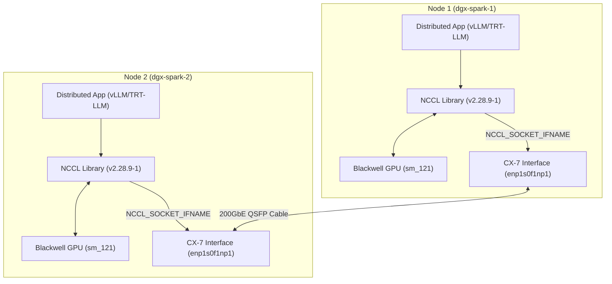
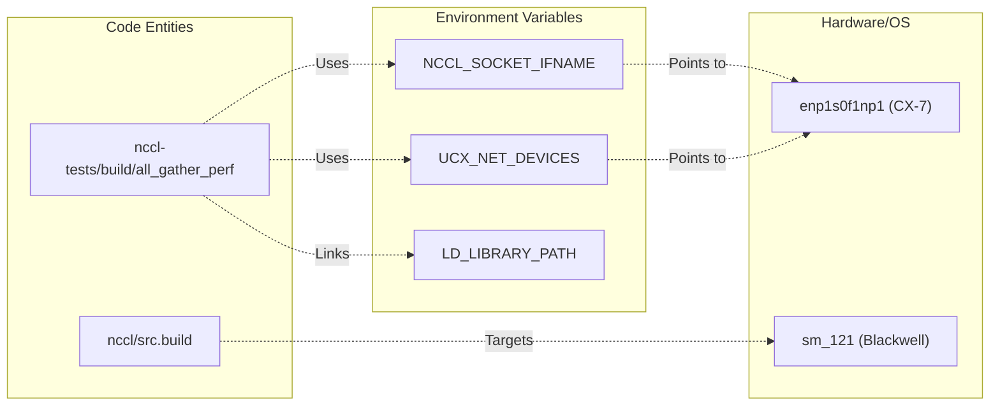

<!-- source: DeepWiki mcp.deepwiki.com · repo NVIDIA/dgx-spark-playbooks · page 7.5 NCCL Configuration · fetched 2026-10-26 -->

# NCCL Configuration

<details>
<summary>Relevant source files</summary>

The following files were used as context for generating this wiki page:

- [nvidia/connect-two-sparks/README.md](nvidia/connect-two-sparks/README.md)
- [nvidia/multi-modal-inference/README.md](nvidia/multi-modal-inference/README.md)
- [nvidia/nccl/README.md](nvidia/nccl/README.md)

</details>


This page describes how to configure the NVIDIA Collective Communications Library (NCCL) for high-performance GPU-to-GPU communication across multiple DGX Spark devices. NCCL is the foundational library for distributed training and inference workloads, enabling collective operations like all-reduce, broadcast, and gather over high-speed interconnects.

---

## Overview

NCCL (NVIDIA Collective Communication Library) enables high-bandwidth communication between GPUs across multiple nodes. On DGX Spark systems with Blackwell architecture, NCCL must be specifically built and configured to utilize the 200GbE QSFP direct connections for optimal performance in distributed workloads.

### Key Objectives
- **Blackwell Support**: Building NCCL from source with `sm_121` support.
- **Topology Awareness**: Ensuring NCCL detects the correct GPU-to-network topology.
- **Interface Selection**: Explicitly routing traffic through high-speed CX-7 interfaces rather than standard management Ethernet.

Sources: [nvidia/nccl/README.md:13-26](), [nvidia/nccl/README.md:62-65]()

---

## System Architecture and Data Flow

The following diagram illustrates how NCCL bridges the gap between high-level distributed frameworks (like MPI or Ray) and the physical hardware interfaces on DGX Spark.

### NCCL Communication Path


**Interface Mapping**: While physical ports may appear with multiple names (e.g., `enp1s0f1np1` and `enP2p1s0f1np1`), it is recommended to use the `enp1<...>` naming convention for NCCL configuration.

Sources: [nvidia/nccl/README.md:109-115](), [nvidia/connect-two-sparks/README.md:87-97]()

---

## Implementation: Building NCCL for Blackwell

To support the Blackwell architecture (`sm_121`) on DGX Spark, NCCL should be built from source.

### Build Steps
The build process targets the specific compute capability of the Blackwell GPUs found in Spark systems.

```bash
# Clone specific version
git clone -b v2.28.9-1 https://github.com/NVIDIA/nccl.git ~/nccl/
cd ~/nccl/

# Build with Blackwell support
make -j src.build NVCC_GENCODE="-gencode=arch=compute_121,code=sm_121"
```

### Environment Configuration
After building, the following environment variables must be exported to ensure the system uses the optimized build:

| Variable | Path / Value |
|----------|--------------|
| `CUDA_HOME` | `/usr/local/cuda` |
| `MPI_HOME` | `/usr/lib/aarch64-linux-gnu/openmpi` |
| `NCCL_HOME` | `$HOME/nccl/build/` |
| `LD_LIBRARY_PATH` | Includes `$NCCL_HOME/lib` and `$MPI_HOME/lib` |

Sources: [nvidia/nccl/README.md:67-79]()

---

## Network Interface Configuration

NCCL must be told which network interface to use for the "bootstrap" connection and data transfer. On DGX Spark, this is typically a CX-7 interface connected via QSFP.

### Identifying the Active Interface
Use `ibdev2netdev` to find the interface that is currently `(Up)`.

```bash
ibdev2netdev
# Example Output:
# roceP2p1s0f1 port 1 ==> enP2p1s0f1np1 (Up)
# rocep1s0f1 port 1 ==> enp1s0f1np1 (Up)
```

### Execution Variables
When running a distributed workload (e.g., via `mpirun`), these variables force NCCL and the underlying transport (UCX/MPI) to use the high-speed link.

```bash
export UCX_NET_DEVICES=enp1s0f1np1
export NCCL_SOCKET_IFNAME=enp1s0f1np1
export OMPI_MCA_btl_tcp_if_include=enp1s0f1np1
```

Sources: [nvidia/nccl/README.md:92-109](), [nvidia/nccl/README.md:140-144]()

---

## Performance Validation

The `nccl-tests` suite is used to validate the installation and measure actual inter-node bandwidth.

### Running the All-Gather Test
This test measures the performance of the `all_gather` collective operation across two nodes.

```bash
mpirun -np 2 -H <Node1_IP>:1,<Node2_IP>:1 \
  --mca plm_rsh_agent "ssh -o UserKnownHostsFile=/dev/null -o StrictHostKeyChecking=no" \
  -x LD_LIBRARY_PATH=$LD_LIBRARY_PATH \
  $HOME/nccl-tests/build/all_gather_perf -b 16G -e 16G -f 2
```

### Bandwidth Considerations
- **Single Cable**: Full bandwidth can be achieved with one QSFP cable if configured correctly.
- **Dual Cables**: If two QSFP cables are used, all four interfaces must have IP addresses assigned to reach maximum aggregate bandwidth.

Sources: [nvidia/nccl/README.md:133-152](), [nvidia/connect-two-sparks/README.md:107-110]()

---

## Troubleshooting

### Common NCCL Issues on DGX Spark

| Issue | Code Entity / Symbol | Solution |
|-------|----------------------|----------|
| **Hanging `mpirun`** | `plm_rsh_agent` | Verify passwordless SSH between nodes. |
| **Interface Not Found** | `NCCL_SOCKET_IFNAME` | Ensure the interface name matches the `(Up)` entry in `ibdev2netdev`. |
| **Build Failure** | `NVCC_GENCODE` | Verify CUDA toolkit is installed (`nvcc --version`) and matches `sm_121`. |
| **Low Bandwidth** | `UCX_NET_DEVICES` | Ensure the variable points to the 200GbE interface, not the 1GbE management port. |

### Code-to-System Mapping


Sources: [nvidia/nccl/README.md:183-195](), [nvidia/nccl/README.md:74-79]()

---

