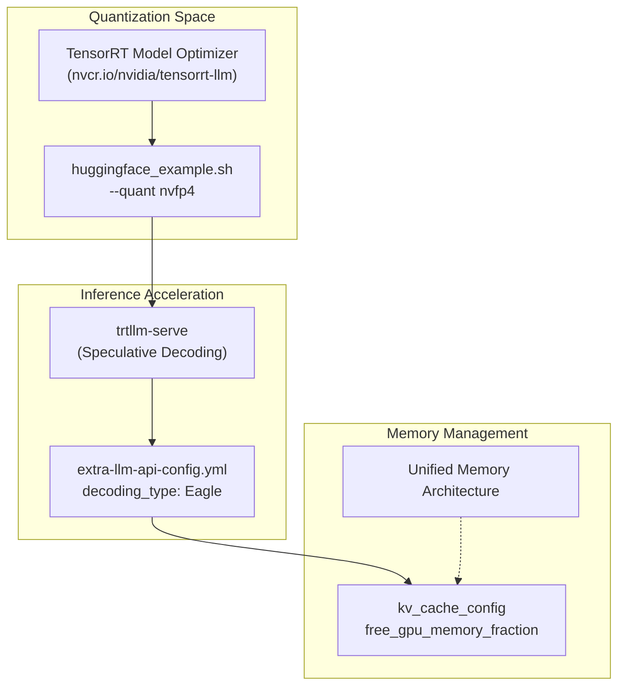
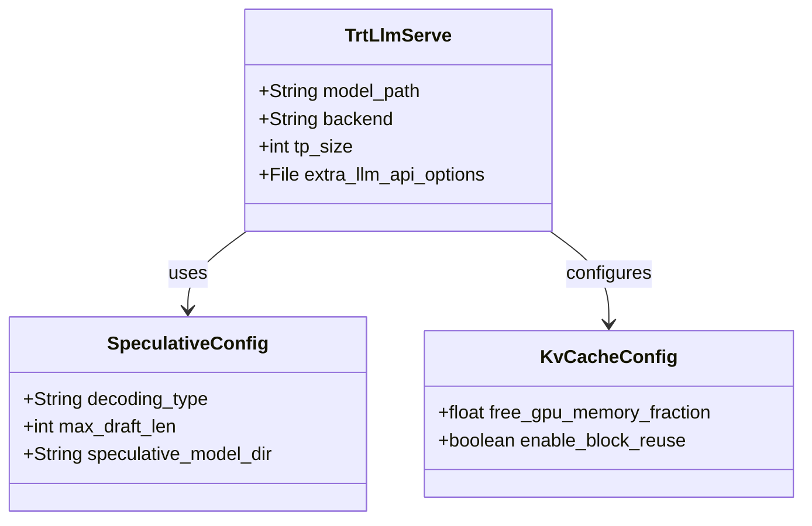

<!-- source: DeepWiki mcp.deepwiki.com · repo NVIDIA/dgx-spark-playbooks · page 8 Model Optimization · fetched 2026-10-26 -->

# Model Optimization

Relevant source files

The following files were used as context for generating this wiki page:

- [nvidia/nvfp4-quantization/README.md](nvidia/nvfp4-quantization/README.md)
- [nvidia/speculative-decoding/README.md](nvidia/speculative-decoding/README.md)

## Purpose and Scope

This section covers techniques for optimizing model performance, memory usage, and inference speed on DGX Spark devices. Model optimization is critical for deploying large language models on single-node or multi-node Spark configurations, particularly given the Unified Memory Architecture (UMA) that enables 128GB dynamic GPU/CPU memory sharing.

The three primary optimization categories are:
- **Quantization Techniques** ([Quantization Techniques](#8.1)): Applying NVFP4, FP8, and other methods to reduce memory footprint.
- **Speculative Decoding** ([Speculative Decoding](#8.2)): Implementing EAGLE-3 and Draft-Target methods for faster inference.
- **Memory Management** ([Memory Management](#8.3)): Strategies for managing batch sizes, KV caches, and UMA buffer flushing.

For information about deploying optimized models, see Inference Systems ([Inference Systems](#4)). For multi-node optimization strategies, see Multi-Node Setups ([Multi-Node Setups](#7)).

## Why Optimization Matters on DGX Spark

The DGX Spark hardware platform, featuring the NVIDIA Blackwell architecture, presents unique optimization opportunities:

| Hardware Feature | Optimization Implication |
|-----------------|-------------------------|
| **Blackwell GPU** | Native support for NVFP4 and FP8 precision in Tensor Cores [nvidia/nvfp4-quantization/README.md:17-20]() |
| **128GB Unified Memory** | Sufficient for models like GPT-OSS-120B with optimization, but requires careful management [nvidia/speculative-decoding/README.md:39-41]() |
| **Tensor Parallelism (TP)** | Enables splitting models across multiple Sparks via QSFP cables [nvidia/speculative-decoding/README.md:41-43]() |
| **High Dynamic Range** | NVFP4 maintains floating-point semantics for stable convergence compared to INT4 [nvidia/nvfp4-quantization/README.md:18-19]() |

Sources: [nvidia/nvfp4-quantization/README.md:17-25](), [nvidia/speculative-decoding/README.md:37-45]()

## Optimization Pipeline

The following diagram associates optimization stages with the specific tools and scripts provided in the repository.

### Optimization Workflow to Code Mapping

Sources: [nvidia/nvfp4-quantization/README.md:112-132](), [nvidia/speculative-decoding/README.md:114-141]()

## Optimization Technique Overview

### Quantization Techniques (8.1)

Quantization reduces model memory footprint by using lower-precision numerical formats. On Blackwell GPUs, **NVFP4** is a primary focus, providing a 4-bit floating-point format with a shared exponent [nvidia/nvfp4-quantization/README.md:17-18]().

- **Memory Reduction**: Cuts memory use ~3.5x vs FP16 and ~1.8x vs FP8 [nvidia/nvfp4-quantization/README.md:23-23]().
- **Accuracy**: Maintains accuracy close to FP8 (usually <1% loss) [nvidia/nvfp4-quantization/README.md:24-24]().
- **Implementation**: Uses the `huggingface_example.sh` script within the TensorRT-LLM container [nvidia/nvfp4-quantization/README.md:126-131]().

For details, see [Quantization Techniques](#8.1).

### Speculative Decoding (8.2)

Speculative decoding speeds up text generation by using a small, fast model (or head) to draft tokens that a larger model then verifies [nvidia/speculative-decoding/README.md:29-30]().

- **EAGLE-3**: Uses a built-in drafting head that fuses features from multiple layers, improving acceptance rates [nvidia/speculative-decoding/README.md:160-162]().
- **Draft-Target**: Uses a separate, smaller model (e.g., Llama-3.2-1B) to speculate for a larger target model [nvidia/speculative-decoding/README.md:166-168]().
- **Configuration**: Managed via `speculative_config` in the YAML configuration passed to `trtllm-serve` [nvidia/speculative-decoding/README.md:125-128]().

For details, see [Speculative Decoding](#8.2).

### Memory Management (8.3)

Effective memory management is critical when dealing with large models on the 128GB Spark system.

- **KV Cache Tuning**: Adjusting `free_gpu_memory_fraction` (e.g., setting to 0.9) to balance model weights and context memory [nvidia/speculative-decoding/README.md:131-131]().
- **Multi-Node Expansion**: Connecting two Sparks doubles available memory to 256GB, enabling models like Qwen3-235B-A22B [nvidia/speculative-decoding/README.md:41-43]().
- **System Limits**: Configuring `memlock` and `stack` ulimits is required for high-performance inference containers [nvidia/nvfp4-quantization/README.md:117-117]().

For details, see [Memory Management](#8.3).

## Engine-Specific Optimization

### TensorRT-LLM Speculative Configuration
The `trtllm-serve` binary utilizes a YAML configuration to define optimization parameters at runtime.

Sources: [nvidia/speculative-decoding/README.md:119-141]()

### Optimization Decision Matrix

| Scenario | Primary Concern | Recommended Technique | Tool/Script |
| :--- | :--- | :--- | :--- |
| **Model > 100B on 1 Spark** | Memory Footprint | NVFP4 Quantization | `huggingface_example.sh --quant nvfp4` |
| **High Latency/Slow Gen** | Inference Speed | EAGLE-3 Speculative | `trtllm-serve --extra_llm_api_options` |
| **Model > 200B** | Memory Capacity | Multi-Node TP=2 | `OpenMPI` + `NCCL` |
| **High Batch Workloads** | Throughput | FP8 Quantization | `Model-Optimizer` |

Sources: [nvidia/nvfp4-quantization/README.md:22-34](), [nvidia/speculative-decoding/README.md:39-45]()

## Optimization Workflow Example: NVFP4 Quantization

To quantize a model like `DeepSeek-R1-Distill-Llama-8B` for Spark:
1. **Prepare**: Create an output directory and export `HF_TOKEN` [nvidia/nvfp4-quantization/README.md:96-107]().
2. **Execute**: Run the `nvcr.io/nvidia/tensorrt-llm` container with the Model Optimizer [nvidia/nvfp4-quantization/README.md:117-121]().
3. **Quantize**: Use the `huggingface_example.sh` script with `--quant nvfp4` and `--export_fmt hf` [nvidia/nvfp4-quantization/README.md:126-130]().
4. **Deploy**: Load the resulting `.safetensors` or `.bin` files into your inference engine [nvidia/nvfp4-quantization/README.md:160-171]().

Sources: [nvidia/nvfp4-quantization/README.md:91-172]()

---

