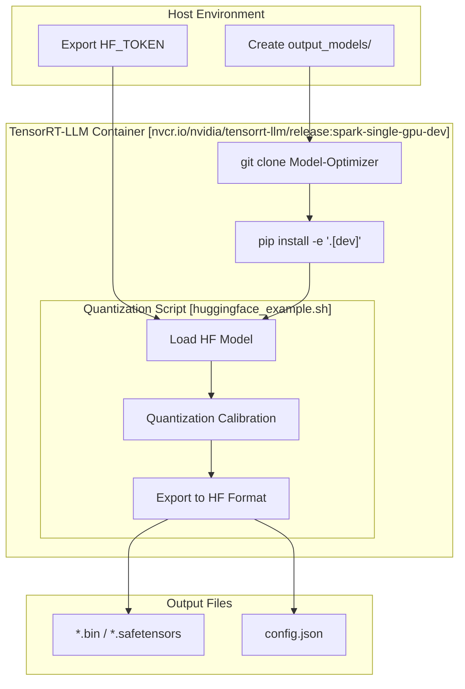
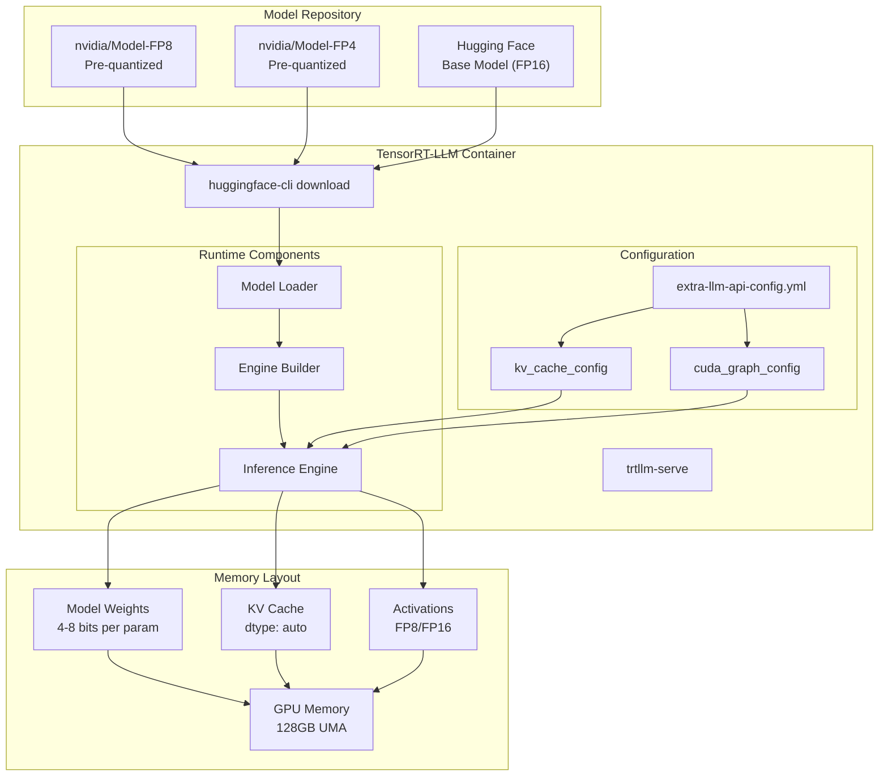

<!-- source: DeepWiki mcp.deepwiki.com · repo NVIDIA/dgx-spark-playbooks · page 8.1 Quantization Techniques · fetched 2026-10-26 -->

# Quantization Techniques

<details>
<summary>Relevant source files</summary>

The following files were used as context for generating this wiki page:

- [nvidia/nvfp4-quantization/README.md](nvidia/nvfp4-quantization/README.md)

</details>


## Purpose and Scope

This document describes quantization techniques available on DGX Spark for reducing model memory footprint and increasing inference throughput. It covers the quantization formats supported by TensorRT-LLM (NVFP4, FP8, MXFP4) and practical implementation details for applying quantization to production workloads, including custom quantization workflows using the NVIDIA TensorRT Model Optimizer.

For general inference configuration, see [Inference Systems](#4). For memory management strategies beyond quantization, see [Memory Management](#8.3). For speculative decoding optimizations, see [Speculative Decoding](#8.2).

---

## Overview

Quantization reduces numerical precision of model weights and activations, trading minimal accuracy loss for substantial memory savings and performance gains. On DGX Spark's Blackwell architecture with 128GB Unified Memory, quantization enables fitting larger models (70B-235B parameters) and serving multiple concurrent requests within available memory.

### Quantization Format Comparison

| Format | Bits per Weight | Memory Reduction | Accuracy Impact | Hardware Support | Typical Use Case |
|--------|----------------|------------------|-----------------|------------------|------------------|
| **FP16** | 16 | Baseline (1.0x) | None | Universal | Development/debugging |
| **FP8** | 8 | 2.0x | Minimal (<1% loss) | Blackwell native | Production inference |
| **NVFP4** | 4 | 4.0x | Low (1-3% loss) | Blackwell optimized | Large models (70B+) |
| **MXFP4** | 4 | 4.0x | Variable | Experimental | Research workloads |
| **INT8** | 8 | 2.0x | Low-Medium | Legacy GPUs | Compatibility |

**Key Benefits of NVFP4 on Blackwell:**
- Reduces memory usage by approximately 3.5x vs FP16 and 1.8x vs FP8 [nvidia/nvfp4-quantization/README.md:23]().
- Maintains accuracy close to FP8, typically with less than 1% loss [nvidia/nvfp4-quantization/README.md:24]().
- Utilizes native Blackwell Tensor Core support for mixed-precision execution (FP4 weights/activations with FP16 accumulation) [nvidia/nvfp4-quantization/README.md:19-20]().

Sources: [nvidia/trt-llm/README.md:84-115](), [nvidia/nvfp4-quantization/README.md:13-26]()

---

## Custom Quantization with TensorRT Model Optimizer

While many pre-quantized models are available, users can quantize custom models to NVFP4 using the `TensorRT-Model-Optimizer` inside a TensorRT-LLM container [nvidia/nvfp4-quantization/README.md:30-31]().

### Workflow: Custom NVFP4 Quantization



**Implementation Steps:**
1. **Environment Prep**: Create a local directory and mount it to `/workspace/output_models` to persist results [nvidia/nvfp4-quantization/README.md:93-98]().
2. **Execution**: Run the container with `--ipc=host` and `--ulimit memlock=-1` for optimal GPU performance [nvidia/nvfp4-quantization/README.md:117-121]().
3. **Quantization Command**: Execute the `huggingface_example.sh` script with `--quant nvfp4` [nvidia/nvfp4-quantization/README.md:126-131]().

Sources: [nvidia/nvfp4-quantization/README.md:73-132]()

---

## Quantization in TensorRT-LLM

TensorRT-LLM provides pre-quantized model checkpoints and runtime quantization capabilities. The playbooks primarily use pre-quantized checkpoints from NVIDIA's model repository for simplicity and reliability.

### Architecture: Quantized Model Serving



**Component Roles:**
- `huggingface-cli download`: Retrieves quantized checkpoint from model hub [nvidia/trt-llm/README.md:334]().
- `trtllm-serve`: High-level serving command that handles model loading and API server [nvidia/trt-llm/README.md:344]().
- `Model Loader`: Parses quantized weights and configuration.
- `Engine Builder`: Constructs optimized inference engine with quantization-aware kernels.
- `extra-llm-api-config.yml`: Runtime configuration for KV cache and memory management [nvidia/trt-llm/README.md:335]().

Sources: [nvidia/trt-llm/README.md:320-350](), [nvidia/trt-llm/README.md:155-186]()

---

## Pre-Quantized Model Matrix

TensorRT-LLM supports the following pre-quantized models on DGX Spark. These models are production-ready and optimized for Blackwell architecture.

### Language Models

| Model Family | Size | FP8 Handle | NVFP4 Handle | MXFP4 Handle |
|-------------|------|------------|--------------|--------------|
| **LLaMA 3.1** | 8B | `nvidia/Llama-3.1-8B-Instruct-FP8` | `nvidia/Llama-3.1-8B-Instruct-FP4` | - |
| **LLaMA 3.3** | 70B | - | `nvidia/Llama-3.3-70B-Instruct-FP4` | - |
| **LLaMA 3.3 Nemotron** | 49B | `nvidia/Llama-3_3-Nemotron-Super-49B-v1_5-FP8` | - | - |
| **LLaMA 4 Scout** | 17B | - | `nvidia/Llama-4-Scout-17B-16E-Instruct-FP4` | - |
| **Qwen3** | 8B | `nvidia/Qwen3-8B-FP8` | `nvidia/Qwen3-8B-FP4` | - |
| **Qwen3** | 14B | `nvidia/Qwen3-14B-FP8` | `nvidia/Qwen3-14B-FP4` | - |
| **Qwen3** | 32B | - | `nvidia/Qwen3-32B-FP4` | - |
| **Qwen3** | 235B (2-node) | - | `nvidia/Qwen3-235B-A22B-FP4` | - |
| **Qwen3-30B-A3B** | 30B | - | `nvidia/Qwen3-30B-A3B-FP4` | - |
| **Phi-4 Reasoning** | - | `nvidia/Phi-4-reasoning-plus-FP8` | `nvidia/Phi-4-reasoning-plus-FP4` | - |
| **GPT-OSS** | 20B | - | - | `openai/gpt-oss-20b` (MXFP4) |
| **GPT-OSS** | 120B | - | - | `openai/gpt-oss-120b` (MXFP4) |

### Vision-Language Models

| Model | Size | FP8 Handle | NVFP4 Handle |
|-------|------|------------|--------------|
| **Qwen2.5-VL** | 7B | `nvidia/Qwen2.5-VL-7B-Instruct-FP8` | `nvidia/Qwen2.5-VL-7B-Instruct-FP4` |
| **Phi-4 Multimodal** | - | `nvidia/Phi-4-multimodal-instruct-FP8` | `nvidia/Phi-4-multimodal-instruct-FP4` |

Sources: [nvidia/trt-llm/README.md:88-110]()

---

## Implementation Patterns

### Pattern 1: Single-Node FP8 Inference

Serving an FP8-quantized model on a single DGX Spark device:

**Implementation:**

Environment variables are set for authentication and model selection [nvidia/trt-llm/README.md:160-161]():
```bash
export HF_TOKEN=<your-huggingface-token>
export MODEL_HANDLE="nvidia/Llama-3.1-8B-Instruct-FP8"
```

Configuration controls memory allocation [nvidia/trt-llm/README.md:335-343]():
```yaml
print_iter_log: false
kv_cache_config:
  dtype: "auto"
  free_gpu_memory_fraction: 0.9
cuda_graph_config:
  enable_padding: true
disable_overlap_scheduler: true
```

The serving command launches the API server [nvidia/trt-llm/README.md:344-348]():
```bash
trtllm-serve "$MODEL_HANDLE" \
  --max_batch_size 64 \
  --trust_remote_code \
  --port 8355 \
  --extra_llm_api_options /tmp/extra-llm-api-config.yml
```

Sources: [nvidia/trt-llm/README.md:324-350]()

---

### Pattern 2: Single-Node NVFP4 Inference

NVFP4 quantization provides 4-bit precision, enabling larger models like LLaMA 3.3 70B to fit comfortably on a single node.

**Implementation for 70B Model:**

The NVFP4 checkpoint is specified [nvidia/trt-llm/README.md:94]():
```bash
export MODEL_HANDLE="nvidia/Llama-3.3-70B-Instruct-FP4"
```

**Memory calculation:**
- 70B parameters × 16 bits (FP16) ÷ 8 bits/byte = 140GB (Exceeds single node capacity)
- 70B parameters × 8 bits (FP8) ÷ 8 bits/byte = 70GB (Fits with tight margin)
- 70B parameters × 4 bits (NVFP4) ÷ 8 bits/byte = 35GB (Fits comfortably)

Sources: [nvidia/trt-llm/README.md:94](), [nvidia/trt-llm/README.md:324-350]()

---

### Pattern 3: Multi-Node NVFP4 Inference

For models exceeding single-node capacity (e.g., 235B parameters), tensor parallelism distributes the quantized model across two DGX Spark devices.

**Implementation:**

Docker Swarm orchestrates multi-node deployment [nvidia/trt-llm/README.md:520-523](). Tensor parallelism splits the model across GPUs [nvidia/trt-llm/README.md:595-606]():
```bash
mpirun -x HF_TOKEN trtllm-llmapi-launch trtllm-serve $MODEL \
  --tp_size 2 \
  --backend pytorch \
  --max_num_tokens 32768 \
  --max_batch_size 4 \
  --extra_llm_api_options /tmp/extra-llm-api-config.yml \
  --port 8355
```

**Memory Distribution:**
- 235B parameters × 4 bits (NVFP4) ÷ 8 bits/byte = 117.5GB total
- With `--tp_size 2`: ~59GB per GPU (fits within 64GB per node)

Sources: [nvidia/trt-llm/README.md:580-606](), [nvidia/trt-llm/README.md:109]()

---

## Configuration Parameters

### KV Cache Configuration

The KV cache stores key-value pairs from attention layers. Its dtype and size significantly impact memory usage [nvidia/trt-llm/README.md:336-339]():

```yaml
kv_cache_config:
  dtype: "auto"  # Options: auto, fp8, fp16
  free_gpu_memory_fraction: 0.9  # Reserve 90% for KV cache after model load
```

- **dtype: auto**: Matches model precision (FP8 models use FP8 KV cache).
- **free_gpu_memory_fraction**: Controls memory allocation for KV cache after model weights are loaded.

Sources: [nvidia/trt-llm/README.md:336-339]()

### Batch Size Tuning

The `--max_batch_size` parameter controls concurrent request processing [nvidia/trt-llm/README.md:345-346]():
- **FP8 models (8B-14B)**: `--max_batch_size 64`
- **NVFP4 models (32B-70B)**: `--max_batch_size 16-32`
- **Large NVFP4 models (120B+)**: `--max_batch_size 4-8`

Sources: [nvidia/trt-llm/README.md:345-346](), [nvidia/trt-llm/README.md:602]()

---

## Troubleshooting Quantization Issues

| Symptom | Cause | Solution |
|---------|-------|----------|
| `CUDA out of memory` during model load | Quantized model still too large | Increase quantization (FP8→NVFP4) or reduce `free_gpu_memory_fraction` |
| `pynvml.NVMLError_NotSupported` | Environment limitation | Expected in some environments; does not affect results [nvidia/nvfp4-quantization/README.md:134](). |
| `CUDA out of memory` during inference | KV cache exhausted | Reduce `--max_batch_size` or `free_gpu_memory_fraction` |
| Slow first request | Engine build/optimization | Expected; subsequent requests use cached engine |

Sources: [nvidia/trt-llm/README.md:725-733](), [nvidia/nvfp4-quantization/README.md:134-135]()

---

## Summary

Quantization on DGX Spark follows a tiered strategy:
1. **FP8** for models up to 32B parameters (optimal performance, minimal accuracy loss).
2. **NVFP4** for models 32B-70B on single node (4× memory reduction).
3. **NVFP4 with tensor parallelism** for models >70B across two nodes.
4. **Custom Quantization** using TensorRT Model Optimizer for specific needs.

Pre-quantized checkpoints from NVIDIA simplify deployment, while the `TensorRT-Model-Optimizer` provides flexibility for custom models. All quantized formats maintain compatibility with the OpenAI-compatible API exposed by `trtllm-serve`.

Sources: [nvidia/trt-llm/README.md:1-755](), [nvidia/nvfp4-quantization/README.md:1-132]()

---

